# Storytelling de screenshots

Evidência visual de que o projeto funciona: **dado no Unity Catalog → job rodou → dashboard e Genie no Databricks → site 3020 (jornada 001) → chatbot e painéis no Single-SPA**.

Guarde os PNG em `screenshots/` (crie a pasta na raiz). A coluna **Prévia** aponta para esse caminho — o Markdown mostra a imagem quando o arquivo existir. Não capture token, PAT, `.env` nem e-mail completo se aparecer.

Home (`/`) e Sobre 001 são o **mesmo conteúdo** de propósito. Os dois prints comprovam a âncora `/#about` e a rota `/about-challenge-001`.

Os challenges 002–004 repetem o mesmo menu (Sobre / Contexto / Análise / Modelo / Estatísticas). Não são obrigatórios no fio principal; estão no [apêndice](#apêndice-002-004).

---

## O que a lista original não cobria

| Lacuna | Por que importa |
| --- | --- |
| Catalogs `supportiq`, `crm`, `social` | Só `ravenstack` não prova os quatro silos (SPEC-007 / Lab 01). |
| Pasta dos notebooks no Workspace | Prova o upload dos quatro packs. |
| Um job com run **SUCCESS** (Lab 01→04) | A lista de jobs não prova execução. |
| Um Lakeview **publicado** (não só `/sql/dashboards`) | É o entregável do Lab 03. |
| Uma sala Genie com pergunta + SQL | A lista de espaços não prova o Assistant. |
| Chatbot: sala 001 com resposta | A tela vazia de `/sdk/chatbot` não prova o proxy Genie. |
| Painel **depois** do login (iframe com tiles) | Personas + login sem o embed não fecham o fluxo. |
| Dropdown do menu com 001–004 | Mostra que os outros packs existem sem 16 prints extras. |

---

## Sequência

| # | Prévia | URL | O que precisa aparecer |
| --- | --- | --- | --- |
| 01 |  | [Catalog `workspace`](https://dbc-0dea39b3-be1e.cloud.databricks.com/explore/data/workspace?o=7474644277755368) | Os quatro schemas: `ravenstack`, `supportiq`, `crm`, `social`. |
| 02 | 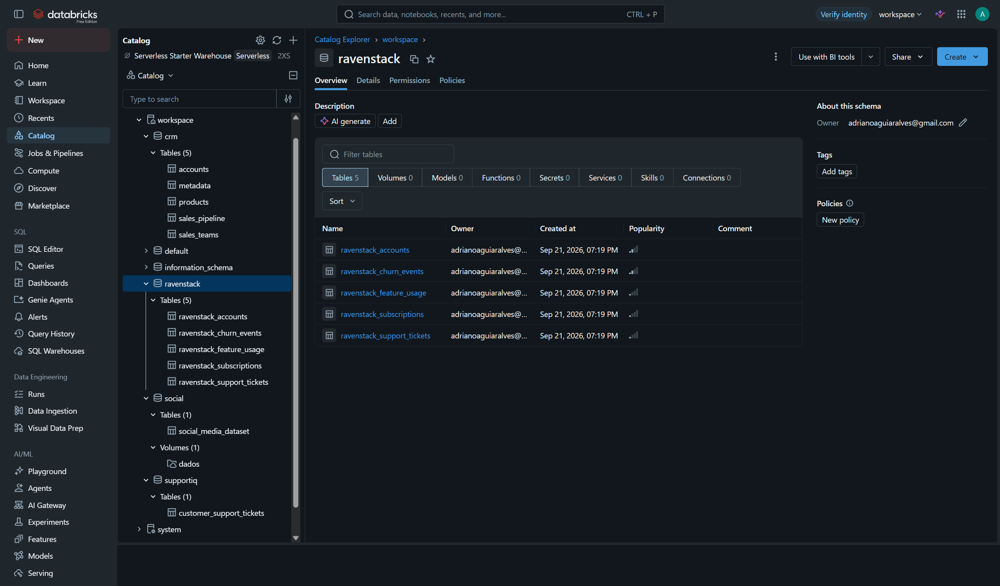 | [Tabelas ravenstack](https://dbc-0dea39b3-be1e.cloud.databricks.com/explore/data/workspace/ravenstack?o=7474644277755368&activeListType=TABLE) | As cinco `ravenstack_*` (accounts, subscriptions, feature_usage, support_tickets, churn_events). |
| 03 | 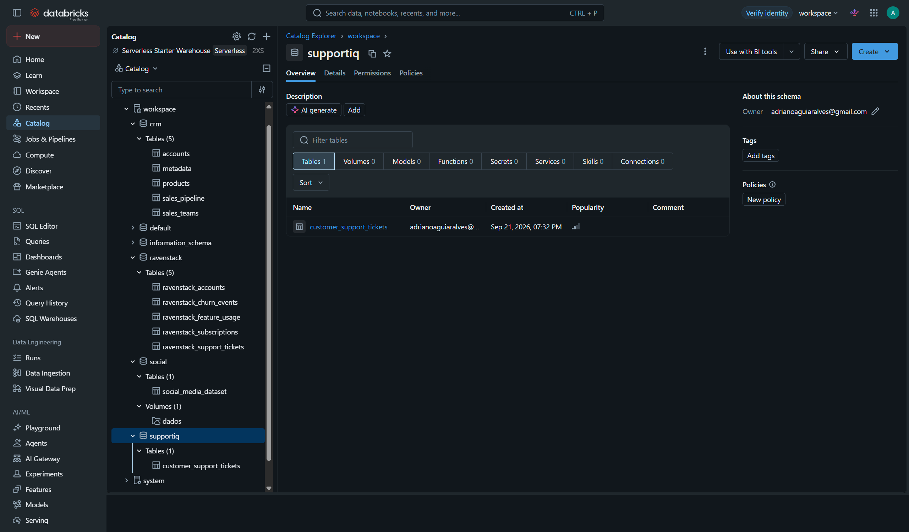 | [Tabelas supportiq](https://dbc-0dea39b3-be1e.cloud.databricks.com/explore/data/workspace/supportiq?o=7474644277755368&activeListType=TABLE) | `customer_support_tickets`. |
| 04 | 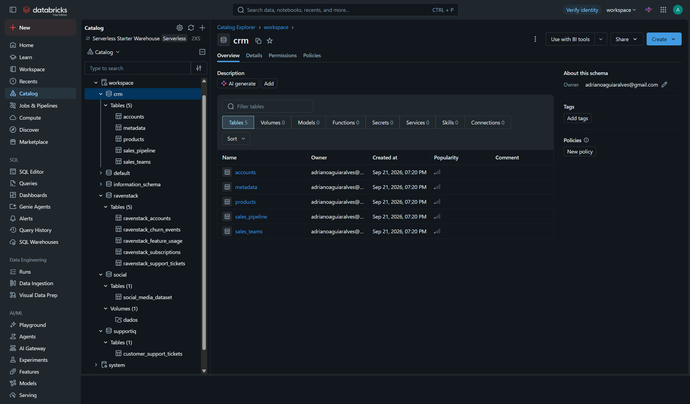 | [Tabelas crm](https://dbc-0dea39b3-be1e.cloud.databricks.com/explore/data/workspace/crm?o=7474644277755368&activeListType=TABLE) | `accounts`, `products`, `sales_teams`, `sales_pipeline`. |
| 05 | 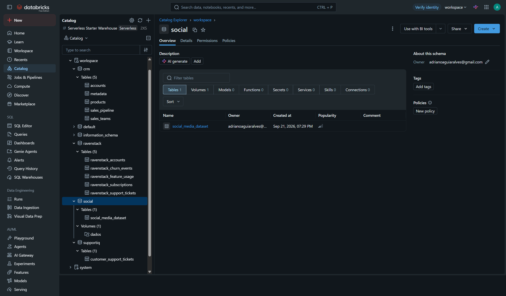 | [Tabelas social](https://dbc-0dea39b3-be1e.cloud.databricks.com/explore/data/workspace/social?o=7474644277755368&activeListType=TABLE) | `social_media_dataset`. |
| 06 | 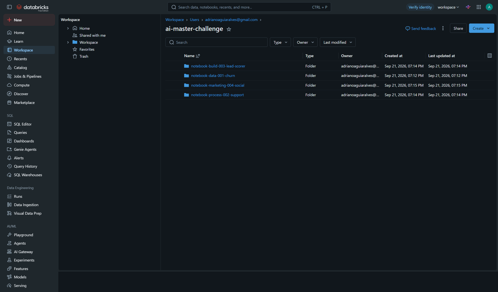 | [Browse Workspace](https://dbc-0dea39b3-be1e.cloud.databricks.com/browse?o=7474644277755368) | Pasta `ai-master-challenge` com os quatro `notebook-*-00N`. |
| 07 | 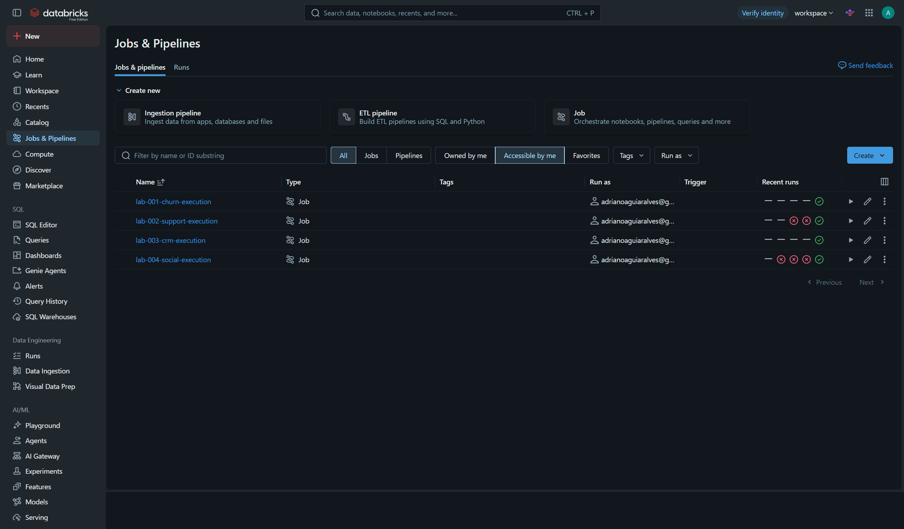 | [Jobs & pipelines](https://dbc-0dea39b3-be1e.cloud.databricks.com/jobs?o=7474644277755368) | Os quatro jobs: `lab-001-churn-execution`, `lab-002-support-execution`, `lab-003-crm-execution`, `lab-004-social-execution`. |
| 08 |  | [Job 001](https://dbc-0dea39b3-be1e.cloud.databricks.com/jobs/463412912486977?o=7474644277755368) | Último run **SUCCESS**. Tasks 01_import → 02_assistant → 03_dashboard → 04_analise. |
| 09 |  | [SQL dashboards](https://dbc-0dea39b3-be1e.cloud.databricks.com/sql/dashboards?o=7474644277755368) | Os quatro AI/BI: `lab-001-churn-ceo`, `lab-002-support-ops`, `lab-003-crm-seller`, `lab-004-social-media`. |
| 10 | 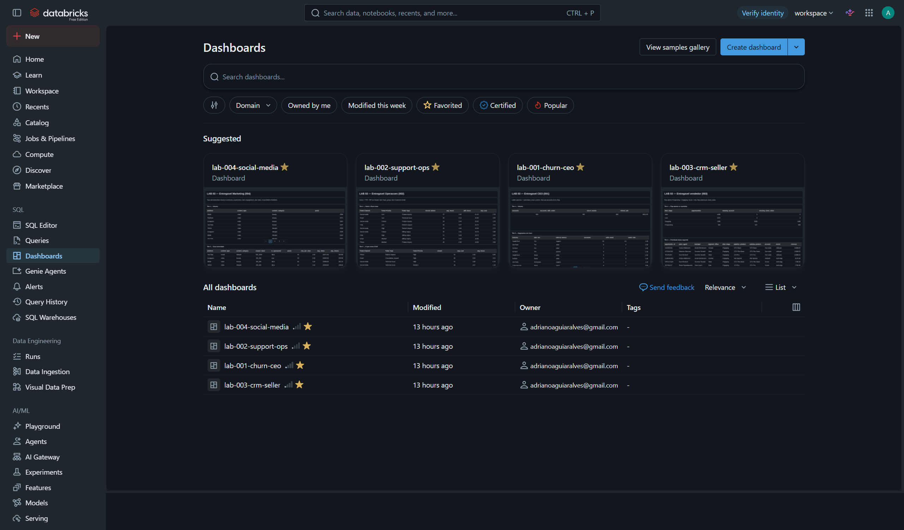 | [lab-001-churn-ceo publicado](https://dbc-0dea39b3-be1e.cloud.databricks.com/dashboardsv3/01f1b611c23d1c1d8abb2e1d9847d535/published?o=7474644277755368) | Tiles do CEO (causa / segmentos / ações) com dados de `workspace.ravenstack`. |
| 11 | 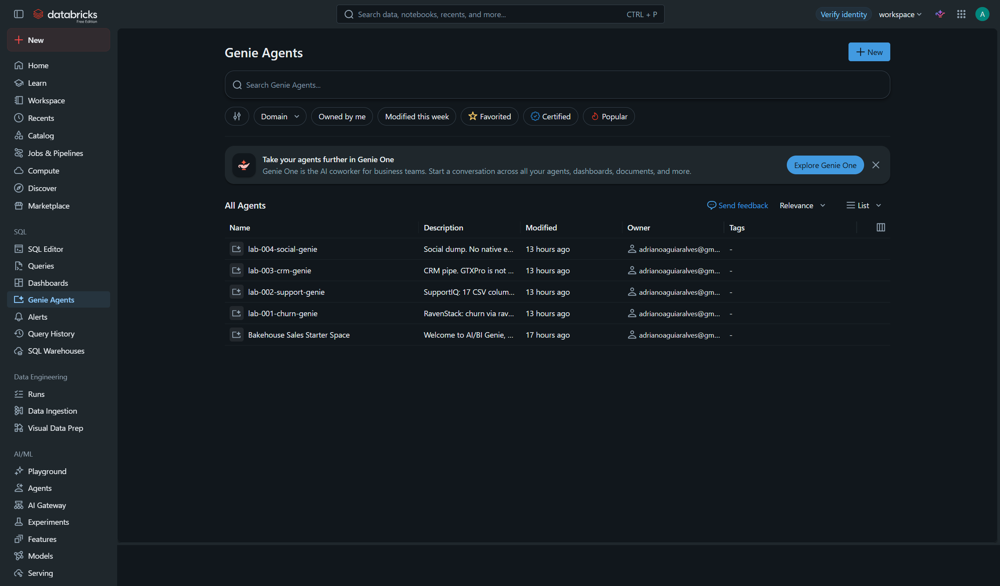 | [Genie](https://dbc-0dea39b3-be1e.cloud.databricks.com/genie?o=7474644277755368) | Os quatro spaces Lab 02 (churn, support, crm, social). |
| 12 |  | [Sala 001 churn](https://dbc-0dea39b3-be1e.cloud.databricks.com/genie/rooms/01f1b6165ad01ca4a5f3b95c6d3d3609?o=7474644277755368) | Uma pergunta do Lab 02 + SQL/resposta só com colunas do CSV (ex.: contas vs `churn_event_id`). |
| 13 | 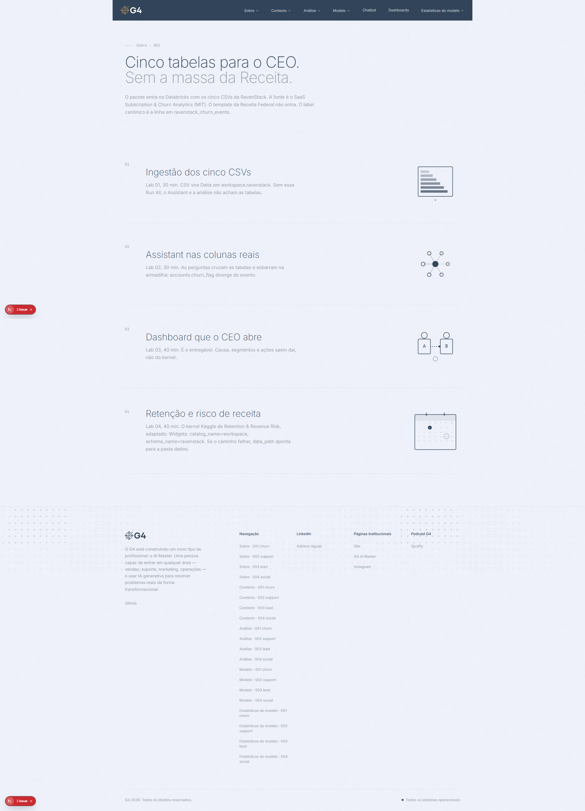 | [Home](http://localhost:3020/) | Sobre 001: “Cinco tabelas para o CEO.” Menu G4 (Sobre, Contexto, Análise, Modelo, Chatbot, Dashboards, Estatísticas do modelo). |
| 14 | 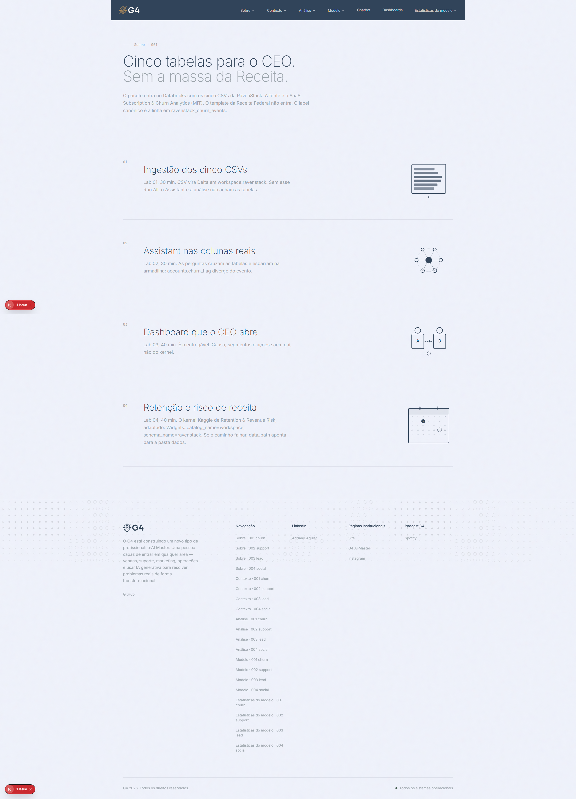 | [Sobre 001](http://localhost:3020/about-challenge-001) | O mesmo conteúdo da home (rota canônica do challenge). |
| 15 |  | [Contexto 001](http://localhost:3020/research-challenge-001#background) | Seção `#background`: RavenStack, cinco tabelas, label em `churn_events`. |
| 16 |  | [Análise 001](http://localhost:3020/research-challenge-001#analysis) | Seção `#analysis`: cruzamento, segmentos, o que o CEO faz. |
| 17 | 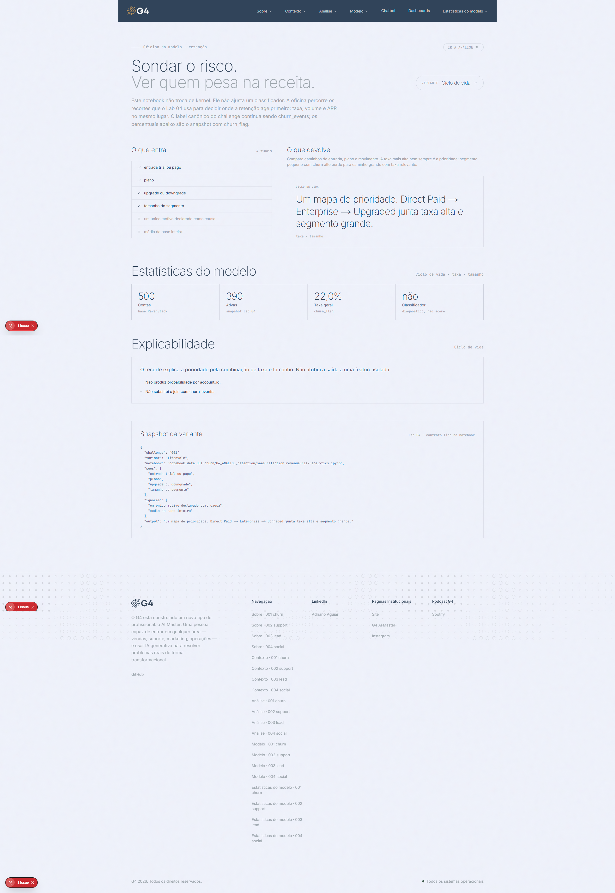 | [Modelo 001](http://localhost:3020/model-challenge-001) | Oficina do modelo de churn (contrato do Lab 04 / kernel). |
| 18 |  | [Home](http://localhost:3020/) | Dropdown Sobre (ou Contexto) aberto: `001 churn`, `002 support`, `003 lead`, `004 social`. |
| 19 | 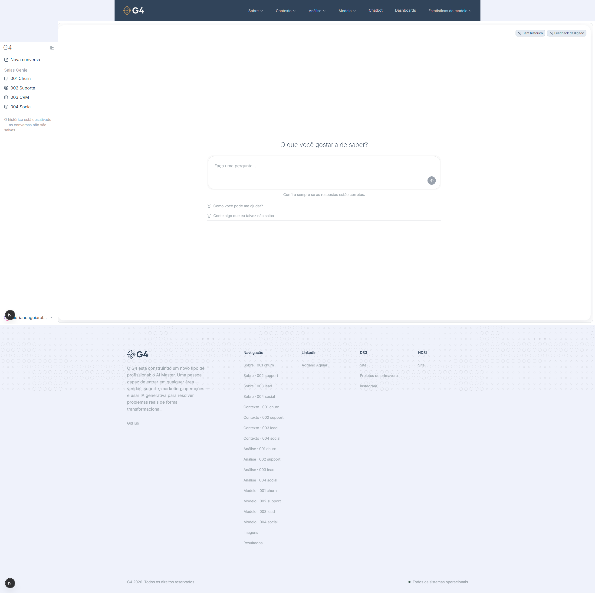 | [Chatbot](http://localhost:3020/sdk/chatbot) | Single-SPA no host 3020. Sidebar **Salas Genie**: 001 Churn, 002 Suporte, 003 CRM, 004 Social. Sem header duplicado. |
| 20 | 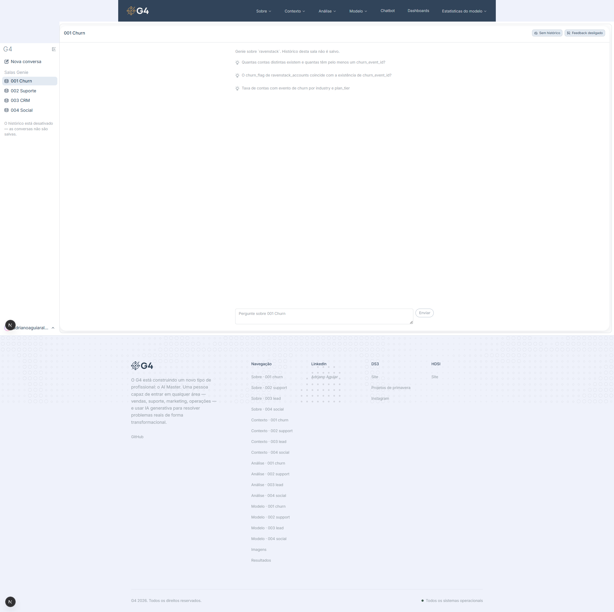 | [Chatbot](http://localhost:3020/sdk/chatbot) | Sala **001 Churn** com uma pergunta e resposta do Genie (número de contas / evento). Se o iframe cortar: [3030 /room/churn](http://localhost:3030/room/churn). |
| 21 | 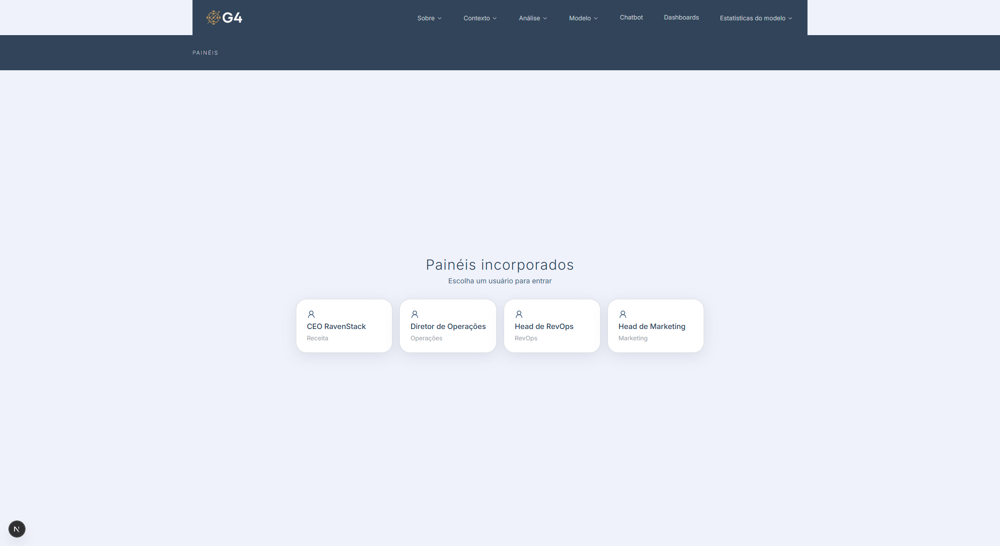 | [Dashboards](http://localhost:3020/sdk/dashboards) | Quatro personas: CEO RavenStack, Diretor de Operações, Head de RevOps, Head de Marketing. |
| 22 | 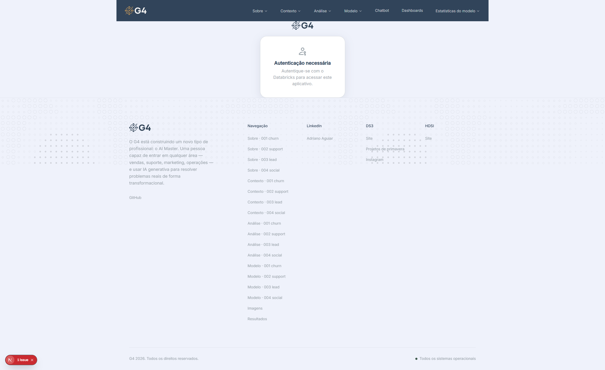 | [Dashboards](http://localhost:3020/sdk/dashboards) | Tela de login / escolha de usuário (ex.: `ceo`). |
| 23 | 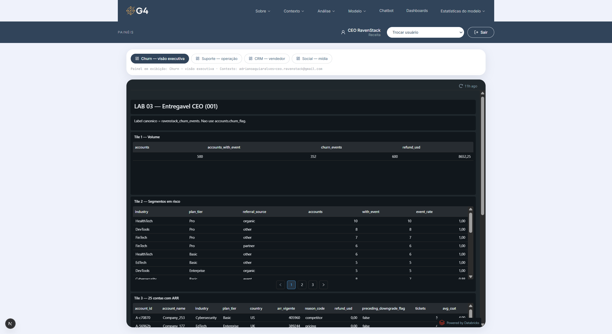 | [Dashboards](http://localhost:3020/sdk/dashboards) | Depois do login como CEO: iframe do `lab-001-churn-ceo` com tiles. Se o iframe cortar: [3010](http://localhost:3010/). |
| 24 |  | [Estatísticas 001](http://localhost:3020/model-2-challenge-001) | Página do menu **Estatísticas do modelo** para o churn (ranking / métricas do pack; sem galeria histológica). |

---

## Como bater (ordem)

1. Databricks logado no workspace `dbc-0dea39b3-be1e` (`o=7474644277755368`).
2. Prints 01–12 (dado → job → dashboard → Genie).
3. `make local` (ou `.\scripts\up-local.ps1`) — 3020, 3030 e 3010 no ar. Ver [COMO-RODAR.md](./COMO-RODAR.md).
4. Prints 13–24 no Chrome, janela cheia, sem DevTools.
5. No chatbot, use uma pergunta do Lab 02 (ex.: “Quantas contas distintas existem e quantas têm pelo menos um churn_event_id?”).
6. Nos painéis, logue como `ceo` para o print 23.

---

## Apêndice 002–004 (opcional)

Mesmo padrão da jornada 001. Só se precisar provar os outros packs no site.

| # | Prévia | URL | O que precisa aparecer |
| --- | --- | --- | --- |
| A01 |  | [Sobre 002](http://localhost:3020/about-challenge-002) | Pacote support / SupportIQ. |
| A02 |  | [Contexto 002](http://localhost:3020/research-challenge-002#background) | 8.469 tickets, 17 colunas. |
| A03 |  | [Análise 002](http://localhost:3020/research-challenge-002#analysis) | Gargalos e o que não automatizar. |
| A04 |  | [Modelo 002](http://localhost:3020/model-challenge-002) | Oficina do modelo de suporte. |
| A05 |  | [Estatísticas 002](http://localhost:3020/model-2-challenge-002) | Métricas do pack 002. |
| A06 |  | [Sobre 003](http://localhost:3020/about-challenge-003) | Pacote CRM / lead scorer. |
| A07 |  | [Contexto 003](http://localhost:3020/research-challenge-003#background) | accounts / products / teams / pipeline. |
| A08 |  | [Análise 003](http://localhost:3020/research-challenge-003#analysis) | Score e por que não ordenar só por valor. |
| A09 |  | [Modelo 003](http://localhost:3020/model-challenge-003) | Oficina do scorer. |
| A10 |  | [Estatísticas 003](http://localhost:3020/model-2-challenge-003) | Métricas do pack 003 (AUC dos blocos). |
| A11 |  | [Sobre 004](http://localhost:3020/about-challenge-004) | Pacote social. |
| A12 |  | [Contexto 004](http://localhost:3020/research-challenge-004#background) | 27 colunas do CSV; sem CNPJ. |
| A13 |  | [Análise 004](http://localhost:3020/research-challenge-004#analysis) | Engajamento e patrocínio. |
| A14 |  | [Modelo 004](http://localhost:3020/model-challenge-004) | Oficina do analisador. |
| A15 |  | [Estatísticas 004](http://localhost:3020/model-2-challenge-004) | Métricas do pack 004. |
| A16 |  | [lab-002-support-ops](https://dbc-0dea39b3-be1e.cloud.databricks.com/dashboardsv3/01f1b611c9d4161bac29737cf1c07d47/published?o=7474644277755368) | Tiles de operações. |
| A17 |  | [lab-003-crm-seller](https://dbc-0dea39b3-be1e.cloud.databricks.com/dashboardsv3/01f1b611cd0118a78e40dc8a5f8a3609/published?o=7474644277755368) | Tiles do vendedor / RevOps. |
| A18 |  | [lab-004-social-media](https://dbc-0dea39b3-be1e.cloud.databricks.com/dashboardsv3/01f1b611d0801412b387d62b0dc4d8d6/published?o=7474644277755368) | Tiles de social. |
| A19 |  | [Oficina /model-2](http://localhost:3020/model-2) | Oficina Wisconsin (patches / redes). Existe no repo; **não** é o item do menu Estatísticas. |

---

## Fora deste storytelling

- Process log de uso de IA (obrigatório na submissão — [submission-guide.md](./submission-guide.md)). Não substitui os prints de produto acima.
- Rodapé (Páginas Institucionais / Podcast G4): identidade, não runtime.
- Segredos, PAT, Service Principal.
