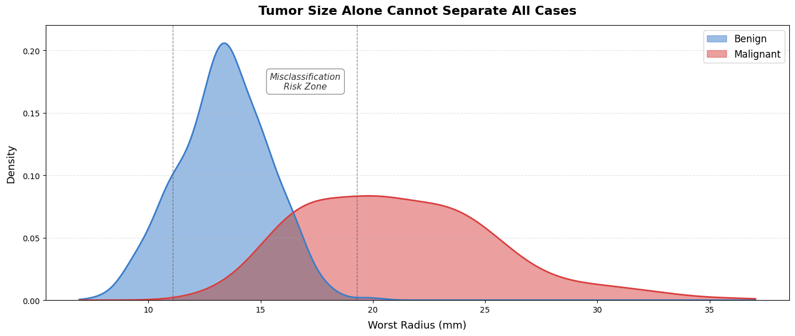
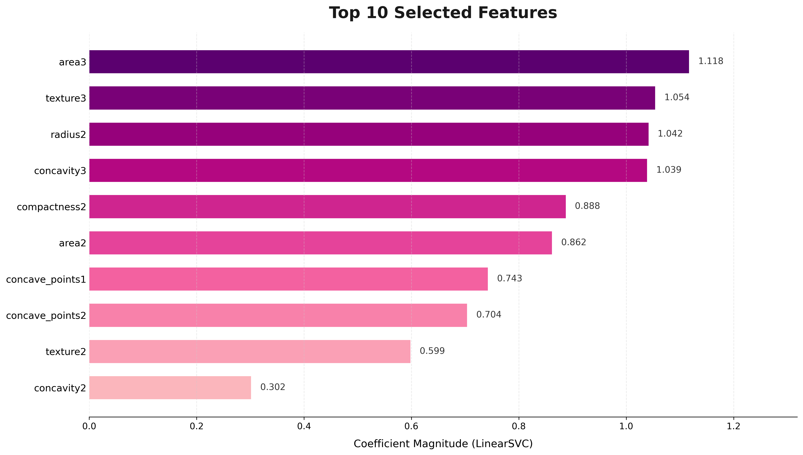
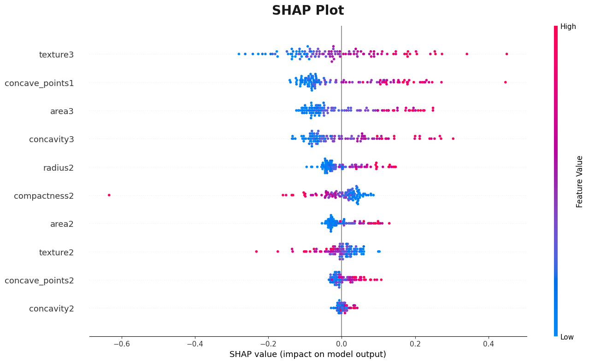

# Tumor Sense

O Tumor Sense é um pipeline ponta a ponta de classificação SVM sobre o Wisconsin Breast Cancer Diagnostic. Ele reduz 30 medidas brutas do núcleo celular às 10 features mais preditivas e alcança alto poder discriminatório — uma segunda opinião baseada em dados para casos ambíguos de punção aspirativa por agulha fina (PAAF / FNA).

### 🔗 Demo ao vivo

[**Ver o site do Tumor Sense →**](https://tumorsense-ntrueba-5031s-projects.vercel.app)

---
### Por que não usar só o tamanho do tumor?




O tamanho sozinho deixa uma zona grande de sobreposição em que casos benignos e malignos são indistinguíveis. O Tumor Sense usa 10 medidas do núcleo celular juntas para resolver exatamente esses casos ambíguos.

---

## Resultados em um relance

| Métrica | Score |
|---|---|
| Recall de maligno | **98%** |
| Precisão de maligno | **98%** |
| ROC-AUC | **0.995** |

Um falso negativo (chamar de benigno um tumor maligno) é um erro que ameaça a vida. O modelo foi avaliado com essa assimetria em mente.

---

## Metodologia

### 1. Pré-processamento
- Dataset: [UCI Wisconsin Breast Cancer Diagnostic](https://archive.ics.uci.edu/ml/datasets/Breast+Cancer+Wisconsin+(Diagnostic)) (569 amostras, 30 features)
- Split treino-teste estratificado para preservar o balanceamento das classes

### 2. Seleção de features
- **Recursive Feature Elimination (RFE)** com estimador `LinearSVC`
- 30 features brutas → **as 10 mais preditivas**



### 3. Treino do modelo
- **Algoritmo:** Support Vector Machine com kernel RBF
- **Ajuste de hiperparâmetros:** `GridSearchCV` em `C` e `gamma`
- Melhores parâmetros via busca em grade com validação cruzada

### 4. Avaliação
- Precisão, recall e F1 por classe
- Score ROC-AUC
- Gráfico SHAP para explicabilidade


`texture3` e `concave_points1` pesam mais para empurrar a predição rumo a maligno. Valores altos da feature (rosa) em geral deslocam o modelo para maligno; valores baixos (azul) para benigno.

---

## Stack


---

## Estrutura do repositório

```
tumor-sense/
├── data/
│   └── wdbc.csv                  # dataset Wisconsin Diagnostic Breast Cancer
├── notebook/
│   └── tumor_sense.ipynb         # análise completa e pipeline do modelo
├── models/
│   └── svm_model.pkl             # modelo treinado serializado
├── visuals/
│   ├── misclass.png              # visualização da zona de erro
│   ├── rfe_feature_rankings.png  # ranking RFE das features
│   └── shap.png                  # importância SHAP
└── README.md
```

---

## Como começar

```bash
# Clone o repositório
git clone https://github.com/nathaniel-trueba/tumor-sense.git
cd tumor-sense

# Instale as dependências
pip install -r requirements.txt

# Abra o notebook
jupyter notebook notebook/tumor_sense.ipynb
```

---

## Autores

- **Vedant Vardhaan** — Mentor
- **Nathaniel Trueba** — Integrante
- **Kavya Shah** — Integrante
- **Evan Park** — Integrante
- **Steven Ngo** — Integrante

---

## ⚠️ Aviso ⚠️

O Tumor Sense é um projeto acadêmico e **não se destina a uso clínico**. Todos os resultados vêm de um dataset público de pesquisa e não devem orientar decisões médicas.
