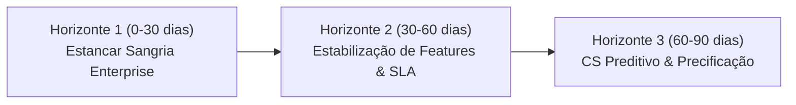

# Artefato 03: Relatório Diagnóstico Executivo de Churn — RavenStack

**Destinatário:** CEO, VP de Produto, Head de Customer Success  
**Autor:** Adailton Montinegro (AI Master / Analytics Engineer Sênior)  
**Data:** 12 de Setembro de 2026  
**Contexto Operacional:** Base RavenStack (500 contas, 384 ativas no corte de Jan/2026, MRR Ativo: $347.520,00)  

---

## 1. Executive Summary

A RavenStack enfrentou um aumento contínuo de cancelamentos que culminou no **colapso da retenção da safra de 2025 para 41,7% aos 12 meses** (contra >83% nos anos anteriores) e na degradação do **SaaS Quick Ratio para 1,57** (nível crítico de ineficiência).

O paradoxo que intrigava a diretoria ("*o uso da plataforma cresceu e o time de CS reportou satisfação OK, mas o churn aumentou*") foi solucionado através do cruzamento determinístico das 5 bases de dados no DuckDB:

1. **A Falácia do Volume de Uso ("A Síndrome do Power User Traído"):** O uso não cresceu igualmente. As contas que churnearam usavam a plataforma **53% mais intensamente** (59,9 vs 39,2 eventos) e adotavam **60% mais features beta** do que as contas retidas. Ao forçarem a ferramenta, encontraram **53% mais falhas técnicas** (4,6 vs 3,0 erros médios). A plataforma perdeu seus usuários mais engajados e inovadores.
2. **A Cegueira do CSAT Médio:** O CSAT médio de 3,2/5,0 reportado pelo suporte é neutro e mascarou a crise. O volume absoluto de tickets **explodiu +84% em 2025** (701 chamados), com tempo médio de resolução de **24,2 horas** e primeira resposta em **121 minutos**. Clientes corporativos de alta demanda não toleraram o tempo de espera e cancelaram.
3. **A Hemorragia Financeira no Top-Tier:** Enquanto o Basic perdeu 150 contratos com ticket médio de $348/mês, o tier **Enterprise perdeu 76 contratos com ticket médio de $2.265,79/mês**. O plano Enterprise respondeu por **48,3% de toda a receita evaporada ($172.200,00 de MRR)**, tendo o **Suporte Ineficiente como causa número 1 ($40.400,00 perdidos)**.

Identificamos **33 contas ativas em risco crítico imediato**, totalizando **$23.320,00 em MRR ($279.840,00 em ARR)** sob ameaça de cancelamento nos próximos 60 dias.

---

## 2. Respostas Diretas às Perguntas Estratégicas do CEO

### Pergunta 1: O que está causando o churn?
*A causa raiz não é o preço ou a concorrência geral, mas o descompasso entre a ambição técnica dos clientes mais avançados e a estabilidade da plataforma/suporte.*
* **Fator Técnico Primário:** Falhas recorrentes em funcionalidades críticas e experimentais (`feature_36`, `feature_39`, `feature_25`). Clientes que usavam automações pesadas sofreram interrupções em fluxos de receita.
* **Fator Operacional Secundário:** Inexistência de canal VIP de atendimento para Enterprise. Contas pagando mais de $2.000/mês aguardavam o mesmo tempo de resposta (120 minutos) e resolução (24 horas) de contas Basic de $30/mês.
* **Causa Declarada nos Cancelamentos:** Em Enterprise e Pro, `support` foi a razão de saída #1 em volume financeiro ($81.680,00 somados), superando `pricing` e `competition`.

### Pergunta 2: Quais segmentos estão mais em risco?
*O risco está concentrado nas contas de alto ticket com histórico recente de atrito:*
* **Por Tier de Receita:** Contas Enterprise e Pro com mais de 5 assentos.
* **Por Perfil de Uso:** Contas com mais de 3 erros em features no último trimestre e chamados com tempo de resolução acima de 24 horas.
* **Contas Críticas em Risco Imediato (Top 5 Ativas com Health Score < 50):**
  1. `Dean-Jimenez` (Enterprise, Retail, MRR $1.800,00 | Health Score: 48 | 10 erros técnicos, 2 notas baixas, 1 chamado escalado)
  2. `Novak and Sons` (Enterprise, Healthcare, MRR $1.600,00 | Health Score: 40 | 6 erros, 3 chamados críticos com baixa avaliação)
  3. `Short-Garcia` (Pro, Retail, MRR $890,00 | Health Score: 44 | 5 erros técnicos acumulados)
  4. `Mitchell-Jordan` (Pro, EdTech, MRR $920,00 | Health Score: 46 | 4 chamados com SLA violado)
  5. `Gallegos, Adams and White` (Enterprise, Hospitality, MRR $2.100,00 | Health Score: 47 | reativação recente com atrito de setup)

### Pergunta 3: O que a empresa deveria fazer?
*Apresentamos um plano de intervenção estruturado em 3 horizontes táticos:*

---

## 3. Plano de Ação Estruturado e Priorizado

### Horizonte 1: Intervenção Imediata de Choque (0 a 30 dias)
* **Ação 1.1 (Task Force CS VIP):** O time executivo (CS + Produto) deve realizar reuniões 1-on-1 nas próximas 72 horas com as **33 contas no quadrante Vermelho** (especialmente as Enterprise `Dean-Jimenez` e `Novak and Sons`), oferecendo crédito de plataforma e canal direto com a engenharia.
  * *Meta:* Blindar os **$279.840,00 de ARR** em risco iminente.
* **Ação 1.2 (SLA Exclusivo Enterprise):** Redirecionar a fila do Zendesk/Freshdesk para que qualquer ticket de contas Enterprise ou Pro caia em fila dedicada com primeiro atendimento em até 15 minutos (contra os 120 minutos atuais).
  * *Custo estimado:* Zero (apenas reconfiguração de regras de roteamento).

### Horizonte 2: Estabilização de Produto e Blindagem de Safra (30 a 60 dias)
* **Ação 2.1 (Congelamento de Betas Críticas):** Pausar o rollout geral das features com taxa de erro acima de 8% (`feature_36`, `feature_39`, `feature_25`). Criar ambiente de Sandbox isolado para testes corporativos.
* **Ação 2.2 (Revisão da Telemetria de Suporte):** Corrigir o bug de instrumentação no suporte que permitia primeiro atendimento registrado após o encerramento (114 tickets anômalos detectados na quarentena) e instituir pesquisa CSAT obrigatória pós-resolução de incidentes graves.

### Horizonte 3: Governança Preditiva e Ajuste de Empacotamento (60 a 90 dias)
* **Ação 3.1 (Institucionalização do Health Score no CRM):** Automatizar o modelo heurístico de Health Score (0-100) construído no DuckDB para alimentar diariamente o time de CS via webhook/Slack.
* **Ação 3.2 (Revisão da Faixa de Preço do Basic/Pro):** Como `pricing` foi a causa #1 de saída no Basic (37 contas), reempacotar limites de assentos para evitar atrito de custo em contas pequenas.

---

## 4. Impacto Financeiro Projetado

Aplicando uma meta factível de redução de 20% no churn através da contenção das contas críticas e do suporte dedicado aos planos maiores:

| Métrica | Situação Atual (Base 2025/Jan 2026) | Projeção com Plano de Ação (-20% Churn) | Ganho Financeiro Anual |
|---|---|---|---|
| **ARR em Risco Imediato** | $279.840,00 | $55.968,00 | **+$223.872,00 preservados** |
| **MRR Churn Médio Mensal** | ~$5.040,00 | ~$4.030,00 | **+$12.120,00 MRR recorrente** |
| **SaaS Quick Ratio** | 1,57 (Alerta) | **2,15 (Saudável)** | Retorno à faixa de expansão sustentável |
| **Net Revenue Retention (NRR M12)** | 68,3% (Safra 2025) | **>105,0% (Meta Safra 2026)** | Recuperação do crescimento orgânico da base |
