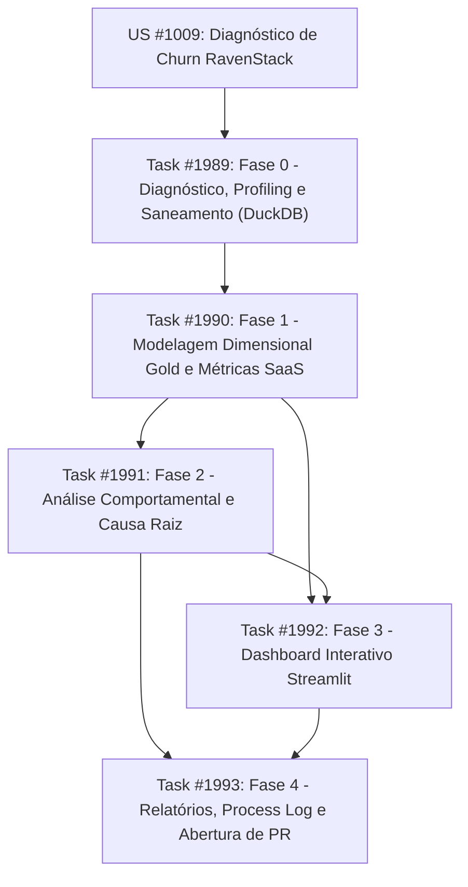

# Plano Estruturado de Execução: Desafio 001 — RavenStack Churn Analytics

**Projeto Taiga:** G4 AI Master (`project_id=4`, slug: `g4-ai-master`)  
**User Story:** `#1009` — `[Challenge 001] Diagnóstico de Churn RavenStack (SaaS Analytics)`  
**Branch:** `submission/adailton-montinegro`  
**Diretório de Entrega:** `submissions/adailton-montinegro/`  

---

## 1. Objetivo Consolidado e Restrições Técnicas

### Objetivo
Desenvolver diagnóstico executivo e analítico profundo de churn sobre o ecossistema RavenStack (~500 contas, 1.449 assinaturas, 6.346 eventos de uso, 1.532 tickets e 374 eventos de churn), respondendo à inconsistência apontada pelo CEO ("uso cresceu e satisfação reportada ok, mas churn subiu").

### Pilares Arquiteturais Inegociáveis
1. **Engine Analítica:** DuckDB local determinístico estruturado em 3 camadas lógicas (`bronze`, `silver`, `gold`).
2. **Saneamento e Quarentena (Fase 0):** Registros com datas futuras, orfandades ou inconsistências de status são isolados em `quarentena_inconsistencias` com reconciliação contábil do impacto em MRR.
3. **Interface Visual:** Streamlit interativo conectando-se em modo leitura às views/tabelas da camada `gold`.
4. **Entregáveis Executivos:** 4 relatórios em Markdown canônico (`artefato_01` a `artefato_04`) cobrindo qualidade, memória de cálculo, relatório executivo e reprodutibilidade.
5. **Governança Distribuída:** Segregação estrita de papéis no Taiga entre Orquestrador (`japax` / Antigravity) e Engenharia de Execução (`elon` / Grok CLI).

---

## 2. Matriz de Identidades e Credenciais Taiga

| Agente / CLI | Identidade Taiga | Credenciais | Papel no Projeto |
|---|---|---|---|
| **Antigravity (Orquestrador)** | `japax` (ID: 6) | `/Users/montinegro/.config/montinegro/taiga.env` | Arquitetura, governança, auditoria cruzada, síntese de negócio e submissão PR |
| **Grok CLI (Execução)** | `elon` (ID: 7) | `/Users/montinegro/.config/montinegro/taiga-grok.env` | Implementação física de pipelines SQL DuckDB, métricas analíticas e dashboard Streamlit |

---

## 3. Mapeamento de Fatias de Trabalho e Dependências

| Task Taiga | Fase / Escopo | Responsável | Status | Blocked by |
|---|---|---|---|---|
| **#1989** | **Fase 0:** Diagnóstico, Profiling e Saneamento (Bronze/Silver/Quarentena) | `japax` (Antigravity) | A iniciar | Nenhuma |
| **#1990** | **Fase 1:** Modelagem Dimensional Gold & Métricas (MRR Bridge & Coortes) | `elon` (Grok CLI) | A iniciar | #1989 |
| **#1991** | **Fase 2:** Análise Comportamental e Causa Raiz de Churn (Features, Suporte) | `japax` (Antigravity) | A iniciar | #1990 |
| **#1992** | **Fase 3:** Construção do Dashboard Interativo Streamlit (4 Visões) | `elon` (Grok CLI) | A iniciar | #1990, #1991 |
| **#1993** | **Fase 4:** Consolidação dos Entregáveis, Evidências, Process Log e PR | `japax` (Antigravity) | A iniciar | #1991, #1992 |

---

## 4. Detalhamento por Fase, Entrypoints e Critérios de Aceite

### Fase 0: Diagnóstico, Profiling e Saneamento (Task #1989)
- **Executor:** `japax` (Antigravity)
- **Entrypoints:**
  - `submissions/adailton-montinegro/solution/sql/01_bronze/ingest.sql`
  - `submissions/adailton-montinegro/solution/sql/02_silver/clean_and_quarantine.sql`
  - `submissions/adailton-montinegro/solution/src/pipeline.py`
  - `submissions/adailton-montinegro/docs/artefato_01_diagnostico_qualidade.md`
- **Atividades:**
  1. Ingestão determinística dos 5 CSVs brutos em schema `bronze` no DuckDB (`ravenstack.duckdb`).
  2. Testes de integridade: unicidade de chaves, orfandade referencial entre `account_id` e `subscription_id`, anomalias temporais (eventos pós-cancelamento, logs anteriores ao cadastro, datas futuras > 2026-02-01).
  3. Criação do schema `silver` com tipagem formal de colunas e isolamento determinístico na tabela `quarentena_inconsistencias`.
  4. Emissão do `artefato_01_diagnostico_qualidade.md` com balanço contábil de linhas recebidas, aproveitadas, expurgadas para quarentena e impacto direto em MRR.
- **Critério de Aceite:** Pipeline DuckDB roda sem warnings; tabela `quarentena_inconsistencias` registra 100% dos desvios com justificativa; soma de MRR reconciliada em centavos.

---

### Fase 1: Modelagem Dimensional Gold e Métricas SaaS (Task #1990)
- **Executor:** `elon` (Grok CLI via `grok --always-approve -p "..."`)
- **Entrypoints:**
  - `submissions/adailton-montinegro/solution/sql/03_gold/dimensions.sql`
  - `submissions/adailton-montinegro/solution/sql/03_gold/facts.sql`
  - `submissions/adailton-montinegro/solution/sql/03_gold/mrr_bridge.sql`
  - `submissions/adailton-montinegro/solution/sql/03_gold/retention_cohorts.sql`
  - `submissions/adailton-montinegro/docs/artefato_02_memoria_calculo_metricas.md`
- **Atividades:**
  1. Modelagem dimensional no schema `gold`: `dim_accounts`, `dim_plans`, `fato_assinaturas`, `fato_eventos_uso`, `fato_atendimento`, `fato_churn`.
  2. SQL canônico para decomposição mensal do MRR Bridge:
     $$\text{Net MRR} = \text{Beginning MRR} + \text{New} + \text{Expansion} - \text{Contraction} - \text{Churned} + \text{Reactivation}$$
  3. Matriz de Coortes M1 a M12 por safra de entrada (Logo Retention e Net Revenue Retention - NRR).
  4. Documentação de todas as premissas e queries no `artefato_02_memoria_calculo_metricas.md`.
- **Critério de Aceite:** Balanço de MRR fecha matematicamente mês a mês ($\Delta MRR = Net MRR$); NRR calculado sem viés de sobrevivência.

---

### Fase 2: Análise Comportamental e Diagnóstico de Causa Raiz (Task #1991)
- **Executor:** `japax` (Antigravity)
- **Entrypoints:**
  - `submissions/adailton-montinegro/solution/sql/03_gold/churn_behavior_analysis.sql`
  - `submissions/adailton-montinegro/solution/sql/03_gold/health_score.sql`
  - `submissions/adailton-montinegro/docs/artefato_03_relatorio_executivo.md` (seção analítica)
- **Atividades:**
  1. Investigação do paradoxo do CEO: desagregação do "crescimento de uso" por feature (identificação de concentração em features beta com bugs/erros vs features core).
  2. Análise de decaimento de engajamento nos 30 e 60 dias anteriores ao cancelamento.
  3. Correlação entre churn e suporte: first response time, tempo de resolução e CSAT mascarado por baixas taxas de resposta voluntária.
  4. Construção do modelo heurístico de Health Score (0 a 100) calibrado por regras auditáveis no DuckDB.
- **Critério de Aceite:** Identificação factual da causa raiz da evasão com contas críticas nominalmente listadas em risco imediato.

---

### Fase 3: Construção do Dashboard Interativo Streamlit (Task #1992)
- **Executor:** `elon` (Grok CLI via `grok --always-approve -p "..."`)
- **Entrypoints:**
  - `submissions/adailton-montinegro/solution/src/app.py`
  - `submissions/adailton-montinegro/solution/src/components/`
  - `submissions/adailton-montinegro/solution/requirements.txt`
  - `submissions/adailton-montinegro/solution/run.sh`
- **Atividades:**
  1. Setup do app multi-página conectando ao DuckDB local (`read_only=True`):
     - **Página 1 (Visão Executiva):** MRR atual, ARR, Logo Churn Rate, Revenue Churn Rate, Quick Ratio SaaS e NRR.
     - **Página 2 (Retenção & Coortes):** Heatmaps dinâmicos de Logo e Revenue Retention M1-M12 por safra.
     - **Página 3 (Produto & Suporte):** Frequência de uso por feature, taxa de erro de features beta, volumetria de tickets e CSAT por tier.
     - **Página 4 (Simulador & Alerta de Risco):** Tabela operacional de contas com Health Score crítico, simulador de impacto de redução de churn no ARR.
  2. Criação do script `run.sh` permitindo inicialização zero-configuração.
- **Critério de Aceite:** App carrega em sub-2s, filtros reativos funcionam sem recomputar agregações pesadas, layout profissional sem quebras visuais.

---

### Fase 4: Consolidação dos Entregáveis, Process Log e PR (Task #1993)
- **Executor:** `japax` (Antigravity)
- **Entrypoints:**
  - `submissions/adailton-montinegro/README.md` (Template oficial preenchido)
  - `submissions/adailton-montinegro/docs/artefato_03_relatorio_executivo.md`
  - `submissions/adailton-montinegro/docs/artefato_04_reprodutibilidade_e_evidencias.md`
  - `submissions/adailton-montinegro/process-log/` (Evidências de uso de IA)
- **Atividades:**
  1. Redação do relatório executivo direcionado ao CEO e C-Level, combinando narrativa estratégica, tabelas resumo e plano de ação tático em 3 horizontes (30/60/90 dias).
  2. Consolidação do guia de reprodutibilidade de ponta a ponta com checklist determinístico de validação.
  3. Estruturação do Process Log obrigatório: documentação do fluxo de orquestração multi-agente, prompts utilizados, correções de rota e julgamento humano aplicado.
  4. Revisão e abertura formal do Pull Request via `gh pr create` conforme as regras de `CONTRIBUTING.md`.
- **Critério de Aceite:** Todos os arquivos salvos estritamente sob `submissions/adailton-montinegro/`, testes passando, PR aberto com título padronizado.

---

## 5. Checklist de Conclusão Checável (DoD)

- [x] Repositório upstream forkado para `adailtonmontinegro/ai-master-challenge`
- [x] Remotes `origin` e `upstream` configurados localmente
- [x] Branch `submission/adailton-montinegro` criada e ativada
- [x] Dados brutos RavenStack (5 CSVs) organizados na estrutura de pastas
- [x] Ambiente virtual `.venv` configurado com `duckdb`, `streamlit`, `pandas`, `plotly`
- [x] User Story #1009 e 5 Tasks registradas no Taiga (projeto 4) com segregação `japax` e `elon`
- [ ] Fase 0 executada e auditada (DuckDB Bronze/Silver/Quarentena + artefato_01)
- [ ] Fase 1 executada via Grok CLI e auditada (DuckDB Gold + MRR Bridge + artefato_02)
- [ ] Fase 2 executada e auditada (Diagnóstico Causa Raiz + Health Score)
- [ ] Fase 3 executada via Grok CLI e testada (Dashboard Streamlit 4 visões)
- [ ] Fase 4 consolidada (artefato_03, artefato_04, README oficial, Process Log e PR aberto)
