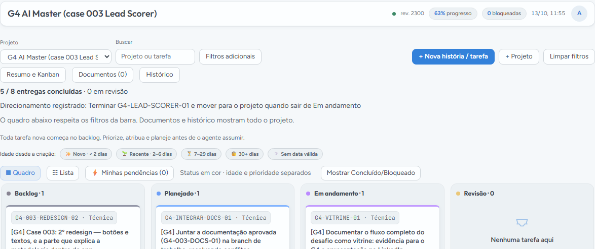

# Process log — Foco, Challenge 003

Dividi o problema em auditoria dos dados, hipótese de priorização, interface, testes e documentação. Usei o Demiurgo para organizar tarefas e revisões. A captura abaixo mostra apenas o quadro filtrado no G4.

O [registro completo](../solution/PROCESS_LOG.md) descreve as ferramentas de IA, as iterações, o que rejeitei e o que acrescentei ao trabalho. A [página do processo no Demiurgo](../solution/docs/vitrine/processo-no-demiurgo.md) identifica as tarefas deste case. O primeiro rascunho de documentação foi recusado por não corresponder ao código. A hipótese de previsão histórica foi rejeitada após AUC de 0,4854; o produto final usa uma regra operacional explicável.

Na verificação final, passaram 21 testes Python, 7 Node e a conferência de 9 documentos. As capturas do [Foco](screenshots/foco-atual.png) e da [documentação no produto](screenshots/construcao-atual.png) mostram a entrega. O quadro foi capturado em 13/10/2026 e não representa o andamento posterior.
