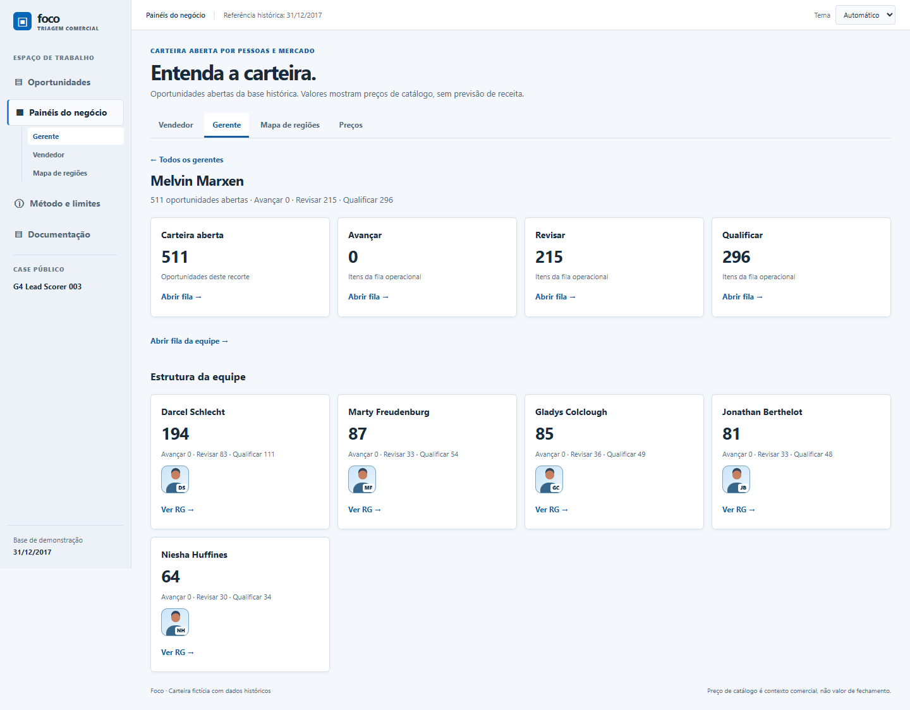
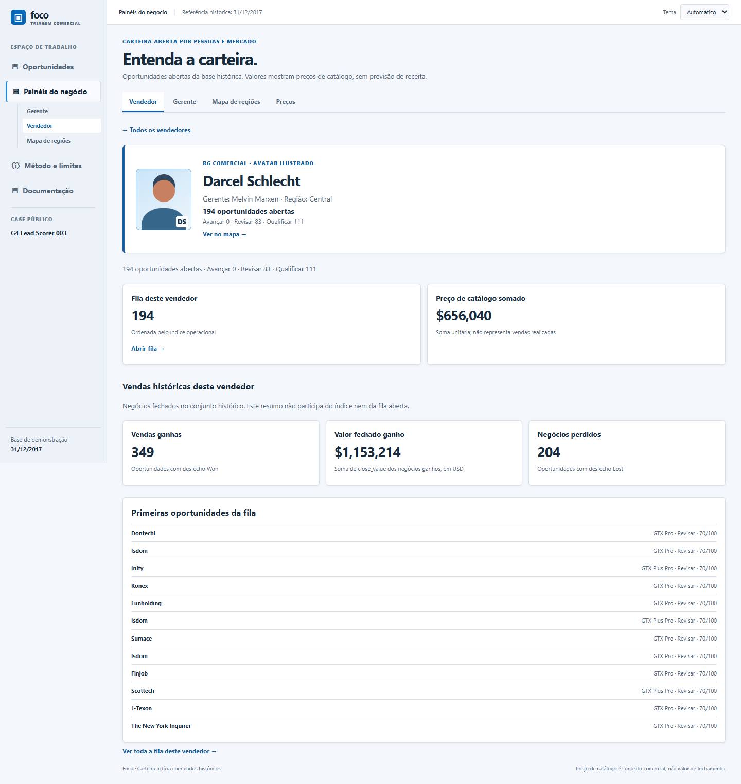
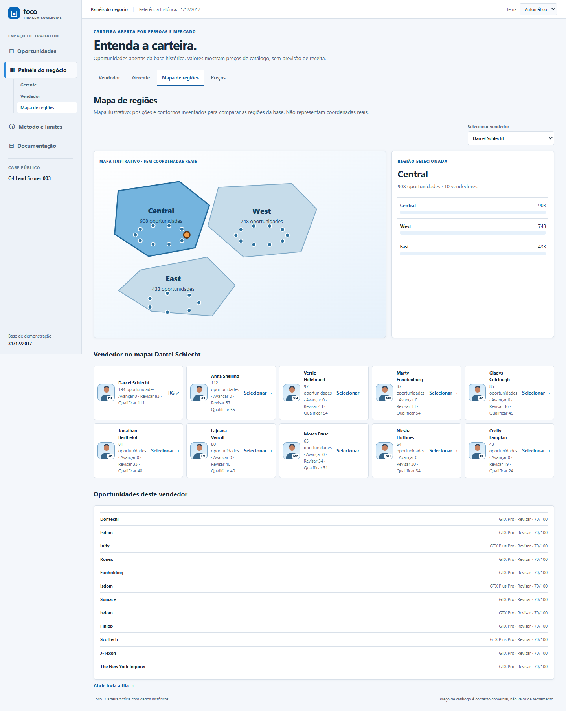
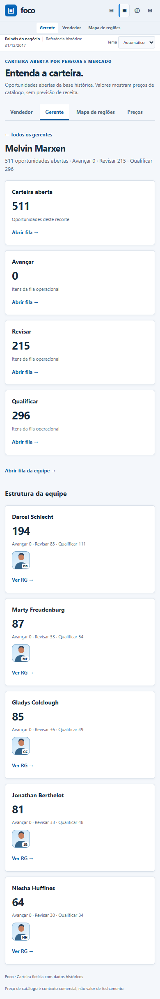
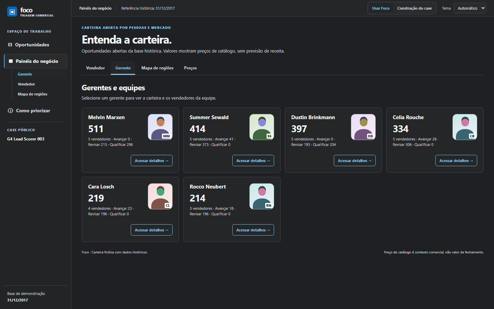

# Foco — especificação funcional

Descreve o que o usuário vê e faz, conferido contra `static/` e `app.py`. O porquê das regras está na [especificação de negócio](business-spec.md); o cálculo, na [especificação técnica](technical-spec.md).

## 1. Mapa de telas

| Tela | Endereço | Arquivos | Função |
| --- | --- | --- | --- |
| Oportunidades | `/` | `index.html`, `app.js`, `filter.js`, `annotations.js` | Fila, filtros, três leituras e detalhe |
| Painéis do negócio | `/panels.html` | `panels.html`, `panels.js`, `business.js` | Gerente, Vendedor, Mapa de regiões, Preços |
| Metodologia | `/method.html` | `method.html` | Filas, cálculo do índice, sinais excluídos, rotina e limites |
| Documentação | `/documentation.html` | `documentation.html` | Índice da construção do case |
| Leitor | `/reader.html?doc=…` | `reader.html`, `reader.js` | Abre os documentos de `docs/` |
| API | `/api/deals` | `app.py` | JSON com a carteira ordenada |

Todas as telas compartilham a barra lateral e o seletor de tema. Os itens “Metodologia” e “Documentação” ficam visíveis em todas as telas; `mode.js` mantém o rótulo da metodologia uniforme.

Na barra lateral, quatro destinos principais usam ícones vetoriais distintos com rótulos visíveis: Oportunidades, Painéis do negócio, Metodologia e Documentação. No desktop, os atalhos de Painéis incluem Gerente, Vendedor, Mapa de regiões e Preços. No celular, os destinos principais ficam em duas colunas com texto e ícone; os atalhos internos ficam nas abas da própria página de Painéis.

O comparativo visual em `evidence/README.md` registra Oportunidades e Metodologia antes/depois em desktop e largura de celular. As capturas novas mostram a navegação, o texto da metodologia e a ausência de rolagem horizontal nessas duas telas.

## 2. Tela Oportunidades

### 2.1 Cabeçalho e totais

Mostra a referência histórica (“Referência histórica: 31/12/2017”) e o total de oportunidades **na seleção atual**: o resultado da busca e dos filtros, antes de escolher uma fila.

### 2.2 Três leituras da mesma carteira

| Leitura | Nome na tela | Conteúdo de cada item |
| --- | --- | --- |
| `table` (padrão) | Mesa comercial | Linha com conta, produto · ID, fila, etapa, índice, preço (USD), dias de engajamento |
| `decision` | Fila de decisão | Cartão com fila, índice, conta, produto · vendedor · ID e próxima ação |
| `lanes` | Kanban | Uma coluna por fila; cartão com conta, produto · vendedor · índice e próxima ação |

Trocar a leitura não recalcula nada: as três usam o mesmo array e a mesma ordem. O Kanban mostra as filas calculadas; **não há arrastar e soltar** e mover um cartão não existe. A leitura escolhida é lembrada no navegador.

### 2.3 Busca e filtros

| Controle | Comportamento |
| --- | --- |
| Buscar oportunidade | Texto livre sobre **ID, conta e produto**. Ignora maiúsculas e espaços nas pontas; casa por trecho. |
| Vendedor, Gerente, Região | Listas montadas com os valores presentes na carteira, em ordem alfabética (pt-BR). Os três combinam por “e”. |
| Filtrar (botão) | Abre e fecha o painel dos três filtros; mostra `(n)` com quantos estão ativos. |
| Limpar filtros | Zera filtros, busca e fila escolhida. |
| Parâmetros de endereço | `/?agent=…`, `/?manager=…`, `/?region=…` aplicam o filtro ao abrir (só se o valor existir na lista) e abrem o painel de filtros. É assim que os Painéis levam à fila de uma pessoa ou região. |

Os filtros preservam a ordem recebida da API. Os valores “Conta não informada” são pesquisáveis, porque o texto faz parte do campo conta.

### 2.4 Filas

Abaixo da busca há os botões **Todas**, **Avançar**, **Revisar** e **Qualificar**, cada um com a contagem do recorte atual. Clicar numa fila filtra a lista; clicar de novo volta a Todas. Os totais por fila respeitam busca e filtros.

### 2.5 Lista e paginação

A lista mostra **40 itens** por vez; **Mostrar mais** acrescenta 40. No Kanban o limite vale por coluna.

### 2.6 Detalhe da oportunidade

Aparece ao selecionar um item; se o item selecionado sai da lista (por filtro), o primeiro visível é selecionado.

| Bloco | Conteúdo |
| --- | --- |
| Cabeçalho | `ID · etapa`, conta (ou “Conta não informada”), selo da fila, produto |
| ÍNDICE OPERACIONAL | `n/100` e o link “Ver metodologia” para Metodologia |
| Por que aparece aqui? | Lista `reasons`: fila e etapa, dias desde o engajamento (ou “Ainda sem data de engajamento”), conta identificada ou ausente, preço de catálogo como contexto ou como impacto potencial |
| PRÓXIMA AÇÃO SUGERIDA | `next_action` da fila |
| Acompanhamento local | Andamento (**Sem status**, **Parado**, **Andando**) e anotação de até 2.000 caracteres; salva ao trocar o andamento ou clicar em Salvar anotação |
| Contexto | Vendedor, gerente, região, preço de catálogo (USD), dias desde o engajamento |
| Rodapé | “Dados históricos · referência em dd/mm/aaaa. Índice operacional, não probabilidade de fechamento.” |

O andamento aparece como marcador na linha, no cartão ou no card do Kanban. Anotações e andamento **não** alteram fila nem índice e ficam só no navegador.

### 2.7 Painéis redimensionáveis (desktop)

Acima de 900 px de largura há um divisor entre lista e detalhe. Arrastar ou usar as setas esquerda/direita (passo de 5 pontos), Home e End ajusta a largura da lista entre 35% e 70% (os limites efetivos podem ser mais estreitos para preservar colunas mínimas). O valor é guardado no navegador; o padrão é 55%.

### 2.8 Celular e telas estreitas

Até 900 px de largura a lista e o detalhe viram telas separadas: selecionar abre o detalhe com **← Voltar à lista**; Voltar (ou a tecla Escape) retorna à lista com o recorte preservado e devolve o foco ao item.

### 2.9 Estados

| Situação | Comportamento |
| --- | --- |
| Carregando | “Carregando oportunidades…” |
| Falha na API | “Não foi possível carregar as oportunidades”, mensagem de erro e botão **Tentar novamente** |
| Sem resultado | “Nenhuma oportunidade encontrada” e botão **Limpar filtros** |
| Conta vazia | Mostra “Conta não informada”; o item continua na fila |
| Sem data de engajamento | Mostra “—” na tabela e “Data não informada” no contexto |

## 3. Painéis do negócio

Todos os painéis usam a mesma carteira aberta da API. A navegação é por endereço com `#`.

| Aba | Endereço | Conteúdo |
| --- | --- | --- |
| Gerente (padrão) | `#gerente` | Cartões de gerente: nome, oportunidades abertas, número de vendedores, filas, avatar ilustrado e **Ver gerente** |
| Gerente — detalhe | `#gerente/<nome>` | Identidade, cartão de carteira aberta com link “Abrir fila →” (`/?manager=…`), totais das três filas e a equipe em cartões de vendedor |
| Vendedor | `#vendedor` | Cartões de vendedor: nome, oportunidades, filas, avatar e **Ver vendedor** |
| Vendedor — detalhe | `#vendedor/<nome>` | Cartão do vendedor (região, filas, “Ver no mapa”), cartão do gerente responsável, fila do vendedor, preço de catálogo somado, **vendas históricas** (ganhas, valor fechado ganho em USD, perdidas), 12 primeiras oportunidades e link para a fila completa |
| Mapa de regiões | `#regiao` | Mapa ilustrativo das regiões, seletor de região, barras comparativas por região |
| Mapa — região | `#regiao/region/<região>` | Região ampliada com os vendedores como marcadores, seletor de vendedor e lista de vendedores |
| Mapa — vendedor | `#regiao/seller/<nome>` | Região do vendedor destacada e as 12 primeiras oportunidades dele |
| Preços | `#preco` | Total de oportunidades, preço mediano e três faixas: até US$ 999, US$ 1.000 a 3.999, US$ 4.000 ou mais |

Regras desta área:

- **Avatar** é uma ilustração gerada no navegador (cores a partir do nome, iniciais). Não usa foto nem serviço externo. Gerentes têm estilo distinto.
- **Vendas históricas** vêm de `sales_by_agent` e são só contexto: não entram na fila nem no índice. Vendedor sem fechamentos mostra zeros.
- **Mapa** é ilustrativo, sem latitude ou longitude, com a faixa “MAPA ILUSTRATIVO · SEM COORDENADAS REAIS”. Cada forma representa um valor de `regional_office`. O desenho comporta as três regiões do dataset (ver [limites técnicos](technical-spec.md)).
- **Preço de catálogo somado** é soma unitária por oportunidade aberta; o texto avisa que não representa vendas realizadas.
- Um vendedor ou gerente só aparece nos Painéis se tiver pelo menos uma oportunidade aberta.

## 4. Como priorizar e Documentação

**Metodologia** explica que `Prospecting` entra em Qualificar; `Engaging` com mais de 90 dias desde o engajamento entra em Revisar; os demais, inclusive sem data, entram em Avançar. Expõe as bases 35/50/65, os quatro bônus condicionais de 10 pontos, o limite de 100, os máximos efetivos 55/80/95 e a ordem fila → índice decrescente → ID. Esclarece que desfecho, valor e data de fechamento não pontuam oportunidades abertas, enquanto vendedor, gerente, região e setor servem apenas de contexto ou filtro. O índice é operacional, não preditivo; a página também explica como conferir o contexto e registrar anotações locais. **Documentação** reúne a construção do case e leva ao **Leitor**, que renderiza os arquivos de `docs/` (cópias em `static/source/`) e oferece link para o arquivo fonte.

## 5. Preferências guardadas no navegador

| Chave | Conteúdo | Origem |
| --- | --- | --- |
| `foco-view` | Leitura escolhida | `app.js` |
| `foco-theme` | Automático, Claro ou Escuro | `theme.js` |
| `foco-panel-width` | Largura da lista (35–70) | `app.js` |
| `foco-opportunity-notes-v1` | Anotações e andamento por ID | `annotations.js` |

Nada disso é enviado ao servidor. Em outro navegador ou dispositivo não aparece. Se o armazenamento estiver cheio ou bloqueado, o detalhe mostra “Não foi possível salvar neste navegador.”

## 6. Acessibilidade implementada

Itens verificados no código: seletor de tema e filtros com rótulo; abas de leitura com `role="tablist"`; botões de fila com `aria-pressed`; itens com `aria-label` (conta, fila, índice, ação) e `aria-pressed`; região da lista com `aria-live`; divisor com `role="separator"` e valores `aria-value*`; áreas do mapa e marcadores com `tabindex`, `role="button"` e ativação por Enter ou espaço; avatares com `role="img"` e texto alternativo. **Não foi feita auditoria de acessibilidade nem teste com leitor de tela**; o roteiro manual do [plano de testes](test-plan.md) lista a navegação por teclado como pendente.

## 7. O que a aplicação não faz

Não altera CRM, etapa, proprietário ou fila; não sincroniza notas; não recalcula o índice em tempo real; não tem login; o Kanban não move cartões; o mapa não representa geografia real. Veja as [evoluções propostas](product-roadmap.md).

## 9. Exemplos de uso com capturas da aplicação

Capturas reais do aplicativo local com os CSVs originais (2.089 oportunidades abertas, 27 vendedores, regiões Central, West e East), registradas em 10/10/2026. Cada imagem é uma captura histórica do Foco, sem edição. Algumas antecedem os ajustes de navegação, cartões de identidade e ampliação do mapa: rótulos como “Ver RG” e o mapa com as três regiões simultâneas não representam exatamente a apresentação atual descrita nas seções anteriores. Os dados e exemplos continuam conferíveis; estas imagens não comprovam uma inspeção visual da versão atual. Esta versão não tem captura própria da Mesa comercial, da Fila de decisão nem do Kanban; a lacuna está no [plano de testes](test-plan.md).

**Exemplo 1 · Gerente e equipe.** Em Painéis do negócio › Gerente, Melvin Marxen reúne 511 oportunidades (Avançar 0, Revisar 215, Qualificar 296) e cinco vendedores. Cada cartão leva à fila do recorte.

**Exemplo 2 · Vendedor.** Darcel Schlecht (gerente Melvin Marxen, região Central) tem 194 oportunidades abertas (Revisar 83, Qualificar 111). As vendas históricas (349 ganhas, 204 perdidas) são só contexto e não entram no índice.

**Exemplo 3 · Mapa de regiões.** O mapa é ilustrativo. Selecionar Darcel destaca a região Central (908 oportunidades; West 748; East 433, somando 2.089) e lista as primeiras oportunidades dele com produto, fila e índice.

**Exemplo 4 · Largura de celular (viewport de 390 × 844).** Capturas de página inteira das mesmas telas em uma coluna; não são evidência de interação em um aparelho real.

**Exemplo 5 · Tema escuro.** Captura histórica dos cartões de gerentes em tema escuro, com avatar ilustrado e o antigo atalho Acessar detalhes; a interface atual usa Ver gerente.

