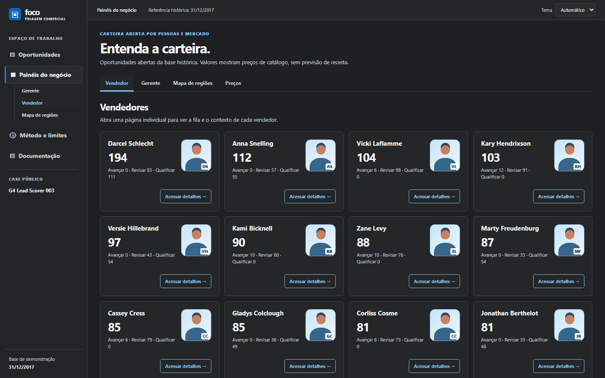
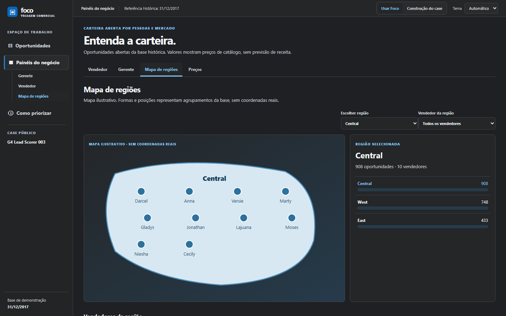
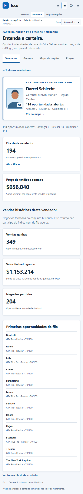
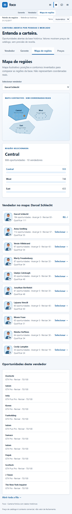

# Prints reais do aplicativo Foco, com um exemplo de uso em cada um

Estas são as capturas do aplicativo **rodando com o conjunto de dados público do desafio** (2.089 oportunidades abertas, 27 vendedores, fictício, até 2017). Entraram no repositório em 10/10/2026, durante os testes (commits `6d965c1`, às 13:09; `26f3b65`, às 13:36; e `d981caf`, às 14:36). Nesta rodada cada uma foi **aberta e conferida**.

As duas capturas da *página de documentação do app* (`construcao-case.png` e `processo-hub.png`) **não entram** nesta galeria nem no carrossel: eram o "print sem relação" que eu apontei, porque mostravam um texto, não o app em uso.

Os nomes de vendedores e gerentes vêm do conjunto de dados público; não são pessoas reais da empresa de ninguém. Os rostos são avatares ilustrados gerados pelo próprio app.

---

## 1. Gerente: a carteira de uma equipe

**Arquivo:** `evidence/gerente-desktop.png` (computador, página inteira, 1440 px de largura)

**Exemplo de uso.** O gerente Melvin Marxen tem **511 oportunidades abertas**, divididas em Avançar 0, Revisar 215 e Qualificar 296. Abaixo, a equipe: Darcel Schlecht 194, Marty Freudenburg 87, Gladys Colclough 85, Jonathan Berthelot 81 e Niesha Huffines 64 (somam 511). Clicar em "Abrir fila" leva à fila daquele recorte; "Ver RG" abre a ficha do vendedor.

**Conferido na imagem:** 194 + 87 + 85 + 81 + 64 = 511; 0 + 215 + 296 = 511.

---

## 2. Vendedor: a ficha ("RG") e o histórico separado do índice

**Arquivo:** `evidence/vendedor-desktop.png` (computador, página inteira)

**Exemplo de uso.** Darcel Schlecht, gerente Melvin Marxen, região Central, **194 oportunidades abertas** (Avançar 0, Revisar 83, Qualificar 111). Mais abaixo, o bloco "Vendas históricas deste vendedor": 349 ganhas, US$ 1.153.214 em valor fechado ganho e 204 perdidas. A própria tela diz que esse resumo **não participa do índice nem da fila aberta**, que é o ajuste pedido na revisão (etapa de painéis).

**Conferido na imagem:** 83 + 111 = 194; as primeiras oportunidades da fila aparecem com "Revisar · 70/100".

---

## 3. Mapa de regiões: ilustrativo, com os números reais

**Arquivo:** `evidence/mapa-desktop.png` (computador, página inteira)

**Exemplo de uso.** Três regiões do conjunto de dados: Central 908, West 748 e East 433 oportunidades, somando 2.089. Ao escolher um vendedor (aqui, Darcel Schlecht), o mapa destaca a região dele e mostra as oportunidades dele logo abaixo. A tela diz "Mapa ilustrativo: posições e contornos inventados... Não representam coordenadas reais".

**Conferido na imagem:** 908 + 748 + 433 = 2.089.

---

## 4. Cartões dos vendedores, em tema escuro

**Arquivo:** `evidence/vendedor-card-ajuste.png` (computador, 1440 × 900)

**Exemplo de uso.** Cada cartão mostra o nome, o total de oportunidades abertas, a divisão por fila e o botão "Acessar detalhes". É a versão do cartão depois do refinamento que eu pedi; o app tem tema automático, claro e escuro.

---

## 5. Gerentes e equipes

**Arquivo:** `docs/evidence/gerentes-desktop.png` (computador, 1440 × 900)

**Exemplo de uso.** Os seis gerentes do conjunto: Melvin Marxen 511, Summer Sewald 414, Dustin Brinkmann 397, Celia Rouche 334, Cara Losch 219 e Rocco Neubert 214 (somam 2.089). Nesta captura, somando as caixas, a fila Avançar tem cerca de 110 itens, Revisar cerca de 1.479 e Qualificar 500 (ver o limite explicado em [`fluxo-completo.md`](fluxo-completo.md), seção 9).

---

## 6. Região escolhida e vendedores dentro dela

**Arquivo:** `docs/evidence/regiao-ampliada.png` (computador, 1440 × 900)

**Exemplo de uso.** Escolhida a região Central (908 oportunidades, 10 vendedores), o mapa mostra cada vendedor como um ponto, com o nome. A visão geral, antes de escolher a região, está em [`docs/evidence/regioes-visao-geral.png`](../evidence/regioes-visao-geral.png).

---

## 7. No celular

| Gerente | Vendedor | Mapa |
| --- | --- | --- |
|  |  |  |

**Arquivos:** `evidence/gerente-mobile.png`, `evidence/vendedor-mobile.png`, `evidence/mapa-mobile.png` (390 px de largura, página inteira).

**Exemplo de uso.** As mesmas três telas empilhadas para o celular, com os mesmos números das versões de computador. O acesso pelo celular na rede local foi confirmado por mim em 09/10 (commit `2d15357`).

A versão estreita no tema escuro está em [`docs/evidence/gerentes-largura-reduzida.png`](../evidence/gerentes-largura-reduzida.png).

---

## O que cada imagem foi conferida contra

Rodada de 13/10/2026: cada arquivo abaixo foi aberto e olhado inteiro. Os prints da tela do Demiurgo, feitos no mesmo dia, **não** estão nesta galeria: precisam de recorte (ver [`processo-no-demiurgo.md`](processo-no-demiurgo.md), seção 6).

| Arquivo | Mostra | Dados pessoais ou caminho de disco? | Outro projeto? |
| --- | --- | --- | --- |
| `evidence/gerente-desktop.png` | Gerente Melvin Marxen e a equipe | Não (nomes do conjunto público) | Não |
| `evidence/vendedor-desktop.png` | Ficha de Darcel Schlecht | Não | Não |
| `evidence/mapa-desktop.png` | Mapa ilustrativo com vendedor selecionado | Não | Não |
| `evidence/vendedor-card-ajuste.png` | Cartões de vendedores, tema escuro | Não | Não |
| `evidence/gerente-mobile.png` | Gerente no celular | Não | Não |
| `evidence/vendedor-mobile.png` | Vendedor no celular | Não | Não |
| `evidence/mapa-mobile.png` | Mapa no celular | Não | Não |
| `docs/evidence/gerentes-desktop.png` | Seis gerentes, tema escuro | Não | Não |
| `docs/evidence/regioes-visao-geral.png` | Mapa com as três regiões | Não | Não |
| `docs/evidence/regiao-ampliada.png` | Região Central ampliada | Não | Não |
| `docs/evidence/gerentes-largura-reduzida.png` | Gerentes em largura de celular | Não | Não |

A barra lateral de todas mostra apenas "G4 Lead Scorer 003".

## O que ainda não tem print real

A tela principal (a fila: **Mesa comercial**, **Fila de decisão** e **Kanban**) e a **explicação do índice** não têm captura registrada. As rodadas da vitrine não conseguiram subir o aplicativo (o ambiente exigiu aprovação para executar Python e baixar o conjunto de dados), então **nenhuma captura nova do Foco foi tirada**: tudo acima é de 10/10. Para o slide da fila, é preciso uma rodada ou uma sessão com permissão para rodar `python app.py` e abrir o app com os arquivos do desafio.
