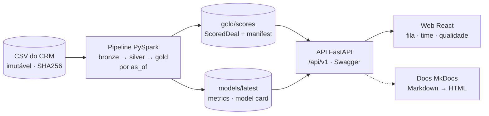

# Submissão — Bernardo Couto — Challenge 003

## Sobre mim

- **Nome:** Bernardo Couto
- **LinkedIn:** TODO(Bernardo)
- **Challenge escolhido:** 003 — Lead Scorer (Vendas / RevOps)

---

## Executive Summary

Construí uma ferramenta que roda com `docker compose up`: API FastAPI com Swagger, web React com o design system do G4 e documentação navegável, alimentadas por um pipeline PySpark que pontua os **2.089 deals abertos** do CRM com score explicável, filtros por vendedor, manager e região e registro de ações do vendedor. O backtest temporal em dois cortes mostrou que **nenhum sinal do CRM — agente, produto, setor, conta, idade, carga ou regressão logística — prevê fechamento melhor que o acaso** (AUC-ROC 0,44–0,53), então a ferramenta não vende probabilidade: ela ordena por **valor esperado × momento do ciclo** e separa o que já morreu. O achado que vale mais dinheiro é de higiene: **1.291 dos 1.589 deals em Engaging (81%) passaram de 138 dias, o ciclo mais longo já fechado**, e carregam **R$ 3,19 mi nominais** contra R$ 0,69 mi dos 298 deals vivos. Recomendação principal para a Head: aprovar a v1 com o posicionamento "valor × timing + higiene do pipeline" e abrir com um **sprint de limpeza de duas semanas** começando pelos 561 deals de 139–180 dias (R$ 1,25 mi), com o forecast oficial saindo só dos deals vivos.

Fontes: `solution/data/gold/scores/as_of=2017-12-31/_manifest.json` (contagens e valores), `solution/models/2017-12-31-rules-v1/model_card.md` §5 (backtest), `docs/revops-review.md` §7 (sprint).

---

## Solução

### Abordagem

**Decomposição antes do prompt.** Li os nove documentos do repositório (não só o brief), baixei o dataset CC0 e rodei um perfil com pandas antes de desenhar qualquer agente. Cada achado do perfil virou um guardrail executável, não um parágrafo: hooks bloqueiam `close_value`/`close_date` em features, relógio real e split aleatório em código de solução.

**Time de agentes em vez de um chat.** O Claude Code foi configurado como 15 papéis versionados em `.claude/agents/` (produto → arquitetura → dados → scoring → API ∥ design → web → QA → revisão → docs), com 9 skills de conhecimento e 6 hooks. Quem define o problema não implementa; quem implementa não avalia; há um agente cuja única função é dizer "isso é igual ao baseline". Detalhe em `docs/agents-architecture.md`.

**O que priorizei.** Um backtest honesto antes de qualquer tela: 11 hipóteses registradas antes da análise, 7 refutadas (`solution/pipeline/analysis/00_hypotheses.md`). O produto foi redesenhado a partir do resultado, não o contrário. Spark é decisão de arquitetura (pipeline reexecutável por data, modelo versionado), não necessidade de volume — e a documentação diz isso (ADR 0001).

### Resultados / Findings

**O que roda** (`solution/README.md`):

| Serviço | URL | O que entrega |
|---|---|---|
| web | http://localhost:5173 | Fila "Trabalhar" e fila "Confirmar ou encerrar", drawer com o porquê de cada score, visão do manager (`/time`), qualidade do modelo (`/qualidade`); estado na URL (`as_of`, região, manager, vendedor) |
| api | http://localhost:8000/docs | 11 rotas em `/api/v1` com filtros, paginação, `as_of`, feedback; erros em envelope único; headers `X-As-Of` e `X-Model-Version` |
| docs | http://localhost:8001 | Este README, arquitetura, dados, scoring, ML, API, design, segurança, limitações, ADRs e process log |
| pipeline (perfil) | — | `build-features → train → score` com JDK 17 na imagem; artefatos commitados para a UI abrir sem JDK (ADR 0006) |

**Telas** (capturadas em modo demonstração — dados fictícios servidos no navegador via MSW, como indica a faixa amarela; TODO(Bernardo): recapturar contra a API real):

| Tela | Arquivo | O que mostra |
|---|---|---|
| Fila do vendedor | `process-log/screenshots/web-fila.png` | "O que esta ferramenta não faz" na primeira abertura; abas Trabalhar / Confirmar ou encerrar; tiles de decisão; cada deal com score, reason code principal e próxima ação |
| Drawer de explicação | `process-log/screenshots/web-fila-drawer.png` | Fatores em pontos do score (▲/▼) separados do contexto informativo (ℹ, "não entram no score"); ações Contatado / Reunião / Proposta / Ocultar / Conta corrigida |
| Confirmar ou encerrar | `process-log/screenshots/web-fila-confirmar.png` | Fila de parados > 138 dias, maior valor primeiro, valor nominal fora do forecast |
| Time | `process-log/screenshots/web-time.png` | Esperado vs parado fora do forecast, distribuição de tiers, tabela por vendedor sem coluna de posição |
| Qualidade | `process-log/screenshots/web-qualidade.png` | Quatro perguntas da Head com resposta em português; empate com o acaso como frase padrão |
| Estados | `web-estado-vazio.png`, `web-estado-artefatos.png` | Recorte vazio e artefatos ausentes (503 com o comando para gerar) |

**Backtest vs baselines** — o que o vendedor vê (`priority_score`) contra o que ele já poderia fazer sem ferramenta. Bootstrap pareado, 2.000 reamostras. Fonte: `solution/models/2017-12-31-rules-v1/model_card.md` §5 (gerado de `metrics.json`).

| Corte 2017-06-30 (1.686 abertos, 970 com desfecho) | AUC-PR [IC 95%] | AUC-ROC | P@10 por vendedor [IC 95%] | Receita no top 20% [IC 95%] |
|---|---|---|---|---|
| Aleatório | 0,605 [0,565; 0,646] | 0,466 | 0,603 [0,547; 0,660] | 0,171 [0,141; 0,208] |
| Maior preço primeiro | 0,641 [0,592; 0,679] | 0,492 | 0,657 [0,587; 0,697] | 0,497 [0,449; 0,546] |
| Mais novo primeiro | 0,622 [0,577; 0,661] | 0,501 | 0,613 [0,559; 0,670] | 0,174 [0,143; 0,213] |
| Taxa-base por produto (= `p_win`) | 0,661 [0,612; 0,700] | 0,533 | 0,680 [0,621; 0,730] | 0,250 [0,199; 0,304] |
| **`priority_score`** | 0,602 [0,561; 0,644] | 0,461 | 0,630 [0,557; 0,672] | **0,376 [0,320; 0,431]** |
| Modelo sombra (LR calibrada, peso 0) | 0,628 [0,591; 0,675] | 0,507 | 0,660 [0,593; 0,700] | 0,307 [0,235; 0,318] |

| Corte 2017-09-30 (2.409 abertos, 935 com desfecho) | AUC-PR [IC 95%] | AUC-ROC | P@10 por vendedor [IC 95%] | Receita no top 20% [IC 95%] |
|---|---|---|---|---|
| Aleatório | 0,592 [0,551; 0,637] | 0,504 | 0,600 [0,543; 0,653] | 0,203 [0,164; 0,243] |
| Maior preço primeiro | 0,594 [0,548; 0,635] | 0,478 | 0,583 [0,533; 0,643] | 0,489 [0,432; 0,529] |
| Mais novo primeiro | 0,584 [0,544; 0,628] | 0,495 | 0,550 [0,507; 0,620] | 0,194 [0,156; 0,235] |
| Taxa-base por produto (= `p_win`) | 0,600 [0,563; 0,649] | 0,495 | 0,543 [0,503; 0,620] | 0,006 [0,005; 0,016] |
| **`priority_score`** | 0,566 [0,525; 0,610] | 0,441 | 0,560 [0,507; 0,617] | **0,359 [0,302; 0,400]** |
| Modelo sombra (LR calibrada, peso 0) | 0,582 [0,548; 0,633] | 0,484 | 0,570 [0,543; 0,657] | 0,292 [0,222; 0,311] |

Leitura: em acerto de *quem fecha*, todos os ICs se sobrepõem ao aleatório. Em receita, o score captura 1,8–2,2× o aleatório e fica abaixo de "ordenar por preço" — o custo de dizer *quando* agir e de demover parados (Spearman score × preço = 0,46; uma lista de preços daria > 0,9). Calibração de `p_win`: Brier 0,235 / 0,243, erro médio 0,041 / 0,046. Dos 149 e 530 deals já parados nos cortes, **zero** fecharam depois. A regressão logística falhou o critério de promoção nos dois cortes e ficou em modo sombra (`metrics.json`, `promotion`).

**Snapshot 2017-12-31** (`_manifest.json`): tiers A 67 · B 516 · C 771 · D 735; confiança alta 88 · média 372 · baixa 1.629; conta conhecida em 31,8%; valor esperado total R$ 2,11 mi, dos quais R$ 437 mil em deals vivos.

**Findings de dados** (`docs/data-quality-report.md`): `GTXPro` ≠ `GTX Pro` (1.480 linhas; sem a correção 1 dos 7 produtos sumiria do join); setor `technolgy`; `close_value` ≈ preço de tabela (razão mediana 0,967–1,004); a conta é **artefato temporal** — 100% dos deals fechados têm conta contra 32% dos abertos, constante em toda faixa de idade, logo `account_known` prevê "já fechou" e foi proibida como feature.

### Recomendações

Priorizadas a partir de `docs/revops-review.md` §0, §2 e §4.

| # | Recomendação | Evidência | Quem |
|---|---|---|---|
| 1 | **Aprovar a v1 como "valor × momento + higiene do pipeline"**, não como previsão de fechamento. Forecast oficial só com deals vivos (≤ 138 d): valor esperado = preço × taxa do produto. | Backtest acima; R$ 3,19 mi parados e R$ 998 mil "esperados" de zumbis fora do forecast (`_manifest.json`) | Head |
| 2 | **Sprint de limpeza de CRM, 2 semanas, dono = manager.** Primeira onda: 561 deals de 139–180 dias (R$ 1,25 mi); segunda: 730 acima de 180 (R$ 1,94 mi). Meta 5 deals/dia por vendedor (mediana de 44 parados zera em 9 dias úteis). Critérios de confirmar/encerrar em `revops-review.md` §2.2. | `revops-review.md` §7 | Managers |
| 3 | **Avisar antes**: marcar os 1.291 como Lost derruba o win rate acumulado de 63% para 53%. Reportar como coorte "limpeza de dezembro", fora da meta do trimestre. | 4.238 / 8.002 (`revops-review.md` §7) | Head |
| 4 | **Manager entra pessoalmente nos GTK 500 parados**: 14 deals, R$ 375 mil nominais. Um que exista paga o sprint. | `revops-review.md` §7 | Managers |
| 5 | **Conta obrigatória ao criar oportunidade** e **data de última atividade por deal**. São as duas lacunas que impedem o score de voltar a prever algo. | `data-quality-report.md`; `revops-review.md` §4 | RevOps / CRM |
| 6 | **Piloto de 8 semanas com controle** estratificado por manager; fase 0 = limpeza para todos; métrica primária = receita fechada em deals vivos; decidir rollout pelas secundárias (conta preenchida, fila resolvida, erro de forecast). | `revops-review.md` §2.3 | Head |
| 7 | **Não expor ajuste de pesos na UI** na v1; pesos 25/35/40 versionados em `weights.py`. Não aprovar reason code de fim de trimestre com números. | `revops-review.md` §3a, §3b | Tech lead |

### Limitações

Resumo; lista completa com fontes em `docs/limitations.md`.

- **Não prevê fechamento.** Todo sinal testado empata com o acaso. A ferramenta é fila de trabalho, não oráculo.
- **O dado não tem o que decide um deal**: sem atividade, sem proposta, sem decisor; Prospecting sem data; 68% sem conta; snapshot único de 2017, possivelmente sintético.
- **Modelo estatístico em sombra** (peso 0); calibração isotônica com viés conhecido; alertas de PSI esperados por diferença de população.
- **Sem autenticação** (protótipo local); desempenho individual exposto na API; campos manipuláveis pelo vendedor documentados em `docs/security-review.md`.
- **Screenshots em modo demonstração** (dados fictícios); ainda não recapturadas contra a API real.

---

## Process Log — Como usei IA

> **Este bloco é obrigatório.** Sem ele, a submissão é desclassificada.

### Ferramentas usadas

| Ferramenta | Para que usou |
|---|---|
| Claude Code (Fable 5.1) — sessão principal | Orquestração, decisões, escrita de configuração, código e documentação |
| Subagentes do Claude Code (15 papéis em `.claude/agents/`) | Especialização e revisão cruzada: produto, RevOps, tech lead, dados, ciência de dados, MLOps, API, design, web, QA, segurança, code review, avaliador do G4, tech writer |
| Skills (9 em `.claude/skills/`) | Fatos verificados do dataset, metodologia de scoring, regras do G4, rubrica, práticas Spark ML, design system do G4, documentação de API, `/log-process`, `/pr-check` |
| Hooks (6 em `.claude/hooks/`) | Guardrails executáveis: escopo de arquivos, comandos destrutivos, leakage, relógio real, split aleatório, quality gate no encerramento |
| `claude-code-guide` (subagente) | Verificar na documentação oficial a sintaxe de agentes, skills, hooks e permissões antes de escrever configuração |
| curl + pandas | Perfil do dataset e extração dos tokens de design do CSS público do G4, na fonte |
| uv, PySpark, FastAPI, React/Vite, Docker, MkDocs, Playwright | Stack da solução e captura de telas |

### Workflow

Cronologia completa em `process-log/01-narrativa.md`; decisões datadas em `process-log/decisions.md`.

1. **Entender antes de construir** (22/09, noite): leitura dos 9 documentos do repositório; download do dataset e perfil com pandas; achados viram hooks e skill `crm-dataset`; 8 agentes e 6 hooks testados com payloads simulados.
2. **Correções e Spark** (23/09, madrugada): renomear agentes, criar `security-engineer` e `machine-learning-engineer`; IA objeta a Spark por volume, Bernardo decide por arquitetura (ADR 0001); JDK 23 detectado como incompatível e transformado em guardrail.
3. **Produto, entrega e design** (23/09, manhã): Streamlit → FastAPI + React + Docker + MkDocs (ADRs 0002–0004); Jev avaliado e rejeitado (ADR 0005); tokens do G4 extraídos do site e contraste AA calculado; papéis de produto e tech lead criados.
4. **Process log estruturado**: script `process-log/tools/export_claude_session.py` gera o chat export sem raciocínio interno; narrativa e erros consolidados.
5. **Construção** (23/09, 11h em diante): tech-lead → scaffold e contrato `ScoredDeal` (ADR 0007); data-engineer → bronze/silver/gold e dois achados novos (conta é artefato temporal; 81% parados); data-scientist → 11 hipóteses, backtest, 7 refutadas; product-designer → UX spec e tokens; revops-engineer → revisão de textos, duas filas, sprint de limpeza; security-engineer → 0 críticos, correções de nginx/Docker/hooks; machine-learning-engineer → jobs, model card, LR em sombra; backend-engineer → API; application-engineer → web e screenshots; quality-engineer, code-reviewer e tech-writer → fechamento.

### Onde a IA errou e como corrigi

Lista completa com evidência em `process-log/02-erros-da-ia.md`. Os seis mais relevantes:

| # | O que a IA fez | Como foi pego | Correção |
|---|---|---|---|
| E10 | Escreveu na skill que idade em Engaging era sinal positivo até ~90 dias e que "mais novo primeiro" seria baseline forte — **antes de testar**. | Backtest temporal do `data-scientist`: idade não discrimina entre deals vivos (AUC-ROC 0,50); "mais novo" só ganha quando censurados contam como Lost. 7 de 11 hipóteses refutadas. | Skills reescritas; `p_win` reduzido à taxa-base por produto; sinais sem poder preditivo viraram reason codes informativos; posicionamento do produto mudou. |
| — | Interpretou 68% sem conta como "preenchimento progressivo ao longo do ciclo". | `data-engineer` mediu: fração com conta ≈ 0,3 em todo mês de engajamento; 100% dos fechados têm conta vs 32% dos abertos. | `account_known` proibida como feature (prevê "já fechou"); PSI obrigatório em `account_*`; skill corrigida. |
| — | `product-designer` rotulou `p_win` como "Prob. de fechar" e deu direção +/− a reason codes sem poder preditivo; `data-scientist` propôs `QUARTER_END_WINDOW` com percentuais. | Revisão do `revops-engineer`: `p_win` é a taxa do produto; o padrão de fim de trimestre é de registro de Lost (110–140 em mar/jun/set/dez vs 287–367 nos demais), não de fechamento. | Rótulo "Fecham {p}% dos {product}"; informativos sem pontos nem ação; `QUARTER_END_WINDOW` vetado. |
| E4 | Rubrica interna e CLAUDE.md tratavam achados do dataset (68% sem conta, GTXPro, 14 vs 57 dias) como diferenciais. | Revisão com o `g4-evaluator` em mente: qualquer análise cuidadosa produz isso. | Seção "baseline vs diferencial"; diferencial passou a ser backtest com baselines e ICs, anti-leakage testado, as-of na UI, hooks. |
| E7 | Primeira versão do script de staging fazia `git add -f` na pasta inteira: 45.236 arquivos no índice (`node_modules`, `.venv`). | Timeout do comando e `git diff --cached`. | Script reescrito com `--pathspec-from-file` e validação "gerados = 0 / fora da pasta = 0": 155 arquivos em 0,1 s; hook bloqueia `git add -f` direto. |
| — | Hooks liberavam a ação com payload inválido (fail-open) e não pegavam `git -C … push --force` nem refspec `+main`; `COPY . .` do web arrastava `node_modules` do host. | Probes do `security-engineer`. | Fail-closed, regex ampliada, `.dockerignore` por serviço (contexto do docs de dezenas de MB para 378 kB). |

Também: `regParam = 0,1` da spec zerava todos os coeficientes da LR (ajustado para 0,01 — a decisão de não promover não muda); unidades misturadas nos pesos dos reason codes (Δp vs pontos) unificadas em pontos do score.

### O que eu adicionei que a IA sozinha não faria

- **Aceitar o resultado negativo e reposicionar o produto.** A IA tende a entregar "modelo preditivo com 85% de score". O backtest disse que nada prevê fechamento; a decisão foi dizer isso na primeira tela, na model card e neste README, e vender valor × momento + higiene. Manter urgência com peso 40 mesmo custando receita no top 20% (0,38 vs 0,50 de ordenar por preço) foi escolha de produto, não de métrica.
- **Tratar a fila de zumbis como achado de negócio, não como bug de dado.** 81% do pipeline parado virou recomendação executiva com dono, cadência, critérios e aviso sobre o win rate — e uma segunda fila na UI, com vocabulário que o vendedor aceita ("Confirmar ou encerrar", nunca "zumbi").
- **Desconfiar da conta.** A explicação óbvia ("preenchem depois") era confortável; pedir a medição por mês de engajamento revelou o artefato temporal que teria feito qualquer modelo parecer ótimo no treino e inútil na segunda-feira.
- **Sem LLM no scoring.** Avaliei o Jev e LLMs e rejeitei (ADR 0005): dados tabulares próprios, explicabilidade exata e execução offline valem mais do que a palavra "IA" no produto.
- **Guardrails como código, não como instrução.** Leakage, relógio real, split aleatório e escopo de arquivos são hooks versionados e testados com payloads; quando um hook bloqueia, ele está certo até prova em contrário.
- **Spark por arquitetura, com objeção registrada.** A IA questionou; eu mantive e exigi que a documentação dissesse a verdade (pipeline reexecutável, não volume).
- **Hipóteses antes da análise.** As 11 hipóteses foram registradas com critério de refutação antes de rodar qualquer script, e o texto original ficou intacto ao lado dos vereditos.

---

## Evidências

- [x] Configuração do Claude Code versionada: `.claude/` (15 agentes, 9 skills, 6 hooks, `settings.json`) e `CLAUDE.md`
- [x] Decision log datado: `process-log/decisions.md`
- [x] Narrativa e erros da IA: `process-log/01-narrativa.md`, `process-log/02-erros-da-ia.md`
- [x] Chat export da sessão de setup: `process-log/chat-exports/` (gerado por `process-log/tools/export_claude_session.py`; raciocínio interno não exportado) — TODO(Bernardo): exportar as sessões seguintes com o mesmo script
- [x] Screenshots do app: `process-log/screenshots/` (modo demonstração) — TODO(Bernardo): recapturar contra a API real
- [ ] Git history: commits pequenos na branch `submission/bernardo-couto` (`git log --oneline -- submissions/bernardo-couto`) — TODO(Bernardo): staging com `tools/git-stage.sh` e commits ainda não feitos nesta árvore
- [x] Hipóteses registradas antes da análise: `solution/pipeline/analysis/00_hypotheses.md`
- [x] Artefatos gerados por código: `solution/models/2017-12-31-rules-v1/{metrics.json,model_card.md}`, `solution/data/gold/scores/as_of=2017-12-31/_manifest.json`
- [x] Documentação navegável: http://localhost:8001 após `docker compose up` (`solution/docs-site/`)
- [x] ADRs: `docs/adr/0001` a `0007`

---

_Submissão enviada em: TODO(Bernardo)_
