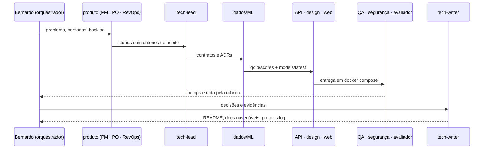
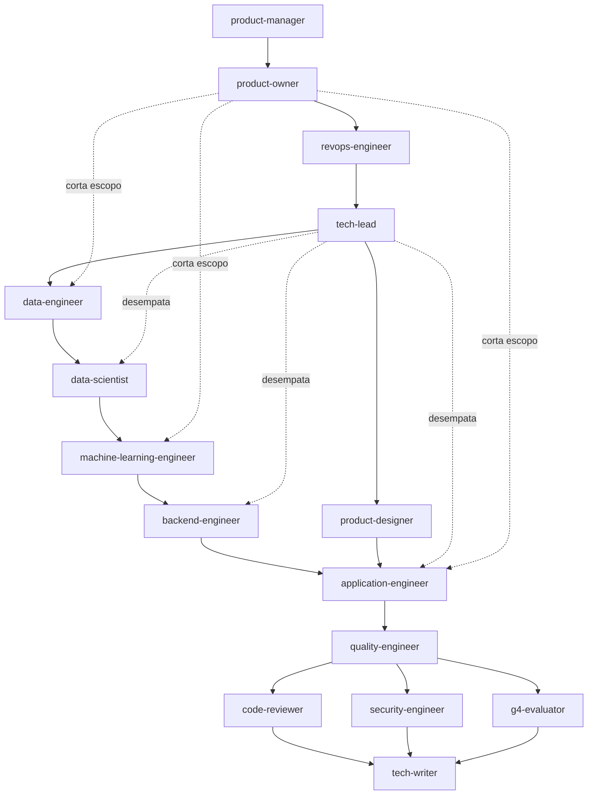

# Arquitetura do time de agentes (Claude Code)

Este projeto foi construído com o Claude Code configurado como um **time de especialistas** em vez de um chat único. A configuração inteira está versionada em [`../.claude/`](../.claude/) e [`../CLAUDE.md`](../CLAUDE.md), dentro da pasta de submissão, para servir como evidência de processo.

## Fluxo de trabalho



## Por que um time e não um prompt

O G4 já tem a resposta de "colar o brief numa IA". Um único agente generalista tende a produzir exatamente isso: score = valor × stage, tabela Streamlit, limitações genéricas. Separar papéis força **tensão produtiva**: quem define o problema não é quem implementa; quem implementa não é quem avalia; e há um agente cuja única função é dizer "isso é igual ao baseline".

## Papéis



| Agente | Responsabilidade | Ferramentas | Skills pré-carregadas |
|---|---|---|---|
| `product-manager` | Problem statement, personas, métricas de sucesso e piloto, escopo MVP, executive summary | leitura + shell | `crm-dataset`, `scoring-methodology` |
| `product-owner` | Backlog priorizado com critérios de aceite, ordem de execução, cortes de escopo | leitura/escrita | `submission-rules`, `eval-rubric` |
| `revops-engineer` | Dono do problema de vendas: requisitos, "segunda-feira de manhã", reason codes, validação de UX de decisão | leitura + shell | `crm-dataset`, `scoring-methodology` |
| `tech-lead` | ADRs, contratos (`ScoredDeal` → OpenAPI → TS), estrutura, Docker Compose, desempate técnico | leitura/escrita + shell | `spark-ml-practices`, `api-documentation`, `scoring-methodology` |
| `data-engineer` | Bronze/silver/gold em PySpark, contratos de qualidade, features point-in-time, relatório de qualidade | leitura/escrita + shell | `crm-dataset`, `spark-ml-practices`, `scoring-methodology` |
| `data-scientist` | Hipóteses, EDA, desenho do scoring em camadas, backtest temporal vs. baselines, explicabilidade | leitura/escrita + shell | `crm-dataset`, `scoring-methodology`, `spark-ml-practices` |
| `machine-learning-engineer` | Spark ML Pipeline, jobs `--as-of`, versionamento do modelo, model card, métricas, PSI | leitura/escrita + shell | `spark-ml-practices`, `scoring-methodology`, `crm-dataset` |
| `backend-engineer` | API FastAPI com OpenAPI exemplar, filtros, as-of, feedback, Dockerfile, testes | leitura/escrita + shell | `api-documentation`, `scoring-methodology` |
| `product-designer` | Fluxos, telas, estados, acessibilidade, aplicação do design system G4 | leitura/escrita + shell | `g4-design-system`, `scoring-methodology` |
| `application-engineer` | Web React + Vite + Tailwind (tokens G4), tipos do OpenAPI, Dockerfile nginx, testes | leitura/escrita + shell | `g4-design-system`, `scoring-methodology`, `api-documentation` |
| `quality-engineer` | Testes (pipeline/api/web), clean-room com Docker, adversarial do scoring, reexecutabilidade | leitura/escrita + shell | `scoring-methodology`, `spark-ml-practices`, `submission-rules` |
| `security-engineer` | Modelo de ameaças, auditoria de dependências, segredos, hardening API/web/Docker, riscos do modelo | leitura/escrita + shell | `submission-rules` |
| `code-reviewer` | Revisão somente-leitura: correção, manutenibilidade, anti-padrões Spark, separação de camadas | leitura + shell | — |
| `tech-writer` | README da submissão, docs, MkDocs, process log; tudo em pt-BR com Mermaid | leitura/escrita + shell | `submission-rules` |
| `g4-evaluator` | Simula o comitê: nota por critério, baseline vs. diferencial, top 3 alavancas | leitura + shell | `eval-rubric`, `submission-rules` |

O orquestrador (sessão principal, dirigida pelo Bernardo) decide, delega e registra. Arquitetura técnica em [`solution-architecture.md`](./solution-architecture.md); decisões em [`adr/`](./adr/).

## Skills (conhecimento reutilizável)

| Skill | Conteúdo | Invocação |
|---|---|---|
| `crm-dataset` | Fatos verificados por código sobre as 4 tabelas: contagens, nulos, armadilhas, snapshot | automática pelo modelo |
| `scoring-methodology` | Prob × valor × urgência, regras anti-leakage, protocolo de backtest, contrato de explicabilidade, invariantes | automática |
| `submission-rules` | Regras do G4 destiladas (PR-only, escopo, `.gitignore`, process log) | automática |
| `eval-rubric` | Rubrica 0–5 por critério + sinais de baseline vs. julgamento | automática |
| `spark-ml-practices` | Quando Spark se justifica, ambiente JDK, camadas parquet por as_of, Pipeline ML, validação temporal, model card, PSI, testes | automática |
| `g4-design-system` | Tokens reais do site do G4 (cores, fontes, raios), contraste AA, regras de aplicação no Tailwind | automática |
| `api-documentation` | OpenAPI exemplar no FastAPI, geração de tipos TS, MkDocs Material com Mermaid e Swagger embutido | automática |
| `/log-process` | Registra entrada datada no decision log | humano ou modelo |
| `/pr-check` | Checklist executável antes do PR | somente humano |

## Guardrails (hooks)

| Evento | Script | O que faz |
|---|---|---|
| `SessionStart` | `session_start.py` | Injeta status: branch, integridade SHA256 dos dados, snapshot, JDK compatível com Spark (alerta se o padrão for 23+), modelo atual, estado do projeto, última decisão |
| `PreToolUse` Edit/Write | `guard_paths.py` | Bloqueia edição fora da pasta de submissão, em `data/raw/` e em arquivos de segredo |
| `PreToolUse` Bash | `guard_bash.py` | Bloqueia `push --force`, `--no-verify`, `reset --hard`, `clean -f`, `rm -rf` amplo, `sudo`, `curl \| sh`, `pip install`, `git add -A/.`, edição do `.gitignore` raiz |
| `PostToolUse` Edit/Write | `format_python.sh` | `ruff format` + `ruff check --fix` em `.py` da solução |
| `PostToolUse` Edit/Write | `guard_leakage.py` | Bloqueia `close_value`/`close_date`/`outcome_*` em código de features/scoring/ML/UI, relógio real (`now()`, `today()`, `current_date()`), split aleatório (`randomSplit`, `CrossValidator`), `inferSchema=True` e correções de dado fora da camada de limpeza |
| `Stop` | `stop_quality_gate.py` | Se código da solução mudou e `pytest` falha, impede encerrar sem corrigir (com proteção contra loop) |

Permissões (`settings.json`): allowlist para `uv`, `pytest`, `ruff`, `git` de leitura e commit; `ask` para `git push`, `checkout`, `gh pr`, `rm`; `deny` para force push, `sudo`, `pip install` e leitura de credenciais (`~/.kaggle`, `~/.ssh`, `.env`).

## Como rodar o time

```bash
cd submissions/bernardo-couto   # a configuração só é carregada a partir daqui
claude
```

Todos os hooks foram testados com payloads simulados na sessão de setup (ver `process-log/decisions.md`).
