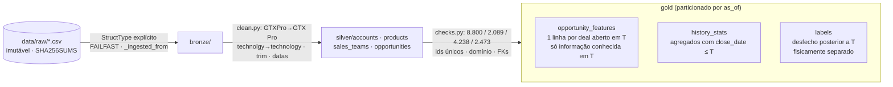

# Relatório de qualidade de dados — camadas bronze, silver e gold

Todos os números abaixo foram produzidos pelo pipeline PySpark (`uv run python -m lead_scorer.jobs build-features --as-of <data>`) sobre a cópia imutável em `solution/data/raw/` (checksums em `SHA256SUMS`, verificados no início de cada execução). Snapshot do CRM: **2017-12-31**. Nenhuma estatística usa o relógio da máquina; toda idade é medida em relação ao `as_of` do job.

## Arquitetura em camadas



- **Bronze** (`load.py`, `schemas.py`): leitura dos 4 CSVs com `StructType` declarado, `inferSchema=False`, `mode=FAILFAST`; cada linha recebe `_ingested_from` = SHA256 do arquivo de origem. Datas ficam como texto: parsing é uma correção, e correções vivem na silver.
- **Silver** (`clean.py`, `silver.py`): única fonte de correções em código (tabelas de mapeamento `PRODUCT_NAME_MAP` e `SECTOR_MAP`), tipos, `left join` de `opportunities` com produto, conta e time e flags `product_matched`, `account_known`, `agent_matched`. Asserção: nenhuma linha se perde (8.800 antes e depois). Um teste força um catálogo com chave duplicada e verifica que o job falha em vez de multiplicar linhas.
- **Gold** (`gold.py`): três tabelas por partição `as_of=YYYY-MM-DD`, escrita `overwrite` na partição, `_manifest.json` (parâmetros, git sha, checksums dos raw, contagens, duração) dentro de cada partição. O prefixo `_` faz Spark e pyarrow ignorarem o arquivo ao ler o diretório.
- **Checks** (`checks.py`): contagens de referência, unicidade de `opportunity_id`, domínio de `deal_stage`, datas 100% parseadas, deals fechados com ambas as datas e `close_value`, deals abertos sem `close_date`, `close_date ≥ engage_date`, cobertura de FKs. Qualquer violação lança `DataQualityError` e aborta o job.

## Achados verificados

### Tabelas e integridade

| Tabela | Linhas | Chave | Observação |
|---|---|---|---|
| `sales_pipeline` | 8.800 | `opportunity_id` (0 duplicatas) | 100% dos `sales_agent` e 100% das `account` não nulas existem nas dimensões |
| `accounts` | 85 | `account` | 15 subsidiárias; `revenue` em US$ milhões (4,54 – 11.698); `employees` 9 – 34.288 |
| `products` | 7 | `product` | `sales_price` de 55 (MG Special) a 26.768 (GTK 500) |
| `sales_teams` | 35 | `sales_agent` | 6 managers, 3 escritórios; **5 agentes do cadastro não têm nenhum deal** |

Nenhum espaço em branco sobrando em nenhuma coluna de texto dos CSVs (o `trim` fica como proteção para reexecuções com novos extratos).

### Estágios, datas e nulos

| `deal_stage` | n | `engage_date` | `close_date` | `account` nula | `close_value` |
|---|---|---|---|---|---|
| Won | 4.238 | 100% | 100% | 0% | 38 – 30.288 |
| Lost | 2.473 | 100% | 100% | 0% | sempre 0 |
| Engaging | 1.589 | 100% | nula | **68,5%** (1.088) | nula |
| Prospecting | 500 | **nula** | nula | **67,4%** (337) | nula |

- Alvo do scorer: **2.089 deals abertos**, dos quais **1.425 (68,2%) sem conta**.
- `engage_date`: 2016-10-20 → 2017-12-27. `close_date`: 2017-03-01 → 2017-12-31. Nenhum deal fecha antes de engajar; ciclo mínimo de 1 dia.
- Win rate global dos fechados: **63,15%** (4.238 / 6.711). Por produto 60,0–64,8%; por agente 55,0–70,4%; por setor 61,2–64,8%. Variância modesta em todas as dimensões: o poder preditivo dos agregados é limitado e a UI deve comunicar incerteza.
- Ciclo (dias entre `engage_date` e `close_date`): Lost mediana **14** (p75 79), Won mediana **57** (p75 88), máximo **138** em ambos. Mediana global 45.

Todos os números coincidem com a skill `crm-dataset`; nenhuma correção da skill foi necessária.

### Sujeira corrigida em código (`clean.py`)

| Problema | Onde | Correção | Efeito |
|---|---|---|---|
| `GTXPro` no pipeline vs `GTX Pro` no catálogo | `sales_pipeline.product` (1.480 linhas) | `PRODUCT_NAME_MAP` | Sem a correção o join perderia 1 dos 7 produtos (`product_matched=false` em 16,8% dos deals) |
| `technolgy` | `accounts.sector` (12 contas) | `SECTOR_MAP` | Setor `technology` passa a agregar 1.058 deals fechados |
| Datas como texto | `engage_date`, `close_date` | `to_date(yyyy-MM-dd)` | 100% parseadas (check falha se algum valor não parsear) |

Nenhum CSV foi alterado; `shasum -a 256 -c SHA256SUMS` continua OK e é executado por `verify_checksums()` em todo job.

### Razão `close_value / sales_price` dos Won

| Produto | n Won | mediana da razão |
|---|---|---|
| GTK 500 | 15 | 0,967 |
| GTX Basic | 915 | 0,995 |
| GTX Plus Basic | 653 | 0,988 |
| GTX Plus Pro | 479 | 1,004 |
| GTX Pro | 729 | 1,001 |
| MG Advanced | 654 | 0,997 |
| MG Special | 793 | 1,000 |

**Achado:** o valor fechado é praticamente o preço de tabela (razão global 0,998). O "ajuste por histórico de Won" existe no pipeline (`value_ratio_*`) mas muda o valor esperado em menos de 4%. O que domina o valor esperado é o `sales_price` do produto, e o GTK 500 (26.768) é 5× o segundo produto mais caro — daí a regra da metodologia de não deixar o score virar "ordenar por preço".

### Idade dos deals abertos no snapshot (achado novo)

Com `as_of = 2017-12-31`, os 1.589 deals Engaging têm `days_in_engaging` com **mínimo 9, mediana 165 e máximo 423 dias** (p10 107, p25 148, p75 263, p90 319).

| Faixa | n | % dos Engaging |
|---|---|---|
| ≤ 90 dias (janela em que Won costuma fechar) | 110 | 6,9% |
| 91 – 138 dias | 188 | 11,8% |
| **> 138 dias (nunca observado em deal fechado)** | **1.291** | **81,2%** |

Implicações:

- A curva de sobrevivência empírica `P(Won | ainda aberto após d dias)` sobe de 63,2% (d=0) para 71,0% (d=91) e 76% (d=126) — sobreviver é sinal positivo — mas tem **n = 0 para d ≥ 140**. Para 81% do pipeline aberto a curva não informa nada; o pipeline devolve `n_survival = 0` e `win_rate_survival` = taxa-base (suavização), e cabe à camada de regras tratar isso como `ZOMBIE_RISK`, não como sinal positivo.
- A distribuição de `engage_month` dos Engaging tem pico em 2017-07 (402 deals) e 2017-08 (254): parece um lote de deals que nunca foi atualizado no CRM. É uma limitação do dado (não há data de última atividade), não algo que a limpeza possa corrigir.

### `account_known` é um artefato temporal (achado novo, crítico para o backtest)

Como só o snapshot é observável, `account` de um deal aberto em T reflete o CRM em 2017-12-31, não em T. Todo deal fechado tem conta; 68% dos abertos não têm. Consequência nos cortes:

| `as_of` | deals abertos em T | com conta | fecharam depois de T (labels) | ainda abertos no snapshot |
|---|---|---|---|---|
| 2017-06-30 | 1.686 | 71,3% | 970 (Won 62,8%) | 716 |
| 2017-09-30 | 2.409 | 58,2% | 935 (Won 59,8%) | 1.474 |
| 2017-12-31 | 2.089 | 31,8% | 0 | 2.089 |

Nos cortes de backtest, `account_known = true` para **100%** dos deals com label e ~32% dos que continuam abertos. Portanto: (1) qualquer modelo treinado sobre `labels` vê contas sempre preenchidas e será pontuado num lote com 68% de nulos — deslocamento de distribuição que o PSI do job `score` precisa reportar; (2) `account_known` **não pode** ser usado para prever "vai fechar vs. continua aberto" no backtest, porque ali ele é consequência do desfecho. A hipótese da skill de que "a conta é preenchida ao longo do ciclo" não se sustenta pela idade: a fração com conta entre os Engaging é ~0,3 em todos os meses de engajamento (0,21 – 0,54, sem tendência).

## Decisões de modelagem dos dados

1. **"Aberto em T"** = `engage_date ≤ T` e (`close_date > T` ou nula). O `deal_stage` desses deals é reescrito para `Engaging` em `opportunity_features`, porque é o que o CRM mostrava em T; Won/Lost é futuro.
2. **Prospecting** (sem nenhuma data) só é considerado aberto quando `as_of = SNAPSHOT_DATE`, com `has_timeline = false`, `days_in_engaging` nulo e urgência desconhecida. Nos cortes de backtest os 500 Prospecting são excluídos e `_manifest.json` registra `prospecting_included = false`.
3. **História point-in-time**: `compute_history(opps, as_of)` usa apenas `close_date ≤ as_of`. Dimensões: global, produto, agente, setor, par (agente, produto), conta; curva de sobrevivência em d = 0, 7, …, 140; carga de deals abertos por agente. Formato longo (`dimension, key, key2, n, wins, win_rate, median_cycle_days, median_value_ratio`) para auditoria e para a camada de regras. Medianas exatas (`percentile`), não aproximadas.
4. **Suavização bayesiana** das taxas nas features: `(wins + α·p0) / (n + α)` com α = 20 e p0 = taxa-base global em `as_of`. Um par agente-produto com 3 deals não vira 100% nem 0%; com n = 0 a taxa é exatamente p0. Os `n_*` acompanham para que o score exponha confiança.
5. **Nulos são informação**: deal sem conta mantém a linha, `account_known = false`, e **todas** as features de conta e de setor (inclusive `n_account`, `win_rate_sector`) ficam nulas — não zero, porque "sem histórico" e "não sabemos a conta" são coisas diferentes. Nunca `dropna` em deals.
6. **Separação física**: `opportunity_features` não contém `close_value`, `close_date`, `cycle_days` nem `label_won` (`OUTCOME_COLUMNS`; asserção no código e teste). `labels` tem `opportunity_id, label_won, close_date, close_value, days_to_close_from_as_of` e é vazia no snapshot.
7. **`price_tier`**: `low` < 2.000 (MG Special, GTX Basic, GTX Plus Basic), `mid` < 10.000 (MG Advanced, GTX Pro, GTX Plus Pro), `high` (GTK 500).

## Contagens por execução

| `as_of` | `opportunity_features` | `history_stats` | `labels` | fechados usados na história | taxa-base p0 |
|---|---|---|---|---|---|
| 2017-06-30 | 1.686 | 358 | 970 | 2.679 | 66,6% |
| 2017-09-30 | 2.409 | 360 | 935 | 4.726 | 64,4% |
| 2017-12-31 | 2.089 (1.589 Engaging + 500 Prospecting) | 359 | 0 | 6.711 | 63,2% |

Silver em todas as execuções: 8.800 oportunidades, 2.089 abertas, 1.589 Engaging, 500 Prospecting, 4.238 Won, 2.473 Lost, 1.425 abertas sem conta; 85 contas, 7 produtos, 35 agentes. Cada execução leva ~15 s em `local[*]`; reexecução sobrescreve a partição e produz contagens idênticas (teste `test_build_features_job_is_idempotent`).

## Limitações do dado (não corrigíveis em código)

- **Prospecting sem data alguma**: impossível medir idade ou incluir no backtest; no snapshot recebem features de produto, agente e conta (quando existe) e nada de tempo.
- **Sem data de criação nem de última atividade**: `engage_date` é a única marca temporal de um deal aberto; a idade extrema dos Engaging (81% acima de 138 dias) pode ser deal morto não atualizado ou CRM desatualizado — o dado não distingue.
- **`account` observada só no snapshot**: features de conta em cortes passados são anacrônicas (ver acima). Backtests devem reportar métricas com e sem features de conta.
- **Sem histórico por conta antes do dataset**: `n_account` conta apenas deals fechados dentro da janela 2017-03 → `as_of`.
- **Base pequena para alguns cruzamentos**: GTK 500 tem 25 deals fechados; os 178 pares agente-produto têm mediana de 29,5 deals fechados, 17 pares com menos de 10 e 4 com 3 ou menos — por isso a suavização.
- **Spark aqui é decisão de arquitetura** (pipeline reexecutável por `as_of`, escalável ao CRM inteiro), não necessidade de volume: 8.800 linhas cabem em pandas. A API lê os parquet com pyarrow, sem JVM.

## Como reproduzir

```bash
cd solution/pipeline
export JAVA_HOME=$(/usr/libexec/java_home -v 21)     # JDK 17 ou 21
uv run python -m lead_scorer.jobs build-features --as-of 2017-12-31
uv run python -m lead_scorer.jobs build-features --as-of 2017-09-30
uv run python -m lead_scorer.jobs build-features --as-of 2017-06-30
uv run pytest -q tests/test_data_layers.py
```

Saída em `solution/data/{bronze,silver,gold}/`; gold particionado por `as_of`, cada partição com `_manifest.json`.
