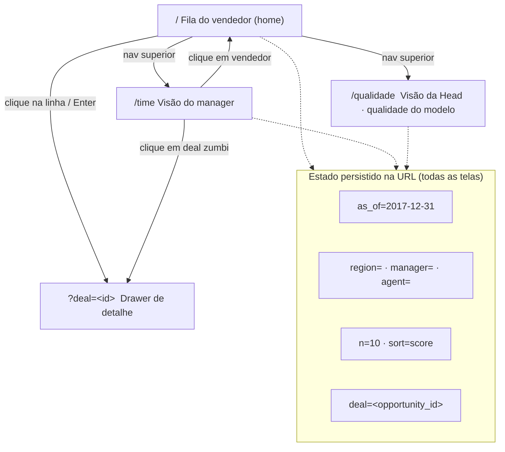
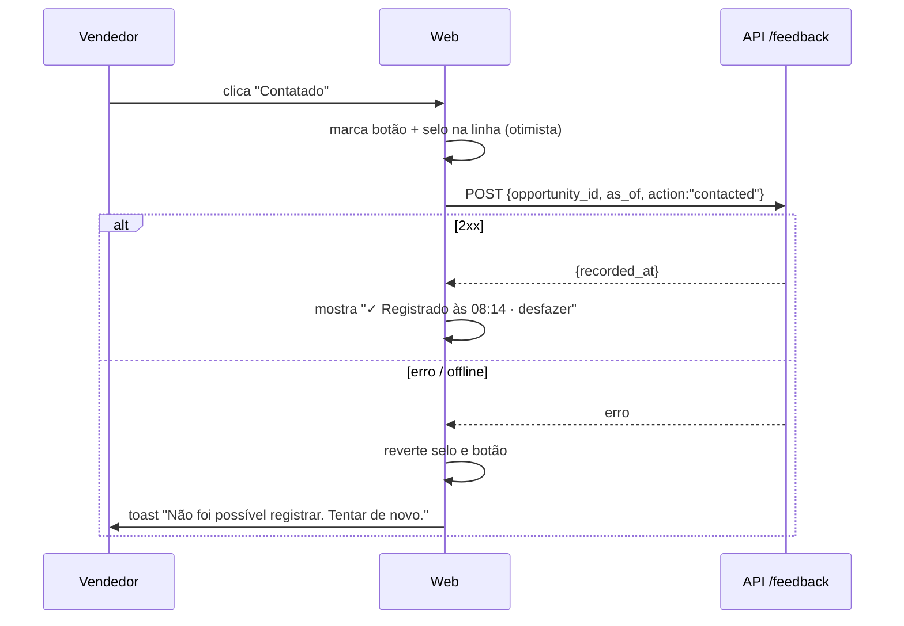

# Especificação de UX — Lead Scorer · Vendas

**Autor:** product-designer (agente) · **Revisão humana pendente:** Bernardo Couto · **Data:** 2026-09-23
**Insumos:** brief do Challenge 003, `scoring-methodology`, `g4-design-system`, contrato `ScoredDeal` (`solution/shared/lead_scorer_contracts`), `revops-engineer` (perguntas de segunda-feira).

> Princípio único: a tela responde **"o que eu faço hoje?"** antes de mostrar qualquer dado. Tudo o mais é detalhe sob demanda.

---

## 1. Personas e a pergunta de segunda-feira

| Persona | Quem é | Pergunta às 8h de segunda | Tela que responde | O que NÃO pode acontecer |
|---|---|---|---|---|
| **Vendedor** | 1 dos 35 agentes; ~60 deals abertos; 12 minutos antes da primeira ligação | "Em quais 10 deals eu ligo hoje, e por quê?" | Fila do vendedor (home) | Ver uma tabela de 60 linhas sem ordem; ler "feature = 0.83" |
| **Manager** | 1 dos 6; 5–7 vendedores; reunião de pipeline na segunda às 10h | "Quem está com deal grande esfriando? Onde o time perde tempo?" | Visão do manager | Ver um ranking punitivo de vendedores; comparar agentes sem contexto de carga |
| **Head de RevOps** | Pediu a ferramenta; presta contas de receita por região | "Posso confiar nisso mais do que no feeling? Quanto do pipeline a ferramenta cobre?" | Visão da Head / qualidade do modelo | Ler AUC, Brier ou "walk-forward" sem tradução |
| **Avaliador / dev** | Sobe com `docker compose up` numa máquina limpa | "Roda? Se faltar artefato, o que eu faço?" | Estados (artefatos ausentes, erro) | Tela branca ou `undefined` |

As três perguntas do RevOps que toda tela precisa devolver: **(a) o que está quente e fecha se eu agir; (b) o que é grande e está esfriando; (c) onde estou perdendo tempo.** Cada componente abaixo aponta para (a), (b) ou (c). Componente que não aponta para nenhuma foi removido.

---

## 2. Arquitetura da informação



**Regras de estado na URL**
- Filtros são hierárquicos e persistidos: `?region=Central&manager=Melvin%20Marxen&agent=Darcel%20Schlecht`. Mudar `region` limpa `manager` e `agent`; mudar `manager` limpa `agent`. Um link colado reproduz exatamente a mesma tela (o manager manda o link para o vendedor no WhatsApp).
- `as_of` sempre presente; se ausente, a UI usa `default_as_of` de `GET /api/v1/meta` e o escreve na URL (`history.replaceState`), para que o link compartilhado fique datado.
- `deal=` abre o drawer; fechar remove o parâmetro. Voltar do navegador fecha o drawer.

**Layout base (todas as telas, ≥ 1024 px)**

```
┌──────────────────────────────────────────────────────────────────────────────┐
│ ██ navy  Lead Scorer · Vendas        Fila  Time  Qualidade      [API online] │
├──────────────┬───────────────────────────────────────────────────────────────┤
│ SIDEBAR 264px│ CONTEÚDO (max 1120px, gutter 24px)                            │
│ Filtros      │                                                               │
│  Região   ▾  │                                                               │
│  Manager  ▾  │                                                               │
│  Vendedor ▾  │                                                               │
│ ───────────  │                                                               │
│ Referência   │                                                               │
│  Dados até ▾ │                                                               │
│  31/12/2017  │                                                               │
│ Modelo v1    │                                                               │
│ Gerado em …  │                                                               │
│ [Limpar]     │                                                               │
├──────────────┴───────────────────────────────────────────────────────────────┤
│ Dados até 31/12/2017 · modelo 2017-12-31-lr-v1 · scores gerados em 23/09/2026│
└──────────────────────────────────────────────────────────────────────────────┘
```

Abaixo de 1024 px a sidebar vira um botão **"Filtros (3)"** que abre um painel lateral; a fila vira cards empilhados (uma coluna). A barra de referência (as-of · modelo · execução) é **sempre visível** — no rodapé fixo em telas pequenas.

---

## 3. Tela A — Fila do vendedor (home, `/`)

**Pergunta que responde:** (a) o que está quente; e, pelos avisos, (b) o que grande está esfriando.
**Contrato:** `GET /api/v1/deals?as_of=&regional_office=&manager=&sales_agent=&limit=N` → `ScoredDeal[]` já ordenados por `priority_score` desc. A UI **nunca** reordena por lógica própria; só oferece ordenação secundária visual (valor, dias) com aviso "ordem original = prioridade".

### 3.1 Wireframe

```
┌ CONTEÚDO ─────────────────────────────────────────────────────────────────────┐
│ h1 (serif)  Sua fila de hoje                                                   │
│ p           Darcel Schlecht · 61 deals abertos · mostrando os 10 mais          │
│             prioritários                                     [Top 10 ▾] [⇅ Prioridade ▾] │
│                                                                                │
│ ┌ RESUMO (3 tiles, só números que mudam decisão) ────────────────────────────┐ │
│ │ 4 deals quentes para agir   │ R$ 12.4 mil esperados no │ 3 deals parados   │ │
│ │ esta semana (tier A)        │ top 10                   │ há +100 dias      │ │
│ └────────────────────────────────────────────────────────────────────────────┘ │
│                                                                                │
│ ┌ LINHA 1 ──────────────────────────────────────────────────────────────────┐  │
│ │ [A] 82  Konex · GTX Pro                    R$ 3.412 esperados   ● Confiança alta │
│ │        ▲ Você fecha 74% dos GTX Pro (média do time: 63%).                 │  │
│ │        → Ligar esta semana e propor data de fechamento.        78 dias    │  │
│ └───────────────────────────────────────────────────────────────────────────┘  │
│ ┌ LINHA 2 ──────────────────────────────────────────────────────────────────┐  │
│ │ [A] 79  Conta não informada · MG Advanced   R$ 2.108 esperados  ◐ Confiança média │
│ │        ▲ 66 dias em Engaging: deals que passam de 60 dias fecham em 68%.  │  │
│ │        → Confirmar a conta no CRM e agendar próximo passo.     66 dias    │  │
│ │        ⚠ Conta não informada no CRM. [Registrar conta]                    │  │
│ └───────────────────────────────────────────────────────────────────────────┘  │
│ ┌ LINHA 3 ──────────────────────────────────────────────────────────────────┐  │
│ │ [B] 61  Zumgoity · GTK 500                 R$ 18.930 esperados  ● Confiança alta │
│ │        ▼ 121 dias em Engaging: acima de 90% dos deals que fecharam (100). │  │
│ │        → Confirmar hoje se o deal ainda existe.               121 dias ⏳ │  │
│ └───────────────────────────────────────────────────────────────────────────┘  │
│ …                                                                              │
│ [Ver mais 10]                                                                  │
└────────────────────────────────────────────────────────────────────────────────┘
```

### 3.2 Anatomia da linha (componente `DealRow`)

Ordem de leitura (esquerda → direita, cima → baixo) = ordem de decisão:

| # | Elemento | Fonte no contrato | Regra visual |
|---|---|---|---|
| 1 | **Badge de tier** `[A]` | `tier` | Cor + letra, sempre a letra (nunca só cor). 28×28 px, radius 10. |
| 2 | **Score** `82` | `priority_score` arredondado (0 casas) | Manrope 700, 20 px, `g4.text`. Tooltip/aria: "Prioridade 82 de 100". |
| 3 | **Conta · Produto** | `account ?? "Conta não informada"`, `product` | 16 px 600. Quando `account == null`, texto em `muted` + itálico e aviso (item 8). |
| 4 | **Valor esperado** | `expected_value` formatado `R$ 3.412` | Alinhado à direita; `Intl.NumberFormat('pt-BR', {style:'currency', currency:'BRL', maximumFractionDigits:0})`. Rótulo "esperados" para deixar claro que não é o preço de tabela. |
| 5 | **Badge de confiança** | `confidence` | `alta` ● preenchido · `media` ◐ meio · `baixa` ○ vazio + texto. Ver §8 copy. |
| 6 | **Motivo principal** | `reasons[0]` (maior `|weight|`) | Ícone ▲ (`+`, `signal.pos`) / ▼ (`−`, `signal.neg`) / ℹ (`i`, `muted`) + `text_pt`. Uma linha; ellipsis com `title`. |
| 7 | **Próxima ação** | `next_action` | Prefixo "→", 14 px 600, `g4.navy700`. É o elemento mais importante depois do score: nunca ocultar em nenhuma largura. |
| 8 | **Aviso de conta** | `account == null` | Faixa `highlight` a 20 % com ícone ⚠ e CTA secundário "Registrar conta" → abre drawer na aba Ações com a ação `conta corrigida` em foco. |
| 9 | **Dias em Engaging** | `days_in_engaging` | `78 dias`; nulo → "Prospecting · sem data". Ícone ⏳ quando `> 100` (p90 do ciclo Won). |

Clique/Enter em qualquer parte da linha (exceto no CTA) abre o **drawer** (§4).

### 3.3 Controles do topo

- **Top N** (`n=`): 10 (padrão) · 25 · 50 · Todos. Copy: "Top 10". Persistido na URL.
- **Ordenação secundária** (`sort=`): `score` (padrão) · `value` · `days`. Ao sair de `score` aparece o aviso inline "Ordenado por valor. A prioridade continua no badge." — para ninguém confundir a ordenação com a recomendação.
- **Tiles de resumo** (3, fixos): (1) `count(tier == 'A')` no recorte → "deals quentes para agir esta semana"; (2) `sum(expected_value)` do top N → "esperados no top N"; (3) `count(days_in_engaging > 100)` → "deals parados há +100 dias". Cada tile responde, na ordem, às perguntas (a), (b), (c). Nenhum outro tile.

### 3.4 Sidebar de filtros

```
Filtros
  Região        [ Todas          ▾ ]   ← regional_office: Central · East · West
  Manager       [ Todos          ▾ ]   ← depende da região
  Vendedor      [ Todos          ▾ ]   ← depende do manager
  Chips ativos: (Central ×) (Melvin Marxen ×) (Darcel Schlecht ×)
  [Limpar filtros]

Referência
  Dados até     [ 31/12/2017     ▾ ]   ← as_of_available de /meta; 1 opção = select desabilitado + texto
  Modelo        2017-12-31-lr-v1
  Gerado em     23/09/2026 08:12       ← manifest do score (se exposto por /meta); senão omitir a linha
  ⓘ "Toda idade de deal é contada até a data de referência, não até hoje."
```

Os valores das listas vêm dos próprios `ScoredDeal` retornados sem filtro (`distinct`), ou de um `GET /api/v1/deals/facets` se o backend preferir (**pergunta aberta B1**).

---

## 4. Tela B — Drawer de detalhe do deal (`?deal=<id>`)

**Pergunta que responde:** "Por que este deal está aqui e o que eu faço com ele?" — e registra a decisão.
**Contrato:** `GET /api/v1/deals/{opportunity_id}?as_of=` → `ScoredDeal`; `POST /api/v1/feedback` `{opportunity_id, as_of, action, note?}`.

### 4.1 Wireframe (painel lateral direito, 480 px, sobre um scrim navy a 40 %)

```
┌──────────────────────────────────────────────────────────────┐
│ [A] 82   Konex · GTX Pro                                [×]  │
│ Darcel Schlecht · Central · Engaging há 78 dias              │
│ Prob. de fechar 71 % · R$ 3.412 esperados · ● Confiança alta │
│ ────────────────────────────────────────────────────────────  │
│ → PRÓXIMA AÇÃO                                                │
│   Ligar esta semana e propor data de fechamento.             │
│                                                              │
│ POR QUE ESTE SCORE                                            │
│ ▲ +9 pts  Você fecha 74% dos GTX Pro (média do time: 63%).   │
│ ▲ +5 pts  78 dias em Engaging: deals que passam de 60 dias   │
│           fecham em 68%.                                     │
│ ▲ +3 pts  Setor tecnologia: fecha 66% (média 63%).           │
│ ▼ −2 pts  GTX Pro tem ticket médio baixo (R$ 4.821):         │
│           valor esperado limitado.                           │
│ ℹ  0 pts  Modelo estatístico confirma a estimativa das       │
│           regras (ajuste de +1 pt).                          │
│ ⓘ Pesos em pontos do score (0–100). Sinal ▲ ajuda, ▼ reduz.  │
│                                                              │
│ HISTÓRICO DA CONTA                    (só se account != null)│
│ Konex · tecnologia · 2.400 funcionários · receita US$ 1,2 bi │
│ 3 deals fechados com você: 2 ganhos, 1 perdido               │
│ Último fechamento: GTX Basic, 14/10/2017                     │
│                                                              │
│ REGISTRAR O QUE VOCÊ FEZ                                     │
│ [ Contatado ] [ Reunião marcada ] [ Proposta enviada ]       │
│ [ Descartar ]                       [ Conta corrigida ]      │
│ ✓ Registrado "Contatado" às 08:14 · [desfazer]               │
└──────────────────────────────────────────────────────────────┘
```

### 4.2 Regras

- **Lista completa de razões**, ordenada por `|weight|` desc (a API já entrega assim; não reordenar). Cada linha: ícone de direção + peso formatado + `text_pt`. Peso: `weight` é "pontos de score ou contribuição em p_win" segundo o contrato; a UI mostra **`(weight × 100).toFixed(0)` pts** quando `|weight| < 1` e o valor bruto caso contrário, com sinal explícito (`+9`, `−2`, `0`). **Pergunta aberta B2:** confirmar com data-scientist a unidade definitiva, para que o rótulo "pts" seja verdadeiro.
- Direção `i` (informativo) nunca recebe cor verde/vermelha; usa `muted` e ícone ℹ.
- **Histórico da conta**: seção inteira omitida quando `account == null`; no lugar entra o cartão de aviso (§8, `accountUnknown`) com o botão "Conta corrigida" em destaque. Os campos de conta (setor, funcionários, receita, deals anteriores) exigem que a API exponha esses dados (**pergunta aberta B3**: `GET /api/v1/accounts/{name}` ou embutir `account_summary` no `ScoredDeal`). Sem esse endpoint, a seção mostra só "Conta: Konex" e a sub-seção fica oculta — não inventar números.
- **Ações** (`action` ∈ `contacted | meeting | proposal | discard | account_fixed`): botões segmentados; `discard` usa estilo de risco e pede confirmação inline ("Descartar remove o deal da sua fila, não do CRM. Confirmar?"). **Estado otimista:** ao clicar, a linha na fila recebe imediatamente o selo da ação ("Contatado hoje") e o botão fica marcado; se o `POST` falhar, o selo volta e um toast de erro aparece com "Tentar de novo". `discard` oculta a linha da fila (com "desfazer" por 8 s) — o deal continua no dataset.
- Foco inicial no título do drawer; `Esc` fecha; foco retorna à linha de origem (ver `accessibility.md`).

### 4.3 Fluxo de ação (Mermaid)



---

## 5. Tela C — Visão do manager (`/time`)

**Pergunta que responde:** (b) o que grande está esfriando; (c) onde o time perde tempo. **Não** responde "quem é o pior vendedor".
**Contrato:** proposta `GET /api/v1/deals/summary?as_of=&regional_office=&manager=` (**pergunta aberta B4**); enquanto não existir, a UI agrega no cliente a partir de `GET /deals?limit=all` no recorte (2.089 linhas cabem no navegador).

### 5.1 Wireframe

```
h1  Saúde do pipeline · time de Melvin Marxen
p   6 vendedores · 412 deals abertos · dados até 31/12/2017

┌ TILES ─────────────────────────────────────────────────────────────────────────┐
│ R$ 184 mil esperados    │ R$ 41 mil em risco      │ 37 deals zumbis  │ 34 % dos deals │
│ no pipeline aberto      │ (parados há +100 dias)  │ (+138 dias)      │ com conta     │
│                         │ [ver deals]             │ [ver deals]      │ informada     │
└────────────────────────────────────────────────────────────────────────────────┘

┌ DISTRIBUIÇÃO DE TIERS (barra empilhada única, 100 %) ──────────────────────────┐
│ ████ A 22 %  ████████ B 27 %  ████████ C 26 %  ███████ D 25 %                  │
│ legenda com letra + contagem; barras rotuladas dentro                          │
└────────────────────────────────────────────────────────────────────────────────┘

┌ POR VENDEDOR (tabela, ordenada por VALOR EM RISCO desc — não por score) ──────┐
│ Vendedor         Abertos  Tier A  Esperado    Em risco   Zumbis  Conta inf.  Carga │
│ Darcel Schlecht     61      12    R$ 48 mil   R$ 9 mil      6      31 %      ●●●○ │
│ Cassey Cress        70       9    R$ 39 mil   R$ 12 mil     9      28 %      ●●●● │
│ …                                                                                 │
│ Clique em uma linha → Fila do vendedor filtrada (link com filtros na URL)        │
└───────────────────────────────────────────────────────────────────────────────────┘

┌ DEALS ZUMBIS DO TIME (lista curta, máx. 10, valor esperado desc) ─────────────┐
│ ▼ [C] 38  Zumgoity · GTK 500 · Cassey Cress · 142 dias · R$ 18.930  → Confirmar │
│ …                                                                               │
└─────────────────────────────────────────────────────────────────────────────────┘
```

### 5.2 Regras anti-ranking

- Tabela por vendedor ordenada por **valor em risco**, nunca por "score médio" nem por "win rate". Não existe coluna de posição (1º, 2º…).
- Coluna **Carga** (`AGENT_OVERLOAD` agregado: nº de deals abertos vs. mediana do time) contextualiza: quem tem mais zumbis frequentemente tem mais deals. Ícone ●●●○ com texto alternativo "carga alta (61 deals; mediana do time 52)".
- Toda métrica de vendedor vem acompanhada do **link para a fila dele**: a ação do manager é ajudar a priorizar, não pontuar pessoas.
- Tiles são clicáveis e levam à fila com o filtro correspondente (`?manager=…&sort=days`), fechando o ciclo "ver → agir".

### 5.3 Definições exibidas no rodapé da tela (copy)

"**Em risco** = valor esperado dos deals com mais de 100 dias em Engaging (90 % dos deals ganhos fecharam antes disso). **Zumbi** = mais de 138 dias, o maior ciclo já observado. **Conta informada** = deals com conta preenchida no CRM; sem conta, a estimativa é menos confiável."

---

## 6. Tela D — Visão da Head / qualidade do modelo (`/qualidade`)

**Pergunta que responde:** "Posso confiar nisso mais do que no feeling? Quanto do pipeline cobre?"
**Contrato:** proposta `GET /api/v1/model/quality` lendo `models/latest/metrics.json` + model card (**pergunta aberta B5**). Todos os números exibidos vêm do backtest; nada calculado na UI.

### 6.1 Wireframe

```
h1  Qualidade do modelo · versão 2017-12-31-lr-v1
p   Testado em dois cortes no passado (30/06/2017 e 30/09/2017): pontuamos os deals
    abertos naquela data e conferimos o que fechou depois.

┌ 1. A FERRAMENTA VENCE O FEELING? (gráfico de barras horizontais + IC) ────────┐
│ Dos 10 primeiros de cada vendedor, quantos fecharam?                          │
│ Lead Scorer          ████████████████████ 7,4 de 10   [6,8–8,0]               │
│ Mais novo primeiro   ██████████████       6,5 de 10   [5,9–7,1]               │
│ Maior preço primeiro █████████████        6,3 de 10   [5,7–6,9]               │
│ Taxa-base por produto█████████████        6,3 de 10   [5,7–6,9]               │
│ Escolha aleatória    ████████████         6,3 de 10   [5,6–7,0]               │
│ ⓘ Barras cinzas = intervalo de 95 %. Se as barras se sobrepõem, a diferença   │
│   não é segura.                                                               │
│ Frase gerada do metrics.json: "O Lead Scorer acertou 0,9 deal a mais a cada   │
│   10 do que ordenar pelo mais novo — a melhor alternativa simples."           │
│   OU, se não vencer: "O Lead Scorer empatou com 'mais novo primeiro'. O ganho │
│   está na explicação e na detecção de zumbis, não no ranking."                │
└───────────────────────────────────────────────────────────────────────────────┘

┌ 2. QUANDO DIZ 70 %, FECHA 70 %? (calibração, 5 faixas) ───────────────────────┐
│ Faixa prevista   Fechou de fato   Deals                                       │
│ 40–50 %          ██████ 46 %      118                                         │
│ 50–60 %          ███████ 57 %     412                                         │
│ 60–70 %          ████████ 64 %    903                                         │
│ 70–80 %          █████████ 73 %   356                                         │
│ 80–90 %          ██████████ 81 %  64                                          │
│ Frase: "Erro médio de calibração: 2 pontos. Quando a ferramenta diz 70 %,     │
│ fecha entre 68 e 73 %."                                                       │
└───────────────────────────────────────────────────────────────────────────────┘

┌ 3. QUANTO DO PIPELINE ELA COBRE? (tiles) ──────────────────────────────────────┐
│ 100 % dos 2.089 deals abertos pontuados │ 32 % com conta informada (confiança  │
│                                          │ alta possível) │ 500 em Prospecting  │
│                                          │ sem data (urgência desconhecida)    │
└───────────────────────────────────────────────────────────────────────────────┘

┌ 4. RECEITA CAPTURADA (1 linha) ───────────────────────────────────────────────┐
│ Focando nos 20 % de maior score, o time teria capturado 31 % da receita       │
│ fechada depois do corte (aleatório: 20 %).                                    │
└───────────────────────────────────────────────────────────────────────────────┘

Rodapé: "Limites: variância modesta entre vendedores e produtos (win rate 55–70 %);
sem dados de atividade (e-mails, reuniões); Prospecting sem data. Detalhes no model card."
[Abrir model card] [Abrir Swagger]
```

### 6.2 Mapeamento métrica → linguagem de negócio

| Métrica no `metrics.json` | Como aparece | Nunca aparece como |
|---|---|---|
| `precision_at_10` por baseline + IC bootstrap | "Dos 10 primeiros, quantos fecharam: 7,4 de 10 [6,8–8,0]" | precision@10, P@k |
| `lift_top_decile` | "Os 10 % de maior score fecham 1,3× mais que a média" | lift |
| `revenue_capture_top20` | "Focando nos 20 % de maior score, capturaria X % da receita" | recall de receita |
| `brier`, `calibration_bins` | tabela de 5 faixas + "erro médio de calibração: N pontos" | Brier score, ECE |
| `coverage`, `account_known_rate`, `prospecting_count` | tiles de cobertura | — |

Os quatro gráficos/tabelas respondem, respectivamente: vence o feeling? · é honesto? · cobre tudo? · vale dinheiro? Nenhum outro gráfico entra nesta tela. Números acima são **ilustrativos** (formato), não resultados: a tela lê `metrics.json`.

---

## 7. Estados

| Estado | Gatilho | O que aparece | Copy (pt-BR) |
|---|---|---|---|
| **Carregando** | qualquer fetch > 150 ms | Skeleton com 5 linhas cinza `#E8EBEF` no formato da `DealRow`; tiles com placeholder; nunca spinner sozinho | `aria-busy="true"`, texto oculto "Carregando sua fila…" |
| **Vazio (filtro)** | 200 com `[]` | Ilustração textual (sem imagem), título + explicação + ação | **Título:** "Nenhum deal aberto neste recorte." **Corpo:** "Tente ampliar o filtro ou trocar a data de referência." **Botão:** "Limpar filtros" |
| **Vazio (tudo descartado)** | todas as linhas do top N descartadas na sessão | mesmo padrão | **Título:** "Você já tratou todos os deals desta página." **Botão:** "Ver mais 10" |
| **Artefatos ausentes** | `/meta.artifacts_present == false` ou 404/`ARTIFACTS_MISSING` | Cartão navy com bloco de código copiável; nenhuma tabela vazia | **Título:** "Ainda não há scores gerados." **Corpo:** "Rode o pipeline uma vez e recarregue esta página." **Código:** `cd solution && make pipeline` **Alternativa (sem JDK):** `docker compose --profile pipeline up` **Rodapé:** "Precisa de JDK 17 ou 21 no host. O caminho por Docker não precisa." Botão "Copiar comando" |
| **Erro da API** | rede/5xx | Faixa `risk` no topo da área de conteúdo, dados anteriores mantidos se existirem | **Título:** "Não foi possível carregar os deals." **Corpo:** "A API não respondeu (erro {status}). Verifique se `docker compose up` está rodando." **Botão:** "Tentar de novo" |
| **API offline no boot** | `/health` falha | Pílula `risk` no header (já existe) + estado de erro no conteúdo | "API indisponível. Rode `docker compose up` ou `make up`." |
| **Feedback falhou** | `POST /feedback` erro | toast no canto inferior; reverte estado otimista | "Não foi possível registrar a ação. Tentar de novo." |
| **Ação registrada** | `POST /feedback` 2xx | selo inline na linha + linha de confirmação no drawer | "✓ Registrado 'Contatado' às 08:14 · desfazer" |
| **Sem histórico de conta** | endpoint de conta ausente | seção oculta (não mostra "—") | — |
| **Qualidade sem métricas** | `metrics.json` ausente | Estado "artefatos ausentes" com `make pipeline` (o job `train` gera as métricas) | "As métricas do backtest ainda não foram geradas." |

---

## 8. Copy — todos os rótulos (fonte única: `src/i18n/pt-BR.ts`)

```ts
// Proposta de adição a solution/web/src/i18n/pt-BR.ts (aplicar via application-engineer)
export const t = {
  brand: 'Lead Scorer · Vendas',
  tagline: 'Em quais deals focar hoje — e por quê.',
  nav: { queue: 'Fila', team: 'Time', quality: 'Qualidade' },
  status: {
    checking: 'Verificando a API…',
    online: 'API online',
    offline: 'API indisponível. Rode `docker compose up` ou `make up`.',
  },
  reference: {
    title: 'Referência',
    asOf: 'Dados até',
    model: 'Modelo',
    generatedAt: 'Gerado em',
    note: 'Toda idade de deal é contada até a data de referência, não até hoje.',
    footer: (asOf: string, model: string) => `Dados até ${asOf} · modelo ${model}`,
  },
  filters: {
    title: 'Filtros',
    region: 'Região',
    manager: 'Manager',
    agent: 'Vendedor',
    all: 'Todos',
    allFeminine: 'Todas',
    clear: 'Limpar filtros',
    open: (n: number) => (n ? `Filtros (${n})` : 'Filtros'),
    removeChip: (label: string) => `Remover filtro ${label}`,
  },
  queue: {
    title: 'Sua fila de hoje',
    titleTeam: 'Fila do time',
    subtitle: (agent: string, total: number, shown: number) =>
      `${agent} · ${total} deals abertos · mostrando os ${shown} mais prioritários`,
    topN: (n: number) => `Top ${n}`,
    topAll: 'Todos',
    sort: { score: 'Prioridade', value: 'Valor esperado', days: 'Dias em Engaging' },
    sortWarning: 'Ordenado por outro critério. A prioridade continua no badge.',
    more: (n: number) => `Ver mais ${n}`,
    tiles: {
      hot: (n: number) => `${n} deals quentes para agir esta semana`,
      hotHint: 'Tier A no recorte atual',
      expected: 'esperados no top',
      stale: (n: number) => `${n} deals parados há +100 dias`,
    },
  },
  deal: {
    score: (s: number) => `Prioridade ${s} de 100`,
    expected: 'esperados',
    pWin: (p: number) => `Prob. de fechar ${p} %`,
    daysEngaging: (d: number) => `${d} dias em Engaging`,
    prospecting: 'Prospecting · sem data',
    accountUnknown: 'Conta não informada',
    accountUnknownWarning: 'Conta não informada no CRM. Sem ela, a estimativa é menos confiável.',
    accountUnknownCta: 'Registrar conta',
    nextAction: 'Próxima ação',
    whyTitle: 'Por que este score',
    whyHint: 'Pesos em pontos do score (0–100). ▲ ajuda, ▼ reduz, ℹ informativo.',
    historyTitle: 'Histórico da conta',
    historyClosed: (won: number, lost: number) => `${won + lost} deals fechados com você: ${won} ganhos, ${lost} perdidos`,
    close: 'Fechar detalhe',
    openDetail: (account: string, product: string) => `Abrir detalhe de ${account} · ${product}`,
  },
  confidence: {
    alta: 'Confiança alta',
    media: 'Confiança média',
    baixa: 'Confiança baixa',
    hint: {
      alta: 'Conta conhecida e histórico suficiente.',
      media: 'Conta não informada ou histórico pequeno.',
      baixa: 'Prospecting sem data ou quase sem histórico.',
    },
  },
  tiers: { A: 'Tier A', B: 'Tier B', C: 'Tier C', D: 'Tier D' },
  tierHint: {
    A: 'Quente: agir esta semana',
    B: 'Bom: manter ritmo',
    C: 'Morno: acompanhar',
    D: 'Frio ou parado: decidir se continua',
  },
  direction: { '+': 'Aumenta o score', '-': 'Reduz o score', i: 'Informativo' },
  actions: {
    title: 'Registrar o que você fez',
    contacted: 'Contatado',
    meeting: 'Reunião marcada',
    proposal: 'Proposta enviada',
    discard: 'Descartar',
    accountFixed: 'Conta corrigida',
    discardConfirm: 'Descartar remove o deal da sua fila, não do CRM. Confirmar?',
    confirm: 'Confirmar',
    cancel: 'Cancelar',
    recorded: (label: string, time: string) => `Registrado "${label}" às ${time}`,
    undo: 'desfazer',
    badgeToday: (label: string) => `${label} hoje`,
    error: 'Não foi possível registrar a ação.',
    retry: 'Tentar de novo',
  },
  team: {
    title: (manager: string) => `Saúde do pipeline · time de ${manager}`,
    titleAll: 'Saúde do pipeline',
    subtitle: (agents: number, deals: number, asOf: string) => `${agents} vendedores · ${deals} deals abertos · dados até ${asOf}`,
    tiles: {
      expected: 'esperados no pipeline aberto',
      atRisk: 'em risco (parados há +100 dias)',
      zombies: (n: number) => `${n} deals zumbis (+138 dias)`,
      coverage: (p: number) => `${p} % dos deals com conta informada`,
      seeDeals: 'ver deals',
    },
    tierDistribution: 'Distribuição de tiers',
    byAgent: 'Por vendedor',
    columns: { agent: 'Vendedor', open: 'Abertos', tierA: 'Tier A', expected: 'Esperado', atRisk: 'Em risco', zombies: 'Zumbis', accountKnown: 'Conta inf.', load: 'Carga' },
    load: (n: number, median: number) => `carga ${n > median * 1.2 ? 'alta' : n < median * 0.8 ? 'baixa' : 'normal'} (${n} deals; mediana do time ${median})`,
    zombiesTitle: 'Deals zumbis do time',
    definitions: 'Em risco = valor esperado dos deals com mais de 100 dias em Engaging (90 % dos deals ganhos fecharam antes disso). Zumbi = mais de 138 dias, o maior ciclo já observado. Conta informada = deals com conta preenchida no CRM.',
    rowLink: (agent: string) => `Abrir fila de ${agent}`,
  },
  quality: {
    title: (version: string) => `Qualidade do modelo · versão ${version}`,
    intro: (cuts: string) => `Testado em cortes no passado (${cuts}): pontuamos os deals abertos naquela data e conferimos o que fechou depois.`,
    q1: 'A ferramenta vence o feeling?',
    q1Sub: 'Dos 10 primeiros de cada vendedor, quantos fecharam?',
    outOf10: (v: number) => `${v.toFixed(1).replace('.', ',')} de 10`,
    ciHint: 'Faixas cinzas = intervalo de 95 %. Se as faixas se sobrepõem, a diferença não é segura.',
    baselines: { scorer: 'Lead Scorer', newest: 'Mais novo primeiro', price: 'Maior preço primeiro', base_rate: 'Taxa-base por produto', random: 'Escolha aleatória' },
    wins: (delta: string, best: string) => `O Lead Scorer acertou ${delta} deal a mais a cada 10 do que "${best}" — a melhor alternativa simples.`,
    ties: (best: string) => `O Lead Scorer empatou com "${best}". O ganho está na explicação e na detecção de zumbis, não no ranking.`,
    q2: 'Quando diz 70 %, fecha 70 %?',
    calibrationCols: { predicted: 'Faixa prevista', actual: 'Fechou de fato', deals: 'Deals' },
    calibrationSummary: (err: number) => `Erro médio de calibração: ${err} pontos.`,
    q3: 'Quanto do pipeline ela cobre?',
    coverageAll: (n: number) => `100 % dos ${n} deals abertos pontuados`,
    coverageAccount: (p: number) => `${p} % com conta informada (confiança alta possível)`,
    coverageProspecting: (n: number) => `${n} em Prospecting sem data (urgência desconhecida)`,
    q4: 'Vale dinheiro?',
    revenue: (top: number, rnd: number) => `Focando nos 20 % de maior score, o time teria capturado ${top} % da receita fechada depois do corte (aleatório: ${rnd} %).`,
    limits: 'Limites: variância modesta entre vendedores e produtos (win rate 55–70 %); sem dados de atividade (e-mails, reuniões); Prospecting sem data.',
    modelCard: 'Abrir model card',
    swagger: 'Abrir Swagger',
  },
  states: {
    loading: 'Carregando sua fila…',
    emptyTitle: 'Nenhum deal aberto neste recorte.',
    emptyBody: 'Tente ampliar o filtro ou trocar a data de referência.',
    allHandledTitle: 'Você já tratou todos os deals desta página.',
    artifactsTitle: 'Ainda não há scores gerados.',
    artifactsBody: 'Rode o pipeline uma vez e recarregue esta página.',
    artifactsCmd: 'cd solution && make pipeline',
    artifactsCmdDocker: 'docker compose --profile pipeline up',
    artifactsNote: 'Precisa de JDK 17 ou 21 no host. O caminho por Docker não precisa.',
    copy: 'Copiar comando',
    copied: 'Copiado',
    apiErrorTitle: 'Não foi possível carregar os deals.',
    apiErrorBody: (status: number | string) => `A API não respondeu (erro ${status}). Verifique se \`docker compose up\` está rodando.`,
    retry: 'Tentar de novo',
    metricsMissing: 'As métricas do backtest ainda não foram geradas.',
  },
} as const;
```

---

## 9. Templates dos reason codes (voz do vendedor, com o número)

Os textos finais são gerados **no pipeline** (`text_pt` já vem no contrato); esta tabela é a referência de redação para o data-scientist/ML engineer e para os testes de snapshot. `{}` = placeholder numérico. Segunda pessoa ("você") na fila do próprio vendedor; quando o manager vê a fila de outro, o backend não muda o texto — o drawer mostra o nome do vendedor no cabeçalho, o que já desambigua. Máx. 2 frases, ≤ 160 caracteres.

| `ReasonCode` | Dir. | Template `text_pt` | Ação sugerida (alimenta `next_action`) |
|---|---|---|---|
| `PRODUCT_BASE_RATE` | i / + / − | "{product} fecha em {rate}% dos casos (média geral: {global}%)." | — (contexto) |
| `AGENT_TRACK_RECORD` | + / − | "Você fecha {rate}% dos seus deals ({n} fechados; média do time: {team}%)." | + "Mantenha o ritmo." / − "Peça apoio do manager neste." |
| `AGENT_PRODUCT_FIT` | + / − | "Você fecha {rate}% dos {product} (média do time: {team}%)." | + "Use seu roteiro de {product}." / − "Envolva quem fecha mais {product}." |
| `SECTOR_FIT` | + / − | "Setor {sector}: fecha {rate}% (média {global}%)." | — |
| `ACCOUNT_SIZE` | + / − | "Conta com {employees} funcionários e receita de {revenue}: {frase}." (frase: "porte acima da média dos fechamentos" / "porte abaixo da média") | — |
| `ACCOUNT_HISTORY` | + / − | "{won} ganhos e {lost} perdidos nesta conta; último em {date}." | + "Retome o contato que já conhece." / − "Entenda por que perdeu antes." |
| `ACCOUNT_UNKNOWN` | i | "Conta não informada no CRM: estimativa menos confiável ({pct}% dos deals abertos estão assim)." | "Registre a conta no CRM antes do próximo contato." |
| `SURVIVAL_POSITIVE` | + | "{days} dias em Engaging: deals que passam de {threshold} dias fecham em {rate}%." | "Proponha data de fechamento esta semana." |
| `ZOMBIE_RISK` | − | "{days} dias em Engaging: acima de {pct}% dos deals que fecharam ({threshold}). Risco de esfriar." · crítico (>138): "{days} dias em Engaging: acima do ciclo máximo observado ({max}). Confirme se o deal ainda existe." | "Ligar hoje para confirmar se o deal ainda existe." |
| `HIGH_TICKET` | + | "{product} tem ticket alto (R$ {price}): cada fechamento vale {mult}× a média." | "Priorize mesmo com probabilidade média." |
| `LOW_TICKET` | − | "{product} tem ticket baixo (R$ {price}): valor esperado limitado." | "Resolva rápido; não gaste mais de um contato." |
| `PROSPECTING_NO_TIMELINE` | i | "Em Prospecting, sem data de engajamento: não dá para medir urgência." | "Qualifique e mova para Engaging, ou descarte." |
| `AGENT_OVERLOAD` | − | "Você tem {n} deals abertos (mediana do time: {median}): menos tempo por deal." | "Descarte os frios para abrir agenda." |
| `MODEL_CONTRIBUTION` | + / − / i | "Modelo estatístico {ajusta} a estimativa das regras em {delta} pontos." (ajusta ∈ "confirma" quando \|delta\| < 1; "eleva"; "reduz") | — |

Regras de redação: número sempre presente; nunca "feature", "coeficiente", "probabilidade calibrada"; percentuais inteiros; moeda `R$` sem centavos; dias inteiros.

---

## 10. Decisões de design (com alternativas descartadas)

1. **Linhas ricas em vez de tabela densa na home.** Tabela de 12 colunas foi descartada: o vendedor não compara colunas, ele lê "o quê / por quê / o que fazer". A tabela densa fica na visão do manager, onde comparar é o trabalho.
2. **Tiles de resumo limitados a 3**, um por pergunta de segunda-feira. Um 4º tile ("win rate do vendedor") foi descartado por não mudar decisão hoje.
3. **Filtros na URL, não em `localStorage`**: o manager manda link; o avaliador reproduz a tela. `localStorage` só para preferência de Top N.
4. **Manager sem ranking**: tabela ordenada por valor em risco e sem coluna de posição. Descartado "leaderboard de win rate" (variância 55–70 % é modesta e viraria constrangimento sem valor).
5. **Qualidade em perguntas, não em métricas**: cada bloco tem título-pergunta. Descartadas curvas ROC/PR (não respondem a nenhuma pergunta da Head).
6. **Gold só como fundo de botão/badge com texto navy**, nunca texto sobre claro: 2,89:1 (falha até em texto grande, limite 3:1).
7. **Tier C/D com fundo claro e texto escuro**: texto branco sobre `#6B7A8C` dá 4,39:1 e sobre `#9AA3AE` 2,55:1 — ambos falham. O scaffold atual (`App.tsx`) usa branco em todos os tiers e precisa mudar.
8. **Estado otimista com desfazer** nas ações: latência zero percebida; erro reverte. Descartado modal de confirmação para tudo (só `Descartar` confirma).
9. **Drawer, não página de detalhe**: mantém a fila visível e o contexto de "próximo da lista".
10. **Sem dark mode** no MVP (skill G4). Sem logo: wordmark textual.

---

## 11. Perguntas abertas para o Bernardo (validação visual e de produto)

- **V1.** Densidade da `DealRow` (3 linhas por deal): 10 deals cabem numa tela de 1080p sem rolar? Se não, reduzir para 2 linhas (motivo + ação na mesma linha) — decidir vendo no navegador.
- **V2.** Tiers C/D com fundo claro (tinta) e texto escuro em vez de sólido: aceitar a mudança visual em relação ao scaffold?
- **V3.** Faixa amarela (`highlight` a 20 %) para "conta não informada": em ~68 % das linhas ela vai aparecer. Alternativa: só o ícone ⚠ + texto em `muted`, e a faixa completa apenas no drawer. Preferência?
- **V4.** Serif (Libre Baskerville) só no h1 de cada tela e no wordmark; todo o resto Manrope. Confirmar.
- **B1–B5 (backend):** facets de filtro; unidade de `weight`; endpoint de conta; endpoint `deals/summary`; endpoint `model/quality`. Sem B4/B5 a UI agrega no cliente e a tela Qualidade lê um JSON estático servido pelo web (`/quality.json` copiado de `models/latest/metrics.json` no build) — fallback aceitável para o MVP.
