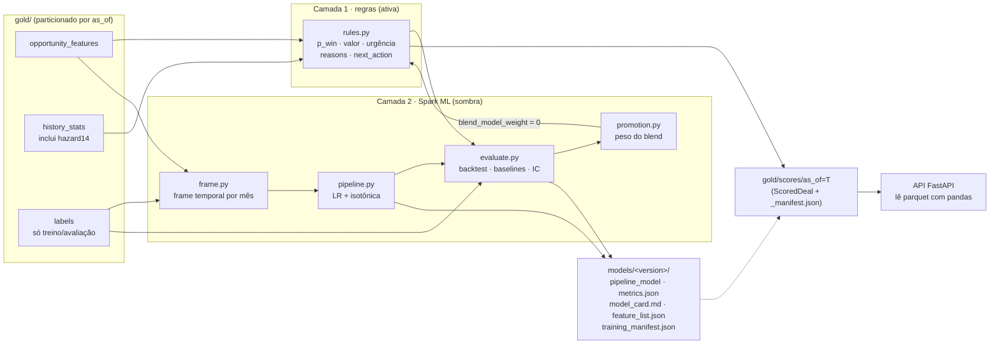
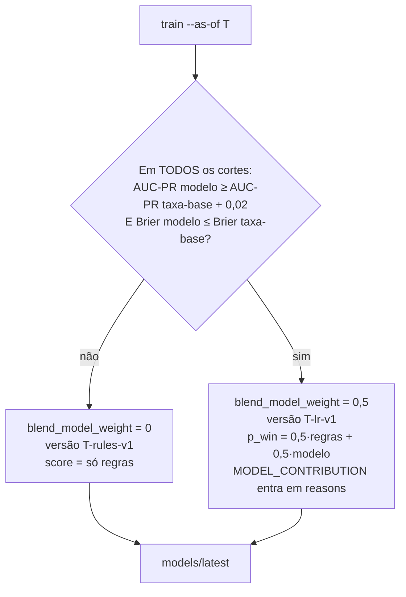

# Pipeline de ML — camadas, jobs, promoção e monitoramento

**Para:** quem vai operar ou evoluir o scoring · **De:** machine-learning-engineer · **Especificação implementada:** `docs/specs/scoring-spec.md` (data-scientist) e `docs/revops-review.md` §1/§3 (textos e `next_action`).
**Código:** `solution/pipeline/src/lead_scorer/{scoring,ml,jobs}` · **Testes:** `solution/pipeline/tests/test_scoring_*.py`, `test_ml_*.py`.

## 1. Por que este desenho

O score tem **duas camadas**, e só a primeira decide o que o vendedor vê:

| Camada | O que faz | Onde vive | Estado |
|---|---|---|---|
| 1 · Regras | `p_win` = taxa de Won do produto (suavizada) × 0,5 se parado há > 138 dias; valor esperado; urgência = hazard de Won em 14 dias dado a idade; `priority_score = 25·p̂ + 35·valor + 40·urgência`; tiers, confiança, `reasons`, `next_action`. Tudo em expressões Spark SQL, sem UDF Python. | `scoring/rules.py` (funções puras, um reason code por regra), `scoring/score.py` (montagem), `scoring/weights.py` (constantes) | **Ativa** |
| 2 · Modelo | `Pipeline` Spark ML: `StringIndexer(product) → OneHotEncoder → Imputer → VectorAssembler → StandardScaler → LogisticRegression` (elastic-net) + `IsotonicRegression` calibrada em hold-out temporal. | `ml/features.py` (lista fechada), `ml/frame.py` (frame temporal), `ml/pipeline.py`, `ml/promotion.py` | **Sombra** (peso 0 no blend) |

Motivo do modo sombra: no backtest nenhum conjunto de features prevê o desfecho melhor que a taxa-base do produto (AUC-ROC ≈ 0,5, Brier pior). A camada 2 existe para **provar isso a cada retreino** e ser promovida automaticamente no dia em que deixar de ser verdade — não para enfeitar o score.

Spark aqui é decisão de arquitetura (pipeline reexecutável por `--as-of`, escalável ao CRM inteiro), não necessidade de volume: 8.800 deals cabem em pandas, e as métricas de avaliação (bootstrap, calibração) rodam em pandas no driver.



## 2. Jobs

Todos rodam com `cd solution/pipeline && uv run python -m lead_scorer.jobs <job> --as-of YYYY-MM-DD` (JDK 17/21; `lead_scorer/spark.py` resolve `JAVA_HOME`). Nenhum usa relógio real: toda idade é contada até `--as-of`.

| Job | Entrada | Saída | Idempotência |
|---|---|---|---|
| `build-features` | `data/raw/*.csv` | bronze, silver, `gold/{opportunity_features,history_stats,labels}/as_of=T` + `_manifest.json` | reescreve a partição `as_of=T` |
| `train` | silver + gold (recalcula gold dos cortes e dos meses do frame em memória) | `models/<version>/` e ponteiro `models/latest` | reescreve a versão; **não move o ponteiro** se o aceite falhar (exit 3) |
| `score` | `gold/{opportunity_features,history_stats}/as_of=T` + `models/<version>` | `gold/scores/as_of=T/` (parquet no contrato `ScoredDeal` + `_manifest.json`) | reescreve a partição; duas execuções geram linhas idênticas (teste por hash) |

### 2.1 `train --as-of T`

1. Para cada corte de backtest `c < T` (padrão `2017-06-30` e `2017-09-30`): monta o **frame temporal** — um bloco por fim de mês `m` de `2017-03-31` até `c − 1 mês`, com os deals abertos em `m` cujo desfecho era conhecido até `c` (`labels/as_of=m` filtrado por `close_date ≤ c`). O último mês do frame é hold-out da calibração isotônica; os anteriores treinam a LR. Nunca `randomSplit`.
2. Pontua os deals abertos em `c` com as regras **e** com o modelo sombra; avalia ambos contra `labels/as_of=c` com bootstrap pareado (2.000 reamostras, semente fixa) e os baselines obrigatórios: aleatório, maior preço, mais novo primeiro, mais antigo primeiro, taxa-base por produto.
3. Decide a promoção (§4) e treina o modelo final no frame que termina em `T − 1 mês`.
4. Grava `models/<version>/` e atualiza `models/latest` (arquivo de uma linha com o nome da versão). Versão: `<T>-rules-v1` em sombra, `<T>-lr-v1` se promovido.

Aceite (spec §7), verificado em cada corte antes de mover o ponteiro: Brier(`p_win`) ≤ 0,245; erro médio de calibração ≤ 0,06; receita realizada no top 20% por `priority_score` ≥ 1,5× aleatório com IC inferior acima do aleatório; Spearman(score, preço) < 0,9. `--no-strict` grava os artefatos mesmo assim (para investigar), sem mover o ponteiro.

### 2.2 `score --as-of T --model models/latest`

Lê **só** as partições `as_of=T` (point-in-time por construção; um teste injeta um fechamento posterior a `T` no histórico e verifica saída idêntica), aplica as regras, roda o modelo sombra (probabilidade registrada no manifesto, blend com o peso decidido no `train`), valida **todas** as linhas com `ScoredDeal.model_validate` lendo o parquet escrito (o que a API vai ler) e grava o `_manifest.json` com: parâmetros (`weights.py`), git sha, checksums dos raw, contagens (tiers, confiança, parados, Prospecting, cobertura de conta), valores (esperado total, nominal parado, nominal vivo), Spearman(score, preço), **PSI por feature vs. treino** e alarmes, estatísticas do modelo sombra, duração e timestamp de auditoria.

Ordenação do parquet: `priority_score DESC, days_in_engaging ASC` — dentro da fila de parados o mais novo vem primeiro (é o mais provável de ainda existir).

### 2.3 Convenções do contrato

- Colunas exatamente as de `ScoredDeal` + `sales_price` (preço de tabela, pedido pelo backend). `reasons` é `array<struct<code, direction, weight, text_pt>>`, ordenado por `|weight|` decrescente (empate: ordem da regra).
- **Unidade de `Reason.weight`: pontos de `priority_score` (0–100), para todo código**, e os códigos de score fecham a conta: `PRODUCT_BASE_RATE = 25·p̂` (+), `URGENCY_WINDOW = 40·urgência` (+), `HIGH_TICKET`/`LOW_TICKET = 35·valor_norm` (= pontos de valor; `LOW_TICKET` tem direção `−` porque são poucos pontos), `ZOMBIE_RISK = 25·(p̂(p_win) − p̂(p_prod))` menos o que o teto de 49 remover (−). Soma `PRODUCT_BASE_RATE + ticket + URGENCY_WINDOW + ZOMBIE_RISK = priority_score` quando há reason de ticket; deals com preço entre 600 e 4.000 não têm reason de ticket e os pontos de valor ficam só em `score_breakdown`. Informativos (agente, agente×produto, setor, conta, sobrevivência, carga) = 0 com direção `i`. A UI exibe o valor bruto com sinal — **não** multiplicar por 100.
- `score_breakdown = {p_win_points, value_points, urgency_points}` (struct no parquet; `ScoreBreakdown` no contrato, schema 1.2.0): soma = `priority_score` ± 0,01.
- Valor nominal parado (`zombie_nominal_value` no manifesto/`metrics.json`/model card) = **soma de `sales_price`** dos deals > 138 d (R$ 3.198.664 no snapshot), mesma definição do `/pipeline/summary` da API. A versão anterior multiplicava pela razão histórica `close_value/preço` do produto (R$ 3.185.048) e agora é gravada à parte como `zombie_nominal_value_ratio_adjusted`.
- `MODEL_CONTRIBUTION` só aparece quando `summary.blend_model_weight > 0` em `metrics.json`.

## 3. Como ler `metrics.json` e o model card

`models/<version>/metrics.json` (contrato para a tela "Qualidade"):

| Chave | Conteúdo |
|---|---|
| `summary` | snapshot: `coverage`, `prospecting_count`, `zombie_count`, `account_known_rate`, `mean_calibration_error`, `spearman_score_price`, `tier_counts`, `confidence_counts`, `blend_model_weight`, valores nominais |
| `backtest[corte]` | scorer: `brier`, `auc_pr` (+`_ci`), `auc_roc`, `lift_top_decile`, `precision_at_10` (+`_ci`, média por vendedor com ≥ 10 deals), `precision_at_25`, `revenue_capture_top20` (+`_ci`), `revenue_{14,30}d_{top20,top10_agent}` (+`_share`), `top5_agent_share_120_138` (concentração do top 5 por vendedor na faixa 120–138 d — efeito do hazard), `calibration_bins`, `zombies_at_cut`, `zombies_closed_after` |
| `baselines[nome][corte]` | `random`, `price`, `price_alive` (preço decrescente excluindo > 138 d), `newest`, `oldest`, `base_rate`, mesmas métricas + `revenue_{14,30}d_{top20,top10_agent}` (R$ fechados nesse prazo após o corte e share do total) |
| `by_signal[sinal][corte]` | linha completa para `p_win`, `expected_value`, `priority_score` |
| `shadow_model[corte]` | LR calibrada: métricas + `brier_raw`, `n_train`, `n_calibration`, `coefficients` |
| `pessimistic[corte]` | censurados tratados como Lost (mostra por que "mais novo primeiro" só sobe por causa dos parados) |
| `promotion` | regra, critérios por corte, `promoted`, `blend_model_weight` |
| `acceptance` | limiares do §7 por corte e `passed` |

Convenção: métricas probabilísticas (Brier, AUC-PR, calibração) usam `p_win`; métricas de ranking que o vendedor sente (P@10 por vendedor, receita no top 20%) usam `priority_score`.

O `model_card.md` (pt-BR) é gerado do mesmo JSON: o que o artefato é, dados e janela, features e coeficientes, resultado no snapshot, tabela de backtest por corte vs. baselines, calibração, decisão de promoção, aceite, monitoramento, limitações e uso pretendido. A frase-chave que ele repete: **nenhum critério acerta quem vai fechar melhor que o acaso; o ganho está em valor, momento e limpeza.**

## 4. Regra de promoção da camada 2



Resultado atual (`2017-12-31-rules-v1`): modelo sombra com AUC-PR 0,628 / 0,582 contra 0,661 / 0,600 da taxa-base e Brier 0,273 / 0,276 contra 0,235 / 0,243 → **não promovido**. Observação de implementação: com `regParam = 0,1` (valor da spec) a LR elastic-net zera **todos** os coeficientes — a prova mais direta de que as features não carregam sinal —, então o pipeline usa `regParam = 0,01` para manter um modelo sombra não degenerado cujas métricas signifiquem algo; a decisão fica igual.

Para promover manualmente uma versão já treinada: escreva o nome dela em `solution/models/latest` e rode `score` de novo. Para voltar atrás, reescreva o ponteiro — as versões anteriores continuam em `models/`.

## 5. Monitoramento: PSI e cobertura

O `score` compara a distribuição de cada feature do lote com a do frame de treino (`training_manifest.json → feature_distributions`: decis + proporções para numéricas, participação por categoria para `product`, nulos como bin próprio) e grava `psi` e `psi_alerts` (PSI > 0,2) no manifesto, com aviso no console.

Como ler: no snapshot `2017-12-31` os alarmes em `log_days`, `open_load`, `product_rate` e `survival_rate` são **esperados** — o frame de treino é feito de deals que fecharam (mais novos, sem Prospecting), enquanto o lote pontuado tem 81% de deals parados há mais de 138 dias e 500 Prospecting sem idade. É diferença de população, não bug; e é mais um motivo para a camada 2 ficar em sombra. Um alarme em `account_known` (se alguém o incluir como feature) é o sintoma do vazamento descrito na spec, não drift real. Também vão ao manifesto a cobertura de conta e a distribuição de tiers/confiança do lote.

## 6. Agendamento

Ordem obrigatória: `build-features → train → score`. Exemplo com cron e o perfil `pipeline` do Compose (imagem com JDK 17), toda segunda às 06:00, com `AS_OF` parametrizado (no dataset real seria a data do extrato do CRM; aqui é sempre `2017-12-31`):

```cron
# m h dom mon dow  comando
0 6 * * 1  cd /srv/lead-scorer/solution && AS_OF=2017-12-31 docker compose --profile pipeline run --rm pipeline >> /var/log/lead-scorer/pipeline.log 2>&1
```

Equivalente local (`make pipeline AS_OF=2017-12-31` em `solution/`):

```bash
cd solution/pipeline
export JAVA_HOME=$(/usr/libexec/java_home -v 21)
uv run python -m lead_scorer.jobs build-features --as-of 2017-12-31
uv run python -m lead_scorer.jobs train          --as-of 2017-12-31
uv run python -m lead_scorer.jobs score          --as-of 2017-12-31 --model models/latest
```

Códigos de saída: `0` ok; `2` pré-requisito ausente (partição gold, `models/latest`) com a dica do comando a rodar; `3` aceite do §7 falhou (ponteiro não movido). Em Airflow/Prefect, três tasks em cadeia com os mesmos comandos; o `_manifest.json` de cada partição é o registro de execução (parâmetros, git sha, checksums dos raw, contagens, duração).

Tempos medidos nesta máquina (Spark `local[*]`): `build-features` ≈ 15 s por `as_of`; `train` ≈ 55–60 s (10 reconstruções de gold em memória, 3 ajustes de LR, bootstrap de 2.000 reamostras em dois cortes); `score` ≈ 7 s.

## 7. Testes

`uv run pytest -q` em `solution/pipeline` (64 testes, ≈ 55 s): invariantes da spec §6 em frames sintéticos (`test_scoring_rules.py`: monotonia em preço, parados nunca em A e ≤ 49, conta desconhecida ⇒ confiança ≠ alta + `ACCOUNT_UNKNOWN`, Prospecting ⇒ urgência 0,5, sem NaN, determinismo, produto sem histórico ⇒ prior, códigos no enum e texto com número, ordenação por `|weight|`); lote real (`test_scoring_jobs.py`: 2.089 linhas, Spearman 0,46, tiers/confiança iguais ao protótipo, point-in-time com fechamento futuro injetado, job `score` idempotente por hash, `metrics.json` no layout do §8); camada 2 (`test_ml_pipeline.py`: `FEATURES ∩ FORBIDDEN = ∅`, vetor sem conta/desfecho, predição limitada e determinística, round-trip `save/load`, produto inédito mantido, PSI, avaliação e regra de promoção). Os testes que dependem de artefatos em disco são pulados num clone limpo.

## 8. Questões abertas

- Reponderação temporal do frame de treino (viés: meses recentes só têm deals rápidos, taxa de Won no treino 0,68 vs 0,60–0,63 fora do tempo); hoje só a isotônica no último mês corrige parte disso.
- `ZOMBIE_P_FACTOR = 0,5` é convenção; calibrar com `data/feedback/actions` quando houver feedback real.
- GBT não testado (spec §5); mesma regra de promoção e margem > 0,02 sobre a LR se alguém tentar.
- `precision_at_10` do aleatório e os ICs diferem do protótipo pandas na 2ª–3ª casa porque a ordem das linhas (aqui: `opportunity_id`) muda a semente efetiva do bootstrap e o desempate; os pontos das métricas do scorer coincidem (Brier 0,235/0,243; receita 0,376/0,359; P@10 0,630/0,560; AUC-PR 0,661/0,600 vs 0,651/0,605 — diferença de desempate em `p_win`, que tem muitos empates por produto).
