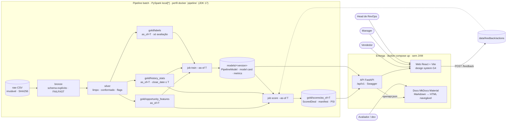
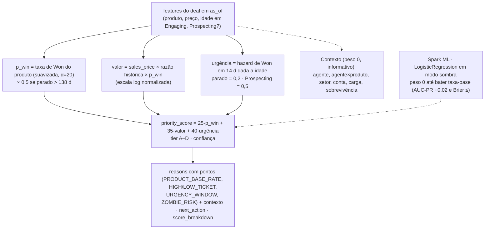
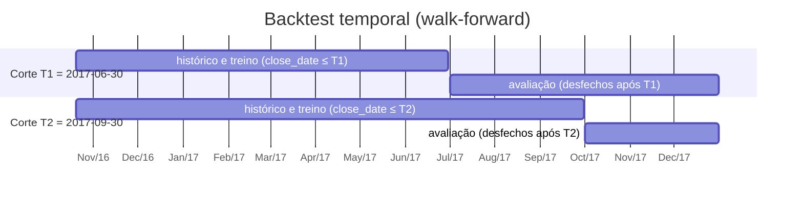
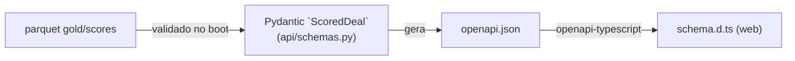
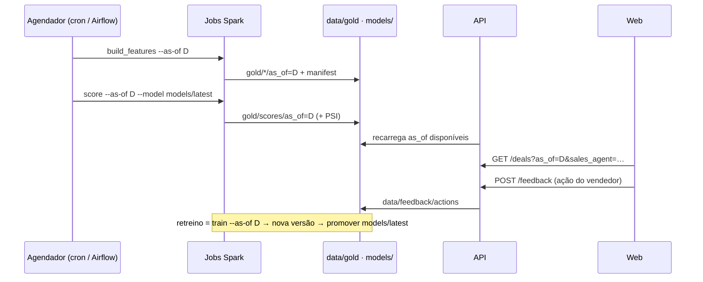

# Arquitetura da solução

## Decisão de arquitetura (e sua justificativa honesta)

O dataset do challenge tem 8.800 oportunidades e caberia em pandas. Spark **não** foi escolhido por volume. Foi escolhido porque o pedido real da Head de RevOps é uma ferramenta que **sempre execute a classificação**: um pipeline reexecutável por data (`--as-of`), com modelo versionado e monitorado, que o time de dados possa agendar e que escale ao CRM inteiro sem reescrita. A experiência do vendedor, por outro lado, precisa abrir em segundos e rodar em qualquer máquina: por isso a API e o web **não** usam Spark em runtime e `docker compose up` sobe tudo com artefatos já gerados.

Trade-offs assumidos: JVM (JDK 17/21) como pré-requisito **apenas** para reexecutar o pipeline; mais peças (API, web, docs) do que um app monolítico. Contrapartidas: contrato único (`ScoredDeal`) do parquet ao navegador, Swagger completo, documentação navegável e um caminho direto para produção.

## Visão geral

## Camadas de dados

| Camada | Conteúdo | Garantias |
|---|---|---|
| raw | 4 CSVs CC0 + `SHA256SUMS` | Imutável; verificado a cada job |
| bronze | Leitura com `StructType` explícito, `FAILFAST` | Nenhuma transformação; rastreabilidade por checksum |
| silver | Tabelas limpas e conformadas (`GTXPro→GTX Pro`, `technolgy→technology`, datas tipadas, flags `account_known`, `product_matched`) | Checks de qualidade falham o job; nenhuma linha perdida em join |
| gold | `opportunity_features`, `history_stats`, `labels`, `scores`, particionados por `as_of` | Point-in-time: só informação conhecida em `as_of`; labels fisicamente separados das features |

## Scoring em duas camadas

Por que assim: o backtest temporal mostrou que agente, setor, conta, carga e idade **não** preveem fechamento melhor que o acaso (AUC-ROC 0,44–0,53). Esses sinais ficam visíveis como contexto, mas não movem o score. O que a ferramenta entrega é ordenação por valor esperado × janela de decisão e a separação do pipeline parado.

Cada regra é uma função pura testada que emite um reason code. As contribuições do modelo entram na explicação apenas quando exatas (coeficiente × valor padronizado). `confidence` cai quando `account_known = false` ou o histórico do grupo é pequeno.

## Validação

Métricas: AUC-PR, Brier e calibração, lift do top decil, precision@k por vendedor, receita capturada no top 20%, com intervalos de confiança por bootstrap. Baselines: aleatório, preço, preço excluindo parados, mais novo, mais antigo, taxa-base por produto. `randomSplit`/`CrossValidator` são bloqueados por hook. Resultado: nenhum método prevê fechamento melhor que o acaso; a documentação diz isso e a tela Qualidade mostra o empate como frase padrão.

## Contrato único: `ScoredDeal`

Campos (schema 1.1.0+): `opportunity_id, sales_agent, manager, regional_office, product, sales_price, account, deal_stage, days_in_engaging, priority_score, tier, p_win, expected_value, urgency, confidence, reasons[], next_action, score_breakdown, as_of, model_version`.

## Operação

- Jobs idempotentes; `manifest.json` por execução (parâmetros, git sha, checksums, contagens, duração, PSI).
- `models/<version>/` com `PipelineModel`, `model_card.md`, `metrics.json`, `feature_list.json`; `models/latest` é um ponteiro.
- Ambiente: uv + Python 3.12 + PySpark 3.5 + JDK 17/21 no host, ou perfil `pipeline` do Compose.

## Segurança e uso responsável

Dados públicos sem PII real, mas a ferramenta expõe desempenho individual: visão de manager contextualizada, sem ranking punitivo. Dependências auditadas (`pip-audit`, `npm audit`), segredos varridos, API com validação estrita e CORS restrito, imagens slim não-root. Detalhes em `security-review.md`.

## Decisões registradas (ADRs em `adr/`)

0001 Spark como pipeline batch · 0002 FastAPI + React · 0003 Docker Compose como forma de entrega · 0004 MkDocs Material · 0005 Sem LLM no scoring · 0006 Artefatos commitados para rodar sem JDK · 0007 Contrato `ScoredDeal` em pacote compartilhado.

## O que fica explicitamente fora

Sem dados de atividade (e-mails, reuniões); Prospecting sem datas; ~68% dos deals abertos sem conta; variância modesta entre agentes/produtos limita o poder preditivo; autenticação e multi-tenant fora do MVP. Ver `limitations.md`.
