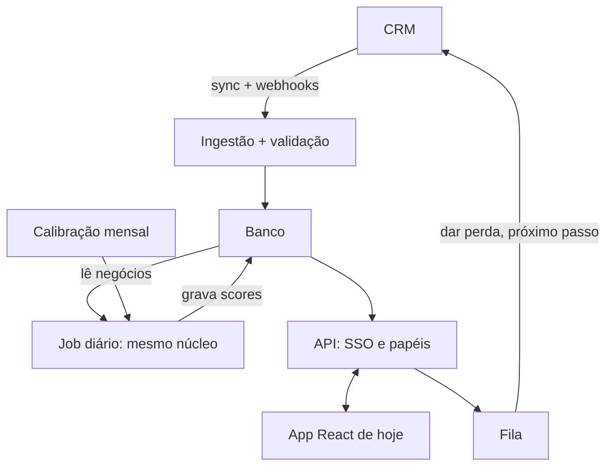

# Como escalar

Como este app viraria uma plataforma usada por muitas pessoas, e por quê.

**Medido e projetado:**
- A seção 2 descreve o que existe e foi medido.
- Da seção 3 em diante, é projeto: nada daquilo foi construído.
- Todo número leva uma marca. "(medido)" quer dizer que vem de um comando ou teste. "(estimativa: conta)" quer dizer que foi calculado a partir do medido, e a conta vem ao lado.

## 1. Resumo

1. O cálculo não é o gargalo: com 880 mil negócios, a semana de um vendedor sai em 143 ms no navegador (medido).
2. O primeiro limite real é a privacidade: hoje o navegador recebe a base inteira, e numa empresa cada pessoa só pode ver o que lhe cabe.
3. O score muda com o passar dos dias e é uma posição dentro da empresa inteira. Por isso o desenho é um job diário que calcula tudo em lote e uma API que serve leituras pequenas e prontas.
4. O mesmo núcleo (`src/core`) roda no job, sem reescrever a regra. Banco, API, SSO e fila entram em volta dele.
5. São três fases, cada uma com um gatilho: foto diária, serviço e plataforma. O backtest é o portão de qualquer mudança de regra em todas elas.

## 2. O que está medido

### Desempenho (`npm run bench`)

O bench copia os negócios da base k vezes, com ID novo, mantendo os 35 vendedores e os 7 produtos. Ele roda o núcleo na data padrão e grava `solution/analysis/saidas/bench.md`.
- **Ambiente:** Apple M3 Pro, 11 núcleos; Node v22.23.2; Chromium 156.0.8078.4.
- **Método:** mediana de 5 rodadas, depois de 1 de aquecimento.
- **Tela:** o que o app calcula ao abrir a semana de um vendedor: curva, score de todos, a lista dele e a equipe do gestor.
- **Job:** curva, score de todos e as listas dos 35 vendedores.
- **Foto:** os negócios em JSON.

Tudo nesta tabela é medido. Os tempos estão em milissegundos.

| k | Negócios | Em andamento | Tela (Node) | Tela (Chromium) | Job (Node) | Job (Chromium) | Foto JSON | Foto gzip |
|---|---|---|---|---|---|---|---|---|
| 1 | 8.800 | 1.589 | 2 | 2 | 9 | 6 | 1,3 MB | 0,2 MB |
| 10 | 88.000 | 15.890 | 18 | 13 | 62 | 54 | 13,2 MB | 1,6 MB |
| 100 | 880.000 | 158.900 | 216 | 143 | 690 | 616 | 133,3 MB | 16,6 MB |

**Leitura:**
- O tempo cresce quase em linha reta: de ×10 para ×100, o job no Node foi de 62 para 690 ms, ou 11× (medido).
- Os tempos não incluem baixar nem interpretar o JSON. Isso não foi medido.
- Em outra máquina os tempos mudam; a proporção entre as escalas é o que importa.

### Troca de fonte de dados

O núcleo recebe um `Dataset` (`src/core/data.ts`), não arquivos. Há dois adaptadores:
- `parseDataset`, que lê os CSVs e é o que o app usa;
- `fromCrmJson`, que lê um JSON no formato de uma API de CRM, com outros nomes de campo e datas ISO.

`adapters.test.ts` prova que os dois dão o mesmo `Dataset`, as mesmas listas dos 35 vendedores e o mesmo backtest (medido). É esse contrato que a ingestão da seção 4 reaproveita.

**Pureza:**
- Nenhum arquivo de `src/core` faz chamada de rede, usa relógio do sistema ou guarda estado entre chamadas.
- A data de referência é parâmetro de todas as contas.
- O app embute os CSVs no bundle (`src/ui/dataset.ts`). Por isso, hoje, quem abre o site recebe a base inteira.

### Qualidade da ordem (backtest)

O backtest roda com `npm run auditoria`, que chama `runBacktest` em `src/core/backtest.ts`. Ele usa as datas com histórico suficiente (31/07, 31/08 e 30/09/2017) e mede a receita ganha em 90 dias pelos 10 primeiros de cada vendedor. Tudo abaixo é medido.

| Comparação | Resultado |
|---|---|
| Potencial | 40,86% |
| Só preço | 33,20%. O potencial ganha por +7,66 p.p., com margem de erro de 3,49 a 12,62 |
| Situação e preço | Empate: +0,12 p.p. (p = 0,90) |
| Modelo de ML (gradient boosting) | 43,18%. A diferença de +2,32 p.p. não é significativa (margem de −2,46 a +6,39; p = 0,33) |

Esse script é o que vira portão na seção 4.

## 3. Perfil da carga e o que ele decide

| Característica | Decisão que ela força |
|---|---|
| **O custo cresce com negócios, não com pessoas.** Cada pessoa lê só a própria lista: um vendedor tem dezenas de negócios em andamento, e uma resposta com 50 deles tem uns 8 KB (estimativa: 133,3 MB ÷ 880.000 = 151 B por negócio em JSON; × 50). | Muita leitura e pouca escrita. Calcular em lote e servir leituras prontas, com cache. Mais usuários pesam na API, não no cálculo. |
| **O score muda com o passar dos dias, sem nenhum evento no CRM.** `chanceCurve(deals, t)` recalcula a curva a cada data, porque a coorte anda com T. A chance de um negócio cai quando ele passa de faixa (30, 60, 90, 104 e 120 dias). Aos 90 ele vira esfriando e aos 138 vira frio, sem ninguém tocar nele. | Webhook do CRM não basta, porque a mudança mais comum não gera evento. É preciso um job diário que recalcule tudo na data. |
| **O score é uma posição dentro da empresa inteira.** `potentialScores` dá a cada negócio quente ou esfriando a % dos negócios quentes e esfriando da empresa toda, de todos os vendedores, com potencial menor (arredondada para baixo). | Não dá para calcular um negócio isolado nem um vendedor isolado. O cálculo é por empresa, em lote. Para mudanças durante o dia, o lote grava a distribuição dos potenciais. |
| **A distribuição tem poucos valores.** O potencial é preço de lista × chance da faixa. Por empresa e data, o número de potenciais distintos é no máximo produtos × 6 faixas (42 neste conjunto, com 7 produtos). | Os "cortes de percentil" gravados pelo lote cabem numa tabela de no máximo produtos × 6 linhas (potencial, quantos negócios abaixo). Recalcular um negócio é uma consulta nessa tabela. |
| **O CRM é a fonte da verdade.** O app só lê. "Dar perda" acontece no CRM. | O app nunca é dono do dado. As ações voltam ao CRM por fila, e o banco da plataforma guarda cópia e histórico, não o original. |
| **A curva precisa de histórico.** `hasEnoughHistory` só aceita a curva quando toda faixa tem margem de erro de até ±5 p.p. (D1, D27). | A calibração é por empresa, e uma empresa nova pode não ter curva própria no início. O que fazer nesse caso é decisão de RevOps: esperar ou usar uma curva de referência. |

## 4. Arquitetura alvo (projeto, não implementado)

### Ingestão

**Como entra:**
- Sync incremental pela API do CRM, filtrando pela data de atualização, porque a carga inicial é grande e as mudanças diárias são poucas.
- Webhooks de mudança de estágio, para que um ganho ou uma perda apareça no mesmo dia, sem esperar o próximo sync.

**Regras:**
- **Idempotente.** Cada registro é gravado por (empresa, ID no CRM, data de atualização), porque o mesmo evento pode chegar pelo webhook e pelo sync.
- **O adaptador CRM atual é a porta de entrada.** `fromCrmJson` já converte o formato de uma API de CRM no `Dataset`. Cada CRM real ganha um adaptador desses, testado como em `adapters.test.ts`.
- **Contrato validado por lote.** Hoje os dois adaptadores já recusam etapa desconhecida, e `priceOf` recusa produto sem preço (`data.ts`), mas um erro derruba tudo. Na plataforma, um lote que quebra o contrato é rejeitado e registrado, com o motivo, sem derrubar o dia. O job roda com o último lote válido, e a tela mostra a data dele.

### Cálculo

**Job diário:**
- Roda o mesmo núcleo, nesta ordem: `chanceCurve`, `scoreOpen`, `potentialScores` e `agentLists`. A frase sai de `chancePhrase` e o prazo de `deadline`.
- É idempotente por data da foto: rodar duas vezes a mesma data grava o mesmo resultado, porque toda conta recebe T como parâmetro.

**Tabela de scores proposta:**

| Coluna | Tipo | Por quê |
|---|---|---|
| `empresa_id` | id | isolamento por empresa |
| `negocio_id` | id do CRM | volta ao CRM |
| `dono_id` | id do vendedor | isolamento por papel |
| `data_foto` | data | point-in-time; histórico |
| `versao_curva` | texto | saber qual curva gerou o score |
| `potencial` | número | a ordem |
| `score` | 0 a 100, ou nulo nos frios | a posição |
| `estado` | quente, esfriando, frio, prospecção | as três listas |
| `motivo` | texto | a frase, com o mesmo número da conta |

- **Chave:** (empresa_id, data_foto, negocio_id).
- **Tabela de apoio:** `cortes_percentil`, com (empresa_id, data_foto, potencial, negócios abaixo), no máximo produtos × 6 linhas por empresa e data (42 neste conjunto).

**Paralelismo:**
- Empresas são independentes, então rodam em paralelo.
- Dentro de uma empresa, a curva e o percentil precisam da empresa toda. Um processo por empresa basta: o job leva 690 ms com 880 mil negócios (medido).
- Com 100 vezes mais negócios numa só empresa, seriam cerca de 69 s (estimativa: 690 ms × 100, extrapolação linear).
- O limite antes desse ponto seria a memória, não o tempo. A foto JSON dessa empresa teria uns 13 GB (estimativa: 133,3 MB × 100). Nesse caso, o job lê do banco só as colunas que a curva usa (datas, etapa, produto, dono). Também dá para paralelizar por time os passos que não dependem da empresa toda, como `scoreOpen` e as listas.

**Mudança durante o dia:**
- Um ganho, uma perda ou um negócio novo recalculam só o negócio afetado.
- O score dele sai da busca em `cortes_percentil`, a mesma busca binária de `potentialScores`.
- Os outros negócios não mudam de score até o lote seguinte, quando o ranking volta a ser exato.

### Calibração

**Ritmo e portão:**
- Mensal e por empresa, com a entrada tardia (D27) quando a base começar cortada.
- Cada curva ganha versão.
- `runBacktest` vira portão no pipeline: a curva nova só é publicada se ganhar da atual nas mesmas datas. Se perder, a atual fica e um alerta dispara para RevOps.

**Monitor de calibração:**
- Compara, por faixa de idade, a chance prevista com a fração que virou venda.
- Hoje ele já pegaria a superestimação conhecida (medido, `npm run auditoria`):

| Data | Chance média prevista | Virou venda até 31/12/2017 |
|---|---|---|
| 31/07/2017 | 52% | 37% |
| 31/08/2017 | 48% | 34% |
| 30/09/2017 | 47% | 30% |

- Parte da distância vem de negócios que ainda podiam concluir depois de 31/12: 9,7% em 30/09 (medido).
- O alerta olha a tendência, não um ponto só.

### Banco

**Postgres:**
- os dados são relacionais (negócio, empresa, produto, vendedor, equipe);
- tem isolamento por linha (RLS) nativo;
- o volume cabe com folga.

**Volume do histórico de scores:**
- Com 158.900 negócios em andamento (medido, ×100) e uns 100 bytes por linha, são uns 16 MB por dia, ou uns 6 GB por ano (estimativa: 158.900 × 100 B × 365).

**Estrutura:**
- **Índices:** (empresa_id, dono_id, data_foto) para a semana do vendedor; (empresa_id, data_foto) para o job e o gestor.
- **RLS:** por empresa sempre. Dentro da empresa, por papel: o vendedor vê os negócios em que é dono, o gestor vê a equipe, e RevOps vê a empresa toda.
- **Histórico de scores guardado:**
  - para auditoria ("por que este negócio estava em 1º na segunda?");
  - para um backtest com as listas que foram de fato mostradas, e não só reconstruídas.
- **Data warehouse:** só na fase 3, quando houver várias empresas e análises entre elas.

### API

**Endpoints:**
- `GET /semana?pessoa=&data=`: as três listas do vendedor, com score, estado, motivo e prazo;
- `GET /equipe?gestor=&data=`: a visão do gestor;
- `POST /acoes`: "dar perda" e "próximo passo", que entram na fila.

**Acesso:**
- SSO (OIDC ou SAML) com o provedor de identidade da empresa.
- Papéis: vendedor, gestor e RevOps.
- O papel e a empresa vêm do token, nunca do parâmetro.

**Cache:**
- As respostas são pequenas (seção 3) e mudam uma vez por dia.
- O cache é por usuário, data da foto e versão da curva, com ETag. A segunda abertura do dia não toca no banco.

### Front

- **O mesmo app.** A fonte troca de arquivo para API atrás do mesmo contrato. Hoje `src/ui/dataset.ts` chama `parseDataset`; na plataforma, a tela recebe as listas já calculadas.
- **A data da foto fica visível**, como a data de referência já fica hoje no controle segmentado.

### Ações

- O caminho é fila, chave de idempotência e nova tentativa com espera crescente (backoff), porque a API do CRM tem limite de chamadas e cai.
- O que falha depois das tentativas vai para uma fila de falhas, com alerta.
- Todo pedido fica num log de auditoria (quem, o quê, quando, resposta do CRM).
- **O CRM continua sendo a fonte da verdade.** O app mostra "enviado" até o CRM confirmar, e o próximo sync traz o estado real.

## 5. Segurança e privacidade

**Acesso:**
- Isolamento por empresa no banco (RLS), e não só no código da API.
- Menor privilégio: o job escreve só nos scores, a API lê e enfileira, e só a ingestão fala com o CRM.

**Proteção:**
- Criptografia em trânsito (TLS) e em repouso.
- Segredos do CRM num cofre.
- Log de acesso por usuário.

**LGPD (a validar com o jurídico):**
- **Minimização.** O cálculo usa datas, etapa, produto e preço. O nome do vendedor serve para dar a lista à pessoa certa, e o nome da empresa cliente só aparece na tela. Contatos do cliente não entram.
- **Dado de desempenho de vendedor.** A visão do gestor mostra quanto da carteira de cada vendedor esfria. Isso já aparece como situação do funil, não como ranking (D29), e o acesso fica restrito ao gestor e a RevOps.
- **Retenção.** Quanto tempo guardar o histórico de scores é uma decisão a tomar com o jurídico e RevOps.
- **Base legal.** A tratar com o jurídico. Este documento não afirma qual é.

## 6. Operação

**SLOs (proposta):**
- lista pronta antes do expediente, por exemplo às 6h no fuso da empresa, em 99% dos dias úteis;
- p95 da API abaixo de 300 ms nas leituras;
- disponibilidade de 99,5% no horário comercial.

**Métricas:**
- duração do job, por empresa;
- atraso do sync (agora menos a última atualização recebida);
- lotes rejeitados, com o motivo;
- desvio da calibração por faixa;
- fila de ações: tamanho, idade da mais antiga e falhas.

**Se o job falhar:** a API serve a lista anterior, com a data dela na tela. O vendedor trabalha com a lista de ontem sabendo que é de ontem.

**Runbook:**
1. **Job falhou:** ver o log. Corrigida a causa, rodar de novo a mesma data, o que é seguro porque o job é idempotente.
2. **Lote rejeitado:** ver o motivo registrado e corrigir o adaptador ou o mapeamento do CRM. Depois, reprocessar o lote e rodar o job da data.
3. **Sync atrasado:** conferir o limite da API do CRM. A tela já mostra a data da foto, então ninguém vê dado velho achando que é novo.
4. **Alerta de calibração:** a curva atual fica. RevOps olha o desvio por faixa e decide se investiga a base ou espera o próximo mês.
5. **Fila de falhas crescendo:** ver a resposta do CRM. Depois de corrigir, reenviar, o que é seguro pela chave de idempotência.

## 7. Custo

O custo é dominado pelo sync com o CRM e pelo armazenamento do histórico, não por CPU: o job de uma empresa com 880 mil negócios leva menos de 1 s (medido).

**Sem GPU e sem LLM no cálculo do score:**
- **Explicação.** A frase "De cada 100 negócios que chegaram aos N dias…" tem o mesmo número da conta. Um modelo gerativo poderia dizer algo diferente da conta.
- **Custo.** Chamar um modelo por negócio por dia custaria mais que todo o resto e não melhoraria a ordem.
- **Backtest reproduzível.** A mesma entrada dá a mesma lista, então dá para comparar uma curva com outra e auditar uma segunda-feira passada.

## 8. Medir impacto

O backtest mede se a lista ordena bem, não se usá-la faz vender mais.

**Na fase 3, a mudança de comportamento se mede com:**
- **liberação escalonada por time:** os times entram em semanas diferentes, e quem ainda não entrou serve de comparação;
- **ou um grupo de controle** que segue sem a lista por um período.
- **A unidade é o time, não o vendedor**, porque colegas do mesmo time conversam e contaminariam a comparação.

**Métricas:**
- **Principal:** receita ganha em 90 dias pelos negócios em andamento, por vendedor. É a mesma do backtest, agora medida no mundo real.
- **De apoio:**
  - fração da carteira que fica fria;
  - tempo até dar perda num negócio frio;
  - ciclo de vendas.

Com poucos times, a margem de erro será larga, e o relatório precisa dizer isso.

## 9. Fases e gatilhos

| Fase | Gatilho de entrada | O que entra | Limite que leva à próxima |
|---|---|---|---|
| **1. Foto diária** | Um time piloto, até cerca de 250 mil negócios, com a foto de até ~5 MB com gzip (estimativa abaixo) | Exportação diária do CRM para JSON; o mesmo app lendo a foto por `fromCrmJson`; acesso restrito por login na frente do site | Todo usuário logado recebe a base inteira. Isso acaba quando cada pessoa só pode ver a própria carteira, ou quando a foto passa do tamanho que se aceita no celular |
| **2. Serviço** | Mais de um time, ou exigência de que cada pessoa veja só a própria carteira | Postgres com RLS, job diário, API com SSO e papéis, ações de volta ao CRM pela fila, histórico de scores | Várias empresas ou unidades, ou sinais de que a curva envelheceu (monitor de calibração) |
| **3. Plataforma** | Várias empresas ou unidades, ou mudança no comportamento das vendas | Isolamento por empresa, calibração mensal com portão, monitor de calibração, medição de impacto com grupo de controle, data warehouse | — |

**O que não muda em nenhuma fase:**
- a regra (preço de lista × chance pela idade);
- a frase de motivo com o mesmo número da conta;
- a data de referência como parâmetro;
- o backtest como portão.

Nenhuma mudança de regra entra sem ganhar da atual no teste com o passado.

**Conta do limite da fase 1:**
- Bytes por negócio com gzip:
  - ×10: 1,6 MB ÷ 88.000 = 18,2 B;
  - ×100: 16,6 MB ÷ 880.000 = 18,9 B.
- Usei o maior, 18,9 B, por ser o mais conservador.
- 5 MB ÷ 18,9 B = 265 mil negócios. Arredondado para baixo em múltiplos de 50 mil, dá 250 mil (estimativa).

Nesse tamanho:
- a tela levaria uns 41 ms no Chromium (estimativa: 143 ms × 250/880);
- o navegador teria de interpretar uns 38 MB de JSON (estimativa: 250.000 × 151 B).

O tempo de baixar e interpretar esse JSON num celular não foi medido. Meça antes do piloto.

## 10. O que eu não faria agora

- **Microsserviços.** São três peças (ingestão, job e API) com um núcleo só. Dividir mais traria rede e versões entre serviços sem ganho.
- **ML no lugar da regra sem ganhar no portão.** O gradient boosting ficou em +2,32 p.p., dentro do acaso (p = 0,33), e o vendedor perderia a frase com o número da conta.
- **Percentil calculado a cada pedido.** Ele depende da empresa toda e muda só uma vez por dia. Calcular a cada pedido repetiria o mesmo trabalho para cada pessoa.
- **LLM no score:** pelos motivos da seção 7.
- **Tempo real antes de existir a necessidade.** A regra trabalha em dias. Um score que muda a cada minuto não muda o que o vendedor faz na segunda de manhã.

## 11. O que melhoraria o score com mais dados

- **Atividades:** último contato e próxima ação marcada. Hoje a idade é o sinal mais forte que os dados têm. Com atividade, dá para testar se um negócio frio está mesmo parado, ou se um quente está esquecido.
- **Motivo de perda:** separar "perdeu para concorrente" de "sumiu" mostraria se a queda da chance com a idade é abandono ou perda real.
- **Data de início da prospecção e empresa em todo negócio** (recomendação 5 do README). Sem a data, a prospecção não entra na conta da chance. Sem a empresa, setor e porte não podem ser testados nos negócios em andamento.

Cada sinal novo passa pelo mesmo portão: só entra se ganhar da regra atual no backtest.

## 12. Riscos e controles

| Risco | Como aparece | Controle | Seção |
|---|---|---|---|
| Curva descalibrada | A chance prevista se afasta do que vira venda. Já observado: 52% previstos e 37% realizados em 31/07/2017 | Monitor de calibração por faixa, com alerta pela tendência; o app usa a chance para ordenar, não para prever receita | 4 (Calibração) |
| Regra nova pior que a atual | Uma curva ou um sinal novo ordena pior que a regra em produção | `runBacktest` como portão: se perder, a atual fica e um alerta dispara | 4 (Calibração), 11 |
| Vazamento entre empresas ou pessoas | Alguém vê negócios de outra empresa, ou de fora da própria carteira | RLS por empresa e por papel no banco; papel e empresa vindos do token, nunca do parâmetro; menor privilégio | 4 (Banco, API), 5 |
| Dados atrasados | O sync com o CRM atrasa e a lista fica velha | Métrica de atraso do sync; a tela mostra a data da foto; webhooks de mudança de estágio | 4 (Ingestão), 6 |
| Lote que quebra o contrato | O CRM manda etapa desconhecida ou produto sem preço | O lote é rejeitado e registrado, sem derrubar o dia; o job usa o último lote válido | 4 (Ingestão), 6 |
| Ação que não chega ao CRM | "Dar perda" falha por limite ou queda da API do CRM | Fila com chave de idempotência, nova tentativa com backoff, fila de falhas e log de auditoria | 4 (Ações), 6 |
| Vendedor que não confia no score | O vendedor ignora a lista | Frase de motivo com o mesmo número da conta; regra explicável, sem LLM nem ML que não ganhe no portão | 7, 10 |
| Lista sem efeito no resultado | A lista ordena bem no passado, mas usá-la não faz vender mais | Liberação escalonada por time ou grupo de controle, medindo a receita ganha em 90 dias | 8 |
