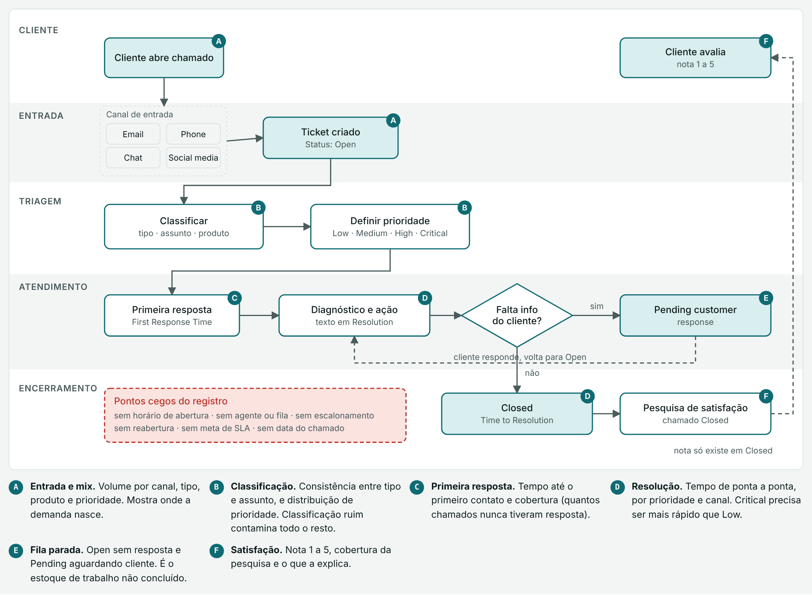

# Submissão — Darcio Alves — Challenge 002

## Sobre mim

- **Nome:** Darcio Alves
- **LinkedIn:** [linkedin.com/in/darcioalves](https://www.linkedin.com/in/darcioalves/)
- **Challenge escolhido:** 002 — Redesign de Suporte (Operações / CX)

---

## Executive Summary

Li os dois datasets como uma operação real, montei um painel para cada um e construí dois protótipos funcionais: um classificador interativo que aplica a política de roteamento proposta e deixa uma pessoa corrigir a fila, porque o próprio Dataset 2 tem tickets classificados na fila errada, e um roteador que categoriza e prioriza cada ticket novo (P1 a P4, com prazo) numa caixa de entrada ordenada. No Dataset 1 (8.469 chamados), o fluxo trava antes do atendimento. 67,3% dos chamados estão fora de Closed, e 2.819 nunca receberam uma 1ª resposta. A prioridade é só um rótulo: o tempo não muda entre as faixas (p = 0,09). Testei os piores tempos por canal, prioridade e tipo sob duas premissas para os horários, e nenhuma combinação se sustenta: o pior caso muda conforme a premissa e fica na faixa do acaso. Nenhuma variável registrada explica a satisfação: todas juntas explicam 0% da nota. O maior problema é de processo e de registro, não de velocidade.

No Dataset 2 (47.837 e-mails de service desk), um classificador simples acerta a fila em 86,3% dos casos (top-2: 96,4%). Roteando automaticamente só os tickets com confiança ≥ 90%, metade do volume dispensa triagem manual, com erro de 0,72%. Juntando os dois datasets numa estimativa com premissas explícitas, o ganho líquido do fluxo proposto fica em torno de **3.300 h/ano (≈ R$ 197 mil)** num volume de 30 mil chamados/ano, numa faixa de 1.200 a 5.700 h, já descontado o custo da auditoria semanal. A maior fatia está na resposta sugerida por IA para os problemas técnicos e financeiros (cerca de 1.600 h). Os chamados que a automação resolve sozinha são os de acesso, configuração, instalação, recomendação e entrega, além dos alertas e pedidos padronizados do service desk.

A recomendação principal é instrumentar os tempos, dar dono à fila e regra à prioridade, e então automatizar a triagem com um limiar de confiança. O humano fica nos casos ambíguos, urgentes e nas filas sem critério.

Para implementar, parto da **premissa de apresentação de que a empresa já tem um sistema de gestão de chamados, com os canais (social media, chat, e-mail e telefone) já integrados**. O projeto implementa as Recomendações e o Mapa de automação sobre esse sistema, em fases com critério de passagem: fundação (medição e regras), triagem automática, fluxo sem retrabalho e respostas com IA. São cerca de 8 meses e R$ 266 mil de implantação no cenário base, com retorno em ~33 meses. O primeiro compromisso é só a fundação e a triagem automática (R$ 108 mil, 3,5 meses). Como 70% do ganho está na fase de respostas com IA, o volume real é a primeira coisa a confirmar.

---

## Solução

### Abordagem

1. **Auditar antes de analisar.** Verifiquei a contagem real de registros, o padrão de nulos e as distribuições. O "~30 mil" do enunciado são as linhas físicas do CSV do Dataset 1: 72,6% das descrições têm quebra de linha dentro do campo. Os registros reais são 8.469.
2. **Reconstruir o processo que o dado representa**, para saber o que cada dataset mede e o que fica fora dele. O Dataset 1 vira um fluxo em 5 raias com pontos de medição de A a F (diagrama em Resultados, seção 1). O Dataset 2 é mais simples: usuário interno → e-mail → caixa do service desk → atribuição de fila.
3. **Testar toda comparação.** Usei Kruskal-Wallis para tempo e CSAT, qui-quadrado para backlog e z-score com correção de Bonferroni para o mapa canal × prioridade. Diferença sem significância não vira ação.
4. **Cruzar os datasets.** O Dataset 1 mostra a taxonomia quebrada e a prioridade sem efeito. O Dataset 2 mostra que dá para rotear pelo texto e extrair a urgência dele.
5. **Desenhar a automação por política de confiança**, não "automatizar tudo". Medi o acerto por faixa de confiança e por fila para decidir onde a IA decide sozinha, onde só sugere e onde não entra.
6. **Construir os painéis, o classificador e o roteador** com os dados completos (8.469 e 47.837 registros), não com exemplos escolhidos a dedo. O classificador e o roteador foram testados em tickets que o modelo não viu no treino.

### Resultados / Findings

#### 1. Onde o fluxo trava (Dataset 1)

Reconstruí o processo a partir dos campos registrados nos 8.469 chamados (8.320 clientes distintos). As letras A a F marcam os pontos de medição, explicados na legenda. Em vermelho estão as etapas que um suporte normalmente tem, mas que o registro não captura.

_Fonte: aba Processo do [Painel de Suporte](https://claude.ai/artifact/XFA3f1Mc3XC2LfM8HCDRSh)._

**Estados do chamado.** Open (sem resposta ou em fila) → Pending (aguardando o cliente) → Closed. Só os chamados Closed têm todos os campos preenchidos. Por isso, tempo e satisfação descrevem apenas o que terminou, e o que está aberto ou pendente precisa ser lido à parte, como backlog.

| Ponto | O que encontrei |
|---|---|
| **A** Entrada e mix | Volume quase igual entre canais e entre prioridades (cerca de 25% cada) |
| **B** Classificação | Os 16 assuntos aparecem nos 5 tipos, então não dá para rotear pelo tipo. A prioridade não segue critério |
| **C** Primeira resposta | **2.819 chamados Open (33,3%) sem nenhuma resposta.** Sem horário de abertura, o tempo não pode ser medido |
| **D** Resolução | Mediana de 6,3 h e P90 de 16,0 h¹. Em 49,3% dos casos, a resolução foi registrada antes da 1ª resposta |
| **E** Fila parada | **Backlog de 67,3%** (2.819 Open + 2.881 Pending), sendo **2.783 High ou Critical** |
| **F** Satisfação | CSAT de 2,99. Nenhuma variável registrada explica a nota (seção 2) |

¹ Considera só os chamados com resolução depois da 1ª resposta (n = 1.404 de 2.769). 96,2% dos horários caem no mesmo dia.

O que os testes mostram sobre os pontos B e D:

- **A prioridade não ordena o atendimento.** As medianas são Critical 6,0 h, High 7,1 h, Medium 5,9 h e Low 7,1 h (Kruskal-Wallis p = 0,09).
- **Nenhuma combinação canal × prioridade é gargalo.** Nenhuma das 16 células do mapa difere da média geral (|z| ≥ 2,96 com correção de Bonferroni). O canal também não altera o tempo (p = 0,79).
**Quais combinações geram os piores tempos?** O registro não tem horário de abertura, e 49,3% das resoluções aparecem antes da 1ª resposta. Para responder mesmo assim, testei duas premissas para o tempo entre a 1ª resposta e a resolução:

- **P1 — só durações positivas:** descarta os casos negativos (n = 1.404; mediana 6,3 h).
- **P2 — resolução no dia seguinte:** soma 24 h aos casos negativos, como se a resolução tivesse ocorrido no dia seguinte (n = 2.769; mediana 11,6 h; P90 21,7 h).

Para cada nível de cruzamento, comparei a pior combinação com o pior valor que o acaso produziria em grupos do mesmo tamanho (simulação embaralhando os tempos, faixa de 5% a 95%):

| Cruzamento | Pior em P1 | Pior em P2 | Acaso (P1 / P2) |
|---|---|---|---|
| Canal | Chat 6,5 h | Phone 12,3 h | até 7,3 / 12,6 h |
| Prioridade | High 7,1 h | High 12,1 h | até 7,4 / 12,6 h |
| Tipo | Product inquiry 7,0 h | Product inquiry 12,2 h | até 7,5 / 12,9 h |
| Canal × prioridade | Chat · High 8,4 h | Social media · Medium 13,7 h | até 8,9 / 14,3 h |
| Prioridade × tipo | High · Refund 8,8 h | High · Refund 13,4 h | até 9,0 / 14,9 h |
| Canal × prioridade × tipo | Chat · Low · Technical 13,2 h (n = 15) | Social media · Medium · Technical 16,2 h | até 13,1 / 18,3 h |

- **Leitura:** a pior combinação muda conforme a premissa, e quase todas ficam dentro da faixa do acaso. A exceção é Chat · Low · Technical em P1 (13,2 h, contra 13,1 h do acaso), mas com só 15 casos e sem se repetir em P2. Nenhum teste global é significativo (Kruskal-Wallis p ≥ 0,09).
- **Únicos sinais estáveis:** Prioridade High e o tipo Product inquiry são os piores nas duas premissas, e High · Refund request lidera o cruzamento prioridade × tipo nas duas. Não são gargalos comprovados, mas são os primeiros a acompanhar quando os tempos forem registrados de verdade.
- **A fila também não tem gargalo localizado.** 33,3% dos chamados estão Open sem resposta. Nenhuma combinação de canal, prioridade, tipo ou assunto foge da faixa do acaso: o pior caso, Phone · Low, tem 38,9%, contra até 39,0% esperados (qui-quadrado p ≥ 0,15). Dos 2.819 sem resposta, 1.396 (49,5%) são High ou Critical, a mesma proporção do total. A prioridade não protege o chamado da fila.
- **Conclusão:** o fluxo trava antes do atendimento, nos pontos C e E, e de forma uniforme. A causa está na falta de dono da fila e de critério de prioridade, não num canal ou tipo específico.

#### 2. O que impacta satisfação (Dataset 1, ponto F)

- CSAT médio de 2,99, com 39,8% de notas 1 e 2. A distribuição é plana, com cerca de 20% em cada nota.
- **Nenhuma dimensão registrada explica a nota:**

| Dimensão | p (Kruskal-Wallis) |
|---|---|
| Canal | 0,28 |
| Tipo | 0,70 |
| Prioridade | 0,63 |
| Produto | 0,67 |
| Faixa etária | 0,80 |
| Gênero | 0,63 |

- **Todas as variáveis juntas também não explicam.** Treinei dois modelos com canal, prioridade, tipo, assunto, produto, idade, gênero, tempo (P2) e hora da 1ª resposta: uma regressão linear e uma floresta aleatória, em validação cruzada 5-fold. Os dois explicam 0% da variação da nota (R² de −0,03). Para prever quem dá nota 1 ou 2, a AUC é 0,50, igual a sortear.

Respondendo às perguntas do Diretor:

| Pergunta | Resposta | Evidência |
|---|---|---|
| É o tempo de resposta? | **Não** | Correlação de Spearman com o tempo: 0,00 em P1 e −0,02 em P2 (p ≥ 0,33). Nos quartis de tempo, do mais rápido ao mais lento, a nota fica entre 2,94 e 3,13, sem tendência |
| É o canal? | **Não** | Maior diferença: Chat 3,08 contra Phone 2,95. O canal explica 0,14% da variação, e com 95% de confiança a diferença real é no máximo 0,28 ponto |
| É o tipo de problema? | **Não** | Tipo: no máximo 0,27 ponto (p = 0,70). Assunto: a maior diferença (0,38, Installation support contra Delivery problem) é o melhor contra o pior entre 16 assuntos, e o teste global não é significativo (p = 0,81) |

- **Único sinal, irrelevante na prática:** chamados com a 1ª resposta mais tarde no dia têm nota um pouco menor (Spearman −0,04, p = 0,03). Em cerca de dez testes, um resultado assim é esperado por acaso, e o efeito é pequeno demais para orientar uma ação.
- **Dá para seguir com uma premissa?** Não para atribuir causa. A ausência de efeito é um resultado forte: com cerca de 690 notas por canal, o teste enxergaria diferenças a partir de uns 0,2 ponto. O caminho honesto é tratar os fatores mais citados em CX (resolver no primeiro contato, tempo até a 1ª resposta, número de contatos, agente) como **hipóteses a testar**. Elas só podem ser testadas com os campos que hoje faltam (reabertura, agente, horário de abertura), e a meta inicial é derrubar os 39,8% de notas 1 e 2.
- **Leitura:** a satisfação depende do que não se registra hoje. Por isso não recomendo nenhuma ação por canal ou produto com base no CSAT.
- **Cobertura da pesquisa de 100% dos fechados.** Isso é incomum e merece auditoria da coleta.

#### 3. Onde a IA ajuda: roteamento (Dataset 2)

- **O rótulo indica a fila que resolve, não o assunto do texto.** Só 22% dos tickets com a palavra "access" estão na fila Access. O classificador aprende roteamento, que é o que a operação precisa.
- **Modelo:** TF-IDF de 1 e 2 palavras com regressão logística, em validação cruzada 5-fold sobre os 47.837 tickets. Acerto de **86,3%**, top-2 de **96,4%**.
- **Curva de confiança:**

| Confiança | % dos tickets | Acerto | Política |
|---|---|---|---|
| ≥ 90% | 51,3% | 98,6% | Roteia automaticamente |
| 70–90% | 26,7% | 86,2% | Sugere 1 fila |
| 50–70% | 16,3% | 62,1% | Sugere 2 filas |
| < 50% | 5,7% | 44,5% | Triagem humana |

- **Erro da política:** 344 tickets (0,72% do total). Rotear tudo automaticamente erraria 6.576 (13,7%).
- **Filas frágeis (recall):** Administrative rights 68,6% (23,1% dos casos previstos como Hardware), Internal Project 81,0% e Miscellaneous 83,8%. As demais ficam entre 85,6% e 88,9%.
- **O próprio Dataset 2 tem erros de classificação.** Parte do que aparece como "erro do modelo" é a fila atribuída pela operação que está errada:
  - nos 344 tickets em que o modelo discorda do rótulo com 90% ou mais de confiança, a leitura de uma amostra mostra vários rótulos claramente trocados;
  - *"extension cables… please provide couple extensions"* está em HR Support, e o modelo diz Hardware;
  - *"time sheet… training intern"* está em Hardware, e o modelo diz HR Support;
  - *"invalid oracle code… got error"* está em HR Support, e o modelo diz Internal Project, a fila dos códigos de projeto;
  - *"oracle cannot approve time entries"* está em Miscellaneous, e não em HR Support;
  - 76 tickets repetem o mesmo conjunto de palavras, e 5 deles estão em filas diferentes;
  - cerca de 20% dos pedidos de senha e de pasta/drive estão em Hardware.

  Consequência: o acerto de 86% é medido contra um gabarito com erros. A análise do Dataset 2 estimou um teto prático perto de 90%. A política automática pode errar menos que os 0,72% medidos, e o rótulo não deve ser usado para treinar sem antes ser auditado. Por isso o protótipo tem uma revisão humana que registra a fila correta.

  **Análise prévia de reclassificação.** Antes de decidir se valia corrigir a base e retreinar, propus e fiz uma análise prévia para medir o ganho:
  - **Método:** dois modelos independentes classificaram cada ticket sem tê-lo visto no treino. Só contam como sugestão de mudança os casos em que os dois concordam numa fila diferente da original.
  - **Volume:** 1.726 tickets suspeitos (3,6% da base), dos quais 495 com confiança alta ou média (1,0%).
  - **Conferência:** li uma amostra de 115 sugestões. Nos casos que dá para decidir, a sugestão está certa em cerca de 4 de cada 5 nos níveis alto e médio; cerca de um terço dos casos é ambíguo.
  - **Viés:** a maior parte das trocas vai para Hardware (+482 no saldo), justamente a fila que o modelo já prevê em excesso.

  **Decisão: manter a base original nesta entrega.**
  - O ganho máximo de acerto seria de cerca de 1 ponto percentual.
  - Esse ganho ficaria inflado: o modelo seria retreinado com as próprias sugestões e "acertaria" o que ele mesmo propôs.
  - Aplicar tudo sem revisão humana trocaria erros antigos por erros novos e reforçaria o viés para Hardware.

  A correção fica para a recomendação 12, com revisão humana antes de retreinar. O arquivo com as sugestões (`all_tickets_processed_improved_v3_ajuste_reclassificacao.csv`) é o ponto de partida dessa revisão.

#### 4. Falhas de processo visíveis no texto (Dataset 2)

- **Miscellaneous é uma fila sem dono:** 7.060 tickets que misturam relatórios Oracle, aprovação de despesas e pesquisas do ServiceNow.
- **Alertas automáticos sem destino fixo:** 220 tickets divididos entre Hardware (46%) e Miscellaneous (43%).
- **Pedidos de outras filas vão para Hardware.** No rótulo humano, Hardware recebe 19,9% dos resets de senha, 19,8% dos pedidos de pasta/drive e 22,6% dos pedidos de acesso.
- **Mensagens padronizadas com fila previsível.** 28 aberturas que se repetem cobrem 1.779 tickets (3,7%): 1.541 são modelos de pedido (compras, novo colaborador, desligamento, código de projeto, acesso) e 238 são alertas de sistema (caixa de e-mail cheia, avisos de ponto do Oracle). Em 25 das 28 aberturas, 90% ou mais vai para uma única fila (1.611 tickets), então dá para rotear por regra, sem modelo. As exceções são dois pedidos de acesso e o alerta crítico.
- **Treze intenções cobrem 40,4% da demanda.**
- **A prioridade só aparece no texto.** 2.806 tickets pedem urgência e 643 cobram resposta (6,9% no total), sem campo nem SLA. Relatos de falha ou erro são 18,5% (29,0% em Admin rights).
- **Ruído:** 87,8% têm saudação e 31,3% trazem cabeçalho de e-mail colado.
- **Follow-ups podem estar virando tickets novos.** A faixa vai de 0,9% (começam com re/fw) a 19,6% (re/fw em qualquer ponto do texto).

#### 5. Quanto estamos desperdiçando

Nenhum dos datasets registra tempo de atendimento ou custo. Por isso, a estimativa combina volumes medidos com premissas de esforço, todas explícitas e editáveis. O volume anual é de 30 mil chamados, como diz o enunciado, com o mix do Dataset 1. O custo é de R$ 60/h.

**Nível de automação por assunto (premissa, a partir dos 16 assuntos do Dataset 1):**

| Nível | Assuntos | % dos chamados | O que a IA faz |
|---|---|---|---|
| **A — resolve sozinha** | Account access, Product setup, Installation support, Product recommendation, Delivery problem | 31,2% | Responde com base de conhecimento, autosserviço ou consulta a sistema (reset de senha, guia de instalação, rastreio, recomendação). O humano só entra se o cliente pedir |
| **B — sugere, humano decide** | Software bug, Network problem, Battery life, Display issue, Product e Peripheral compatibility, Payment issue, Refund request, Cancellation request | 56,5% | Coleta os dados que faltam, propõe diagnóstico e rascunho de resposta. Envolve dinheiro, retenção ou diagnóstico, então o humano aprova |
| **C — humano** | Hardware issue, Data loss | 12,3% | Só triagem e roteamento. Troca de equipamento e perda de dados exigem julgamento e têm risco alto |

**Premissas por cenário:**

| Premissa | Conservador | Base | Otimista |
|---|---|---|---|
| Tempo de atendimento A / B / C | 8 / 15 / 30 min | 10 / 20 / 40 min | 12 / 25 / 45 min |
| Nível A resolvido pela IA | 30% | 50% | 70% |
| Redução de tempo no nível B | 15% | 30% | 40% |
| Triagem por chamado (automatizada em 51,7%, medido no Dataset 2) | 2 min | 3 min | 4 min |
| Rodada extra por chamado Pending (34% do volume) e quanto a coleta de dados evita (esteiras automática e híbrida) | 5 min, 25% | 8 min, 40% | 10 min, 60% |
| Urgências que vão direto para a esteira humana, sem automação (urgência ou cobrança no texto, Dataset 2) | 6,9% | 6,9% | 6,9% |
| Duplicatas evitadas (piso medido: tickets que começam com re/fw, Dataset 2) | 0,9% | 0,9% | 0,9% |
| Auditoria semanal de 200 tickets (custo, sai do ganho) | 3 min cada | 2 min cada | 1 min cada |

**Resultado (horas por ano):**

| Fonte do desperdício | Conservador | Base | Otimista |
|---|---|---|---|
| Triagem manual | 510 | 780 | 1.030 |
| Nível A feito por humano | 350 | 730 | 1.220 |
| Nível B sem apoio de IA | 590 | **1.580** | 2.630 |
| Idas e vindas por falta de informação (Pending) | 170 | 440 | 830 |
| Duplicatas tratadas como chamados novos | 70 | 100 | 120 |
| (−) Auditoria semanal do roteamento | −520 | −350 | −170 |
| **Ganho líquido** | **1.180 h · R$ 71 mil** | **3.280 h · R$ 197 mil** | **5.670 h · R$ 340 mil** |
| % do esforço atual do suporte | 13% | 26% | 37% |

**Como o fluxo proposto mudou a conta (v8 → v11):** o cenário base caiu de 3.800 h (R$ 228 mil) para 3.280 h (R$ 197 mil), cerca de 14% a menos. A estimativa anterior não descontava três coisas que o fluxo agora explicita:

- as urgências (6,9%) furam a fila e vão direto para uma pessoa, sem passar pela automação;
- a coleta de dados acontece só nas esteiras automática e híbrida, e não no nível C;
- a auditoria semanal custa cerca de 350 h/ano.

Do outro lado, a detecção de duplicatas soma de 70 a 120 h, contando só o piso medido de 0,9%; o teto de 19,6% de re/fw não entrou. Os valores são ganho operacional, antes do custo das ferramentas de IA (licença e uso), que depende do fornecedor e não foi estimado.

**Ganhos de qualidade esperados (não entram nas horas):**

| Indicador | Hoje | Com o fluxo proposto | Como medir |
|---|---|---|---|
| Chamados sem nenhuma resposta | 2.819 (33,3%), metade High ou Critical | 0, com a 1ª resposta automática na entrada | % de chamados sem 1ª resposta |
| Urgências | Prioridade é só rótulo: o tempo não muda entre as faixas (p = 0,09) | Vão direto para uma pessoa, com SLA curto. A IA só sobe a prioridade | Tempo até a 1ª resposta humana nas urgências |
| Erro de roteamento | Sem medida; pedidos de senha e acesso caem em Hardware (cerca de 20%) | 0,72% na faixa automática, auditado toda semana, com parada abaixo de 97% de acerto | Acerto da amostra semanal |
| Idas e vindas por falta de dados | 34% dos chamados em Pending | −25% a −60%, conforme o cenário | % de chamados que passam por Pending |
| Repetição para o cliente | Sem registro | No transbordo, a pessoa recebe o resumo da IA e o cliente não repete nada | Transbordos com resumo; reabertura |
| Satisfação | 2,99, com 39,8% de notas 1 e 2; nenhuma variável registrada explica | **Sem meta de ganho prometida:** os dados não mostram o que move a nota. O fluxo passa a registrar os campos para testar as hipóteses | % de notas 1 e 2 por esteira |

- **Onde está o maior desperdício recuperável:** em horas, é o **nível B**: mais da metade do volume, em que a IA não resolve, mas corta o tempo do agente. Em automação completa, o maior ganho está no **nível A** (31% dos chamados), que a IA pode resolver sem agente.
- **O que a automação resolve sozinha, com evidência do Dataset 2.** Aqui o rótulo é a fila, então a evidência é que a fila é previsível pelo texto, não que o chamado foi resolvido.

| Tipo de chamado | Volume | Evidência |
|---|---|---|
| Alertas de sistema (caixa de e-mail cheia, avisos de ponto do Oracle) | 238 | Chegam sem pedido humano; regra fixa de destino e ação |
| Mensagens padronizadas com fila previsível | 1.611 | 25 das 28 aberturas vão 90% ou mais para uma única fila |
| Novo colaborador (starter) | 2.256 | 91,5% na mesma fila; o modelo acerta 95,7% |
| Pedido de compra (PO) | 1.708 | 86,3% na mesma fila; o modelo acerta 96,5% |
| Reset de senha / conta | 1.950 | 70,2% em Access; o modelo acerta 87,2%. É autosserviço clássico |

- **Fila parada (Dataset 1):** 2.819 chamados sem nenhuma resposta, metade deles High ou Critical. É o desperdício mais visível para o cliente, mas não vira horas porque não existe horário de abertura. Uma 1ª resposta automática da IA (confirmação, pedido de dados faltantes e resposta do nível A) evita que um chamado fique sem nenhuma resposta.
- **Medido no Dataset 2, sem premissa de assunto:** a calculadora do service desk (47.837 tickets, 3 min de triagem, 4 min extras por pedido em texto livre) dá 1.237 h de triagem mais 103 h de formulário, **≈ 1.339 h/ano (≈ R$ 80 mil)**. É o piso do ganho de triagem com os números medidos.

#### Protótipo

| Entregável | O que faz |
|---|---|
| [Painel de Suporte — Dataset 1](https://claude.ai/artifact/XFA3f1Mc3XC2LfM8HCDRSh) | Três abas: Processo (diagrama com pontos de medição), Painel de KPIs (com testes estatísticos) e Guia de KPIs. Roda sobre os 8.469 chamados e aceita carregar outro CSV. |
| [Painel do service desk de TI — Dataset 2](https://claude.ai/artifact/Q8mQ2pcZZ68qnGerUAgmPC) | Representação do dado, KPIs em três grupos (medidos, proxy, a coletar), falhas de roteamento, demanda repetitiva, as 28 mensagens padronizadas, sinais no texto e calculadora de horas. |
| `painel-suporte-dataset2-analise.py` | Treina e avalia o classificador sobre os 47.837 tickets e gera todos os números do painel (≈ 2 min). |
| [**Classificador de Tickets**](https://claude.ai/artifact/1AV1Gfax5WvtzvR5isCMVm) | Protótipo funcional da triagem: cola-se o texto de um ticket e ele devolve a fila, a confiança, as duas filas mais prováveis, os termos que pesaram, os sinais de urgência e a ação da política (roteia sozinho, sugere 1 ou 2 filas, triagem humana ou esteira humana por urgência). Roda no navegador e traz 10 exemplos reais que o modelo não viu no treino. Na **revisão humana**, a pessoa marca se a fila está certa ou errada e indica a fila correta. Nos exemplos do dataset, a página também registra quando a fila original foi contestada. As avaliações ficam guardadas e somadas na própria página. |
| [**Roteador de Tickets**](https://claude.ai/artifact/D2RtfYHRUCwVD6hUzVpd8e) | Protótipo do roteador automático: categoriza e prioriza cada ticket novo. Usa o mesmo modelo do classificador para a fila e aplica a regra de prioridade urgência × impacto (P1 a P4, com prazo de 1, 4, 8 ou 24 h). O ticket entra numa caixa de entrada ordenada por prioridade, com a decisão de roteamento e o motivo: roteado sozinho, sugestão de fila, confirmação por uma pessoa, triagem humana ou esteira humana por urgência. Dá para escrever um ticket ou simular a chegada de tickets reais que o modelo não viu, comparando a fila com a do dataset. O atendente confirma ou ajusta a fila e a prioridade dos casos que passam por ele. |

**Como o classificador foi validado.** Treinei com 80% dos tickets (38.269) e testei nos 20% restantes (9.568), que o modelo não viu. O vocabulário foi limitado a 30 mil termos para a página ficar leve. O resultado ficou praticamente igual ao da validação cruzada com o modelo completo:

| Medida | Protótipo (teste em 9.568) | Análise (validação cruzada, 47.837) |
|---|---|---|
| Acerto | 86,1% | 86,3% |
| Fila certa entre as duas primeiras | 96,2% | 96,4% |
| Tickets com confiança ≥ 90% | 53,5%, com 98,3% de acerto | 51,3%, com 98,6% de acerto |

Conferi que a página calcula as mesmas probabilidades do modelo em Python: as duas concordam na fila dos 200 tickets testados.

Além da confiança, o protótipo aplica as regras do fluxo proposto:
- urgência ou cobrança no texto manda o ticket para a esteira humana;
- Administrative rights e Miscellaneous sempre pedem confirmação de uma pessoa.

**Como o roteador decide.** As regras são aplicadas em ordem, e a urgência vem antes da confiança: um ticket P1 ou P2 nunca é roteado sem uma pessoa.

| Prioridade | Regra (sinais no texto) | Prazo proposto | % no teste (9.568) |
|---|---|---|---|
| P1 | Urgência + falha ou impacto amplo (serviço parado, equipe inteira afetada) | 1 h | 2,6% |
| P2 | Urgência, cobrança ou impacto amplo | 4 h | 7,0% |
| P3 | Relato de falha ou erro | 8 h | 14,7% |
| P4 | Nenhum sinal | 24 h | 75,8% |

| Decisão | Quando | % no teste | Acerto da fila |
|---|---|---|---|
| Esteira humana | P1 ou P2 | 9,6% | 85,2% |
| Pessoa confirma | Administrative rights ou Miscellaneous | 15,1% | 86,6% |
| Triagem humana | Confiança < 50% | 4,6% | 38,8% |
| Roteado sozinho | Confiança ≥ 90% | 41,9% | 98,5% (60 erros) |
| Sugere 1 ou 2 filas | Confiança de 50% a 90% | 28,8% | 75,5% |

O roteador manda sozinho menos tickets que o classificador (41,9% contra 53,5%) porque tira antes as urgências e as duas filas que sempre passam por pessoa. Em troca, erra menos na faixa automática (98,5%). Ele soma o impacto amplo aos sinais de urgência, como pede a regra impacto × urgência do fluxo proposto, por isso a esteira humana recebe 9,6% e não os 6,9% do classificador.

### Recomendações

**Prioridade 1 — pré-requisitos (sem eles, nenhuma automação é mensurável)**

1. **Instrumentar os tempos.** Registrar Created At, First Response At, Resolved At e Closed At, além de agente/fila, reatribuições, reabertura e meta de SLA.
2. **Dar dono à fila parada.** Atacar os 2.819 chamados sem resposta, a começar pelos High e Critical, e criar um alerta de chamado sem 1ª resposta.
3. **Definir uma regra de prioridade** (impacto × urgência) com SLA e fila por faixa. Hoje a prioridade não muda nada. O Roteador de Tickets traz uma primeira versão (P1 a P4) para validar com a operação.

**Prioridade 2 — automação de baixo risco**

4. **Regra fixa para alertas automáticos e mensagens padronizadas** (1.979 tickets, 4,1%). Também converter os 1.541 modelos de pedido em formulários estruturados.
5. **Rotear automaticamente com confiança ≥ 90%** e sugerir fila nos demais casos, conforme a tabela acima. Auditar 200 tickets por semana e suspender se o acerto cair abaixo de 97%.
6. **Detectar urgência, cobrança e impacto no texto** para alimentar o campo de prioridade (6,9% com urgência ou cobrança; 9,6% somando o impacto, como no Roteador de Tickets).
7. **1ª resposta automática com coleta do que falta.** A IA confirma o recebimento, pede os dados que faltam e já resolve o nível A (31% dos chamados). Isso ataca a fila sem resposta e as idas e vindas do Pending.
8. **Resposta sugerida por IA no nível B** (56% dos chamados), com o agente aprovando. É a maior fatia de horas recuperáveis (≈ 1.580 h/ano no cenário base).

**Prioridade 3 — qualidade da entrada**

9. **Criar critério de entrada para Miscellaneous e Administrative rights** (8.820 tickets, 18,4%) e corrigir a taxonomia tipo × assunto.
10. **Limpar saudação, assinatura e thread** antes de o agente ler o ticket (87,8% têm esse ruído).
11. **Vincular re/fw ao ticket original.**
12. **Auditar e corrigir os rótulos antes de treinar.** Começar pelos 495 tickets que a análise prévia marcou com confiança alta ou média e pelos 344 de alta confiança em que modelo e rótulo discordam, usando a revisão humana do protótipo. As correções viram o gabarito do retreino e a base para medir o acerto real.
13. **Criar modelos de resolução e um formulário estruturado.** Hoje a resolução tem em média 5,5 palavras e a descrição é padronizada.

**Mapa de automação: o que automatizar, como e até onde**

| Capacidade | Automatizar? | Como funciona | Evidência nos dados | Onde o humano entra |
|---|---|---|---|---|
| **Classificação automática** | Sim | O classificador lê o texto e escolhe a fila. As mensagens padronizadas e os alertas vão por regra fixa, sem modelo | Acerto de 86,3% e top-2 de 96,4% (Dataset 2). No Dataset 1, os 16 assuntos aparecem nos 5 tipos, então o tipo registrado hoje não serve para classificar | Revisa a amostra semanal e os 344 rótulos suspeitos |
| **Roteamento inteligente** | Sim, por faixa de confiança | Roteia sozinho a partir de 90% de confiança (51,3% dos tickets, erro de 0,72%). Entre 50% e 90%, sugere 1 ou 2 filas | 98,6% de acerto na faixa alta, contra 44,5% abaixo de 50% | Decide abaixo de 90%; Administrative rights e Miscellaneous sempre passam por pessoa |
| **Respostas sugeridas** | Sim, em duas etapas | 1) Base de respostas por intenção: as 13 intenções do Dataset 2 cobrem 40,4% da demanda. 2) Rascunho da IA nos níveis A e B, montado a partir dessa base | O texto de resolução atual não serve como base: tem 5,5 palavras em média no Dataset 1, e o Dataset 2 não tem resolução. Primeiro é preciso criar os modelos de resolução (recomendação 12) | No nível B, o agente aprova o rascunho antes do envio |
| **Triagem de prioridade** | Parcial: a IA sugere, o humano confirma | Lê no texto sinais de urgência (5,9%), cobrança (1,3%) e falha (18,5%) e propõe a prioridade com o SLA correspondente. Funcionando no Roteador de Tickets (P1 a P4) | No Dataset 1, a prioridade registrada não muda o tempo (p = 0,09) e tem cerca de 25% por faixa, então hoje não há critério a imitar. Urgência aparece mais em Internal Project (8,7%) e Admin rights (8,4%) | Confirma a prioridade. **A IA pode subir a prioridade, nunca baixar** |
| **Detecção de duplicatas** | Sim, como alerta | Liga re/fw e follow-ups ao ticket original e agrupa textos quase iguais do mesmo solicitante | Re/fw entre 0,9% e 19,6% dos tickets; 76 tickets com o mesmo conjunto de palavras, 5 deles em filas diferentes (Dataset 2); 139 e-mails de cliente com mais de um chamado (Dataset 1) | Decide se funde ou mantém separado. A IA não fecha um ticket por ser duplicado |

**O que NÃO automatizar, com exemplos dos dados**

| Tipo de ticket | Por que exige julgamento humano | Exemplo nos dados |
|---|---|---|
| Perda de dados (Data loss) | Risco irreversível; a orientação errada pode apagar o que ainda dá para recuperar | *"I've accidentally deleted important data from my {product}. Is there any way to recover the deleted files?"* (165 descrições assim no Dataset 1) |
| Defeito de equipamento (Hardware issue) | A troca ou o reparo envolve garantia, custo e logística | *"My {product} is making strange noises and not functioning properly. I suspect there might be a hardware issue."* (182) |
| Autosserviço que falhou | Se o caminho automático já não funcionou, repetir o roteiro irrita o cliente | *"I've forgotten my password… and the password reset option is not working."* (186). O reset comum é nível A; quando o próprio reset falha, vai para uma pessoa |
| Concessão de privilégio (Administrative rights) | Dar acesso de administrador é decisão de segurança. Pelo texto, a fila se confunde com Hardware | Palavras típicas da fila: outlook, upgrade, exchange, windows, install; 23,1% (407 de 1.760) foram previstos como Hardware |
| Rótulo ambíguo ou discutível | O próprio rótulo humano diverge; automatizar só congela o erro | *"oracle cannot approve time entries"* está em Miscellaneous, e não em HR Support. *"access request for a site"* vai 70% para Hardware, embora seja pedido de acesso |
| Reembolso, cancelamento e cobrança | Envolvem dinheiro e retenção de cliente. A IA prepara o caso, uma pessoa decide | 576 Refund request e 487 Cancellation request no Dataset 1; 643 tickets de cobrança no Dataset 2 |

Além disso:

- **Tickets com confiança abaixo de 50%:** o acerto é de 44,5%, pior que deixar uma pessoa decidir.
- **Nível C (Hardware issue e Data loss, 12% dos chamados):** troca de equipamento e perda de dados exigem julgamento e têm risco alto. A IA só faz a triagem.
- **Administrative rights:** pelo texto, não se distingue de Hardware (recall de 68,6%). Envolve concessão de privilégio, então exige aprovação humana.
- **Miscellaneous:** enquanto não houver critério de entrada, o modelo só reproduz a bagunça da fila.
- **Urgência, cobrança e escalação:** a IA sinaliza e prioriza, mas quem responde é uma pessoa.
- **Decisões que afetam a satisfação** (qualidade da resolução, reembolso, cancelamento): os dados mostram que a nota não é explicada pelo que se registra, então não há base para delegar.

**Fluxo proposto**

O ticket passa por quatro etapas: entrada, classificação, decisão de urgência e roteamento. O roteamento o coloca numa de três esteiras (automática, híbrida ou humana), e as três terminam no mesmo encerramento.

**1. Entrada (IA, em segundos)**
- O ticket chega por qualquer canal e recebe na hora uma 1ª resposta automática que confirma o recebimento. Nenhum chamado fica sem resposta, como os 2.819 de hoje.
- A IA limpa o texto (saudação, assinatura, thread) e verifica se é duplicata ou follow-up. Se for, anexa ao ticket original em vez de abrir outro.

**2. Classificação (IA)**
- **Fila e assunto:** regras fixas para alertas e mensagens padronizadas; o classificador cuida do resto e devolve uma confiança.
- **Urgência:** urgente ou normal, a partir de três fontes:
  - sinais no texto: pedido de urgência (5,9%), cobrança (1,3%), relato de falha (18,5%);
  - impacto no negócio: regra de impacto × urgência (cliente ou área afetada, serviço parado, valor envolvido);
  - **V2:** tom de voz e sentimento do texto, quando o canal de voz e o histórico de notas estiverem registrados. Hoje nenhum dos datasets tem esse dado.
- **Regra de segurança:** a IA pode subir a prioridade, nunca baixar.

**3. Decisão de urgência**
- O ticket **urgente vai direto para a esteira humana**, fura a fila e dispara o SLA curto. O humano confirma ou ajusta a prioridade.

**4. Roteamento para a fila e a esteira certas**
- A fila é escolhida por tipo e assunto, confiança e urgência. Com confiança de 90% ou mais, o roteamento é automático. Entre 50% e 90%, o atendente recebe 1 ou 2 filas sugeridas. Abaixo de 50%, a triagem é humana.
- A esteira segue o nível de automação do assunto (seção 5):

| Esteira | Recebe | Quem faz o quê | Ordem de grandeza |
|---|---|---|---|
| **Automática** | Nível A (acesso, configuração, instalação, recomendação, entrega), alertas de sistema e mensagens padronizadas com fila previsível | A IA resolve com base de respostas, autosserviço ou consulta a sistema e confirma com o cliente | ~31% dos chamados |
| **Híbrida** (IA + transbordo) | Nível B (bug, rede, bateria, tela, compatibilidade, pagamento, reembolso, cancelamento) | **Automático:** pede os dados que faltam (evita as idas e vindas do Pending) e propõe diagnóstico e rascunho. **Humano:** segue com o atendimento e aprova o envio | ~56% |
| **Humana** (transbordo) | Urgências, nível C (hardware, perda de dados), Administrative rights, Miscellaneous sem critério, confiança abaixo de 50% e tudo o que a automação não resolveu | O atendente conduz; a IA só resume o caso e sugere fila | ~12%, mais as urgências e os transbordos |

**5. Transbordo (da esteira automática ou híbrida para a humana)**
- Acontece quando:
  - a automação falha duas vezes ou o cliente não confirma a solução (exemplo: o reset de senha que não funciona);
  - o cliente pede uma pessoa;
  - o tom piora ao longo da conversa;
  - o ticket é reaberto.
- O caso passa com um resumo da IA: o que foi pedido, o que já foi tentado e quais dados foram coletados. O cliente não precisa repetir nada.

**6. Resolução e encerramento**
- O atendente resolve usando modelos de resolução e registra causa e ação. Esse registro alimenta a base de respostas da esteira automática.
- Ao fechar, o chamado registra os campos que hoje faltam (abertura, 1ª resposta, resolução, agente, reabertura) e envia a pesquisa de satisfação.

**7. Controle**
- Toda semana, uma auditoria de 200 tickets roteados automaticamente; se o acerto cair abaixo de 97%, o roteamento automático é suspenso.
- Também são revisados os transbordos, para descobrir o que a automação ainda não resolve.
- Os rótulos corrigidos realimentam o classificador.

### Estratégia de implantação

> **Premissa de apresentação (não vem dos dados):** para efeito deste case, assumo que **a empresa já tem um sistema de gestão de chamados e que os canais de entrada (social media, chat, e-mail e telefone) já estão integrados a ele**. O projeto **implementa as Recomendações (1 a 13) e o Mapa de automação** desta submissão sobre esse sistema. Não há compra de helpdesk, integração de canais nem desenvolvimento de plataforma. O classificador, o roteador e a IA generativa entram como um serviço próprio, ligado ao sistema existente por API. Os prazos e custos abaixo valem só sob essa premissa.

A proposta é implantar por fases, cada uma com um critério de passagem medido, em vez de um projeto único. O protótipo já existe (os quatro links da seção Protótipo). A ordem das fases segue a das recomendações: primeiro o que torna a operação mensurável, depois a automação de baixo risco e, por último, a IA generativa.

**Fases**

| Fase | Duração (base) | Recomendações e capacidades do Mapa | O que entrega | Critério para passar à fase seguinte |
|---|---|---|---|---|
| **0. Protótipo** | concluída | — | Painéis, classificador e roteador testados em 9.568 tickets não vistos | Validação do desenho pela liderança |
| **1. Fundação** | 1,5 mês | Recomendações 1, 2, 3, 9 e 12 | Tempos registrados no sistema, dono da fila sem resposta com alerta, regra de prioridade P1–P4 com SLA, critério de entrada para Miscellaneous e Administrative rights, auditoria dos 495 + 344 rótulos suspeitos e 4 semanas de linha de base | Linha de base medida: tempo até a 1ª resposta, % sem resposta, reatribuições e Pending |
| **2. Triagem automática** | 2 meses | Recomendações 4, 5, 6 e 10. Mapa: classificação, roteamento e triagem de prioridade | Regra fixa para alertas e mensagens padronizadas, limpeza de saudação e assinatura, classificador e roteador ligados ao sistema. Nas primeiras 4 semanas, só sugerem (modo sombra). Depois: roteamento automático ≥ 90%, urgência marcada como P1/P2 e auditoria semanal | Acerto ≥ 97% na faixa automática por 4 semanas seguidas e nenhum P1 roteado sem pessoa |
| **3. Fluxo sem retrabalho** | 2 meses | Recomendações 7 (1ª resposta e coleta), 11 e 13. Mapa: detecção de duplicatas e base das respostas sugeridas | Confirmação automática com pedido dos dados que faltam, re/fw e follow-ups ligados ao ticket original, modelos de resolução por intenção e formulário estruturado | Rodadas de Pending e duplicatas abaixo da linha de base; modelos de resolução cobrindo as intenções mais frequentes |
| **4. Respostas com IA** | 2,5 meses | Recomendações 7 (resolução do nível A) e 8. Mapa: respostas sugeridas | Autosserviço no nível A, rascunho aprovado pelo atendente no nível B e transbordo com resumo | Taxa de aprovação dos rascunhos, transbordo e % de notas 1 e 2 sem piora |
| **5. Operação contínua** | — | Controle do fluxo proposto | Retreino com os rótulos corrigidos, revisão mensal das regras e V2 (tom de voz e sentimento) | — |

**Onde está o ganho.** As fases não valem o mesmo. Usando os componentes do cenário base da seção 5:

| Fase | Componentes da seção 5 | Horas/ano | R$/ano |
|---|---|---|---|
| 1. Fundação | — (cria a medição de que as outras fases dependem) | 0 | — |
| 2. Triagem automática | Triagem, menos o custo da auditoria | 430 | 26 mil |
| 3. Fluxo sem retrabalho | Pending e duplicatas | 540 | 32 mil |
| 4. Respostas com IA | Níveis A e B | 2.310 | 139 mil |

A fase 4 concentra 70% do ganho. É ela que paga o projeto, e por isso também é a que exige o critério mais rigoroso. As fases 1 e 2 se justificam mais pela qualidade (urgência tratada primeiro, nenhum chamado sem resposta) e por criar a medição do que pelas horas.

**Prazo, custo e retorno** (30 mil chamados/ano)

| | Otimista | **Base** | Conservador |
|---|---|---|---|
| Prazo até a fase 4 | 6,5 meses | **8 meses** | 10 meses |
| Custo de implantação (equipe) | R$ 178 mil | **R$ 266 mil** | R$ 418 mil |
| Custo recorrente por ano | R$ 52 mil | **R$ 71 mil** | R$ 101 mil |
| Ganho bruto por ano (seção 5) | R$ 339 mil | **R$ 197 mil** | R$ 70 mil |
| Ganho líquido por ano em operação plena | R$ 287 mil | **R$ 126 mil** | −R$ 31 mil |
| Payback (desde o início do projeto) | 13 meses | **33 meses** | não se paga |
| Volume para pagar a implantação em 24 meses de operação plena | ~12 mil chamados/ano | **~31 mil** | ~132 mil |

- **Equipe:**
  - especialista da operação (0,5 FTE, em todas as fases);
  - cientista de dados (0,25 na fundação, de 0,5 a 0,75 depois);
  - engenheiro de integração com a API do sistema (0,25 na fundação e 0,5 depois);
  - produto (0,25).
- **Custo recorrente no cenário base:**
  - sustentação (0,1 de dados e 0,1 de engenharia): R$ 49 mil;
  - API de LLM: R$ 12 mil;
  - hospedagem do serviço: R$ 10 mil.

  Não há licença nova nem custo de canal.

**Recomendação de implantação**

- **Aprovar fase a fase.** Primeiro, só as fases 1 e 2: R$ 108 mil e 3,5 meses no cenário base. As demais dependem do critério de passagem.
- **A fase 1 não depende de IA.** Ela é configuração e processo no sistema atual (campos de tempo, alerta, regra de prioridade, critério de entrada, auditoria de rótulos) e já ataca os achados do Dataset 1: chamados sem resposta e prioridade sem efeito.
- **O caso financeiro depende do volume e da fase 4.** Com 30 mil chamados/ano, o cenário base se paga em cerca de 33 meses. A partir de ~31 mil chamados/ano, a implantação se paga em 24 meses de operação plena. Se a fase 4 não atingir o critério, o projeto se sustenta pela qualidade, mas não pelas horas. Por isso o volume real e a linha de base da fase 1 são as primeiras coisas a confirmar.

**Riscos de implantação e mitigação**

| Risco | Mitigação |
|---|---|
| Adesão dos atendentes (a IA vista como fiscal ou ameaça) | Modo sombra na fase 2, atendente sempre com a palavra final e ganho medido em horas devolvidas à equipe |
| API do sistema atual limitada (sem webhook, sem campo de prioridade ou de confiança) | Validar na fase 1. Se faltar, usar a camada de automação do próprio sistema ou um middleware de integração antes de seguir para a fase 2 |
| Canais com qualidade de texto diferente (ligações registradas de forma resumida, mensagens curtas de social media) | Medir o acerto por canal desde o modo sombra e manter a triagem humana no canal que não atingir o critério |
| Dados pessoais enviados ao provedor de IA (LGPD) | Contrato de tratamento de dados, mascaramento de nomes e documentos antes da chamada e retenção zero no provedor |
| Queda de acerto com o tempo (assuntos novos, sazonalidade) | Auditoria semanal com regra de parada abaixo de 97% e retreino com os rótulos corrigidos |
| Horas liberadas que não viram resultado | Decidir antes o destino das horas (absorver crescimento, evitar contratação ou realocar para a fila sem resposta) |

Premissas:

- **Equipe:** salários CLT de mercado na faixa de pleno, × 1,7 de encargos. O especialista da operação custa R$ 60/h, o mesmo valor da seção 5.
- **Recorrentes:** API de LLM de R$ 6 a 30 mil/ano e hospedagem de R$ 800/mês.
- **Ganho:** vem da seção 5, valorado a R$ 60/h.
- **Prazo:** duração × 1,3 no cenário conservador e × 0,85 no otimista. A API de LLM entra a partir da fase 3.

Cálculo em `implantacao-custos.py`.

### Limitações

- **Dataset 1:** tratei os dados como reais, mas há sinais fortes de geração sintética:
  - nomes do Faker;
  - tempos aleatórios no mesmo dia, com 49% negativos;
  - variáveis categóricas independentes (Cramér's V ≤ 0,07);
  - CSAT uniforme;
  - placeholder `{product_purchased}` em 100% das descrições.

  Por isso, os achados do Dataset 1 valem mais como falhas de registro do que como medida do desempenho da operação.
- **Tempos do Dataset 1:** sem horário de abertura, usei duas premissas: só durações positivas (P1, n = 1.404) e negativo como resolução no dia seguinte (P2, n = 2.769). As conclusões valem nas duas, mas nenhuma mede espera real do cliente.
- **Dataset 2:** não tem tempo, canal, prioridade, resolução nem CSAT. Também não diz se a fila foi atribuída por pessoa ou por regra. O rótulo foi tratado como verdade, mas ele contém erros de classificação (seção 3). Os 344 erros da política incluem rótulos trocados que ainda não foram auditados, então as métricas de acerto são conservadoras.
- **Horas e custo:** não incluem o custo das ferramentas de IA. Dependem das premissas de esforço, do nível de automação por assunto e do volume de 30 mil chamados/ano (por isso os três cenários). No Dataset 1, o assunto não tem relação com a descrição; numa operação real, o nível de automação seria definido lendo os chamados. Intenções, re/fw e cabeçalhos foram detectados por padrão de texto (o re/fw é uma faixa, não um número). As mensagens padronizadas são inferidas por aberturas repetidas (5 primeiras palavras, 20 repetições ou mais), com o tipo definido lendo exemplos; o dataset não tem campo de formulário.
- **Prioridade do roteador:** vem só de palavras no texto, porque o Dataset 2 não tem campo de prioridade nem tempo. Os prazos de 1, 4, 8 e 24 h são uma proposta, e a regra não foi validada contra uma prioridade real. Em produção, ela seria calibrada com a operação e com os tempos registrados (recomendação 1).
- **Custos de implantação:** dependem da premissa de apresentação de que já existe um sistema de gestão de chamados com API e com os quatro canais integrados. Sem ela, seria preciso somar helpdesk e integração de canais. Salários e consumo de IA são faixas de mercado pesquisadas em outubro de 2026, não cotações. Os custos de treinamento além do tempo do especialista da operação não estão incluídos.
- **Domínios e idioma:** os domínios são diferentes (varejo e TI interna), o texto é em inglês e o Dataset 2 já vem pré-processado. Em produção, o texto novo precisa passar pela mesma limpeza.

---

## Process Log — Como usei IA

### Ferramentas usadas

| Ferramenta | Para que usou |
|------------|--------------|
| Claude (Cowork) — Sonnet 5.5 | Primeira versão do painel do Dataset 2 |
| Claude (Cowork) — Opus 5.5 | Auditoria dos datasets, testes estatísticos, revisão crítica da v1, painéis finais, estruturação e revisões da submissão, recálculo dos cenários e imagem do processo |
| Claude Artifacts | Publicação dos dois painéis, do classificador e do roteador |
| Python (pandas, scipy, scikit-learn) via Claude | Cálculo dos KPIs, testes e classificador com validação cruzada |
| Projeto no Claude | Memória compartilhada entre as sessões (análises, JSONs de KPIs, código, versões da submissão) |
| Busca na web (via Claude) | Faixas de mercado para a estratégia de implantação: salários no Brasil, encargos CLT, preço de API de LLM e, nas versões intermediárias, licenças de helpdesk, conectores de canal e câmbio |
| Git + diffs | Versionamento da submissão: cada versão guardada inteira, com diff e histórico de mudanças |

### Workflow

Trabalhei em sessões separadas no Claude (Cowork), ligadas por um projeto compartilhado: cada sessão salvava análises, números e código no projeto, e a seguinte partia desse material.

**Fase 1 — Análise dos datasets (uma sessão para cada dataset)**

1. Pedi uma auditoria de cada dataset antes de qualquer análise: contagem, nulos, distribuições e origem do dado.
2. Decidi tratar os datasets como operação real e pedi para reconstruir o processo que cada um representa.
3. Pedi um painel de KPIs por dataset, com os KPIs separados em medidos, proxy e a coletar.
4. Troquei de modelo (Sonnet → Opus) e pedi uma revisão crítica da v1 antes de qualquer alteração. Aprovei os ajustes um a um.
5. Exigi teste estatístico em toda comparação e defini o filtro de tempo (só durações positivas, sempre citado junto do número).
6. Questionei a origem do dado de "formulários" no Dataset 2. Isso levou a separar as mensagens padronizadas em pedidos e alertas e a corrigir a calculadora.
7. Salvei análises, números e código no projeto para consolidar tudo nesta submissão.

**Fase 2 — Construção da submissão (uma terceira sessão, com o template oficial)**

8. **Primeiro rascunho (v1):** entreguei o template e pedi um rascunho a partir das análises do projeto. Avisei que conduziria o restante com base nos meus achados.
9. **Conferência das fontes:** perguntei se o rascunho usava o material das duas sessões de análise. A IA só tinha acesso ao que estava salvo no projeto, então atualizei o projeto e pedi para refazer (v2). A submissão passou a ler os dados como operação real.
10. **Desenho do processo (v3 a v6):** pedi o desenho da aba Processo do Painel de Suporte no ponto do texto que deixasse a leitura mais clara.
    - Recusei o diagrama Mermaid gerado e exigi o desenho idêntico ao do painel, com a legenda A–F e a explicação dos estados do chamado.
    - Quando a imagem embutida no texto não apareceu, defini o canal de entrega (repositório GitHub, com o `.md` e o `.png` juntos).
11. **Versionamento:** determinei que toda versão da submissão fosse guardada inteira, com um diff entre versões e um histórico de mudanças, para comparar a evolução.
12. **Atualização dos números (v7):** depois de revisar o Dataset 2 numa das sessões de análise, pedi que a submissão incorporasse a nova versão do painel.
13. **As três perguntas do Diretor (v8):** dirigi a resposta a onde o fluxo trava, ao que impacta a satisfação e a quanto se desperdiça. Pedi para verificar se dava para assumir premissas para os tempos e para a satisfação, e para identificar o que a automação resolve sozinha. Orientei a usar primeiro o material já produzido e só reabrir os dados se fosse necessário.
14. **O que automatizar (v9):** conferi a proposta contra a lista do enunciado (classificação, roteamento, respostas sugeridas, triagem de prioridade e detecção de duplicatas) e pedi para complementar, sem substituir, com exemplos dos dados para o que não automatizar.
15. **Fluxo proposto (v10):** levei o meu próprio desenho do fluxo:
    - entrada;
    - classificação com urgência;
    - urgente direto para uma pessoa;
    - três esteiras: automática, híbrida e humana com transbordo.

    Pedi para combinar com o fluxo que já estava no documento, ficando com o melhor dos dois.
16. **Coerência dos números (v11):** perguntei se o novo fluxo alterava o cálculo de desperdício e os ganhos. O recálculo reduziu o ganho do cenário base de 3.800 para 3.280 h/ano e incluiu a tabela de ganhos de qualidade, sem prometer ganho de satisfação.
17. **Registro do processo (v12 a v14):** pedi para documentar no Process Log todos os passos e erros desta fase e fixei uma regra: a cada nova versão, atualizar o Process Log e revisar o documento inteiro.
18. **Protótipo funcional (v15):** decidi incluir o classificador interativo. Forneci o arquivo do Dataset 2 e defini que o protótipo seguisse a política do fluxo proposto. O modelo foi treinado e testado sobre os dados reais e publicado como página. Também forneci meu perfil profissional para completar esta seção.
19. **Revisão humana no protótipo (v17):** apontei que o Dataset 2 tem falhas de classificação e pedi que o classificador deixasse a pessoa marcar a fila como errada e indicar a correta, e que isso entrasse no documento.
20. **Análise prévia antes de corrigir a base (v18):** propus verificar, antes de mexer em qualquer arquivo, se reclassificar o Dataset 2 e retreinar traria ganho real. Pedi um arquivo novo com a sugestão de fila para cada ticket e um resumo do impacto em números, sem alterar nada. Com o resultado e o prazo curto, decidi manter a base original nesta entrega e deixar a correção, com revisão humana, como próximo passo.
21. **Roteador automático (v19):** pedi, além do classificador, um roteador que categorizasse e priorizasse os tickets novos. Ele usa o mesmo modelo, aplica a regra de prioridade urgência × impacto e organiza a caixa de entrada por prioridade, seguindo o fluxo proposto.
22. **Estratégia de implantação (v20 a v22):** pedi uma estratégia para o caso de seguir para a implementação, com protótipo, MVP, fases de entrega, prazo e custo, com premissas de mercado em três cenários e payback sobre o ganho da seção 5. Depois, fixei a premissa de apresentação em duas etapas. Na v21, a empresa já tem um sistema de gestão de chamados, e retirei a opção de desenvolver do zero. Na v22, os canais também já estão integrados, e o escopo do projeto passou a ser implementar as Recomendações e o Mapa de automação. A cada etapa, as estimativas foram refeitas.

### Onde a IA errou e como corrigi

**Dataset 1**

- **Dashboard sem testes.** O painel comparava grupos sem teste e concluía que "a prioridade altera o tempo" olhando só Critical contra Low. Na revisão, Medium era a faixa mais rápida e a diferença não era significativa (p = 0,09).
- **Fuso horário.** O agrupamento por data usava UTC e mostrava 89,8% dos horários no mesmo dia. O valor correto é 96,2%, obtido lendo a data direto do texto.
- **Mapa de calor exagerado.** A escala ia do menor ao maior valor, fazendo ruído parecer gargalo. Troquei por uma escala fixa centrada na média, com teste de significância.
- **Cobertura da pesquisa.** Os 100% apareciam como "Ok" e passaram a ser sinal de atenção.

**Dataset 2 (revisão da v1)**

- **Re/fw superestimado.** O valor de 21,3% contava "re" em qualquer posição, inclusive "re enter". Virou uma faixa de 0,9% a 19,6%.
- **Destaque de erro enganoso.** O painel mostrava 13,7% de erro (rotear tudo), mas a proposta roteia só os tickets ≥ 90%, cujo erro é 0,72%.
- **"Hardware como ralo".** Misturava viés do modelo com falha da operação. Separei o viés do modelo (31,0% previsto contra 28,5% real) do sinal no rótulo humano.
- **Cabeçalho de e-mail.** O valor de 58,5% contava qualquer dia da semana no texto; o padrão real de cabeçalho é 31,3%.
- **Calculadora.** Contava duas vezes a triagem das mensagens padronizadas que já estavam na faixa de alta confiança.
- **"Formulários disfarçados de e-mail."** Perguntei de onde vinha o dado de formulário. Era uma inferência por aberturas repetidas, e 7 das 28 (238 tickets) eram alertas de sistema, não formulários. O achado virou "mensagens padronizadas", separado em pedidos e alertas, e o tempo extra da calculadora passou a valer só para os pedidos (119 h → 103 h).
- **Conclusões fortes demais.** O diagrama afirmava "triagem humana" sem base, e as intenções apareciam como "sem regra clara" a partir de uma simples busca por palavra-chave.

**Construção da submissão**

- **Rascunho com material desatualizado.** A primeira versão foi montada só com o que estava salvo no projeto. Ali o Dataset 1 ainda aparecia como dado sintético que "não sustenta diagnóstico", e a IA não avisou que poderia haver análises mais novas nas outras sessões. Perguntei de onde vinham os findings, atualizei o projeto e pedi para refazer.
- **Diagrama do processo diferente do painel.** A IA redesenhou o processo em Mermaid em vez de usar o desenho já validado no painel, e ficou ilegível. Exigi o desenho idêntico ao do painel. Depois, a imagem veio sem a legenda A–F e sem a explicação dos estados do chamado, e pedi para incluir.
- **Imagem testada no ambiente errado.** Para não depender de arquivo externo, a IA embutiu a imagem no próprio texto e afirmou que funcionava. Ela tinha testado num visualizador dela, e no meu a imagem não aparecia. Ao definir o canal de entrega (GitHub), a imagem voltou a ser um arquivo ao lado do documento.
- **Número herdado sem conferência.** A submissão dizia que a "maioria" dos 2.819 chamados sem resposta era High ou Critical, copiando o resumo de uma das análises. Ao refazer a conta, eram 1.396 (49,5%), a mesma proporção do total. Corrigido.
- **Reabriu os dados antes de esgotar o material existente.** Ao responder às perguntas do Diretor, a IA voltou ao dataset bruto. Interrompi e orientei a usar primeiro as análises já salvas e só reabrir o que faltasse. No fim, só o Dataset 1 foi reaberto, para o que não estava no projeto (cruzamentos triplos, segunda premissa de tempo, modelo de satisfação e volume por assunto), e a nova análise ficou salva para não ser refeita.
- **Números que não acompanharam o novo fluxo.** Depois de incluir as três esteiras, a IA não revisou sozinha o cálculo de desperdício. Quando perguntei, o recálculo mostrou que a estimativa anterior estava cerca de 14% alta: não descontava as urgências que pulam a automação nem o custo da auditoria. O cenário base caiu de 3.800 para 3.280 h/ano.
- **Arquivo do protótipo entregue sem o modelo.** O arquivo do classificador entregue para abrir fora do link publicado era o molde da página, com um marcador no lugar do modelo, e quebrava com o erro `__MODEL__ is not defined`. É o mesmo tipo de falha que já tinha acontecido com o painel do Dataset 2. Corrigido: agora há um arquivo completo, que abre direto, e o molde mostra uma mensagem explicando como gerar o modelo, em vez de quebrar.
- **Falha nos rótulos tratada como nota de rodapé.** A IA registrou os rótulos suspeitos do Dataset 2 só como limitação e em exemplos espalhados, sem tratá-los como achado. Também mediu o acerto como se o gabarito estivesse certo. Apontei que o dataset tem falhas de classificação. O achado foi para a seção 3, com exemplos e consequências, e virou recomendação e função do protótipo.

### O que eu adicionei que a IA sozinha não faria

**Leitura e método**

- **Ler os dados como operação real.** A IA tendia a encerrar o Dataset 1 em "dado sintético, não serve". Decidi tratar as anomalias como falhas de processo e de registro, que é o que um diretor de operações precisa ouvir. Mantive o alerta de dado sintético nas Limitações.
- **Desconfiar do resultado bonito.** Pedi revisão crítica antes de aceitar a primeira versão dos painéis e exigi teste estatístico em toda comparação. Isso derrubou "gargalos" que eram ruído, como a pior combinação de canal, prioridade e tipo e o mapa de calor.
- **Perguntar de onde vem cada número.** Foi o que desfez os "formulários disfarçados de e-mail", que eram inferência e misturavam alertas de sistema, e o "a maioria High ou Critical", que era 49,5%.
- **Não aceitar o gabarito como verdade.** Percebi que o Dataset 2 tem tickets na fila errada e exigi que a pessoa pudesse corrigir a fila no protótipo. Assim, a avaliação humana mede o acerto real e gera um gabarito limpo para retreinar.
- **Medir antes de mudar.** Antes de corrigir a base e retreinar, propus e fiz uma análise prévia para saber se o ajuste valeria a pena. O ganho seria pequeno e parcialmente ilusório, já que o modelo seria medido contra as próprias sugestões. Decidi não arriscar a coerência dos números da entrega por cerca de 1 ponto de acerto.
- **Decidir as premissas e deixá-las visíveis.** Escolhi o tratamento dos tempos negativos e pedi para testar uma segunda premissa. Exigi que horas e custo viessem em três cenários, com as premissas na tabela.

**Desenho da solução**

- **O fluxo de atendimento.** Levei o desenho com classificação de urgência, urgente direto para uma pessoa e três esteiras (automática, híbrida e humana com transbordo), com a IA pedindo os dados que faltam antes de passar o caso. A IA tinha proposto uma sequência linear de passos.
- **Coerência entre as partes.** Perguntei se o novo fluxo mudava o cálculo de desperdício. Mudava: a estimativa estava cerca de 14% alta.
- **Do classificador ao roteador.** Pedi para levar o protótipo da pergunta "qual é a fila?" para a rotina da operação: prioridade com prazo, caixa de entrada ordenada e o atendente confirmando o que passa por ele. É o fluxo proposto funcionando, não só o modelo.
- **Levar a proposta até a implantação.** Pedi o plano de implantação em fases, com custo e prazo. Defini a premissa de apresentação (sistema de chamados e canais já existentes) e o escopo (implementar as Recomendações e o Mapa de automação), para que o plano medisse o custo da proposta e não o de infraestrutura. A conta mostrou o que o protótipo sozinho não mostra: o caso financeiro depende do volume e da fase de IA generativa, então a aprovação deve ser fase a fase.
- **Saber onde parar.** Complementei a proposta de automação com o que não automatizar, com exemplos reais, e não aceitei prometer ganho de satisfação sem evidência.

**Forma de trabalhar**

- **Reaproveitar antes de refazer.** Organizei o trabalho em sessões separadas com um projeto compartilhado. Orientei a IA a usar as análises já salvas e só reabrir os dados quando faltasse algo.
- **Rastreabilidade.** Exigi cada versão da submissão guardada inteira, com diff e histórico, para mostrar a evolução e as correções.
- **Padrão de entrega.** Não aceitei um diagrama diferente do validado no painel e defini o canal de entrega (GitHub) para o documento abrir igual para quem avalia.
- **Experiência de operação real.** Lidero a Finance Transformation da Loft, com nove áreas do backoffice financeiro, entre elas Contas a Pagar e a Receber, Tesouraria e Folha. São 254 iniciativas mapeadas dentro das operações e 63 em produção, com R$ 3,1 milhões em impacto mapeado. Já foram devolvidas 426 h/mês ao negócio, de um potencial de mais de 3.000 h/mês. Antes, liderei o centro de automação da empresa (IA, RPA, ETL) e programas de transformação na SKY e na PwC. Desse trabalho vêm as escolhas deste case:
  - definir a métrica antes e medir em horas;
  - separar o que a automação resolve sozinha do que precisa de uma pessoa;
  - provar a hipótese com protótipo funcional;
  - tratar adoção e governança (auditoria, transbordo, regra de parada) como parte da solução.

---

## Evidências

- [ ] Screenshots das conversas com IA
- [ ] Screen recording do workflow
- [ ] Chat exports
- [x] Código: `painel-suporte-dataset2-analise.py`, fonte dos painéis, do classificador (`classificador-treino.py`) e do roteador (`roteador-dados.py`, que gera as regras testadas e a amostra de simulação)
- [x] Outro: painéis publicados (links na seção Protótipo) e JSONs com todos os KPIs
- [x] Histórico da submissão: `CHANGELOG.md`, todas as versões (v1 em diante) e os diffs entre elas
- [x] Estratégia de implantação: `implantacao-custos.py` (fases por recomendação, custos, payback e volume de equilíbrio, sob a premissa de sistema de chamados e canais já existentes)
- [x] Análise das perguntas do Diretor: `analise-perguntas-diretor.md` e o script correspondente
- [x] Análise prévia de reclassificação do Dataset 2: `resumo-reclassificacao-dataset2.md`, `all_tickets_processed_improved_v3_ajuste_reclassificacao.csv` (sugestão de fila por ticket) e `amostra_validacao_reclassificacao.csv` (115 sugestões avaliadas pela leitura do texto)

---

_Submissão enviada em: 06/10/2026_
