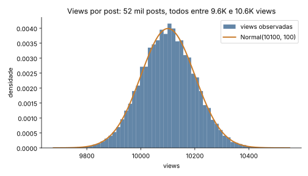
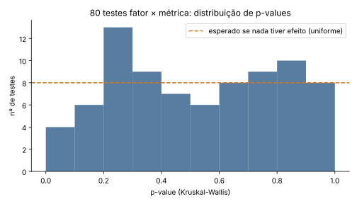
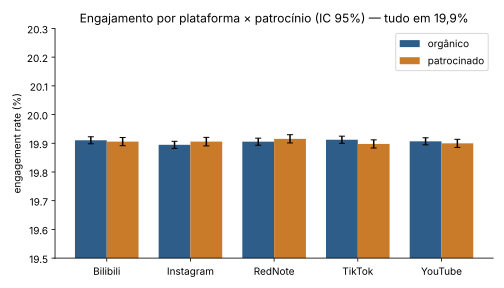
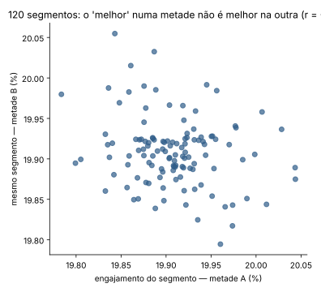
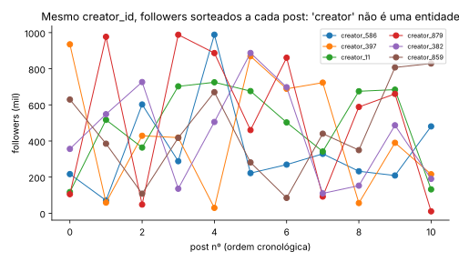

# 01 — Auditoria de dados: o dataset não sustenta nenhuma estratégia

**Pergunta que o Head de Marketing fez:** "o que gera engajamento, se vale patrocinar, qual a estratégia".
**Pergunta que precisa ser respondida antes:** "esses dados conseguem responder isso?"

Resposta: **não**. O dataset de 52.214 posts é gerado artificialmente, com cada métrica sorteada de forma independente de tudo o mais. Qualquer "insight" extraído dele é ruído com cara de dado. Abaixo, a prova — reproduzível com `analysis/run_audit.py`.

## 1. Os números não se comportam como redes sociais

| Métrica | Média | Desvio | Mín–Máx | Coef. de variação |
|---|---|---|---|---|
| views | 10.100 | 100 | 9.676 – 10.551 | **1,0%** |
| likes | 1.510 | 39 | 1.354 – 1.668 | 2,6% |
| shares | 300 | 17 | 227 – 380 | 5,8% |
| comentários | 200 | 14 | 140 – 258 | 7,0% |
| followers | 499.884 | 288.044 | 1.013 – 999.998 | 57,6% |

Em redes reais, views seguem cauda longa: a maioria dos posts fica abaixo da média e meia dúzia viraliza (coeficiente de variação bem acima de 100%). Aqui **todos os 52 mil posts têm entre 9,6K e 10,6K views**, independentemente de o creator ter 1 mil ou 1 milhão de seguidores. A distribuição passa num teste de normalidade perfeita (Shapiro p = 0,34) e followers passam num teste de uniformidade perfeita (KS p = 0,81) — assinatura de `numpy.random.normal` e `numpy.random.uniform`, não de comportamento humano.

## 2. Nada se correlaciona com nada

Maior correlação absoluta entre qualquer par de métricas numéricas (views, likes, shares, comentários, followers, tamanho do conteúdo): **0,007**. Em dados reais, likes e views correlacionam acima de 0,8 por construção. Aqui um post com mais views não tem mais likes.

## 3. Nenhum segmento é diferente de outro

Teste de Kruskal-Wallis para 16 fatores (plataforma, tipo, categoria, idioma, patrocínio, tipo e local de disclosure, categoria do patrocinador, faixa etária, gênero e país da audiência, faixa de creator, hora, dia da semana, mês, nº de hashtags) × 5 métricas = **80 testes**. Resultado: **1 teste com p < 0,05**; por puro acaso esperam-se 4. A distribuição de p-values é uniforme — exatamente o que acontece quando nenhum fator tem efeito.

Engagement rate (likes + shares + comentários ÷ views) por corte:

| Corte | Engajamento |
|---|---|
| Orgânico / Patrocinado | 19,91% / 19,90% (t-test p = 0,80) |
| Bilibili / Instagram / RedNote / TikTok / YouTube | 19,91 / 19,90 / 19,91 / 19,91 / 19,90% |
| vídeo / imagem / misto / texto | 19,90 / 19,90 / 19,91 / 19,92% |
| beauty / lifestyle / tech | 19,91 / 19,91 / 19,90% |
| creator <10K / 10–50K / 50–250K / >250K | 19,90 / 19,91 / 19,91 / 19,91% |

## 4. O "melhor segmento" não se repete

Dividindo os dados ao meio aleatoriamente e calculando o engajamento dos 120 segmentos (plataforma × tipo × categoria × patrocínio) em cada metade, a correlação entre os rankings é **r = −0,22**. Se houvesse um padrão real, as duas metades concordariam (r > 0,8). O top-1 de uma metade é aleatório na outra.

## 5. Um modelo preditivo com todas as features não prevê nada

Gradient boosting com todas as variáveis disponíveis, validação cruzada 5-fold: **R² = −0,001** para engajamento, views e shares. O modelo é pior do que chutar a média.

## 6. "Creator" não é uma entidade

Cada `creator_id` aparece em ~10 posts com **10 nomes diferentes, 10 contagens diferentes de followers e 4,5 plataformas**. 22.314 posts patrocinados têm 18.006 patrocinadores distintos (nomes de empresa gerados pela biblioteca Faker, como "Zamora, Robinson and Sanchez"). Descrições e comentários são frases aleatórias ("Professional radio usually something letter half pattern leader light claim"). Não dá para analisar faixa de influenciador, recorrência de patrocinador ou tema de conteúdo, porque esses campos não representam nada.

## 7. O que a análise "ingênua" teria entregue (e por que está errada)

Se a gente ignorar tudo acima e fizer o que o brief pede, o output seria:

> "O segmento de maior engajamento é **TikTok · misto · beauty · orgânico** (19,98%, +0,37% vs. média). O pior é Instagram · texto · tech (19,85%). RedNote lidera entre plataformas. Patrocínio não altera engajamento. Recomendação: priorizar conteúdo misto de beleza no TikTok e realocar verba de Instagram texto."

Isso é falso em todos os pontos: a diferença top-vs-bottom é 0,66 ponto percentual, dentro do erro amostral, e desaparece em qualquer re-amostragem. É o que uma IA produz quando recebe o brief e os dados sem ninguém perguntar "dá pra confiar?". É também o tipo de recomendação que, implementada, queima verba e credibilidade do time de dados.

## 8. O único dado "verdadeiro" do arquivo: a distribuição de esforço

As proporções das categorias refletem pesos do gerador, mas são a única coisa que descreve o conjunto: 60% vídeo / 20% imagem / 10% misto / 10% texto; 40% beauty / 40% lifestyle / 20% tech; 43% dos posts patrocinados; 75% dos posts de creators com >250K followers; 20% em cada uma das 5 plataformas. Se isso fosse o mix real da empresa, a conclusão seria "estamos espalhados de forma uniforme por 5 plataformas e concentrados em macro-influenciadores" — uma hipótese de desperdício a testar, não uma conclusão.

## Veredito

Volume não é sinal. 52 mil linhas sem variância explicável valem menos do que 500 posts reais com reach, saves, custo e conversão. A estratégia (documento 02) parte daí: **o que fazer quando os dados que você tem não respondem à pergunta que o negócio faz**.
