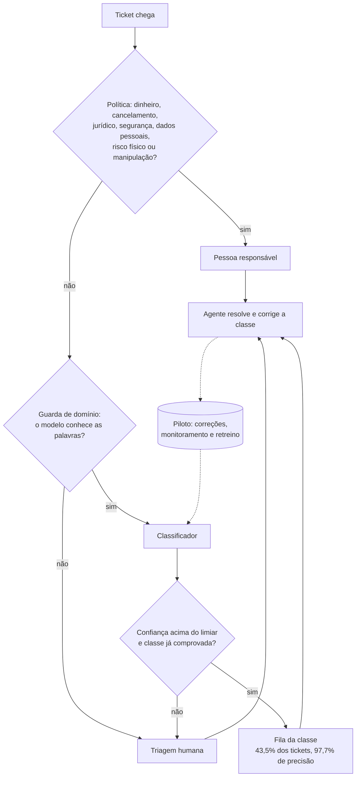

# Submissão — Diogo da Silva Carrico — Challenge 002

## Sobre mim

- **Nome:** Diogo da Silva Carrico
- **LinkedIn:** [linkedin.com/in/diogo-carrico](https://www.linkedin.com/in/diogo-carrico)
- **Challenge escolhido:** 002 — Redesign de Suporte

---

## Executive Summary

O Dataset 1 é sintético e não sustenta um diagnóstico de tempo nem de satisfação: nenhum gargalo e nenhum fator de satisfação resistem a testes estatísticos, e o próprio brief erra o volume (8.469 tickets, não 30 mil) e os tipos de ticket (5, não 3). Por isso o diagnóstico vira uma lista do que medir numa operação real, e o desperdício é estimado com premissas rotuladas: cerca de 68 horas de triagem por mês. A demo da automação, medida de ponta a ponta nos tickets de teste de TI, roteia sozinha 43,5% dos tickets com 97,7% de precisão, só nas 4 classes que provaram 95%, e manda para pessoas tudo o que envolve dinheiro, contrato, segurança ou risco, e tudo o que o modelo não conhece. A recomendação é instrumentar a operação e fazer um piloto em modo sombra antes de automatizar qualquer fila.

Resumo para o conselho técnico: [`docs/sumario-executivo.md`](docs/sumario-executivo.md).

---

## Solução

### Abordagem

1. **Hipóteses antes dos dados.** Escrevi minhas hipóteses e 8 previsões numéricas e fiz o commit antes de baixar os datasets (commit `d899d17`). Os resultados estão em [`process-log/previsoes-resultados.md`](process-log/previsoes-resultados.md).
2. **O que já foi feito.** Antes de executar, revisei os 184 PRs públicos do repositório, os 38 do Challenge 002 e as avaliações da G4, para não repetir o que todos fizeram.
3. **Auditoria dos dados**, antes de qualquer análise.
4. **Diagnóstico como hipóteses testadas**: cada padrão comparado com o que o acaso produz.
5. **Classificador** treinado no Dataset 2, com divisão sem vazamento, calibração e um limiar de confiança por classe.
6. **Política e guarda de domínio**: o que nunca é automatizado e o que o modelo não conhece vão para pessoas.
7. **Corte de escopo.** Quando o trabalho começou a crescer, cortei o que não respondia ao Diretor e registrei como sugestão ([`docs/proximos-passos.md`](docs/proximos-passos.md)).

Todos os números dos relatórios em `docs/` são gerados por código a partir de `solution/outputs/`.

### Resultados

**O brief e os dados** ([`docs/auditoria-dados.md`](docs/auditoria-dados.md))

| O brief diz | Os dados mostram |
| --- | --- |
| ~30.000 tickets | 8.469 registros; o arquivo tem 29.808 linhas porque 6.150 descrições têm quebras de linha |
| 3 tipos de ticket | 5 tipos; reembolso e cancelamento somam 40,7% |
| "First Response Time" é um tempo | É um carimbo de data e hora; sem a abertura do ticket, o tempo de resposta não pode ser calculado |
| Nota de satisfação | Existe só nos 2.769 tickets fechados (32,7%) |

O Dataset 1 é sintético: `{product_purchased}` em 100% das descrições, resoluções sem sentido ("Almost Republican let strategy."), e-mails só em example.com, todos os horários dentro de 27 horas, 49,3% dos tickets resolvidos antes da primeira resposta, e a descrição não prevê o tipo do ticket (18,9% de acerto, contra 20% do acaso).

**As três perguntas do Diretor** ([`docs/diagnostico.md`](docs/diagnostico.md))

1. **Onde o fluxo trava?** Em nenhum ponto detectável. Em 36 testes (4 indicadores em 9 cortes), o menor p corrigido é 0,86. A "pior combinação" de canal, prioridade e tipo é do tamanho que o sorteio produz. Os testes teriam detectado um canal com 3,4 pontos percentuais a mais de tickets sem solução.
2. **O que impacta a satisfação?** Nada mensurável: as 8 variáveis têm q = 0,83, e um modelo com todas elas erra mais do que chutar a média.
3. **Quanto estamos desperdiçando?** Não dá para medir com esta base. A estimativa paramétrica dá 68 horas de triagem recuperáveis por mês (R$ 3.075), numa faixa de 7 a 158 horas, com todas as premissas rotuladas. Triagem é a menor parte do problema: o tempo some em transferências e espera, que a base não registra.

**Proposta de automação** ([`docs/proposta-automacao.md`](docs/proposta-automacao.md))



**Protótipo** ([`docs/classificador.md`](docs/classificador.md))

- TF-IDF + SVM linear, escolhido entre 7 modelos: **86,7% de acurácia** no teste (IC 95% 85,8% a 87,6%), macro-F1 86,5%.
- **Fluxo completo da demo** (política, guarda, limiar e classes habilitadas), medido nos 5.171 tickets de teste: roteia sozinho **43,5% dos tickets com 97,7% de precisão** (IC 95% 97,0% a 98,2%). O classificador sozinho, com limiares por classe, rotearia 64,9% com 97,0%, mas três classes não provaram 95% no teste.
- **Classes habilitadas:** Access, Hardware, Miscellaneous e Purchase roteiam sozinhas. HR Support, Internal Project e Storage ficaram com o limite inferior da precisão abaixo de 95% no teste e esperam o piloto; se ele as confirmar, a cobertura sobe para 64,1%.
- Administrative rights nunca é roteado sozinho: concessão de privilégio é decisão humana, e a classe não alcança 95% com confiança. Bloquear a classe prevista não basta, então medi o vazamento: dos 176 tickets rotulados como Administrative rights no teste, 5 foram roteados sozinhos para Hardware, e nenhum deles pede acesso ou privilégio (são falhas de patch, atualização, boot, monitor e publicação de vagas).
- Nos tickets do Dataset 1, de outra operação, a política, o guarda e os limiares mandam 98,1% para pessoas; os 1,9% que passariam mostram por que o modelo precisa ser retreinado com tickets da operação.
- O piloto precisa observar 230 tickets roteados para provar 95% de precisão no geral, menos de uma semana no volume do brief.

| Funciona hoje | Fica para o piloto |
| --- | --- |
| Política, guarda de domínio, classificador e limiares, numa demo de linha de comando (um texto ou um CSV) | Integração com o sistema de tickets |
| Retreino manual, rodando `train_classifier.py` | Correção da fila pelo agente, registro das decisões, monitoramento semanal e retreino com as correções |

Detalhes em [`docs/proposta-automacao.md`](docs/proposta-automacao.md).

**Custos** (preços de lista conferidos em 13/10/2026; dólar a R$ 5,0096, PTAX de venda)

| Opção, para 10 agentes e 2.500 tickets por mês | Custo mensal |
| --- | --- |
| Construir: a triagem roda localmente, sem API de LLM. Hospedagem, domínio e backup ([Render](https://render.com/pricing.md), [Porkbun](https://porkbun.com/products/domains), [Backblaze](https://www.backblaze.com/cloud-storage/pricing)) | US$ 8 (R$ 40), mais horas de manutenção |
| Comprar IA para um helpdesk já existente: de [Zoho Desk Zia](https://www.zoho.com/desk/pricing.html) (incluída no plano Professional) a [Zendesk Copilot](https://www.getmacha.com/blog/zendesk-ai-pricing-explained) com resoluções automáticas | US$ 0 a 1.950 (R$ 0 a 9.769) |

O que se compra faz mais do que rotear (responde o cliente, resume tickets), então a comparação é só de custo. Se o helpdesk atual já inclui IA, a primeira opção é testá-la; se não inclui, a triagem própria custa pouco para rodar, e o custo real é o tempo de quem a mantém.

### Recomendações

1. **Instrumentar a operação** antes de otimizar: abertura do ticket, transferências e motivo, tempo esperando cliente ou outra equipe, reabertura e taxa de resposta à pesquisa de satisfação.
2. **Retreinar o classificador com tickets da própria operação**, em português. O modelo atual aprendeu com tickets de TI de outra organização.
3. **Piloto em três fases**: sombra (a IA classifica em silêncio), assistida (o agente confirma ou corrige a fila) e automática por fila, só para as classes que provarem 95% de precisão.
4. **Nunca automatizar** os casos da política: dinheiro, cancelamento, cobrança indevida, risco jurídico, segurança, dados pessoais, risco físico e tentativas de manipular a IA.
5. **Antes de construir, verificar o helpdesk atual.**

### Limitações

- O Dataset 1 é sintético: não diz nada sobre uma operação real.
- O Dataset 2 é de TI, de outra organização, em inglês e já pré-processado; a precisão medida não vale direto para suporte ao cliente.
- Os minutos de triagem por ticket, a premissa que mais pesa na estimativa de desperdício, nunca foram medidos.
- HR Support, Internal Project e Storage não provaram 95% de precisão no teste e ficam em piloto. Como foi o teste que decidiu quais classes roteiam sozinhas, o piloto também precisa confirmar as quatro habilitadas.
- Ficaram fora, como sugestão, a revisão humana de rótulos, os rascunhos de resposta com LLM e o teste em português ([`docs/proximos-passos.md`](docs/proximos-passos.md)).

### Como rodar

Requer [uv](https://docs.astral.sh/uv/) e um token do Kaggle em `~/.kaggle/access_token`. Comandos a partir de `solution/`:

```bash
uv sync
uv run python scripts/download_data.py      # baixa os dois datasets para datasets/, fora do git
uv run python scripts/run_audit.py          # auditoria
uv run python scripts/train_classifier.py   # classificador, cerca de 2 minutos
uv run python scripts/run_diagnosis.py      # diagnóstico e desperdício
uv run python -m support_triage.triage "my laptop screen is broken, please replace it"
uv run pytest
```

Os relatórios em `docs/` são regenerados pelos scripts `write_*_report.py`.

---

## Process Log — Como usei IA

| Decisões registradas | Erros da IA registrados | Previsões feitas antes dos dados | Commits | Testes |
| --- | --- | --- | --- | --- |
| 16 ([decisoes.md](process-log/decisoes.md)) | 15 ([erros-da-ia.md](process-log/erros-da-ia.md)) | 8 ([previsoes-resultados.md](process-log/previsoes-resultados.md)) | ver `git log` | 42 |

### Ferramentas usadas

| Ferramenta | Para que usei |
| --- | --- |
| Claude Code (app desktop) | Análise, código, relatórios e git; e o texto das respostas de [`00-hipoteses.md`](process-log/00-hipoteses.md), elaborado a partir dos meus insights |
| Workflows de subagentes do Claude Code | Pesquisa de preços com verificação independente e análise dos 184 PRs públicos |
| Claude Artifacts e Docs | Apresentação inicial dos 4 desafios e termos de referência do projeto |

### Workflow

1. Pedi um resumo dos 4 desafios e uma apresentação ([`process-log/apresentacao-inicial.md`](process-log/apresentacao-inicial.md)); escolhi o 002 como o mais alinhado à vaga.
2. Notei que o brief se contradiz sobre o protótipo e decidi tratá-lo como obrigatório.
3. Pedi a revisão de todos os PRs públicos antes de executar. Ela mostrou que o caminho óbvio (auditar, classificar com TF-IDF, roteamento com confiança) já era comum, e mudou o plano.
4. Pedi tabelas de custo com preços verificados, inclusive de APIs gratuitas.
5. Escrevi as hipóteses e as previsões e fiz o commit antes de abrir os dados.
6. Auditoria, diagnóstico, classificador e proposta, cada fase com seu commit.
7. Cortei o escopo quando ele voltou a crescer.

### Onde a IA errou e como corrigi

Os 15 erros estão em [`process-log/erros-da-ia.md`](process-log/erros-da-ia.md). Os principais:

- **O plano inicial tinha 10 entregas** e usava dados que depois se mostraram sintéticos (E01 a E03). A revisão dos PRs que eu pedi mostrou o problema.
- **O escopo voltou a crescer** depois do primeiro corte (E12). Fui eu que percebi: "to achando que complicamos demais".
- **O modelo de 12,5 MB quase entrou no commit**, apesar do `.gitignore` (E11). Agora o `stage.sh` recusa arquivos acima de 2 MB.
- **O guarda de domínio barrou um ticket legítimo** por causa da palavra "my" (E13). Corrigido, com o efeito medido e registrado.
- **O número divulgado não era o do fluxo completo** (E15): os 64,9% mediam só o classificador, sem a política, o guarda e a exigência de 95% por classe. Uma avaliação externa apontou; agora os números vêm da demo inteira.
- **Teste estatístico errado** para a idade (E09) e **contagens erradas** na síntese dos PRs (E06), pegos na revisão.

### O que eu adicionei que a IA sozinha não faria

- **A escolha do desafio e a leitura do brief**: tratei o protótipo como obrigatório quando o brief se contradiz.
- **Olhar o que já existe antes de construir**: a revisão dos PRs mudou o plano e evitou repetir o que 38 candidatos já tinham feito.
- **Hipóteses e previsões comprometidas antes dos dados**, conferidas depois: acertei a contagem de tickets (P1), a correlação nula (P2) e a acurácia (P3); errei a categoria mais difícil (2.2) e a cobertura (P5: previ 50%, e o fluxo completo roteia 43,5%).
- **A exigência de 95% de precisão olhando por categoria** (hipótese 3.2), que levou aos limiares por classe; com um limiar único, Hardware ficaria abaixo do alvo.
- **Não automatizar concessão de privilégio** (hipótese 3.1): os dados chegaram à mesma conclusão sobre Administrative rights.
- **A experiência de operação** (hipótese 0.2): o tempo some em transferências e espera, não na triagem. Isso orientou a leitura do desperdício e a recomendação de instrumentar.
- **O corte de escopo**: menos entregas, mais bem feitas.

---

## Evidências

- [ ] Screenshots das conversas com IA
- [ ] Screen recording do workflow
- [x] Chat exports ([`process-log/chat-exports/`](process-log/chat-exports/))
- [x] Git history: um commit por fase, as hipóteses antes dos dados
- [x] Outro: hipóteses e previsões ([`00-hipoteses.md`](process-log/00-hipoteses.md)), decisões, erros da IA, apresentação inicial

---

_Submissão enviada em: 13/10/2026_
