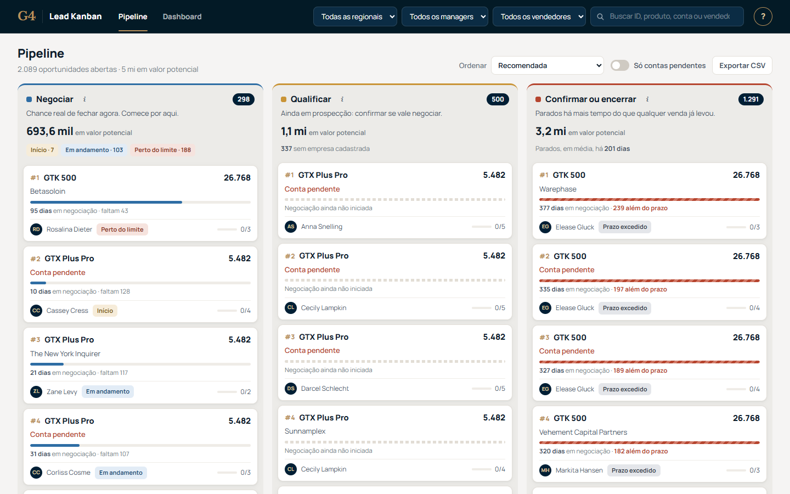
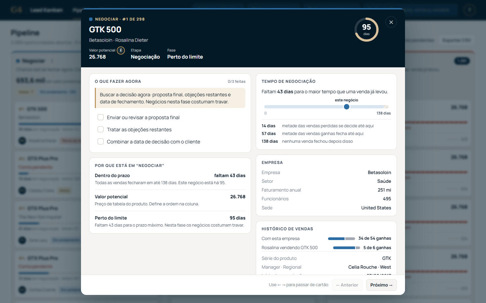
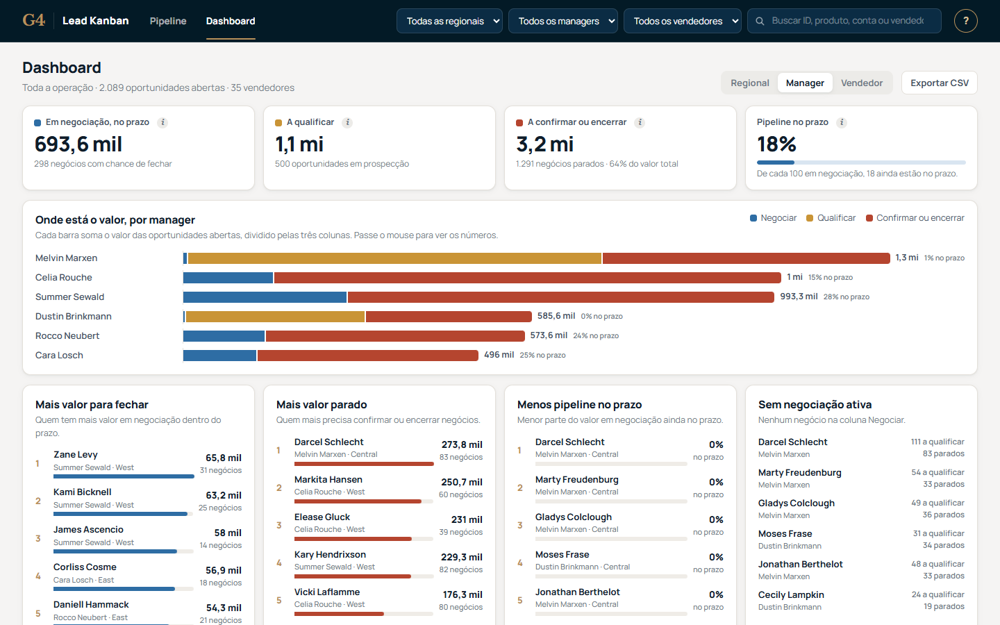
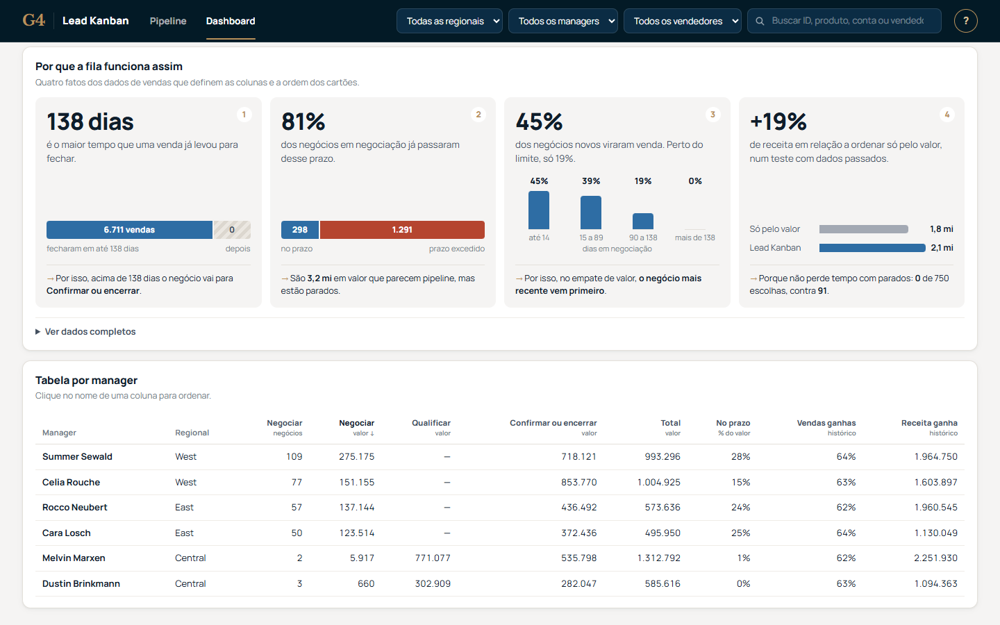
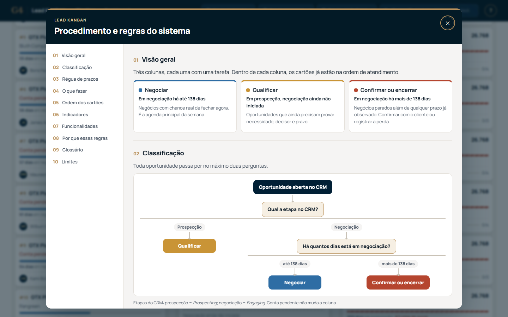

# Submissão — Eduardo Celestino de Carvalho — Challenge 003

## Sobre mim

- **Nome:** Eduardo Celestino de Carvalho
- **LinkedIn:** [linkedin.com/in/educcarvalho](https://www.linkedin.com/in/educcarvalho/)
- **Challenge escolhido:** 003 — Lead Scorer (entregue como **Lead Kanban**)

---

## Executive Summary

Construí o **Lead Kanban**, uma aplicação web que organiza as 2.089 oportunidades abertas do CRM em três colunas de ação (**Negociar**, **Qualificar** e **Confirmar ou encerrar**) e explica cada posição. Produto, setor e vendedor quase não separam ganhos de perdas: um modelo preditivo teve AUC 0,513. O que separa é o tempo: nenhum dos 6.711 negócios concluídos fechou depois de **138 dias** em negociação, e **81%** dos que estão em negociação hoje já passaram desse prazo. Num teste com dados passados, os 5 primeiros negócios de cada vendedor renderam **2,09 mi** de receita, contra **1,76 mi** ao ordenar só pelo valor (+19%, com margem provável de +12% a +25%). A recomendação é revisar primeiro os 1.291 negócios parados (3,2 mi, 64% do valor do pipeline) e usar a coluna Negociar como agenda da semana, com um piloto em parte do time.

**[Abrir a demo pública](https://celestinoedu.github.io/ai-master-challenge/)** · [vídeo tutorial de 2 min](solution/web/media/tutorial.mp4)



---

## Solução

### Abordagem

1. **Problema antes da técnica.** A decisão do vendedor é onde gastar o tempo desta semana. O critério de sucesso é a lista curta (5 por vendedor), não a acurácia global. [Problema e critérios](docs/01-problema-e-criterios.md).
2. **Auditar os dados.** Conferi as quatro tabelas: chaves, datas, nulos, aliases (`GTXPro` → `GTX Pro`) e vazamento de desfecho. Todos os 8.800 negócios foram preservados e o ZIP público é verificado por SHA-256. [Auditoria](docs/04-auditoria-inicial.md).
3. **Testar o caminho óbvio, um modelo de chance de ganho.** A regressão logística, com divisão temporal, não superou a taxa média (AUC 0,513; Brier pior que a referência) e foi descartada como probabilidade. [Relatório G2](docs/07-g2-modelagem.md).
4. **Procurar o sinal que existe.** Perdas se decidem cedo (mediana de 14 dias) e ganhos levam mais (57). Nada fechou depois de 138 dias.
5. **Desenhar a regra e testá-la contra o óbvio.** Fiz um backtest em 5 datas de 2017, usando só o que se sabia em cada data, com controles de robustez. [Regra, backtest e ressalvas](docs/09-g3-revisao-fila-foco.md).
6. **Entregar uma ferramenta usável por quem não é técnico:** Pipeline, Dashboard gerencial e procedimento integrado no botão **?**.

### Resultados / Findings

**A regra** (código em [`priority.py`](solution/leadscore/priority.py)):

| Coluna | Critério | Ordem | Hoje |
|---|---|---|---:|
| **Negociar** | Em negociação há até 138 dias | Valor potencial; no empate, o mais recente | 298 |
| **Qualificar** | Em prospecção | Valor potencial | 500 |
| **Confirmar ou encerrar** | Em negociação há mais de 138 dias | Valor potencial | 1.291 |

Cada cartão mostra o motivo da posição, a fase (Início, Em andamento, Perto do limite) e as ações sugeridas. Conta ausente gera uma tarefa de cadastro e não altera a ordem.

**Por que não um score de 0 a 100:** aqui, o score é a coluna mais a posição dentro dela ("#1 de 298 em Negociar"). Um número como 85 seria lido como chance de fechar, e os dados não sustentam isso: o modelo de probabilidade teve AUC 0,513. Coluna, posição e motivo dizem ao vendedor o que fazer, sem prometer uma precisão que não existe.

**O teste** (top 5 por vendedor, 750 escolhas em 5 datas, desfecho observado até 31/12/2017):

| Método | Vendas ganhas | Receita | Escolhas paradas |
|---|---:|---:|---:|
| Ordenar só pelo valor | 275 | 1,76 mi | 91 |
| Valor, sem os parados (sem olhar a idade) | 299 | 1,90 mi | 0 |
| Valor e mais novo primeiro, com os parados | 320 | 2,06 mi | 31 |
| **Lead Kanban** | **326** | **2,09 mi** | **0** |

- **De onde vem o ganho:** da idade do negócio, em duas partes. Tirar os parados da fila explica cerca de 4 em cada 10 reais a mais; no empate de valor, começar pelo mais novo explica os outros 6.
- **Margem:** bootstrap pareado sobre 150 pares vendedor × data, com 5.000 reamostras. O ganho sobre "só valor" fica entre +12% e +25% (IC 95%). Ordenar por valor e idade sem colunas chega perto (+0,4% a +2,5% a favor da regra), mas deixa 31 negócios parados entre os escolhidos. As colunas tiram esses negócios da agenda e dizem o que fazer com eles.
- Dos 1.443 negócios que já tinham passado do prazo nas datas de teste, **nenhum fechou depois**.
- **Desempate conferido por partes:** refeita só com as 3 primeiras datas, a escolha de "mais recente primeiro" seria a mesma. Nas 2 últimas, ele também vence, com 670 mil de receita contra 502 mil do "mais antigo primeiro" e 493 mil de ordenar só pelo valor.
- **Prazo:** usar o percentil 95 ou 90 em vez do máximo quase não muda a receita da fila. Mas 35 e 86 vendas que ainda iam fechar, respectivamente, cairiam em "Confirmar ou encerrar". Com o máximo, nenhuma.

**A ferramenta:**

| Detalhe do negócio | Dashboard gerencial |
|---|---|
|  |  |
| **Evidência no próprio Dashboard** | **Procedimento (botão ?)** |
|  |  |

Os filtros por regional, manager e vendedor ficam fixos na barra superior e valem para as duas telas. Pipeline e Dashboard exportam CSV. A interface também funciona no [celular](process-log/screenshots/06-celular.png).

**Tutorial em vídeo para quem não é da área:** 2 minutos em motion design, com narração e legendas, dentro do próprio app (botão **?** e guia rápido). [Assistir](solution/web/media/tutorial.mp4) · [como foi feito](video/README.md).

### Recomendações

1. **Revisar primeiro "Confirmar ou encerrar".** São 1.291 negócios e 3,2 mi em valor potencial que distorcem a previsão. Os rankings do Dashboard mostram quem cobrar.
2. **Usar "Negociar" como agenda da semana** num piloto com parte do time, medindo ciclo, taxa de resolução e receita contra o restante.
3. **Registrar no CRM o último contato e o valor negociado.** Com isso, "parado" passa a significar dias sem interação, e não dias desde a entrada na etapa.

### Limitações

- O CRM não traz histórico de etapas, último contato nem valor negociado. "Valor potencial" é o preço de tabela do produto.
- 138 dias é o máximo observado num dataset que parece sintético; o prazo precisa de recálculo periódico.
- **Qualificar** é ordenada só pelo valor: a prospecção não tem data nem outro sinal útil nos dados.
- O backtest é exploratório: duas escolhas foram feitas depois de ver dados, e os cortes se sobrepõem. Ele descarta ideias ruins, mas não promete ganho em operação.
- O sistema é somente leitura; as ações marcadas ficam no navegador.

**O que precisaria para escalar:**
1. **Integração com o CRM:** leitura diária automática no lugar do arquivo de 2017 e escrita das ações e mudanças de etapa, para que "Confirmar ou encerrar" atualize o pipeline de verdade.
2. **Dado de atividade:** último contato, reuniões e propostas. Com isso, "parado" passa a ser dias sem interação, e a coluna Qualificar ganha um sinal além do preço.
3. **Prazo recalculado periodicamente**, por produto se a diferença justificar, e monitorado com o percentil 95 ao lado do máximo.
4. **Login e perfis:** o vendedor vê a própria carteira e o gestor vê o time. As ações marcadas passam a ser salvas no servidor, e não no navegador.
5. **Piloto com grupo de controle** antes do rollout, medindo ciclo, taxa de resolução e receita.

---

## Como executar

Com **Python 3.11+** e sem bibliotecas externas, a partir de `solution/`:

```bash
python server.py --open        # http://localhost:8000
```

**Demo pública, sem instalar nada:** [celestinoedu.github.io/ai-master-challenge](https://celestinoedu.github.io/ai-master-challenge/). É a mesma interface com os dados já processados, gerada por `python build_static.py`.

Na primeira execução, o dataset público é baixado do Kaggle e verificado. Testes: `python -m unittest discover -s tests`. Demonstração, arquitetura e reprodução dos experimentos estão em [solution/README.md](solution/README.md).

---

## Process Log — Como usei IA

### Ferramentas usadas

| Ferramenta | Para que usei |
|---|---|
| Codex / ChatGPT | Ler o brief, planejar, auditar os dados (G1), rodar o experimento preditivo (G2) e construir a primeira fila em Streamlit (G3). |
| Claude Code | Fazer a análise crítica da primeira regra, desenhar e rodar o backtest, reescrever a regra e construir o Lead Kanban (Pipeline, Dashboard e procedimento). |
| Playwright | Revisar cada versão da interface em navegador real, no desktop e no celular, e gerar as capturas. |
| Remotion + Edge TTS | Montar o vídeo tutorial em motion design sobre telas reais do app, com narração neural e legendas. |

### Workflow

1. **Escolha do desafio e hipótese.** Propus prever o sucesso a partir dos negócios ganhos e perdidos. A IA registrou a hipótese e os riscos de vazamento. [Log](process-log/2026-10-15-descoberta.md).
2. **Brief convertido em critérios verificáveis** antes de qualquer código. [Log](process-log/2026-10-15-brief-e-planejamento.md).
3. **Auditoria dos dados**, com correções rastreáveis. [Log](process-log/2026-10-15-g1-dados.md).
4. **Experimento preditivo:** o modelo foi reprovado para uso operacional. [Log](process-log/2026-10-15-g2-modelagem.md).
5. **Primeira fila:** regra de pontos em Streamlit. [Log](process-log/2026-10-15-g3-produto.md).
6. **Revisão crítica, que mudou o rumo.** Pedi uma interface melhor e, em seguida, que a IA explicasse e criticasse a solução. A análise mostrou que a regra de pontos priorizava justamente os negócios parados. Reescrevemos a regra e a testamos. [Log](process-log/2026-10-15-g3-revisao.md).
7. **Produto e UX em três rodadas:**
   - nome, filtros fixos, Dashboard e procedimento;
   - gráficos com os números que justificam a regra;
   - linguagem simples para quem não é da área.

   [Log](process-log/2026-10-15-g3-producao.md) · [Log](process-log/2026-10-15-g3-ux.md).
8. **Revisão de entrega.** Avaliação crítica contra o guia de submissão, testes de robustez, remoção da interface duplicada e teste em clone limpo. [Log](process-log/2026-10-15-entrega.md).
9. **Comparação com as outras submissões e evidências.** Li os 86 PRs do case e as reviews públicas do avaliador. Decidimos incluir os exports das conversas e um vídeo tutorial para usuários não técnicos. [Log](process-log/2026-10-15-concorrencia-e-tutorial.md).
10. **Avaliação como avaliador e correções.** Pedi uma leitura crítica do PR já aberto. A decomposição dos +19% corrigiu a explicação do ganho, e a demo pública passou a dispensar instalação. [Log](process-log/2026-10-15-ganho-e-demo.md).

### Onde a IA errou e como corrigi

- **G2:** o primeiro ensaio usou janelas de observação desiguais e desempate pelo ID. Corrigido para a mesma janela de 30 dias, com desempate fracionário.
- **G3:** a IA primeiro deixou bonito um Kanban sobre a regra antiga, com colunas por idade que reforçavam o problema. Só a análise crítica que pedi expôs isso.
- **Ordenar por valor × taxa de ganho por idade:** a IA propôs, mas a taxa calculada só com negócios concluídos ignora os que travam. O backtest não mostrou ganho, e a ideia foi descartada.
- **Interface:**
  - a IA usou "US$", contrariando a decisão de não inferir moeda;
  - o tooltip do ⓘ sumia sobre os gráficos;
  - o navegador servia versões antigas da página.

  Todos foram encontrados na revisão em navegador e corrigidos.
- **Explicação incompleta do ganho:** a IA atribuiu os +19% só a "não reservar escolhas para parados". A decomposição mostrou que isso explica cerca de 40% do ganho; o resto vem de preferir os mais novos. Na mesma revisão, a IA também errou na direção oposta: usou o desempate "mais antigo primeiro" como se fosse neutro e concluiu que tirar os parados não ajudava. Os dois erros foram corrigidos com variantes neutras e bootstrap.
- **Exagero no texto:** a IA chamou de "validação fora da amostra" uma separação de datas que já tinham sido vistas. Na revisão, o termo virou "conferência por partes", e o JSON foi renomeado para não prometer o que o teste não mostra.
- **Export das conversas:** a primeira versão da redação deixou passar variações em maiúsculas de nomes privados e não trazia as mensagens enviadas durante a execução. A busca no texto final apontou as duas falhas, e o export foi refeito.

### O que eu adicionei que a IA sozinha não faria

- **Propus a hipótese preditiva**, a partir dos negócios ganhos e perdidos, e aceitei o resultado negativo do teste em vez de forçar um score de probabilidade.
- **Pedi a crítica da própria solução** quando ela já "funcionava". Foi isso que revelou que a primeira regra priorizava negócios parados.
- **Defini o critério de UX:** qualquer pessoa deve entender os indicadores sem conhecer a área. Isso levou a menos texto, verbos de ação nas colunas e gráficos com uma frase de conclusão.
- **Cortei o que não servia ao avaliador**, como a comparação com a minha regra anterior no Dashboard.
- **Decidi nome, identidade visual e escopo do Dashboard gerencial:** onde está o valor e quem cobrar.
- **Comparei a entrega com as outras submissões do case.** Ao ver que o insight dos 138 dias era comum, priorizei o que diferencia: transparência total do processo (exports das conversas) e material de apoio para quem não é da área (o vídeo tutorial, no padrão de vídeos que já produzo).

---

## Evidências

- [x] Narrativa escrita, por etapa, em [process-log/](process-log/README.md)
- [x] Capturas da solução funcionando em [process-log/screenshots/](process-log/screenshots/)
- [x] Histórico de commits nesta branch
- [x] Experimentos reproduzíveis: [backtest da regra](solution/experiments/g3-focus-backtest.json) e [G2](solution/experiments/g2-results.json)
- [x] Chat exports das duas sessões (Codex e Claude Code), com ações da IA e redação de dados privados, em [process-log/chat-exports/](process-log/chat-exports/README.md)

---

_Submissão enviada em: 15/10/2026_
