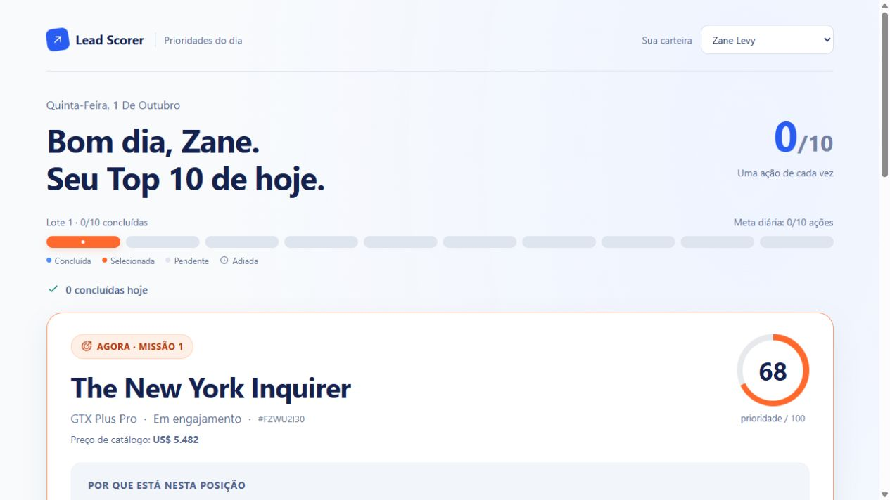

# Submissão — Elton do Amaral Rezende — Challenge 003

## Sobre mim

- **Nome:** Elton do Amaral Rezende.
- **LinkedIn:** [Perfil do candidato](https://www.linkedin.com/in/elton-a-rezende-b6425636b/).
- **GitHub:** [MunhozVs](https://github.com/MunhozVs/).
- **Challenge escolhido:** [Build 003 — Lead Scorer](https://github.com/Gestao-Quatro-Ponto-Zero/ai-master-challenge/tree/main/challenges/build-003-lead-scorer).

---

## Executive Summary

Construí uma aplicação que organiza as oportunidades do vendedor em missões diárias, mostrando o que trabalhar primeiro, por quê e qual pode ser a próxima ação. Parti de uma base pública com 8.800 oportunidades e criei uma regra de prioridade que combina histórico de negociações, tempo desde o engajamento e preço de catálogo. Na avaliação histórica, a regra ficou com 56,4% de vitórias entre os negócios resolvidos do Top 10 de cada vendedor, abaixo dos 60,7% da referência aleatória, então não estou apresentando esse score como uma melhoria comprovada de conversão. Minha recomendação é testar a rotina com vendedores, coletar dados de atividades e validar a priorização em um período novo antes de usá-la para prometer resultados comerciais.

---

## Solução

### Abordagem

Escolhi o Lead Scorer porque esse problema tem muita relação com o que venho construindo no Agiliza Corretagem. Porém, quando comecei a planejar, achei que a solução estava ficando complexa demais. Dei um passo para trás e comecei pela interface: o vendedor precisa abrir a aplicação e entender rápido o que fazer naquele dia.

Construí uma aplicação em React e TypeScript com até dez missões por lote e uma oportunidade expandida por vez. Ela já começa com uma carteira selecionada, e cada missão mostra a prioridade, os motivos e uma orientação. O vendedor pode copiar essa orientação, marcar a ação como feita, adiar para amanhã e desfazer. A meta e a sequência de dias acompanham ações realmente registradas, sem progresso inventado.

Nos bastidores, usei os cinco CSVs do dataset público CRM Sales Opportunities, com a licença CC0 declarada pela fonte. Tratei nomes diferentes para o mesmo produto e mantive oportunidades sem conta ou data, deixando a falta de informação explícita. A pontuação e a explicação saem do mesmo cálculo; não há IA generativa inventando motivos quando o vendedor abre um card.

A regra é `round(100 × (0,65H + 0,25A + 0,10V))`: H representa o histórico por produto, setor e conta; A, o tempo desde o engajamento; V, o preço de catálogo. Mantive os pesos definidos no plano e comparei a regra com alternativas em um corte temporal, sem usar o resultado futuro de uma oportunidade para calcular sua prioridade. [Detalhes do cálculo](docs/SCORING.md).

### Resultados / Findings

- A base contém **8.800 oportunidades**, sendo **2.089 abertas**, além de 85 contas, sete produtos e 35 nomes na equipe. Corrigi 1.480 ocorrências de `GTXPro` para ligar ao produto `GTX Pro`, preservando o nome original. Os arquivos finais não têm vínculos desconhecidos.
- A rotina funciona com seleção de carteira, lotes automáticos, cópia da orientação, conclusão, adiamento, desfazer e histórico. Os registros ficam salvos no navegador, separados por vendedor e versão dos dados. O calendário das ações usa o horário de São Paulo.
- **39 testes passaram**, junto com a verificação de tipos e o build. Também reproduzi a instalação, preparação dos dados, avaliação e compilação em uma pasta limpa no formato de submissão. A revisão no navegador cobriu desktop, celular, restauração e as ações das missões.

Na avaliação, usei os resultados conhecidos até **30/09/2017** para priorizar 2.409 candidatos e observei seus resultados até **31/12/2017**. O Top 10 dos 30 vendedores com candidatos reúne 300 oportunidades por método:

| Método | Ganhas | Perdidas | Sem resultado no período | Vitórias entre as resolvidas |
| --- | ---: | ---: | ---: | ---: |
| Minha regra de prioridade | 145 | 112 | 43 | 56,42% |
| Engajamento mais recente | 144 | 120 | 36 | 54,55% |
| Preço de catálogo | 67 | 57 | 176 | 54,03% |
| Aleatório com seed fixa | 82 | 53 | 165 | 60,74% |

A regra selecionou mais vitórias observadas, porém também selecionou muito mais negócios com resultado conhecido: 257, contra 135 do aleatório. Essa diferença não permite concluir que ela aumentaria a conversão. Os negócios sem resultado no período continuam separados das perdas, e os pesos não foram ajustados olhando o resultado final para melhorar os números.

[Captura no celular](process-log/screenshots/audit-mobile.jpg) · [Avaliação completa](docs/VALIDATION.md) · [Auditoria](docs/AUDITORIA.md).

Para acessar, abrir a [aplicação pública](https://lead-scorer-missoes-003.pokernachapa.chatgpt.site), sem login. Para executar localmente, seguir o [guia de instalação e uso](docs/SETUP.md). Os CSVs estão incluídos; não é necessário ter conta Kaggle.

### Recomendações

1. Testar a rotina com vendedores e observar se eles entendem a prioridade, conseguem executar a orientação e mantêm o hábito de trabalhar a carteira.
2. Registrar contatos, respostas, mudanças de estágio e a situação da carteira em cada data. Isso permite avaliar o que estava disponível no momento da decisão e entender melhor os negócios ainda sem resultado.
3. Validar a regra em um período novo, com comparações definidas antes de olhar os resultados. Só depois considerar novos pesos ou um modelo e verificar se existe ganho comercial.
4. Para uso contínuo por uma equipe, integrar autenticação e CRM, sincronizar os registros e carregar os dados por carteira.

### Limitações

O score é um índice de prioridade, não uma probabilidade de fechar. O preço de catálogo não é o valor negociado nem uma previsão de receita. A avaliação não demonstrou superioridade à referência aleatória na taxa de vitórias entre resolvidos.

Os dados são históricos, de 2017, e representam uma empresa fictícia. Faltam registros de atividades, datas de criação em prospecção e versões dos cadastros ao longo do tempo; por isso, a avaliação tem limitações e não representa uma operação atual.

As ações são declarações do vendedor guardadas localmente. Marcar como feito não comprova contato ou venda, e a aplicação não autentica usuários, atualiza um CRM ou sincroniza dispositivos e abas em tempo real. Os dados estáticos ficam no bundle; carregar cada carteira separadamente é uma evolução de desempenho.

---

## Process Log — Como usei IA

### Ferramentas usadas

| Ferramenta | Para que usei |
| --- | --- |
| ChatGPT | Analisar os desafios com base na minha experiência, escolher o Lead Scorer e explorar o planejamento e as primeiras ideias de interface. |
| Claude | Criar a referência visual de uma rotina simples de prioridades diárias, com um pouco de gamificação. |
| Codex | Planejar as etapas, construir o projeto, preparar os dados, implementar a regra e as missões, testar, revisar no navegador, publicar e organizar a documentação. |

### Workflow

1. Joguei o repositório dos desafios no ChatGPT e pedi um ranking considerando minha experiência. Depois da análise, escolhi o Lead Scorer pela relação com o Agiliza Corretagem.
2. Levei a discussão ao Codex dentro do meu repositório do CRM para dar mais contexto. Quando achei o plano complexo demais, decidi começar pela experiência do vendedor.
3. Pedi telas ao ChatGPT, mas elas ficaram muito parecidas com as do meu CRM. Fui para o Claude e usei sua proposta de prioridades diárias como referência para a aplicação.
4. No repositório novo, pedi ao Codex a estrutura e um plano por etapas. Depois seguimos com os CSVs, a priorização, a avaliação histórica, as missões e a persistência.
5. Revisei a interface e pedi ajustes na linguagem para que um vendedor entendesse as explicações. Com o Codex, também fizemos os testes, a reprodução em ambiente limpo e a revisão da entrega.

O relato mais completo está no [diário](process-log/DIARIO.md), escrito em primeira pessoa a partir das minhas anotações e das decisões do projeto.

### Onde a IA errou e como corrigi

No planejamento, a primeira proposta ficou complexa demais para o que eu queria entregar. Pedi para voltar um passo e pensar primeiro na tela. As primeiras ideias visuais do ChatGPT também ficaram próximas demais do meu CRM, então troquei de ferramenta para explorar outra proposta.

Na aplicação, termos como “idade desde o engajamento”, “taxa suavizada” e “escala logarítmica” deixavam a explicação técnica demais. Marquei os trechos no navegador e pedi uma linguagem que qualquer vendedor pudesse entender. A regra e a pontuação foram preservadas.

Na revisão com o Codex, encontramos uma verificação de interface que podia confundir oportunidades com nomes e pontuações iguais; passamos a conferir o ID. Também corrigimos um caso limite em que nomes especiais de JavaScript podiam fazer a explicação indicar um histórico específico que não existia. O teste reproduziu a falha antes da correção, e a explicação passou a identificar corretamente o uso do histórico geral.

### O que eu adicionei que a IA sozinha não faria

Trouxe o contexto do Agiliza Corretagem e decidi que o principal ponto de contato precisava ser a rotina do vendedor. Isso orientou a escolha de mostrar prioridades e uma próxima ação de cada vez, com as opções de equipe em segundo plano.

Também defini que a gamificação deveria acompanhar o trabalho registrado: adiar não vale como concluir, desfazer precisa corrigir o progresso e a aplicação não começa com conquistas fictícias. Na revisão, meu critério foi se o vendedor conseguiria entender o texto sem conhecer o cálculo.

Por fim, mantive o resultado desfavorável da avaliação explícito. Não faria sentido melhorar a apresentação escondendo que a regra não superou o aleatório nessa métrica, nem mudar os pesos olhando a resposta final só para entregar um número melhor.

---

## Evidências

- [ ] Screenshots das conversas com IA — não incluídos.
- [x] Vídeo — [gravação que fiz para as evidências, publicada no YouTube](https://youtu.be/JDdd-i45K9U).
- [ ] Chat exports — não incluídos.
- [x] Git history — [registro do histórico local da implementação](process-log/GIT_HISTORY.md), preservado junto da submissão. O primeiro commit reuniu a implementação já construída; não representa pequenos commits desde o início.
- [x] Outro: [diário do processo](process-log/DIARIO.md), [índice das evidências](process-log/README.md), [capturas reais da aplicação](process-log/screenshots/) e [auditoria reproduzível](docs/AUDITORIA.md).

O diário inclui o link da conversa inicial no ChatGPT, que pode exigir acesso à conta. As capturas mostram a aplicação funcionando; não são prints de conversas com IA.

---

Submissão enviada em **01/10/2026**: [Pull Request #173](https://github.com/Gestao-Quatro-Ponto-Zero/ai-master-challenge/pull/173).
