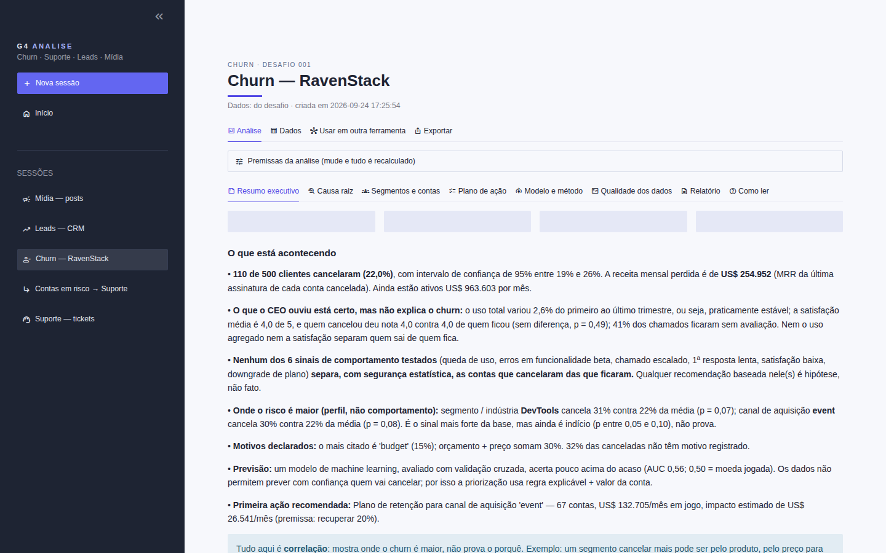

# Submissão — Emerson Souza — Challenges 001, 002, 003 e 004

## Sobre mim

- **Nome:** Emerson Souza
- **LinkedIn:** https://www.linkedin.com/in/emerson-souza-55994b13b/
- **Challenge escolhido:** os quatro (001 Churn, 002 Suporte, 003 Lead Scorer e 004 Social Media), resolvidos por **um único sistema**, o **G4 Analise**

---

## Executive Summary

Construí o **G4 Analise**, um programa em janela própria (Python; testado no Windows e no Linux) em que cada desafio é uma ferramenta completa, que funciona sozinha **e** cooperando: o resultado de uma ferramenta vira a entrada de outra (ex.: contas em risco do Churn → análise de Suporte só dessas contas), com um selo que diz o quanto a ligação é confiável. Os achados principais:

- **001:** o churn de 22% (US$ 254.952/mês) não se explica por uso nem por satisfação, como o CEO ouviu. O risco está no **perfil**: DevTools e canal *event* cancelam cerca de 30%. É indício, não prova, e o sistema entrega as contas priorizadas por risco × valor.
- **002:** 67% dos chamados estão parados e a prioridade não muda o tempo de atendimento. Um classificador de **86,5%** de acerto automatiza 58% dos tickets com 97,9% de acerto, e há regras claras do que **nunca** automatizar.
- **003:** 62% do pipeline está parado há mais tempo que qualquer venda já fechada. O teste honesto no passado mostra que a base **não permite prever** quem ganha (AUC 0,50), então a prioridade vem de valor e de o deal estar vivo, com o porquê de cada score.
- **004:** nada do que a marca controla muda o engajamento e **patrocínio não funciona** (comparação justa em 75 grupos, p = 0,77). A ferramenta prova que enxergaria um efeito real (teste de sanidade: injetado +10%, encontrado +9,6%).

A recomendação transversal é tomar cada decisão com o teste estatístico ao lado, em vez de "a IA disse, o candidato acreditou".

---

## Solução

| O quê | Onde |
|---|---|
| Código do sistema (núcleo + 4 ferramentas + testes) | [`solution/g4_analise/`](solution/g4_analise/) |
| **Como rodar** (um comando, Python 3.11–3.14) | [`docs/como_rodar.md`](docs/como_rodar.md) |
| Arquitetura e cruzamentos | [`docs/arquitetura.md`](docs/arquitetura.md) |
| Relatórios gerados pelo sistema (PDF + Markdown) | [`solution/relatorios/`](solution/relatorios/) |
| Telas | [`solution/capturas/`](solution/capturas/) |

```bash
cd solution/g4_analise && python iniciar.py      # no Windows: dois cliques em ABRIR_G4_ANALISE.bat
```



### Abordagem

1. **Entender antes de construir.** Li com a IA os 11 arquivos do repositório e explorei as 5 bases com contas reais antes de qualquer código. Foi aí que apareceram os pontos que mudaram o projeto: 002 e 004 quase sem sinal, armadilhas de vazamento no 003 e o número de tickets do README que não batia com o arquivo (8.469, e não cerca de 30 mil).
2. **Um sistema, não quatro scripts.** Numa empresa, as áreas se conectam: o churn aponta para o suporte, o suporte gera oportunidades e o social fala com a mesma audiência. Daí a regra do núcleo: cada ferramenta resolve o seu desafio sozinha e coopera com as outras.
3. **Regras de negócio antes de tecnologia**, tudo planejado em documento ([`process-log/planejamento/`](process-log/planejamento/)) e conferido nos dados.
4. **Obrigatórios primeiro** ([checklist de requisitos](process-log/planejamento/07-requisitos_obrigatorios.md)), diferenciais depois, e o layout por último.
5. **Contratos de dados + De/Para:** qualquer ferramenta roda com arquivos de outra empresa, e não só com os do desafio. Isso foi testado com bases mínimas.
6. **Honestidade estatística como produto:** intervalo de confiança, teste e selo de evidência em cada afirmação; "não há diferença" é resultado, desde que a ferramenta prove que enxergaria uma.

### Resultados / Findings

#### 001 — Churn (RavenStack) · [relatório](solution/relatorios/001-churn_diagnostico.pdf)

- **110 de 500 contas cancelaram (22,0%, IC 95% 19–26%)**, com **US$ 254.952/mês** de MRR perdido (última assinatura de cada conta, sem duplicar). Continuam ativos US$ 963.603/mês.
- **O paradoxo do CEO se resolve assim:** o uso agregado ficou estável (+2,6%) e a satisfação é igual entre quem saiu e quem ficou (4,0 × 4,0; p = 0,49). Nenhum dos dois separa quem cancela.
- **Nenhum dos 6 sinais de comportamento testados** (queda de uso, erro em beta, escalonamento, 1ª resposta lenta, satisfação baixa, downgrade) tem diferença comprovada. O sinal mais forte é o **perfil**: DevTools 31% e canal *event* 30%, contra 22% de média (p = 0,07 e 0,08; indício).
- Motivos declarados: orçamento + preço somam 30%, e 32% das canceladas não têm motivo registrado.
- Modelo preditivo com validação cruzada: **AUC 0,56**, pouco acima do acaso. Por isso a priorização é uma regra explicável × valor da conta, e não uma "caixa-preta".

#### 002 — Suporte · [relatório](solution/relatorios/002-suporte_diagnostico.pdf)

- **8.469 chamados, 67% sem resolução**, igual em todos os canais, prioridades e tipos: é problema de **capacidade**, não de um canal.
- **A fila não respeita a urgência:** Critical leva 6,0 h (mediana), o mesmo que as demais prioridades.
- **Nada nos dados explica a satisfação** (7 variáveis, todas com p > 0,05). A nota média de 2,99 não serve como termômetro.
- **Desperdício:** 2.334 h acima da meta (R$ 105 mil com R$ 45/h, premissa editável), concentradas em Critical.
- **Classificador (Dataset 2):** TF-IDF + regressão logística com **86,5%** de acerto em 9.568 tickets nunca vistos, contra 28,5% de chutar a classe mais comum.
- **Fluxo na prática:** com confiança ≥ 85%, o ticket segue automático (58% dos tickets, 97,9% de acerto); de 60% a 85%, a IA sugere e o humano confirma; abaixo disso, vai para humano. **Nunca automatizar:** cancelamento, reembolso, prioridade crítica e permissão de acesso.

#### 003 — Lead Scorer (CRM) · [relatório](solution/relatorios/003-leads_priorizacao.pdf)

- **2.089 deals abertos**, US$ 2,54 milhões de valor esperado (preço × chance).
- **62% do pipeline está parado:** 1.291 deals abertos há mais de 138 dias, mais que o ciclo de qualquer deal já fechado. O primeiro trabalho é requalificar esses deals.
- **Deal perdido morre cedo** (mediana de 14 dias, contra 57 dos ganhos). Por isso a idade entra no score, sempre comparada com deals da mesma idade, sem usar o futuro.
- Vendedor, produto, setor e porte mudam pouco a chance (ex.: vendedor 55–70%, p = 0,26) e entram com peso reduzido, marcados como indício.
- **Validação honesta:** numa foto de 29/09/2017, o score separou ganho de perda com AUC 0,50. **Esta base não permite prever quem ganha**, e o sistema diz isso em vez de vender um score falso.
- **Tela "Minha segunda-feira":** filtros por vendedor, manager, região e produto; 3 listas na ordem de ataque (foco, requalificar, prospecção); cada deal com score, os **3 motivos em pontos** e a próxima ação.

#### 004 — Social Media · [relatório](solution/relatorios/004-midia_estrategia.pdf)

- **52.214 posts de 5.000 criadores.** Em 15 dimensões (plataforma, formato, categoria, tamanho, horário...), a maior diferença de engajamento é de 0,13%, dentro do ruído. Das 49 combinações testadas, 4 pareciam vencedoras num teste comum e **nenhuma** sobreviveu à correção para muitos testes.
- **Patrocínio, em comparação justa** (dentro de 75 grupos de mesma plataforma, categoria e tamanho): engajamento −0,01% (p = 0,77) e views 0,00% (p = 0,73), em todas as faixas.
- **Criador grande custa mais e entrega o mesmo:** as views não crescem com os seguidores. Pagando pelo preço da faixa de 10K–50K, o gasto cairia cerca de 94% (premissa de custo editável).
- **O "não há diferença" é confiável:** num teste de sanidade, injetamos +10% nos patrocinados e a ferramenta encontrou +9,6%.

#### Cooperativo — as ferramentas trabalhando juntas

8 cruzamentos ativos, cada um com selo (dado real, proxy ou hipótese) e com "não dá" onde a base não permite ([detalhes](docs/arquitetura.md#cruzamentos-entre-ferramentas)). Exemplos:

- **Churn → Suporte:** os 155 chamados das 33 contas em risco com problema de suporte (US$ 51 mil/mês). Aqui também a prioridade não muda o tempo, e 71% passaram da meta.
- **Suporte → Churn:** quem pediu cancelamento vira "cancelou" (20% dos 8.320 clientes); idade tem diferença comprovada, mas pequena (2 p.p.).

**Extra:** o agente do **G4 OS** usa o G4 Analise como ferramenta (servidor MCP local com 12 ferramentas). Perguntado "quais contas eu salvo esta semana?", ele respondeu com as 10 contas "Salvar agora" e a ressalva estatística correta, conferidas número a número com a janela na versão daquele dia ([export da conversa](process-log/chat-exports/g4os-agente-usando-g4-analise.md)).

### Recomendações

| # | Desafio | Recomendação | Evidência |
|---|---|---|---|
| 1 | 002 | Atacar o **acúmulo** (67% parado) e fazer a prioridade valer na fila, antes de qualquer automação | forte |
| 2 | 003 | **Limpar o pipeline:** requalificar os 1.291 deals parados (US$ 3,2 mi em tabela) e cobrar higiene de CRM, não taxa de ganho | forte |
| 3 | 004 | **Patrocinar só com teste A/B**, pagar por resultado com teto no preço da faixa 10K–50K e renegociar os contratos 100K+ | forte (sem diferença comprovada) |
| 4 | 002 | Ligar a triagem automática na faixa ≥ 85% de confiança, com os bloqueios de cancelamento, reembolso, Critical e acesso | medido em teste |
| 5 | 001 | Planos de retenção para **canal event** (67 contas, US$ 133 mil/mês) e **DevTools** (78 contas, US$ 125 mil/mês), medindo o resultado | indício |
| 6 | 001/002 | Régua de atendimento para as 33 contas em risco com problema de suporte (sub-sessão Churn → Suporte) | regra de negócio |
| 7 | 003 | Segunda-feira: os 59 deals vivos de maior valor esperado primeiro (US$ 246 mil), depois requalificar, depois prospectar | cálculo |
| 8 | todos | Registrar o que falta nos dados: motivo de cancelamento (32% vazio), satisfação (001: 41% dos chamados sem nota; 002: 67%), custo de patrocínio | qualidade dos dados |

### Limitações

- **Dados sintéticos ou com pouco sinal:** o 002 e o 004 praticamente não têm diferença entre grupos. O sistema mostra isso e decide pelo custo, mas não inventa causa.
- **Previsão:** churn com AUC 0,56 e leads com AUC 0,50. As listas são priorização explicável, não previsão.
- **Cruzamentos entre desafios:** as 4 bases não têm chave em comum. Só Churn → Suporte liga os mesmos registros; os demais são proxy ou hipótese, e cada tela diz qual é o caso.
- **002:** a base não tem a hora de abertura do chamado (o tempo é medido da 1ª resposta à resolução); os tickets da RavenStack não têm texto, então não há classificação neles.
- **004:** não há custo de patrocínio na base (premissa editável) nem variação de frequência de postagem (recomendado testar).
- **Datasets:** só o 001 vai no repositório; os outros três são baixados do Kaggle ([como](docs/como_rodar.md#2-dados)). O `.exe` para Windows não foi gerado nesta entrega: o sistema roda pelo código com um comando.

---

## Process Log — Como usei IA

> O diário completo, com as 23 rodadas, os erros da IA e as correções, está em [`process-log/00-diario.md`](process-log/00-diario.md). O planejamento feito antes do código está em [`process-log/planejamento/`](process-log/planejamento/).

### Ferramentas usadas

| Ferramenta | Para que usei |
|---|---|
| Claude (Cowork) | Ler o repositório e os dados, conferir números nos arquivos, planejar as regras comigo, construir e testar o código (69 testes) e abrir a janela no meu computador para medir o tempo de resposta |
| G4 OS (agente) | Validar o sistema de fora: o agente usou o G4 Analise como ferramenta e eu conferi as respostas contra a janela |

### Workflow

1. **Repositório e dados primeiro:** leitura dos 4 desafios e exploração das bases, com números conferidos nos arquivos.
2. **Decisões minhas:** os 4 desafios num sistema só, o núcleo sozinho + cooperativo, janela própria como software, obrigatórios antes de diferenciais, layout por último.
3. **Planejamento em documento** (`PLANEJAMENTO.md` + 15 anotações), com regras de negócio antes de tecnologia; cada regra foi testada nos dados antes de aprovada.
4. **Construção por etapas:** ambiente (instalação real no Python 3.10–3.14; a 3.10 caiu) → núcleo → Churn → Suporte → cooperativo → Leads → Mídia → pontes. Cada etapa terminava com testes automáticos e rodando com os dados reais.
5. **Minhas avaliações de uso:** eu usei o sistema e achei problemas que os testes não pegavam (downloads que não funcionavam na janela, análise refeita a cada abertura, layout). Cada achado virou correção e registro.
6. **Validação externa:** o agente do G4 OS respondendo com o sistema, com as respostas conferidas número a número.

### Onde a IA errou e como corrigi

- Sugeriu escolher **um desafio "principal"** → são os 4, num sistema só.
- Quis **programar antes de planejar** e escolher **tecnologia antes das regras** → inverti a ordem.
- Anotou **~30 mil tickets** (número do README) → conferido no arquivo: 8.469.
- Planejou **só um cruzamento** → exigi a matriz completa 4×4, com "não dá" onde não dá.
- Anotou 57 contas "precisam de suporte" → rodando o sistema, são 33.
- Os **downloads não funcionavam** dentro da janela; a IA tinha testado só fora dela → eu testei e achei, e agora o sistema grava direto na pasta Downloads.
- A **análise era refeita toda vez** que o sistema abria → agora fica salva (Mídia: 29 s na 1ª vez, 0,5 s ao reabrir).
- Ao ajustar o visual, **tirou as cores e os ícones** que diferenciam as informações → corrigido para cores por categoria e ícones sóbrios.
- Respondeu em inglês, pediu decisões sem explicar as opções e olhou uma sessão antiga do G4 OS para concluir que o agente não funcionava → corrigido em cada caso (ver diário).

### O que eu adicionei que a IA sozinha não faria

- A visão de **um sistema único** ligando as 4 áreas, com o núcleo **sozinho + cooperativo** (o exemplo do churn alimentando o suporte foi meu desde o início).
- A experiência de **software** para quem usa (CEO, diretor, vendedor), e não um notebook.
- A disciplina de **planejar e conferir antes de construir** e de exigir cada particularidade de cada desafio (ex.: "o que NÃO automatizar" com exemplos reais).
- A exigência de que **rode na máquina do avaliador** (Python 3.11–3.14, um comando).
- A ideia de deixar o **agente do G4 OS** usar o G4 Analise como base de análise.
- O **uso real** do sistema como avaliador, que achou problemas que os testes automáticos não pegavam.

---

## Evidências

- [x] Narrativa escrita, passo a passo: [`process-log/00-diario.md`](process-log/00-diario.md) (decisões com autoria, erros da IA e 23 rodadas)
- [x] Planejamento feito antes do código: [`process-log/planejamento/`](process-log/planejamento/)
- [x] Chat export: [agente do G4 OS usando o G4 Analise](process-log/chat-exports/g4os-agente-usando-g4-analise.md)
- [x] Screenshots do sistema rodando: [`solution/capturas/`](solution/capturas/)
- [x] Relatórios gerados pelo sistema: [`solution/relatorios/`](solution/relatorios/)
- [x] Testes automáticos (69): [`solution/g4_analise/testes/`](solution/g4_analise/testes/)
- [x] Git history (commits desta branch)

---

_Submissão enviada em: 24/09/2026_
