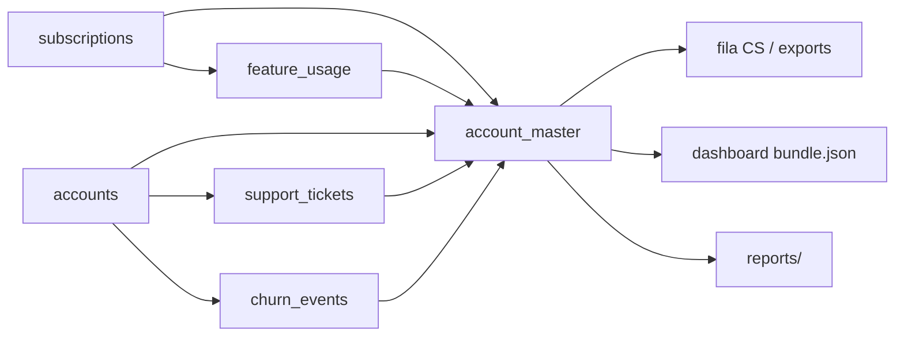

# Metodologia — Challenge 001 (RavenStack)

**Felipe de Lima Santiago** · AI Master G4 · Cursor Agent como executor

Este documento concentra **estratégia, alinhamento ao case, dados, produto e papéis humano/IA**. Evidências obrigatórias continuam em `process-log/`.

---

## 1. Por que o Challenge 001

Audit local de **166 PRs** abertos (out/2026; detalhe opcional no fork em `pr-deficiencies-report.md`):

| Challenge | PRs | O que o field faz | Onde entramos |
|-----------|-----|-------------------|---------------|
| 003 | 77 | Saturação Streamlit + score | Pouco espaço para diferenciar |
| 002 | 34 | Topo forte; muitos sem Dataset 2 | Barra alta |
| **001** | **35** | Join fraco, relatório genérico, pouco MRR | **5 tabelas + narrativa CEO + fila CS** |
| 004 | 14 | Líder estatístico extremo | Risco desproporcional |

**Decisão:** 001 equilibra concorrência, rubrica clara e artefato operacional (fila + playbook), sem competir só em “mais um app”.

---

## 2. Brief CEO → hipóteses → o que os dados disseram

O case não pede dashboard; pede **causa raiz** quando CS, produto e churn **não batem**.

**Hipóteses (antes de codar):**

1. Eventos de churn ≠ churn líquido (reativações).
2. Uso agregado estável; sinal só em subset pré-churn.
3. CSAT médio esconde escalações.
4. Perda econômica segue **MRR**, não contagem de contas.

**Findings reprodutíveis** (`solution/run_analysis.py` → `outputs/summary_stats.json`):

| Fato | Valor |
|------|-------|
| Churn líquido | 110 / 500 (22%) |
| Eventos de churn | 600 |
| Ativas com histórico (“revolving”) | 277 · **US$ 665.190 MRR** |
| MRR perdido (líquido) | **US$ 254.952** |
| Uso médio (retidas vs churn líquido) | ~10,01 vs ~10,03 linhas/evento |
| Queda >30% uso 30d antes do 1º evento | 31% (264 contas com janela) |

**Tese:** não há colapso global de produto/CS no agregado. Há **governança de métricas** (eventos vs líquido), **porta giratória** e segmentos (**DevTools** ~31% churn líquido, canal **event** ~30%). Escalação correlaciona (~6,1% vs ~4,3%) — triagem, não causalidade (`solution/reports/causality_register.md`). Modelo logístico **AUC ~0,62** — triagem humana, não oráculo.

---

## 3. Alinhamento ao case 001

Referência upstream: `challenges/data-001-churn/README.md`.

| Exigência | Evidência |
|-----------|-----------|
| Cruzar 5 tabelas | `outputs/integration_qa.csv` (checks OK), `outputs/account_master.csv` |
| Causa raiz + segmentos + contas | `reports/executive_summary.md`, `outputs/segment_net_churn.csv`, `outputs/contas_analitico.csv`, fila CS |
| Ações priorizadas + impacto | `reports/playbook_cs_revolving.md`, `outputs/recommendations_impact.csv`, `outputs/fila_cs_top50.csv` |
| Correlação ≠ causalidade | `reports/causality_register.md` |
| CEO age em minutos | `reports/ceo_one_pager.md` + Command Center |

**Diferenciais que servem o case (não desviam):** métrica revolving + MRR; React com filtros globais; audit competitivo; `verify_submission.py` + pytest.

---

## 4. Linhagem de dados



| Fonte | Chave | No master |
|-------|-------|-----------|
| accounts | `account_id` | Segmento, trial, churn_flag |
| subscriptions | `subscription_id` → account | MRR/ARR, plano |
| feature_usage | subscription | Uso, erros |
| support_tickets | account | CSAT, escalação |
| churn_events | account | Histórico, reasons |

Validação: `outputs/integration_qa.csv`. Colunas de negócio PT-BR: `analytics/columns.py`.

---

## 5. Produto vs field

| Field (padrão) | Nossa entrega |
|----------------|---------------|
| Streamlit/Dash template | **React + Vite + Recharts** (`solution/command-center/`) |
| Filtros por widget | **Filtros globais** (chips + período + drill-down nos gráficos) |
| Merge cru na UI | `bundle.json` com `status_conta`, `plano_atual`, narrativa executiva |
| Servidor público / tunnel | **`127.0.0.1:8765`** via `serve_dashboard.py` (localhost only) |

Visual: referência G4 — navy + dourado (`command-center/src/theme/g4.ts`).

---

## 6. Papéis: Felipe vs Cursor

| Felipe (orquestra e julga) | Cursor (executa em loop) |
|----------------------------|---------------------------|
| Escolhe challenge e tese após validar números | Pipeline, UI, docs, scripts |
| Refuta narrativa errada da IA (ex.: “queda global de uso”) | Propõe joins, gráficos, estrutura |
| Exige PT-BR, honestidade do AUC, PR só em `felipe/` | `columns.py`, testes, `start.bat` |
| Tom CEO e critérios de causalidade | Rascunhos corrigidos pelo humano |

**Correções típicas:** colunas duplicadas pós-merge; UI Streamlit/listbox rejeitada; servidor errado em `public/`; identidade visual alinhada ao G4.

Timeline: regras G4 → audit PRs → EDA paradoxo → joins + QA → segmentos + fila → relatórios → Command Center → verify + pytest.

---

## 7. Arquitetura técnica

```
data/ (Kaggle, local)
  → run_analysis.py (analytics/)
  → outputs/*.csv, figures/, summary_stats.json
  → export_dashboard.py → command-center/public/data/bundle.json
  → npm run build → dist/
  → serve_dashboard.py (localhost:8765)
```

Score explicável (0–100): eventos, escalações, canal event, DevTools, trial, erros/uso — ver `risk_score()` em `run_analysis.py`. Prioridade fila: risco × MRR.

---

## 8. Estrutura da pasta

```
submissions/felipe/
├── README.md           # Resumo executivo + setup
├── start.bat           # Windows: dependências → pipeline → build → dashboard
├── data/               # CSVs Kaggle (local)
├── docs/
│   ├── METODOLOGIA.md  # Este arquivo
│   └── ENTREGA-E-PR.md # Rubrica CE + checklist PR
├── process-log/        # Evidências IA (obrigatório G4)
└── solution/
    ├── analytics/      # Pipeline + pytest
    ├── command-center/ # React (dist/ após build)
    ├── outputs/        # Gerados
    ├── reports/        # CEO, playbook, causalidade
    ├── run_analysis.py
    ├── serve_dashboard.py
    └── verify_submission.py
```

Não commitar: `node_modules/`, `__pycache__/`, CSVs em `data/`.

---

## 9. Reprodução

**Windows (PC zerado):** `start.bat` na raiz de `felipe/`.

**Manual:**

```bash
cd submissions/felipe/solution
pip install -r requirements.txt
python run_analysis.py
cd command-center && npm install && npm run build
cd .. && python verify_submission.py && python -m pytest analytics/tests/ -q
python serve_dashboard.py   # http://127.0.0.1:8765
```

CSVs: `data/README.md` · Gate CE: `python verify_submission.py` → `VERIFICAÇÃO CE: APROVADA`.

---

_Felipe de Lima Santiago · 2026_
