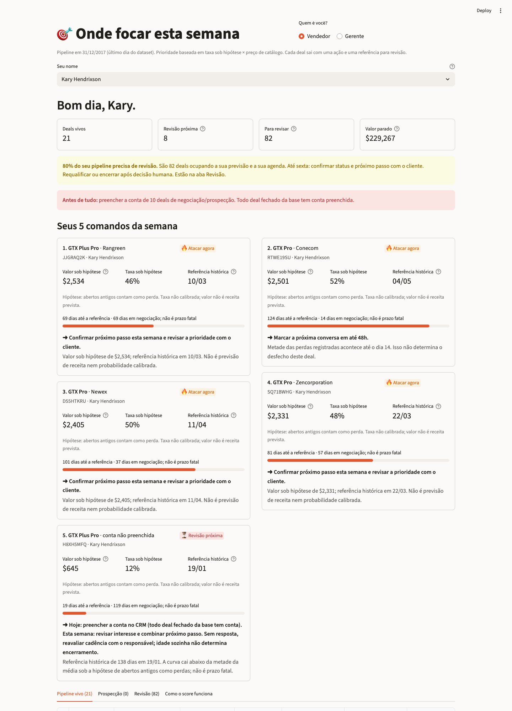
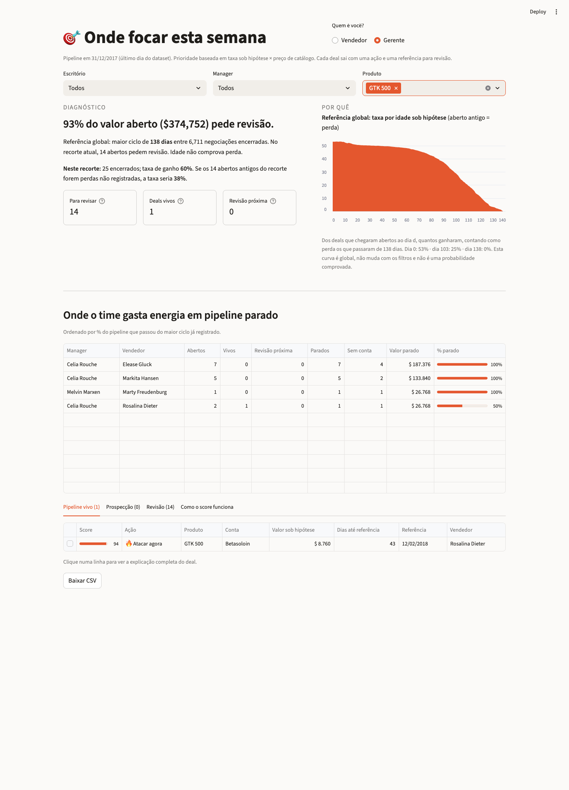
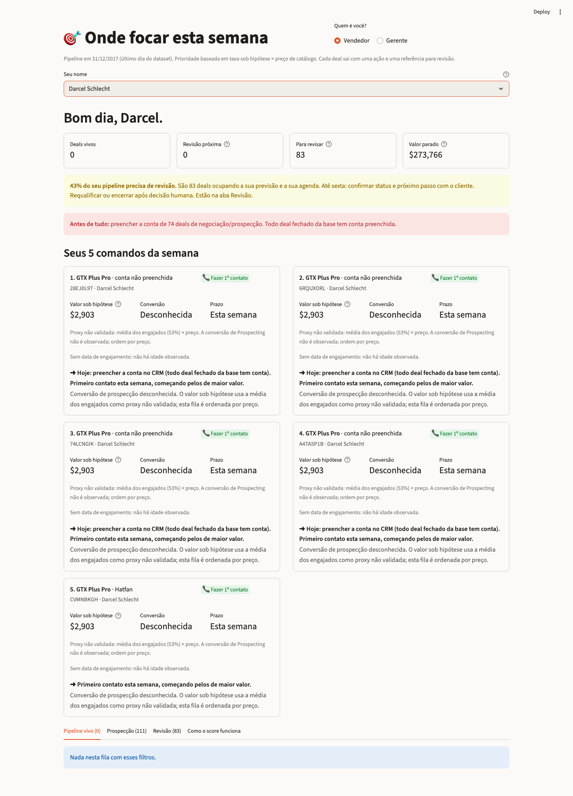

# Submissão — Fellipe Saraiva — Challenge 003 (Lead Scorer)

- **Nome:** Fellipe Saraiva
- **LinkedIn:** [linkedin.com/in/saraivaai](https://www.linkedin.com/in/saraivaai/)
- **Challenge escolhido:** 003 — Lead Scorer

## Executive Summary

**64% do valor aberto no pipeline ($3,2 milhões de $5,0 milhões) está em deals mais velhos que qualquer negociação já encerrada.** Nenhuma das 6.711 negociações encerradas levou mais de 138 dias, mas 1.291 negociações abertas já passaram disso. Se forem perdas que ninguém registrou, a taxa sob essa hipótese cai de 63% para 53%.

Construí um app Streamlit que o vendedor abre na segunda e recebe **5 comandos em ordem, cada um com prazo**. Os deals antigos saem do ranking e viram uma tarefa de revisão humana; 138 dias é um máximo observado, não um prazo fatal.

Também testei o que prevê ganho. Nem vendedor, nem produto, nem setor, nem conta, nem o próprio score separam ganho de perda de forma estável (AUC ≈ 0,5). A idade oscila e muda de direção entre cortes. Por isso o app não promete adivinhar quem compra. Ele organiza a semana: **revisar os antigos e ordenar os próximos contatos com critérios explícitos.**

**A comparação do top 5 não demonstrou vantagem sobre maior preço.** Em quatro cortes, com 90 dias de acompanhamento, o plano teve $3.025,43 de receita observada por vaga contra $3.194,79 do maior preço (−5,3%) e $903,28 da maior idade. São resultados retrospectivos, com desconhecidos e seleções repetidas entre cortes; não são ganho causal. [Protocolo, cobertura e sensibilidade](docs/avaliacao.md).

**Como as peças se encaixam:** [docs/ontologia.md](docs/ontologia.md) define cada conceito (parado, referência histórica, taxa sob hipótese, ação), separa o que é dado, derivado, hipótese e decisão, e aponta onde cada um mora no código.



## Como rodar

Requer Python 3.11 ou superior.

```bash
cd submissions/fellipe-saraiva/solution
python3 -m venv .venv && source .venv/bin/activate     # Windows: .venv\Scripts\activate
pip install -r requirements.txt
python -m unittest discover -s . -p 'test_*.py'        # 34 testes
python scoring.py                                  # diagnóstico e AUC
python evaluation.py                               # top 5, baselines e sensibilidade
streamlit run app.py                                   # http://localhost:8501
```

Os quatro CSVs do [dataset do Kaggle](https://www.kaggle.com/datasets/agungpambudi/crm-sales-predictive-analytics) estão em `solution/data/`. Eles foram baixados de um espelho no GitHub, porque o Kaggle exige login. As contagens batem com o brief, mas a URL do espelho não foi guardada. Por isso os arquivos estão fixados por hash em `solution/data/SHA256SUMS`: `shasum -a 256 -c SHA256SUMS` confere, e um teste falha se algum CSV mudar. O app usa uma **data de referência fixa, 31/12/2017** (último dia da base), e não a data de hoje.

## O que cada pessoa vê

O app abre perguntando: **Vendedor ou Gerente?**

**Vendedor** (escolhe o próprio nome):
1. **"Bom dia, Kary."** Quatro números: deals vivos, Revisão próxima, deals para revisar e o valor parado.
2. **Alertas com comando:**
   - 25% ou mais dos deals abertos parados: o app pede confirmar status e próximo passo até sexta; encerramento depende de avaliação humana e motivo registrado.
   - Abaixo de 25%, o app diz "Pipeline limpo. Agora ataque". Hoje ninguém passa nesse critério: o mais limpo tem 38% parado.
   - Deal de negociação ou prospecção sem conta no CRM: "preencher a conta antes de tudo".
3. **Seus 5 comandos da semana**, em cartões. Cada cartão traz:
   - Valor sob hipótese, taxa não calibrada e **referência histórica**. Em prospecção, a conversão aparece como **desconhecida**, e o uso da média dos engajados é explicado no próprio cartão.
   - Uma barra de distância à referência histórica, sem tratá-la como prazo fatal.
   - O comando em destaque e o porquê.

   A Revisão próxima mais valiosa (que ainda esteja a pelo menos 1 dia da referência) sempre entra no plano. Deal parado nunca entra.
4. **Tabela enxuta.** Ao **clicar numa linha**, aparece a explicação completa: **Verdade → Por que importa → Próximo passo**.

**Gerente** (filtros por escritório, manager e produto):
1. **Diagnóstico:** o valor parado, com taxas calculadas no mesmo recorte dos filtros. A curva de taxa por idade fica explicitamente rotulada como referência global sob hipótese.
2. **Pipeline parado por vendedor**, com % e valor. O primeiro da lista tem 88% dos deals abertos parados.
3. As mesmas filas, com a coluna Vendedor.

| Gerente filtrado | Prospecção sem conta |
|---|---|
|  |  |

## Lógica do score

| Passo | Regra |
|---|---|
| Referência para revisão | O maior ciclo entre os fechados é **138 dias**. Engaging com **mais** de 138 dias vira **Revisar e requalificar** (sai do ranking). O dia 138 permanece elegível. O máximo observado não comprova perda nos mais antigos. |
| Taxa sob hipótese | Dos deals da base que chegaram abertos à mesma idade, quantos ganharam: 53% no dia 0, 48% no dia 60, 37% no dia 90, 25% no dia 103, 11% no dia 120. **Hipótese explícita:** os parados contam como perda, e é ela que produz a queda. Entre os desfechos registrados, a idade não separa ganho de perda; sem a hipótese, pode-se calcular a curva apenas dos fechados (taxa global 63%), sem validá-la para os ainda abertos. |
| Valor sob hipótese | Taxa assumida × preço de catálogo, não previsão de receita. Prospecting recebe a média dos engajados como proxy não validada. Deal aberto não tem `close_value`, e o deal ganho fecha na mediana a 100% do preço de tabela. |
| Score 0–100 | Escala log do valor sob hipótese; valor zero recebe score zero. Os limites vêm do catálogo inteiro, então filtrar a tela não muda o score. |
| Ações | **Revisão próxima** = vivo a partir do dia 103, quando a taxa sob hipótese cai abaixo da metade da média. **Atacar agora** = score ≥ 70. **Manter cadência** = score ≥ 45. **Baixa prioridade** = o resto. **Fazer 1º contato** = Prospecting. |
| Desempate | Dentro do mesmo score, vem antes a menor distância à referência histórica. |
| Deal sem conta | Todo deal fechado da base tem conta, e 209 dos 298 vivos estão sem conta. Pode ser regra do CRM no fechamento, então isso não entra na chance: vira o primeiro comando, preservado também nos cartões de prospecção. |

**A idade muda a ordem, não só o preço.** Um GTX Pro de $4.821 no dia 120 tem $521 sob a hipótese e perde para um GTX Plus Basic de $1.096 no dia 20 ($554). Mesmo assim, o preço ainda pesa muito: a correlação de ordem entre score e preço é 0,78 entre os vivos.

## O backtest: o que tem sinal e o que não tem

Em 4 datas de corte, o histórico **rotulado** contém fechados até o corte, e a avaliação contém os engajados ainda abertos ao fim daquele dia. Esses dois conjuntos são disjuntos. **O fit, porém, também incorpora os abertos antigos do snapshot como pseudo-negativos**, inclusive IDs da avaliação. Portanto, não é correto dizer que todo o fit usa apenas fechados ou que todos os IDs usados no ajuste são disjuntos da avaliação. A hipótese usa idade e estado aberto conhecidos no corte; não foi identificado uso do desfecho futuro desses IDs como rótulo de treino.

Para a AUC, o rótulo é o desfecho registrado até 31/12. Os que seguem abertos não viram perdas na métrica. Na avaliação nova do top 5, status, data e valor de fechamento futuros são apagados antes do fit/seleção, e os resultados observados nos 90 dias seguintes são consultados apenas depois da escolha dos IDs. Uma regressão troca todos os desfechos futuros e verifica que as listas escolhidas permanecem iguais.

| Corte (2017) | Abertos no corte | Com desfecho | Ainda abertos | Score | Idade | Preço | Vendedor | Produto | Setor | Conta |
|---|---:|---:|---:|---:|---:|---:|---:|---:|---:|---:|
| 01/04 | 1.346 | 990 | 356 | 0,53 | 0,47 | 0,53 | 0,50 | 0,45 | 0,48 | 0,47 |
| 01/05 | 1.622 | 1.142 | 480 | 0,52 | 0,54 | 0,52 | 0,46 | 0,49 | 0,47 | 0,48 |
| 01/06 | 1.546 | 939 | 607 | 0,49 | 0,43 | 0,50 | 0,48 | 0,51 | 0,49 | 0,49 |
| 01/07 | 1.706 | 983 | 723 | 0,50 | 0,55 | 0,50 | 0,50 | 0,53 | 0,51 | 0,47 |

**Tudo fica perto de 0,5.** Nenhum atributo desta base separa de forma estável, entre os deals que fecharam, quem ganha de quem perde. A idade chega a 0,43 em um corte e 0,55 em outro: o sinal muda de direção, então não é confiável. Colocar "vendedor: +7 pp" na tela daria uma explicação convincente e falsa.

O máximo de 138 dias é uma referência descritiva para revisão, não evidência de prazo fatal ou custo do atendimento. Os cortes reutilizam deals, então as linhas não são amostras independentes.

## Recomendações

1. **Esta semana:** revisar os antigos com o cliente, registrar interesse e próximo passo. Requalificar ou encerrar somente após decisão humana; ausência de resposta/data não determina Lost.
2. **Toda segunda:** usar o plano como apoio à agenda, sabendo que perdeu para maior preço no teste retrospectivo. Não promover a regra como superior sem validação operacional.
3. **No CRM:** preencher contas, registrar atividades e motivos de encerramento, e medir em piloto prospectivo o efeito de políticas concorrentes. O dataset não contém custo de atendimento nem último contato.

## Limitações

- **Nenhum atributo avaliado separou ganho/perda de modo estável nestes cortes.** O score organiza a agenda; ele não prevê receita deal a deal.
- **"Parado = perda" é uma hipótese**, sustentada por 0 fechamentos após 138 dias em 6.711, mas não verificada nos próprios deals parados. Se parte deles tiver sido ganha sem registro, a chance histórica está subestimada.
- **O limite de 138 dias pode ser artefato da base.** Os engajamentos começam em 20/10/2016, mas nenhum deal fechou antes de 01/03/2017, o que sugere dados sintéticos. Em um CRM real, o limite precisa ser recalculado.
- **Prospecting usa a média histórica.** A base não mostra quantas prospecções viram negociação, então na prática essa fila é ordenada por preço. Sem data de criação, não é possível reconstruir sua população nos cortes passados; essa parte do plano não foi validada retrospectivamente.
- **Para escalar:**
  - Ler direto do CRM (API).
  - Recalcular a curva toda noite.
  - Mandar o plano por Slack ou e-mail às 8h de segunda.
  - Medir se os deals trabalhados pelo plano fecham mais que os outros.

## Como usei IA

Narrativa completa, com os erros de cada versão: [process-log/README.md](process-log/README.md). Evidência atual: [process-log/validacao-v6.txt](process-log/validacao-v6.txt). A [validação v5](process-log/validacao.txt) foi preservada.

| Ferramenta | Uso |
|---|---|
| Warp (agente Oz) | v1 e v2: EDA, primeiro scoring, primeiro backtest |
| Claude | v3 e v5: diagnóstico dos deals parados, interface por papel, plano de segunda, testes e auditoria das outras versões |
| Codex | v6: correções do PR, regressões, baselines e documentação; v4: revisão crítica da v3. Corrigiu a fronteira do dia 138 e a sobreposição de treino e teste, separou os desfechos desconhecidos e cortou afirmações que excediam a evidência |
| Doug (meu método de mentoria) | Critério de produto: verdade antes de comando, comando com prazo, elogio só quando merecido |

| Versão | O que era | Por que mudou |
|---|---|---|
| v1 | Modelo com vendedor, produto, setor e conta | AUC 0,51: o modelo explicava ruído |
| v2 | Valor esperado com curva só de fechados | A chance subia com a idade (viés de sobrevivência) e o score virou tabela de preço |
| v3 | Parados como perda, prazo por deal, interface por papel | Afirmava a hipótese como fato, e o backtest tinha sobreposição de treino e teste no dia do corte |
| v4 | Score fixo (60% valor, 40% idade) e nenhuma hipótese | Rigoroso, mas o plano mandava começar por um deal de $55 parado há 379 dias, e a interface voltou a ser uma tabela |
| v5 | O rigor da v4 com o diagnóstico e a interface da v3 | A hipótese é declarada como hipótese, e o plano prioriza valor e prazo |
| **v6** | Correções da revisão do PR #192 e avaliação do top 5 | Taxas por recorte, conta nos cartões, score zero sem vitórias, incerteza explícita e resultado inferior ao baseline de preço documentado |

Screenshots anteriores (`pipeline.png`, `gerente.png`, `detalhe-deal.png`) foram preservados como evidência da v5. A narrativa histórica do process log foi mantida e recebeu uma seção nova, incluindo a correção da descrição de fit/avaliação.
