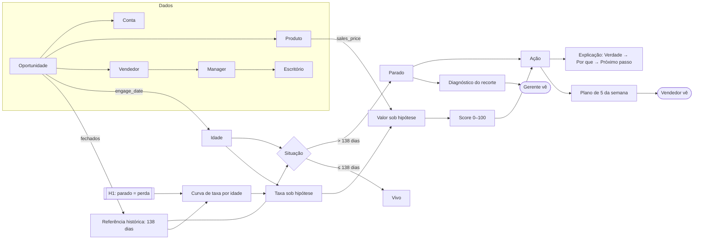

# Ontologia do Lead Scorer

O que cada coisa **é**, de onde vem e o que produz. Serve para ler o código e os documentos sem adivinhar o que um nome quer dizer.

Cada conceito tem uma **origem**:

- **dado:** está no CSV;
- **derivado:** é calculado a partir de dados;
- **hipótese:** é uma suposição declarada que o dado não prova;
- **decisão:** é uma regra de produto.

Todos os números abaixo são da base fixada em `solution/data/` (conferida por `SHA256SUMS`), com data de referência 31/12/2017.

---

## 1. O mapa em uma figura



---

## 2. Entidades do dado (origem: dado)

| Entidade | Arquivo | Chave | O que é | Quantidade |
|---|---|---|---|---:|
| **Oportunidade** | `sales_pipeline.csv` | `opportunity_id` | Uma negociação. É o centro: liga todas as outras. | 8.800 |
| **Conta** | `accounts.csv` | `account` | A empresa cliente: setor, receita, funcionários. | 85 |
| **Produto** | `products.csv` | `product` | Item do catálogo, com série e `sales_price`. | 7 |
| **Vendedor** | `sales_teams.csv` | `sales_agent` | Quem trabalha a oportunidade. | 35 |
| **Manager** | `sales_teams.csv` | `manager` | Quem lidera um grupo de vendedores. | 6 |
| **Escritório** | `sales_teams.csv` | `regional_office` | Região do time. | 3 |

**Relações:** a oportunidade *pertence a* uma conta (ou a nenhuma: 209 dos 298 vivos não têm conta), *vende* um produto e *é trabalhada por* um vendedor. O vendedor *responde a* um manager, que *fica em* um escritório.

**Estágio da oportunidade** (`deal_stage`):

| Estágio | Aberto? | Tem `engage_date`? | Quantidade |
|---|---|---|---:|
| Prospecting | sim | não | 500 |
| Engaging | sim | sim | 1.589 |
| Won | não | sim | 4.238 |
| Lost | não | sim | 2.473 |

Duas grafias da base são corrigidas na carga (`load`): `GTXPro` vira `GTX Pro`, e `technolgy` vira `technology`.

---

## 3. Conceitos derivados (origem: derivado)

| Conceito | Definição | Onde mora | Valor na base |
|---|---|---|---|
| **Idade** | Dias entre `engage_date` e a data de referência. | `score` → `age_days` | — |
| **Referência histórica** | Maior ciclo entre os fechados (engajamento → fechamento). É um **máximo observado**, não um prazo. | `fit` → `cliff` | 138 dias |
| **Parado** | Engaging com idade **maior** que a referência, ou sem data de engajamento. O dia 138 ainda é vivo. | `score` → `stale` | 1.291 |
| **Vivo** | Engaging que não está parado. | `score` → `alive` | 298 |
| **Taxa do CRM** | Ganhos ÷ fechados. É o que o CRM mostra. | `fit` → `crm_rate` | 63% |
| **Exposição** | Quanto do valor aberto, a preço de catálogo, está em parados. | `exposure` | 64% ($3,2M de $5,0M) |
| **Distância à referência** | Dias que faltam para o deal vivo passar de 138. | `score` → `days_left` | — |

---

## 4. Hipóteses declaradas (origem: hipótese)

Nada aqui é provado pelo dado. Cada hipótese tem um efeito no app e um teste de sensibilidade.

| # | Hipótese | Por que é plausível | O que ela produz | Se for falsa |
|---|---|---|---|---|
| **H1** | Deal parado é perda não registrada. | Nenhuma das 6.711 negociações fechadas passou de 138 dias. | A **curva de taxa por idade**: 53% no dia 0, 25% no dia 103, 11% no dia 120. Sem H1, a idade não separa ganho de perda. | A taxa sob hipótese fica subestimada. O cenário `sem_pseudo_perdas` em `evaluation.py` mede isso. |
| **H2** | Prospecção converte na média dos engajados. | A base não tem data de criação nem taxa de conversão de prospecção. | Prospecção é ordenada, na prática, só pelo preço. O cartão mostra conversão **desconhecida**. | A ordem da fila de prospecção continua a mesma; só o número exibido estaria errado. |
| **H3** | Conta vazia é falha de cadastro, não sinal de perda. | Todo deal fechado tem conta, o que sugere uma regra do CRM no fechamento. | "Preencher a conta" vira o primeiro comando, sem mexer na taxa. | Haveria um sinal ignorado, que não seria usado na chance. |
| **H4** | O limite de 138 dias vale fora desta base. | Nenhum: os dados parecem sintéticos (nenhum fechamento antes de 01/03/2017). | Nada no código. Está registrada nas Limitações. | Num CRM real, o limite precisa ser recalculado. `fit` já faz isso sozinho. |

---

## 5. Cadeia de decisão (origem: decisão)

| Passo | Conceito | Regra |
|---|---|---|
| 1 | **Taxa sob hipótese** | Da curva H1, pela idade do deal vivo. Para prospecção, a média (H2). Para parado, zero. |
| 2 | **Valor sob hipótese** | Taxa × `sales_price`. Não é previsão de receita. |
| 3 | **Score 0–100** | Escala log do valor, com limites fixos no catálogo inteiro: filtrar a tela não muda o score. Valor zero dá score zero. |
| 4 | **Ação** | Uma de seis, na ordem da tabela abaixo. |
| 5 | **Plano de 5** | Os 5 vivos de maior valor. A Revisão próxima mais valiosa sempre entra, e parado nunca entra. Se faltar deal vivo, completa com prospecção. |
| 6 | **Explicação** | Toda oportunidade carrega **Verdade** (o fato), **Por que importa** e **Próximo passo** (o comando). |

**As seis ações** (`acao`), avaliadas nesta ordem. Deal sem conta recebe antes "Hoje: preencher a conta no CRM" em qualquer ação, inclusive prospecção:

| Ação | Quando | Quantidade | Comando típico |
|---|---|---:|---|
| Revisar e requalificar | Parado | 1.291 | Até sexta: confirmar interesse e próximo passo. Requalificar ou encerrar só após avaliação humana e registro do motivo. |
| Fazer 1º contato | Prospecting | 500 | Primeiro contato, começando pelos de maior valor. |
| Revisão próxima | Vivo a partir do dia 103, quando a taxa cai abaixo da metade da média | 154 | Revisar interesse e combinar próximo passo. Sem resposta, reavaliar a cadência com o responsável. |
| Atacar agora | Score ≥ 70 | 57 | Confirmar próximo passo esta semana e revisar a prioridade com o cliente. |
| Manter cadência | Score ≥ 45 | 56 | O mesmo comando de "Atacar agora": a diferença está só na ordem. |
| Baixa prioridade | O resto | 31 | Depois dos prioritários, revisar interesse e adequação do produto. |

---

## 6. Papéis e o que cada um vê

| Papel | Pergunta que o app responde | Conceitos na tela |
|---|---|---|
| **Vendedor** | "O que eu faço primeiro esta semana?" | Plano de 5, ações, explicação, alerta de parados e de conta vazia. |
| **Gerente** | "Onde o meu time está travado?" | Diagnóstico do recorte (escritório, manager, produto), taxas do mesmo recorte e parados por vendedor. |

---

## 7. Evidência: como se sabe o que se afirma

| Afirmação | Evidência | Resultado | Arquivo |
|---|---|---|---|
| Nenhum atributo prevê ganho de forma estável | AUC em 4 cortes temporais, só com desfechos registrados | Tudo entre 0,43 e 0,55 | `scoring.py` → `backtest` |
| O plano de 5 é melhor que regras simples | 600 seleções, 90 dias de acompanhamento, com os rótulos escondidos até a escolha | **Não é.** Fica 5,3% abaixo de "maior preço" e muito acima de "maior idade" | `evaluation.py`, `docs/avaliacao.md` |
| O resultado não depende do futuro | Teste que troca todos os desfechos futuros e confere que as listas não mudam | Passa | `test_evaluation.py` |
| A tela mostra o que a regra diz | Testes de interface com cada vendedor e com os filtros do gerente | Passam | `test_app.py` |
| Os dados são os mesmos dos números publicados | SHA-256 de cada CSV | Bate | `data/SHA256SUMS` |

**Consequência para o produto:** o app não vende previsão. Ele vende **organização da semana**: revisar os antigos, ordenar os próximos contatos e dar um porquê para cada um.

---

## 8. Onde cada conceito mora

```
submissions/fellipe-saraiva/
├── README.md              ← a submissão: resumo, lógica, limites, uso de IA
├── solution/
│   ├── data/              ← Entidades (sec. 2) + SHA256SUMS
│   ├── scoring.py         ← Derivados (3), hipótese H1 (4), cadeia de decisão (5), backtest (7)
│   ├── evaluation.py      ← Plano de 5 contra regras simples, cenários de sensibilidade (7)
│   ├── app.py             ← Papéis (6): seller_view, manager_view
│   └── test_*.py          ← Evidência executável (7)
├── docs/
│   ├── ontologia.md       ← este arquivo
│   ├── avaliacao.md       ← protocolo e resultados da comparação de políticas
│   └── *.png              ← telas (v6-* atuais; as demais são da v5)
└── process-log/           ← como foi construído: v1 → v6, erros e correções
```

## 9. Vocabulário

| Termo no código | Significado | Não confundir com |
|---|---|---|
| `cliff` | Referência histórica (138 dias) | Prazo contratual |
| `stale` | Parado | Perdido |
| `prob` | Taxa sob hipótese | Probabilidade calibrada |
| `valor_esperado` | Valor sob hipótese | Receita prevista |
| `last_call` | Dia em que começa a Revisão próxima (103) | Último contato registrado (não existe na base) |
| `urgencia` | Distância à referência, usada só para desempate | Prioridade |
