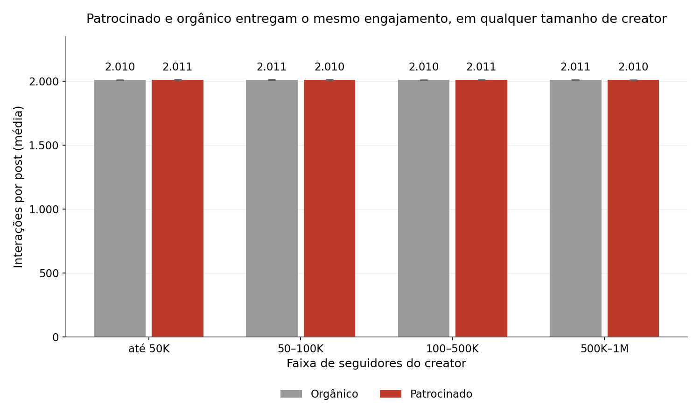
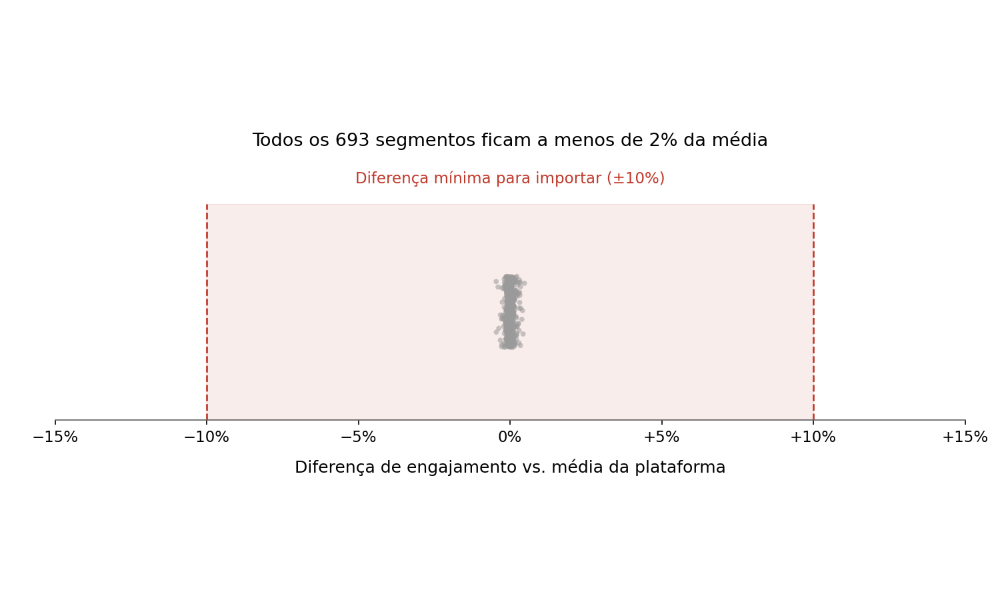

# Estratégia de Social Media: o que os dados mostram e o que fazer

**Para:** Head de Marketing · **De:** Gabriel Mata (AI Master) · **Leitura:** 5 minutos

Detalhes técnicos e provas: [`relatorio_tecnico.md`](relatorio_tecnico.md)

---

## A resposta em uma frase

**Nenhuma escolha que fazemos hoje (plataforma, formato, tema, tamanho do influenciador, patrocínio, hashtag, horário ou público) muda o engajamento ou o alcance dos posts. Cada real pago em patrocínio compra zero engajamento adicional. O orgânico entrega o mesmo resultado, e deve ser a base da estratégia.**

## As 3 decisões que preciso de você

1. **Adotar o orgânico como padrão** e aprovar a nova política de patrocínio: só patrocinar com objetivo que não seja engajamento (venda, nova audiência), sempre medido.
2. **Liberar o acesso aos dados reais** (Meta Business Suite, TikTok Studio, YouTube Studio) e ao custo da mídia paga.
3. **Confirmar a origem desta base**, que não se comporta como dado real (ver "Quão seguro é isso?").

---

# Parte 1 — Análise de performance

## 1.1 O que gera engajamento?

**Nada do que controlamos hoje.** Analisamos 52 mil posts, cada variável isolada e combinada com as outras (693 combinações).

| Variável | Resultado | Maior diferença possível |
|---|---|---|
| **Plataforma** | Instagram, TikTok, YouTube, Bilibili e RedNote rendem o mesmo | 0,08% |
| **Tipo de conteúdo** | Vídeo, imagem, texto e misto rendem o mesmo | 0,11% |
| **Categoria** | Beauty, lifestyle e tech rendem o mesmo | 0,07% |
| **Tamanho do creator** | De 1 mil a 1 milhão de seguidores, o mesmo engajamento | 0,13% |
| Horário, dia e hashtags | Nenhum efeito | — |

**O insight que vai além do óbvio:** o número de seguidores **não compra alcance nem engajamento**. Um influenciador de 5 mil seguidores tem as mesmas ~10.100 visualizações e ~2.010 interações por post que um de 1 milhão.

## 1.2 Patrocínio funciona?

**Não para engajamento nem para alcance. Cada real pago em patrocínio compra zero engajamento adicional.**

| Comparação | Patrocinado | Orgânico | Diferença |
|---|---|---|---|
| **Taxa de engajamento** | 19,9% | 19,9% | 0,0% (no máximo 0,035%) |
| **Alcance** (visualizações por post) | 10.100 | 10.100 | 0,29 visualização |
| **Interações por post** | ~2.010 | ~2.010 | Nenhuma, em qualquer tamanho de influenciador |
| **Custo implícito** | Todo o valor pago | Zero de mídia | O valor pago não compra resultado extra |

**Em que condições vale a pena?** Para engajamento, em nenhuma. Só para objetivos que o orgânico não atinge (venda rastreada, nova audiência), e com medição.

**Com que tipo de influenciador?** Nenhum perfil se destaca: tamanho, alinhamento da marca ao conteúdo e forma de divulgação não mudam o resultado.

**Prova nos números:** 42,7% dos posts são patrocinados e geram exatamente 42,7% do engajamento total. Nada além da sua fatia.

## 1.3 Qual perfil de audiência mais engaja?

**Nenhum.** Idade, gênero e país não mudam o engajamento, nem combinados entre si (126 perfis testados).

| Cruzamento | Resultado |
|---|---|
| Audiência **por plataforma** | Sem diferença |
| Audiência **por tipo de conteúdo** | Sem diferença (68 combinações, todas dentro de ±0,8%) |
| Audiência **por categoria** | Sem diferença |

**Cuidado com o "campeão" falso:** "homens 50+ do Reino Unido" aparecem com +0,5%. Parece um achado, mas foi um entre 126 perfis testados, e o acaso sozinho produz um "campeão" desse tamanho.

## 1.4 O que NÃO funciona?

**Nenhum formato, plataforma ou tema rende abaixo da média**, então não há conteúdo a cortar por desempenho. O que não funciona são investimentos e práticas:

- **Patrocinar para gerar engajamento:** paga-se por um resultado que o orgânico já entrega.
- **Pagar mais por influenciadores grandes:** seguidores não aumentam visualizações nem interações.
- **Otimizar horário, dia e hashtags:** nenhum efeito.
- **Medir engajamento dividindo por seguidores:** faz influenciadores pequenos parecerem 29x melhores, quando entregam exatamente o mesmo.
- **Decidir por "top posts" ou "segmento campeão":** nos testes, todo "campeão" era sorte.

## Quão seguro é isso?

- **Todas as 693 combinações ficam a menos de 2% da média.** Para importar, seria preciso uma diferença de pelo menos 10%.
- **No melhor cenário possível, a melhor escolha renderia 2,6 interações a mais por post, de ~2.010.**
- **Testamos o próprio método:** quando inserimos de propósito uma diferença pequena nos dados, ele a encontrou em 100% das vezes. Se existisse um vencedor, teríamos visto.

**Alerta sobre a base:** ela não se comporta como dado real de redes sociais. O alcance não cresce com os seguidores, e não existe nenhum post fracassado ou viral. Por isso, o plano começa pelos dados reais.

---

# Parte 2 — Estratégia recomendada

## 2.1 Onde concentrar esforço?

**Princípio: orgânico como base.** Ele entrega o mesmo engajamento e o mesmo alcance que o patrocinado, sem pagar por isso.

| Pergunta | Recomendação |
|---|---|
| **Qual plataforma?** | Manter Instagram, TikTok e YouTube. Nenhuma se destaca, e 40% da base é de plataformas onde não operamos (Bilibili e RedNote). |
| **Qual tipo de conteúdo?** | Nenhum a priorizar, nenhum a cortar: todos rendem igual. |
| **Qual frequência?** | A base não permite medir. Testar o aumento da cadência orgânica no plano de 8 semanas. |
| **Qual faixa de creator?** | Nenhuma rende mais. Se houver patrocínio, vale quem tiver o menor preço por desempenho comprovado. |

## 2.2 Política de patrocínio

| Pergunta | Resposta |
|---|---|
| **Patrocinar ou não?** | **Para engajamento, não.** Cada real pago compra zero engajamento adicional. |
| **Em que condições?** | Só com objetivo de venda ou nova audiência, definido antes e medido com UTM e cupom, e só se a mídia paga não entregar o mesmo mais barato. |
| **Com que perfil?** | Nenhum perfil engaja mais. O critério é o desempenho comprovado do influenciador, não o tamanho. |
| **Qual o threshold de seguidores ou engajamento?** | **Nenhum.** Seguidores não aumentam o resultado, e o engajamento é igual em todas as faixas. O limite passa a ser de **preço**: não pagar mais do que a mídia paga custaria para o mesmo objetivo. |

Regras operacionais no anexo.

## 2.3 O que parar de fazer

1. **Patrocinar com objetivo de engajamento.** É o investimento de menor retorno identificado: 42,7% dos posts foram patrocinados e entregaram o mesmo que os orgânicos.
2. **Pagar influenciador pelo número de seguidores.**
3. **Medir engajamento dividindo por seguidores.**
4. **Otimizar horário, dia e hashtags.**
5. **Decidir a partir de "top posts" ou "segmento campeão".**

## 2.4 Quick wins desta semana

1. **Revisar os patrocínios ativos e as renovações:** suspender os que têm engajamento como objetivo; manter só os de venda ou nova audiência, com UTM e cupom.
2. **Trocar o indicador do relatório semanal** para interações por post (ou por visualização). Abolir a divisão por seguidores.
3. **Levantar o custo e o resultado da mídia paga dos últimos 90 dias**, a referência para qualquer patrocínio.
4. **Exportar 90 dias de dados reais** das três plataformas e rodar a ferramenta de acompanhamento.
5. **Criar uma planilha única de patrocínios:** influenciador, valor, objetivo, entrega, interações, cliques, cupons e vendas.

---

## Plano de 8 semanas

| Semana | O que acontece |
|---|---|
| 1 | Base de dados real pronta |
| 2–3 | Diagnóstico com a ferramenta; escolha de no máximo 2 hipóteses |
| 3–8 | **Teste orgânico:** duas versões de conteúdo muito diferentes |
| 3–8 | **Teste de cadência orgânica:** mais posts em uma plataforma, medindo se o engajamento por post se mantém |
| 3–8 | **Teste de patrocínio com objetivo de venda:** custo por venda rastreada vs. mídia paga |
| 8 | Decisão com três respostas possíveis: **funciona** → investir · **comprovadamente não faz diferença** → parar · **ainda não dá para saber** → continuar |

**Por que testar diferenças grandes:** com dados reais, para ter certeza de uma diferença de 20%, é preciso de 100 a 400 posts por versão. Ajustes finos não aparecem em 8 semanas.

## O que mudaria esta conclusão

Com os dados reais, revisamos a estratégia se:

- **o patrocinado render comprovadamente mais que o orgânico** → aí o patrocínio volta a comprar engajamento;
- **algum formato, plataforma ou público render 20% a mais ou mais**, com confirmação → concentramos esforço nele;
- **mais posts reduzirem o engajamento por post** → a cadência orgânica tem um limite.

---

## Anexo — Regras operacionais de patrocínio

| Regra | Como funciona |
|---|---|
| **Objetivo declarado** | Todo patrocínio precisa de um objetivo que não seja engajamento (venda, nova audiência), definido antes do contrato |
| **Sem mínimo de seguidores** | Seguidores não aumentam o resultado. Não pagamos mais por tamanho. |
| **Preço pelo desempenho comprovado** | Média de visualizações e interações dos últimos 10–15 posts do influenciador, com print ou acesso aos dados da plataforma. Nunca seguidores nem media kit. |
| **Teto de preço** | Se a nossa mídia paga entrega o mesmo objetivo mais barato, não patrocinamos |
| **Teste antes do pacote** | Um post-teste antes de qualquer contrato maior |
| **Rastreio obrigatório** | UTM e cupom exclusivo por influenciador, em contrato |
| **Divulgação explícita sempre** | Não reduz o engajamento e protege a marca juridicamente |
| **Marca alinhada ao conteúdo** | Critério de imagem da marca, não de engajamento: nos dados, não muda o resultado |
