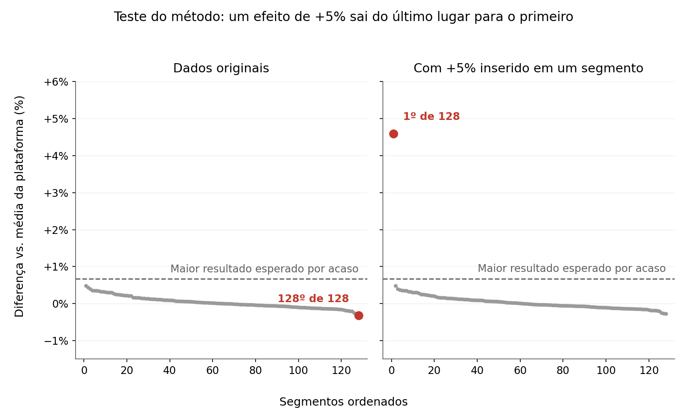
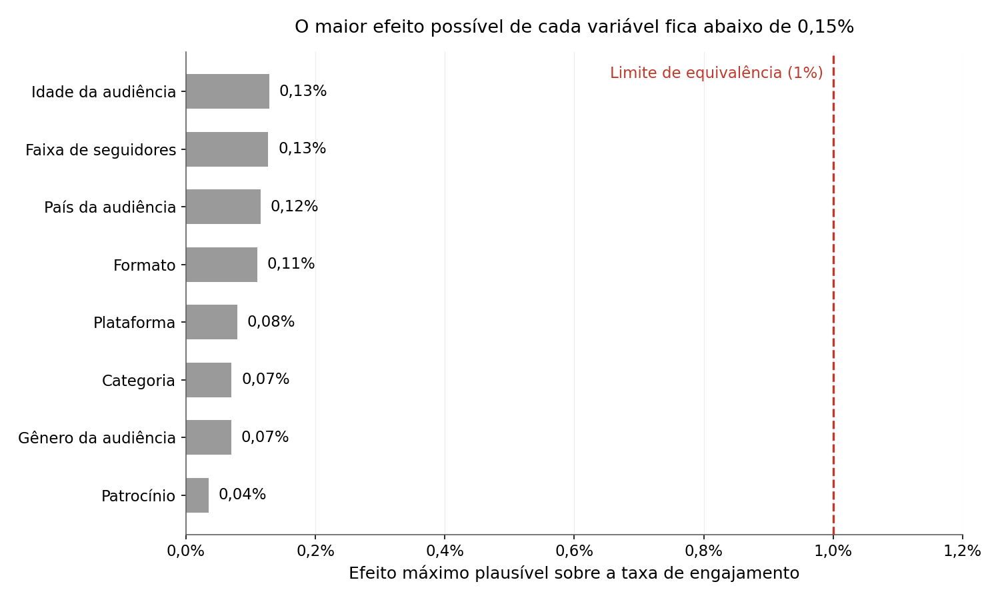

# Relatório técnico — Challenge 004: Estratégia Social Media

**Autor:** Gabriel Mata · **Público:** avaliador técnico

**Versão executiva (Head de Marketing):** [`relatorio_executivo.md`](relatorio_executivo.md)

> Todo número deste relatório sai de código executado. A origem de cada um está indicada como `osXX`, que corresponde a `solution/outputs/osXX/` (resumo em `resumo_osXX.md`). Os scripts estão em `solution/analysis/`.

---

## 1. Resumo

**Conclusão.** Nenhuma variável que a empresa controla (plataforma, formato, categoria, tamanho do creator, patrocínio, fit de patrocinador, hashtags, horário) nem o perfil de audiência altera o engajamento de forma relevante. O pior caso plausível é de **+2,6 interações por post, sobre ~2.010** (os04).

**Consequência central:** patrocinado e orgânico entregam o mesmo engajamento e o mesmo alcance (diferença de 0,29 view por post; os06) em todas as faixas de creator. **Cada real pago em patrocínio compra zero engajamento adicional.** Para o objetivo de engajamento, o orgânico é suficiente, e o patrocínio só se justifica por objetivos que o dataset não mede (conversão, nova audiência).

**O que diferencia esta entrega.** A conclusão coincide com a do baseline (seção 9), o que reforça que a lógica está certa. A diferença está no grau de prova:

| | Baseline | Esta entrega |
|---|---|---|
| Afirmação | "Nenhum efeito significativo" (p-valor alto) | **Efeito máximo plausível ≤ 0,38%** em 105 de 105 segmentos (teste de equivalência) |
| Poder do teste | Não avaliado | **Menor efeito detectável de 0,06% a 0,40%** |
| O método funciona? | Não demonstrado | **Controle positivo: 74 de 74 efeitos injetados detectados** |
| Decisão | Sinal / ruído | **Sinal / sem efeito comprovado / inconclusivo** |

Afirmar que "não há efeito" é diferente de provar que, se houver, ele é irrelevante e que o método o encontraria. É essa prova que permite decidir com segurança.

---

## 2. Diagnóstico da base

52.214 posts, de maio/2023 a maio/2025 (25 meses), 5.000 creator_id, 27 colunas. Sem duplicatas. Nulos apenas em `hashtags` (16,7%) e `comments_text` (16,6%) (os01).

### Testes de sanidade (os04, item 1)

| Indicador | Esperado em dado real | Encontrado |
|---|---|---|
| Views por faixa de seguidores | Crescem com a base de seguidores | Mediana de 10.097 a 10.101, de 1K a 1M de seguidores |
| Correlação likes × views | Forte | 0,0008 |
| Correlação log(seguidores) × log(views) | Positiva | 0,006 |
| Variância ÷ média (views, likes, shares, comentários) | Muito maior que 1 (cauda longa) | Entre 0,99 e 1,00 (padrão Poisson) |
| Posts com engajamento < 10% da mediana | Parcela relevante (fracassos) | 0% (p1 ÷ mediana = 0,95) |
| Amplitude de views | Ordens de grandeza | 9.676 a 10.551 |
| Creator em uma única plataforma | Maioria | 0% dos 5.000 |
| Seguidores constantes por creator | Quase constantes | 0% (variação mediana de 842K entre posts do mesmo creator; os01) |
| Associação idioma × país da audiência | Forte | V de Cramér = 0,011 |
| Patrocinadores distintos | Marcas recorrentes | 18.005 nomes em 22.314 posts patrocinados |
| `content_length` por formato | Diferente para vídeo e texto | Mediana de 173 a 175 em todos os formatos |

**Leitura:** as métricas se comportam como sorteios independentes em torno de médias fixas. A própria descrição do Kaggle informa que os dados são simulados. Isso não invalida a análise: muda a pergunta de *"o que performa melhor?"* para *"o que estes dados permitem afirmar, e com que segurança?"*.

**Consequências para o método:**

- `content_length` não é duração e foi excluído. Não há como sustentar afirmações do tipo "vídeos de 30–60s".
- `creator_id` não é uma entidade coerente, então não há análise por creator e seguidores são tratados como atributo do post.
- As colunas de patrocínio são 100% determinadas por `is_sponsored`. Nas regressões, entra só `is_sponsored`.

---

## 3. Método

### 3.1 Divisão de trabalho
O raciocínio, a interpretação e a estratégia foram feitos no Claude.ai. A execução foi delegada ao Claude Code por **Ordens de Serviço (OS)** curtas, sem contexto estratégico, com regras explícitas: só executar o pedido, não interpretar, máximo de duas tentativas por erro. Detalhes em `process-log/`.

### 3.2 Regra de decisão, fixada antes dos resultados
Um segmento seria classificado como "funciona" ou "não funciona" apenas com:

- **lift ≥ ±10%** vs. a média da plataforma;
- IC 95% (bootstrap) que não contém 1;
- mesmo sentido em duas metades aleatórias da base;
- n ≥ 100.

Análise de sensibilidade com cortes de 3%, 5% e 10%: o resultado não muda (seção 4.1).

### 3.3 Técnicas

| Técnica | Para quê | OS |
|---|---|---|
| Índice por post (valor ÷ média da plataforma) e lift por segmento | Comparação justa entre plataformas | 02 |
| IC 95% bootstrap percentil (1.000 reamostragens) | Margem de erro sem supor normalidade | 02–03c |
| Repetição em duas metades (seed 42) | Separar efeito de sorte | 02–03c |
| Permutação dentro da plataforma (200×) | Comparar o melhor segmento com o melhor esperado por acaso | 02, 03b, 03c |
| Comparação estratificada (plataforma × categoria × formato × faixa) | Patrocinado vs. orgânico entre grupos iguais | 03 |
| OLS com erros HC3 e controles | Efeito isolado do patrocínio | 03 |
| Gradient boosting + validação cruzada de 5 partes vs. previsão pela média | Testar todas as interações ao mesmo tempo | 03 |
| Teste de equivalência (IC 90% dentro de ±1% e ±2%) | Provar ausência de efeito relevante | 03c |
| Menor efeito detectável (poder 80%, α 5%) | Provar que a base tinha poder | 03c |
| Controle positivo (injeção de +1%, +2%, +5%, +10%) | Provar que o método detecta efeitos reais | 03c |
| Caudas (top 10%, top 1%, bottom 10%) com IC de Wilson + KS | Virais e fracassos, não só médias | 03c |
| Tendência mensal (OLS HC3) | Mudança ao longo do tempo | 03c |
| Benjamini-Hochberg (FDR 5%) | Correção de testes múltiplos em hashtags | 04 |

**Fora do escopo, por decisão:**

- **Clustering:** substituído por consolidação supervisionada. O clustering agrupa sem olhar para o engajamento.
- **Árvore de decisão:** dispensada depois que o modelo preditivo mostrou ausência de sinal.

---

## 4. Resultados

### 4.1 O que gera engajamento (os02)

| Teste | Resultado |
|---|---|
| Segmentos avaliados (níveis 1 a 4: de variáveis isoladas até plataforma × formato × categoria × faixa) | 693 × 3 métricas |
| Faixa de lifts | 0,983 a 1,018 |
| Segmentos além de ±3%, ±5% ou ±10% | 0 |
| Plataformas vs. média geral | Razões de 0,9991 a 1,0010 |
| Extremos observados vs. acaso | 24 de 24 dentro do acaso |
| Concordância entre metades | 41% a 48% (o acaso dá 50%) |
| IC excluindo 1 | 0,6% a 3,6% das linhas (o acaso dá ~5%) |
| Hashtags (970 testadas; os04) | 118 com p < 0,05 em 1.940 testes (~97 esperados por acaso); **0 após BH** |


### 4.2 Patrocínio (os03, os03b)

| Teste | Resultado |
|---|---|
| Patrocinado ÷ orgânico, estratificado (141 estratos) | Taxa de engajamento 0,9999 (IC 0,9994–1,0004); shares 0,9995 (0,9985–1,0005); comentários 1,0000 (0,9988–1,0014) |
| Regressão com controles | Efeito de −0,04% a +0,02% da média; p de 0,40 a 0,79; R² ajustado negativo; teste F p de 0,67 a 0,87; número de condição 17,4 |
| Por faixa de seguidores | 0 de 12 ICs excluem 1 |
| Tipo e local de disclosure, categoria do patrocinador | 0 de 51 ICs excluem 1 |
| Fit patrocinador × conteúdo (7.439 posts com fit) | Taxa de engajamento 1,0003 (IC 0,9996–1,0011); as 18 duplas ficam dentro do acaso |
| Participação | 42,74% dos posts são patrocinados e geram 42,73% do engajamento |
| **Alcance (views), simples** (os06) | Razão de 1,00003 (IC 0,99987–1,00020); 10.100,45 vs. 10.100,16 views, diferença de 0,29 view por post |
| **Alcance, estratificado** (os06; 141 estratos) | 1,00005 (IC 0,99987–1,00021) |
| **Alcance por faixa de seguidores** (os06) | 0 de 4 ICs excluem 1; efeitos de 0,9997 a 1,0002 |
| Engajamento absoluto por faixa × patrocínio | 2.009,9 a 2.010,8 interações por post em todas as 8 células |


**Leitura para a decisão:** com efeito estratificado de 0,0% e efeito máximo plausível de 0,035% na taxa de engajamento (os03c), o engajamento incremental do patrocínio é nulo. Qualquer valor pago por patrocínio com objetivo de engajamento é custo sem retorno incremental.

**A hipótese de fit** (patrocinador alinhado à categoria do conteúdo) foi proposta pelo autor e testada; não se sustentou. Uma observação importante: o dataset atribui patrocinadores aleatoriamente, sem simular a escolha por fit que existe na operação real.

### 4.3 Audiência (os03b, os06)

| Teste | Resultado |
|---|---|
| 126 personas (idade × gênero × local, n ≥ 100) | Lifts de 0,9965 a 1,0054; maior esperado por acaso de 1,0065 |
| Categoria × idade, gênero e local (51 segmentos) | Lifts de 0,997 a 1,003, dentro do acaso |
| Patrocínio por público (17 valores × 3 métricas) | 3 de 51 ICs excluem 1, o esperado por acaso |
| **Formato × idade, gênero e país** (os06; 68 segmentos × 3 métricas) | Lifts de 0,9944 a 1,0078; 0 além de ±3%; 1 de 18 extremos fora do acaso por margem mínima (1,00775 vs. p95 de 1,00757), dentro do esperado para 18 testes |

### 4.4 Validação geral (os03)
O gradient boosting com 13 variáveis tem R² entre −0,0013 e −0,0008 nos 4 alvos, e o erro médio fica de 0,05% a 0,07% **maior** que o de prever sempre a média.

---

## 5. Robustez (os03c)

| Pergunta | Teste | Resultado |
|---|---|---|
| Qual o maior efeito possível? | Equivalência | 105 de 105 segmento × métrica equivalentes a ±1%. Efeito máximo plausível: **0,38%** |
| Isso em unidades absolutas? (os04) | Conversão | **2,6 interações**, 1,0 share ou 0,8 comentário por post, no pior caso |
| A base tinha poder? | Menor efeito detectável | De 0,06% a 0,40% |
| O método detecta efeitos reais? | Controle positivo isolado | 72 de 72 detectados (+1%, +2%, +5%; 8 variáveis × 3 métricas) |
| E numa busca entre muitos segmentos? | Controle positivo na busca | Bilibili × vídeo × beauty × 50–100K (n = 137), que era **o pior** dos 128 segmentos, recebe +5%: passa a **1º de 128** e supera o acaso (1,046 vs. p95 de 1,0065) |
| Há diferença nos extremos? | Caudas + KS | 6 de 315 testes após o ajuste de empates (1,9%); KS 4 de 105 (3,8%) |
| Algo mudou no tempo? | Tendência | 1 de 36 inclinações com p < 0,05 (o acaso dá ~1,8); todas entre −0,22% e +0,20% ao ano |





---

## 6. Armadilhas identificadas

| Armadilha | O que pareceria | O que é |
|---|---|---|
| **Engajamento ÷ seguidores** | Creators de até 50K "engajam 29x mais" que os de 500K–1M (os03, bloco 5) | O engajamento absoluto é igual (~2.010); só o denominador muda |
| **Comparações múltiplas** | A persona "50+ \| masculino \| Reino Unido": +0,54%, IC exclui 1, repete nas duas metades | É uma entre 126 testadas; o acaso produz até +0,65% |
| **Colinearidade** | Regressão inicial: vídeo +73 e patrocínio +67 shares, com p < 0,0001 | Variáveis derivadas de outras (número de condição 1e16); no modelo limpo, ~1 share |
| **Campo mal rotulado** | Faixas de "duração de vídeo" | `content_length` tem a mesma distribuição para texto e imagem |
| **Empates em métricas inteiras** | 88 de 315 segmentos com caudas "anormais" | 86 eram efeito do corte por quantil em valores repetidos |
| **p-valor alto = sem efeito** | "p = 0,55, então plataforma não importa" | Falta de prova não é prova de ausência. Corrigido pelo teste de equivalência |

---

## 7. Da análise à decisão

As recomendações estão no relatório executivo, separadas em **[Dado]** (sai das análises) e **[Critério]** (regra de negócio a validar). Em resumo:

- **Orgânico como base [Dado].** Ele entrega o mesmo engajamento que o patrocinado; o patrocínio compra zero engajamento adicional.
- **Patrocínio como exceção [Critério].** Só com objetivo que não seja engajamento (conversão, nova audiência), definido antes e medido com UTM e cupom. Preço por desempenho comprovado, nunca por seguidores [Dado: seguidores não alteram views nem engajamento]. Teto: não patrocinar se a mídia paga entrega o mesmo objetivo mais barato. Disclosure explícito sempre [Dado: sem efeito sobre o engajamento].
- **Sem formato, plataforma, categoria ou público a priorizar ou cortar [Dado].** As 3 plataformas da operação (Instagram, TikTok, YouTube) se mantêm. Bilibili e RedNote (40,2% da base; os04) não fazem parte da operação.
- **Plano de 8 semanas** com variantes orgânicas muito diferentes entre si, um teste de cadência orgânica e um teste de patrocínio com objetivo de conversão. Com a variação típica de dados reais (CV de 0,5 a 1,0), detectar +20% exige de 98 a 392 posts por variante (os04, item 4).

---

## 8. O que mudaria esta conclusão

As recomendações são condicionais a esta base. Com dados reais, cada uma tem um gatilho de revisão definido antes:

| Se, com dados reais... | Então | Recomendação afetada |
|---|---|---|
| Patrocinado render mais que orgânico, com efeito ≥ 10% e IC excluindo 1 | O patrocínio passa a comprar engajamento; precificar por custo por interação incremental | Orgânico como base |
| Views e engajamento crescerem com seguidores | Seguidores voltam a ser indicador de alcance; o preço por desempenho comprovado continua válido | Sem mínimo de seguidores |
| Algum formato, plataforma ou público render ≥ +20%, confirmado em teste | Concentrar esforço nesse segmento | Nada a priorizar |
| Mais posts reduzirem o engajamento por post | A cadência orgânica tem um teto; buscar a frequência ótima | Teste de cadência |
| Patrocínio gerar conversão rastreada mais barata que a mídia paga | Patrocínio justificado por conversão | Patrocínio como exceção |

---

## 9. Comparação com o baseline

**Objetivo.** O baseline não foi gerado para mostrar que a IA erra. O objetivo era comparar **métodos**. O brief e o CSV foram enviados a um chat do Claude sem contexto, num único envio. A conclusão coincidiu, o que reforça a lógica. O que se compara é o embasamento.

| Aspecto | Baseline | Esta entrega |
|---|---|---|
| Conclusão principal | Mesma | Mesma |
| Diagnóstico de dado sintético | ✅ Tabela "esperado × encontrado" (incorporada aqui, com crédito) | ✅ |
| Validação de "top segmentos" | Metades, 30 repetições | Metades + permutação em 4 níveis |
| Ausência de efeito | Por p-valor | **Equivalência + menor efeito detectável** |
| O método funciona? | Não testado | **Controle positivo (74 de 74)** |
| Hashtags | BH, comparando cada hashtag com a base inteira, que inclui o próprio grupo | BH, comparando com os posts **sem** a hashtag |
| Profundidade | Cruzamentos de 2 variáveis | Até 4 variáveis + 126 personas + fit + caudas + tendência |
| Política de patrocínio | ✅ Teto por CPM, UTM, cupom e post-teste (incorporados, com crédito) | **Orgânico por padrão:** o patrocínio compra zero engajamento adicional, então só se justifica com objetivo de conversão ou nova audiência, medido |
| Veredito para decisão | Sinal / real, mas pequeno / ruído | **Sinal / sem efeito comprovado / inconclusivo** |

Todas as afirmações do baseline que não tínhamos testado foram verificadas no CSV antes de serem usadas (`process-log/decisions.md`).

---

## 10. Limitações

- **Dados simulados:** as conclusões valem para esta base. As recomendações marcadas como teste precisam de validação com dados reais.
- **Sem custo, conversão, alcance real, saves ou tempo de exibição:** ROI não é calculável.
- **Diluição no índice por plataforma:** o lift subestima efeitos em segmentos grandes (ex.: +5% injetado nos patrocinados é medido como +2,8%). Isso não afeta a conclusão sobre patrocínio, medida por razão estratificada.
- **Audiência com rótulo único por post**, não a distribuição percentual.
- **Frequência não mensurável:** `creator_id` incoerente impede medir a cadência. A hipótese de que mais posts orgânicos aumentam o total sem reduzir o engajamento por post entra como teste, não como conclusão.
- **Faixas de seguidores desbalanceadas:** até 50K e 50–100K têm cerca de 2,6 mil posts cada, contra 26 mil em 500K–1M.

---

## 11. Reprodução

```bash
pip install -r requirements.txt
# CSV em <raiz do repo>/datasets/social_media_dataset.csv
python solution/analysis/run_all.py
```

| Script | Conteúdo |
|---|---|
| `os01_base_amostral.py` | Base amostral e qualidade |
| `os02_benchmark.py` | Benchmark por segmento, níveis 1 a 4 |
| `os03_patrocinio_validacao.py` | Patrocínio, regressão, modelo preditivo |
| `os03b_fit_audiencia.py` | Fit e audiência |
| `os03c_robustez.py` | Equivalência, poder, controle positivo, caudas, tendência |
| `os04_complementos.py` | Sanidade, hashtags, efeito absoluto, tamanho de amostra |
| `os05_graficos.py` | Gráficos dos relatórios |
| `os06_lacunas.py` | Alcance patrocinado vs. orgânico; formato × audiência |
