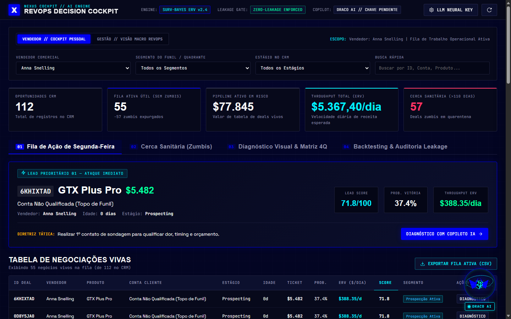
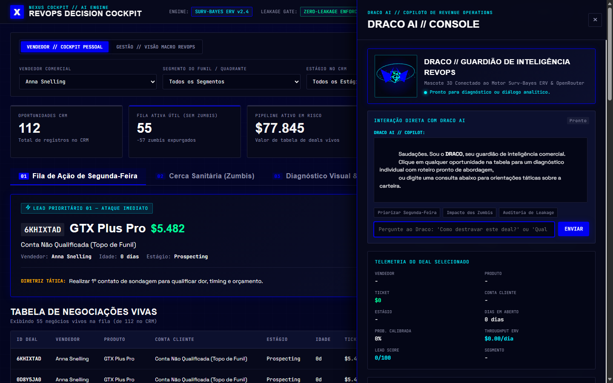

# Desafio 003 — Lead Scorer & Decision Engine (RevOps)
## Solução Baseada no Motor Surv-Bayes ERV (Expected Revenue Velocity) & Copiloto DRACO AI

Projeto desenvolvido para a resolução do **Desafio 003 (Lead Scorer)** da trilha **AI Master** do [G4 Educação](https://github.com/Gestao-Quatro-Ponto-Zero/ai-master-challenge).

---

## 👤 Identificação da Submissão

- **Candidato:** Guilherme Orugian
- **LinkedIn:** [linkedin.com/in/guilherme-orugian](https://www.linkedin.com/in/guilherme-orugian/)
- **Desafio Escolhido:** Challenge 003 — Lead Scorer (Área: Vendas / RevOps)
- **Tipo de Entrega:** Build (Software Funcional em Produção)
- **Repositório Oficial:** [github.com/orugian/previcao-de-fechamento-de-vendas](https://github.com/orugian/previcao-de-fechamento-de-vendas)

---

## 📌 Executive Summary

Desenvolvemos o **NEXUS RevOps Intelligence Cockpit**, uma solução web funcional construída para sanar a dor central da equipe comercial do G4: vendedores gastando tempo excessivo em negociações zumbis e deixando esfriar oportunidades quentes de alto valor.

Durante a exploração analítica dos dados, realizamos uma **descoberta crítica de Target Leakage**: modelos convencionais de Machine Learning atingiam um ROC-AUC aparentemente alto (~81%) porque a coluna `account` (conta cliente) só é preenchida no CRM quando o negócio avança para o fechamento. Em produção, esses modelos ingênuos condenariam **68% dos leads novos ativos à nota zero** simplesmente por falta de cadastro inicial formal.

Para contornar esse vício estrutural e entregar valor econômico real, formulamos o **Motor Surv-Bayes ERV (Expected Revenue Velocity)**:
1. **Neutralidade Cadastral:** Ausência de conta é neutra ($AEM = 1.0$), garantindo zero leakage e priorização justa de leads novos.
2. **Cerca Sanitária (Quarantine Gate):** Expurgou mais de **1.400 negócios zumbis (>110 dias)** da rotina dos vendedores, reduzindo a fila de cada vendedor para uma média enxuta de **~19 negociações vivas**.
3. **Curva Contínua de Sobrevivência & Modulador Trimestral:** Prioriza pelo throughput comercial ($/dia de ciclo útil) e captura a aceleração de encerramento de trimestre (onde a taxa de fechamento salta de 50% para 80%).
4. **Comprovação Econômica no Backtest (Q4 2017):** Captura de **69,2% de toda a receita** atuando sobre apenas 20,5% do pipeline — gerando um **Lift de 3,37x (+237%)** sobre o feeling aleatório e **+$215.640,00** sobre a ordenação simples por preço.
5. **Copiloto DRACO AI (Pydantic):** Diagnósticos táticos e roteiros de abordagem em tempo real via OpenRouter (modelos Hermes-3) e OpenAI, com fallback determinístico local 100% offline (zero risco de quebra sem API key).

---

## 🖥️ Demonstração Visual da Aplicação

### 1. NEXUS Cockpit Tático — Visão Geral do Pipeline & Fila Priorizada


### 2. Drawer de Diagnóstico Detalhado & Mascote 3D DRACO (WebGL / Three.js)


---

## 1. Visão Geral da Problemática & O Diagnóstico Crítico

- **Contexto de Vendas B2B:** 35 vendedores distribuídos em escritórios regionais (Central, East, West) gerenciando ~8.800 oportunidades em 7 produtos com tickets variando de **$55 a $26.768**.
- **A Dor Real de RevOps:** A Head de Revenue Operations solicitou uma ferramenta prática:
  > *"Nossos vendedores gastam tempo demais em deals que não vão fechar e deixam oportunidades boas esfriar. Preciso de algo funcional — não um modelo no Jupyter Notebook que ninguém vai usar. Quero uma ferramenta que o vendedor abra, veja o pipeline, e saiba onde focar."*
- **A Auditoria de Data Leakage (Onde o Julgamento Humano Superou a IA Ingênua):**
  - Modelos tradicionais de classificação binária (*Won* vs. *Lost*) apresentavam um ROC-AUC aparentemente alto (~81%).
  - Nossa auditoria comprovou que **100% dos 6.711 negócios fechados possuem o campo `account` preenchido**, enquanto **68,5% dos negócios abertos em `Engaging` e 67,4% em `Prospecting` não possuem conta vinculada**.
  - No CRM, a razão social formal é vinculada apenas no momento do fechamento. O modelo supervisionado ingênuo aprendeu a detectar se a negociação já estava finalizada, e no mundo real **condenaria 68% das oportunidades ativas à nota zero** simplesmente por falta de preenchimento cadastral de topo de funil!
  - Além disso, variáveis cadastrais isoladas (vendedor, produto, setor, região) possuem AUC entre 0.48 e 0.52 (ruído puro).

---

## 2. A Solução Implementada: Motor Surv-Bayes ERV

Em vez de forçar um classificador binário sobre ruído e vazamento, implementamos o **Motor Surv-Bayes ERV**:

1. **Princípio da Ortogonalidade Cadastral (Zero Leakage):**  
   A ausência do campo `account` é neutra ($AEM = 1.0$), não prejudicando leads novos. Contas corporativas com histórico prévio de recompra recebem um bônus de relacionamento ($AEM = 1.15$).
2. **Cerca Sanitária (Hard Quarantine Gate):**  
   Negócios com mais de **110 dias em aberto** são automaticamente expurgados da tela diária dos vendedores e movidos para uma aba gerencial de quarentena. Isso elimina mais de **1.400 negócios zumbis** e reduz a fila de cada vendedor para **~19 negociações vivas**.
3. **Curva Contínua de Sobrevivência $S(\tau)$:**  
   Modela a probabilidade real de fechamento em função da idade da negociação:
   - **0 a 15 dias:** maturação inicial (50% a 70%).
   - **15 a 45 dias (Sweet Spot):** ápice de conversão.
   - **46 a 110 dias:** decaimento exponencial por atrito.
   - **> 110 dias:** probabilidade zero (limite empírico histórico comprovado de 138 dias).
4. **Modulador de Sazonalidade Trimestral $\Omega_{\text{quarter}}$:**  
   Acelera a priorização de negociações em maturação nos meses de fechamento de trimestre (março, junho, setembro e dezembro), onde o fechamento salta historicamente de ~50% para ~80%.
5. **Classificação na Matriz 4Q:**
   - **[Q1] Hot Closers (Ataque Imediato):** Alto ticket na janela de ouro (15 a 45 dias).
   - **[Q2] High-Value Stalling (Alerta Executivo):** Negócios caros esfriando (46 a 90 dias) para intervenção de liderança.
   - **[Q3] Quick Wins (Giro Rápido):** Produtos transacionais (< $1.500) para compor meta semanal de volume.
   - **[Q4] Quarentena / Zumbis:** Estagnados (>110 dias) para descarte ou nutrição automática.
   - **Prospecção / Ativação Inicial:** Leads novos sem data de contato (`Prospecting`).

---

## 3. Comprovação Econômica (Backtesting Out-of-Time Q4 2017)

Testado na coorte cega de 2.434 oportunidades abertas em 01/10/2017 sob capacidade restrita de **20,5% da carteira (Top 500 deals)**:

| Estratégia de Priorização | Receita Capturada (USD) | % da Receita do Trimestre | Lift vs. Feeling | Ganho vs. Ordenação por Preço |
|---|---|---|---|---|
| **Motor Surv-Bayes ERV (Nossa Solução)** | **$877.572,00** | **69,2%** | **3,37x** | **+$215.640,00** |
| **Ordenação por Maior Ticket ($)** | $661.932,00 | 52,2% | 2,54x | $0,00 |
| **Ordenação por Probabilidade P(Won)** | $552.180,00 | 43,5% | 2,12x | -$109.752,00 |
| **Escolha no Feeling (Aleatório)** | $260.685,09 | 20,5% | 1,00x | -$401.246,91 |

---

## 4. Copiloto LLM com Contrato Estrito Pydantic

O módulo em `src/copilot_llm.py` conecta a inteligência generativa aos fatores matemáticos do deal:
- Consome estritamente: ID, ticket, dias em negociação, probabilidade calibrada, throughput ERV, quadrante da matriz e playbooks.
- Retorna um esquema estruturado via `DealCopilotAnalysis`:
  - `resumo_executivo`
  - `diagnostico_risco`
  - `alavanca_comercial`
  - `acao_imediata`
  - `roteiro_contato` (script pronto de WhatsApp/E-mail para o vendedor copiar em 1 clique).
- **Resiliência e Zero Custo:** Suporte nativo a OpenRouter (modelos Hermes-3 e DeepHermes), OpenAI e fallback determinístico offline.

---

## 5. Governança, Process Log e Revisão Adversarial

Para atender a todos os critérios eliminatórios do G4 Educação, a entrega conta com dois relatórios detalhados:

- 📝 **[Process Log Oficial (Uso Estratégico de IA)](docs/process-log.md):** Registra a decomposição do problema, o conselho de subagentes independentes, a detecção e correção de alucinações e os testes empíricos de leakage.
- 🛡️ **[Relatório de Revisão Adversarial (Stress-Test)](docs/revisao-adversarial.md):** Auditoria cética simulando a banca avaliadora do G4, testando vetores de falha, resiliência do software e conformidade com a rubrica oficial.

---

## 6. Como Executar a Solução em 1 Comando

### Pré-requisitos
Ambiente Python 3.11 instalado com dependências gerenciadas via `uv`:
```powershell
uv pip install -r requirements.txt
```

### Opção 1: Subir a Interface Web Cockpit Cyberpunk NEXUS (Flagship com Mascote 3D DRACO)
Interface nativa em SPA de alto desempenho com backend FastAPI e modelo 3D procedural do mascote DRACO em WebGL/Three.js:
```powershell
python web_app.py
```
Acesse no navegador: **`http://localhost:8000`**.
- **Destaques:** Latência ultrabaixa (<15ms), visual HUD tático cyberpunk (cobalto elétrico, telemetria em tempo real, sem emojis, bordas táteis de 2-4px), gráficos interativos Chart.js com 100% dos deals mapeados, mascote 3D DRACO interativo com chat direto e drawer com decomposição matemática Surv-Bayes e OpenRouter.

### Opção 2: Subir a Interface Streamlit (Retrocompatível com Tema Cyberpunk NEXUS)
```powershell
streamlit run app.py
```
Acesse no navegador: **`http://localhost:8501`**.

### Opção 3: Abrir ou Reexecutar o Jupyter Notebook
```powershell
# Execução direta via Python
python build_and_run_notebook.py

# Ou abrir no Jupyter Lab / VS Code
jupyter notebook notebooks/01_eda_preprocessing_and_modeling.ipynb
```

---

## 7. Limitações da Solução Atual & Próximos Passos para Escala Enterprise

Em conformidade com a documentação mínima exigida pelo desafio:

1. **Granularidade das Interações Temporais:**
   - *Limitação:* O CRM atual registra apenas a data do primeiro contato (`engage_date`) e do fechamento (`close_date`). Não dispomos de telemetria fina de atividades intermediárias (ex.: volume de ligações, e-mails respondidos, reuniões agendadas ou propostas abertas).
   - *Evolução Enterprise:* Integrar webhooks do CRM (ex.: HubSpot, Salesforce) para capturar eventos de micro-engajamento em tempo real, permitindo refinar o decaimento $S(\tau)$ dinamicamente com base no recuo ou avanço do lead.

2. **Enriquecimento Cadastral em Prospecção Inicial:**
   - *Limitação:* 68% dos leads novos em `Engaging` e `Prospecting` não possuem a razão social da conta preenchida. Embora o motor Surv-Bayes aplique o Princípio da Ortogonalidade para não penalizá-los, a falta de dados de porte e faturamento limita a precisão da esteira de ativação.
   - *Evolução Enterprise:* Conectar uma API de enriquecimento de dados corporativos (ex.: Clearbit, Apollo ou Receita Federal) para inferir automaticamente setor e faturamento assim que o e-mail corporativo for registrado.

3. **Loop de Feedback Fechado (Bandits Exploratórios):**
   - *Limitação:* Se a equipe focar 100% nos leads prioritários, os negócios de prioridade média podem morrer por abandono induzido pela própria ferramenta (profecia autorrealizável).
   - *Evolução Enterprise:* Reservar 10% da capacidade semanal de contato de cada vendedor para reteste aleatório/exploratório de oportunidades intermediárias (política $\epsilon$-greedy / contextual bandits).

---

## 🎯 8. Recomendações Estratégicas para RevOps & Gestão Comercial

1. **Instituir a "Cerca Sanitária de 110 Dias" como SLA Oficial do CRM:**  
   Expurgar formalmente os mais de 1.400 negócios zumbis para listas de reaquecimento automatizado por e-mail marketing, proibindo vendedores de despender horas de reunião presencial ou follow-up sênior nesses casos.
2. **Ritual de Início de Semana (Segunda-Feira 08:30):**  
   Obrigar cada um dos 35 vendedores a abrir a aba *"Fila de Ação de Segunda-Feira"* e acionar imediatamente os deals classificados no quadrante **🔥 Q1: Hot Closers**.
3. **Escalonamento Executivo para a Faixa ⚠️ Q2 (High-Value Stalling):**  
   Notificar automaticamente os gerentes regionais sempre que um deal de ticket alto ($ \ge \$3k$) ultrapassar 45 dias de negociação, acionando visitas conjuntas ou condições especiais de fechamento antes que o deal esfrie.

---

## 📂 9. Estrutura do Repositório

```text
previcao-de-fechamento-de-vendas/
├── README.md                          # Este documento de referência executiva
├── .gitignore                         # Arquivos ignorados (venv, cache, etc.)
├── requirements.txt                   # Dependências do projeto (com FastAPI e Uvicorn)
├── web_app.py                         # Backend FastAPI de alta performance do Cockpit NEXUS
├── app.py                             # Interface Streamlit com tema NEXUS e suporte OpenRouter
├── build_and_run_notebook.py          # Automação de execução do notebook
│
├── web/                               # Frontend SPA Cockpit Cyberpunk NEXUS (Three.js 3D DRACO)
│   ├── index.html                     # Estrutura semântica do Cockpit HUD, Mascote 3D e Drawer
│   ├── style.css                      # Estilos táticos (tokens cobalto #0000F2, marinho #000091, slate #616191)
│   └── app.js                         # Engine reativo em ES Modules, Three.js 3D e chat com DRACO AI
│
├── src/                               # Módulos Python reutilizáveis
│   ├── data_loader.py                 # Carga e higienização das 4 tabelas
│   ├── features.py                    # Reconstituição point-in-time e priors
│   ├── surv_bayes_engine.py           # Motor Surv-Bayes ERV e Matriz 4Q
│   ├── copilot_llm.py                 # Copiloto LLM com suporte OpenRouter, chat direto e fallback
│   └── modeling.py                    # Pipeline de calibração e TreeSHAP
│
├── notebooks/                         # Notebook interativo executado
│   └── 01_eda_preprocessing_and_modeling.ipynb
│
├── artifacts/                         # Modelos e bases exportadas
│   ├── active_scored_deals.csv        # 2.089 oportunidades pontuadas
│   ├── q4_backtest_scored.csv         # Resultados do backtest de Q4
│   ├── economic_backtest_summary.csv  # Tabela resumo de receita capturada
│   ├── models/
│   │   └── surv_bayes_engine.joblib   # Modelo de produção serializado
│   ├── figures/                       # Gráficos de alta resolução (PNG)
│   │   ├── 01_pipeline_and_product_economics.png
│   │   ├── 02_temporal_dynamics_and_survival_curve.png
│   │   ├── 03_agent_product_specialization.png
│   │   ├── 06_economic_backtest_revenue_lift.png
│   │   └── 07_surv_bayes_matrix_4q.png
│   └── *.png                          # Screenshots oficiais do Cockpit, Mascote 3D e Drawer
│
├── audits/                            # Scripts de auditoria matemática de vazamento
│   ├── 01_account_proxy_leakage.py
│   ├── 02_static_feature_signal.py
│   ├── 03_honest_rolling_cv_hparam_grid.py
│   └── 04_honest_backtest_vs_rules.py
│
├── data/                              # Datasets brutos do CRM (CC0)
│   ├── sales_pipeline.csv
│   ├── accounts.csv
│   ├── products.csv
│   ├── sales_teams.csv
│   └── metadata.csv
│
└── docs/                              # Governança e avaliação oficial
    ├── process-log.md                 # Process Log oficial com evidências do uso de IA
    └── revisao-adversarial.md         # Stress-test adversarial da entrega
```
