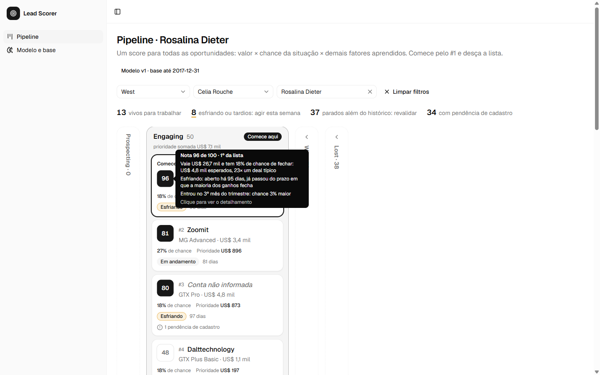
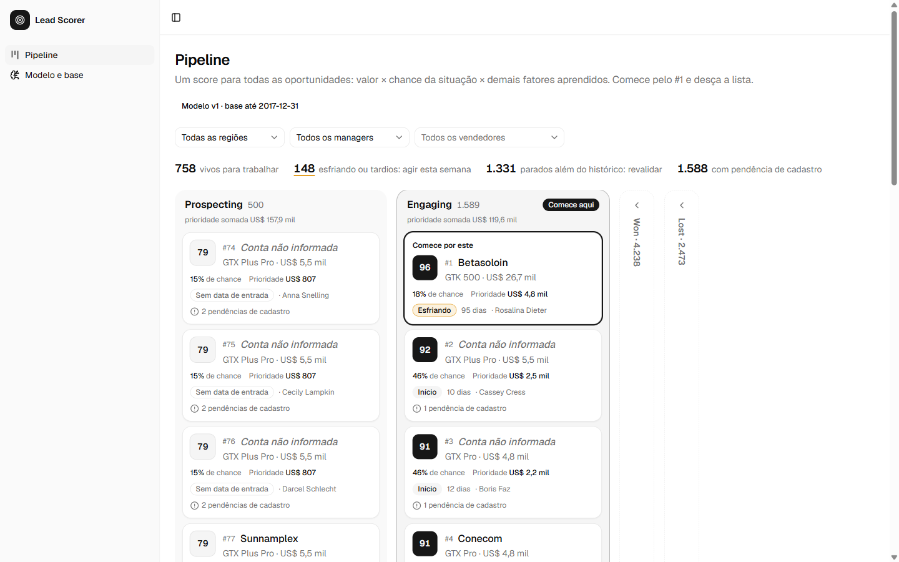
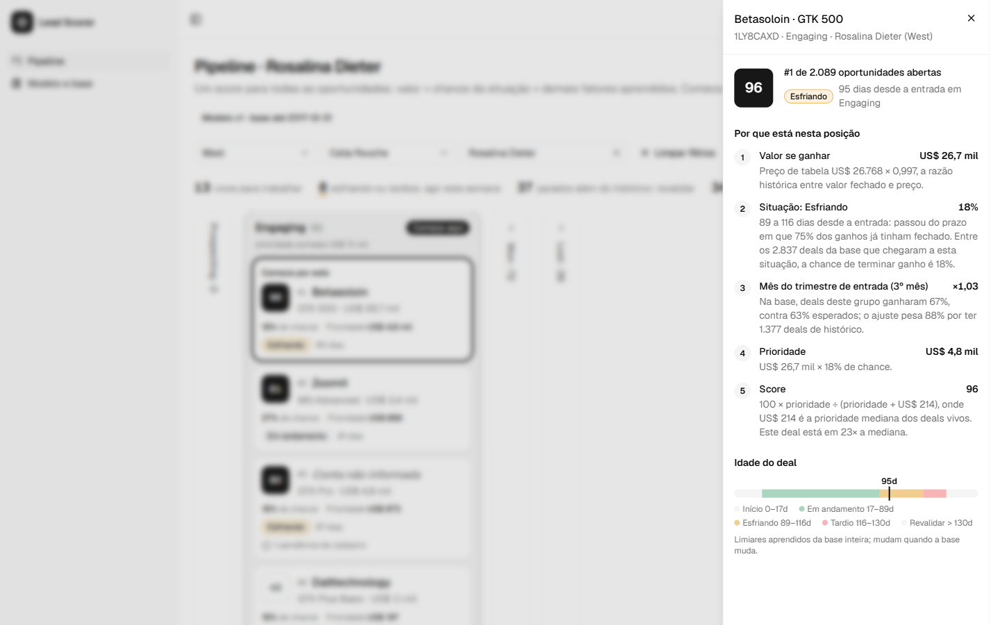
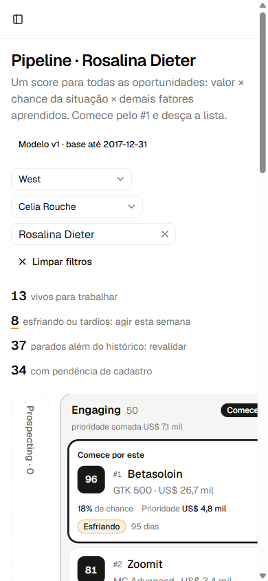

# Submissão — Hiago Hoffman — Challenge 003

## Sobre mim

- **Nome:** Hiago Hoffman
- **LinkedIn:** https://www.linkedin.com/in/hiago-hoffman
- **Challenge escolhido:** 003 — Lead Scorer

---

## Executive Summary

Construí uma aplicação web que abre o pipeline do vendedor ordenado por uma nota de 0 a 100. A nota é explicada ao passar o mouse e detalhada ao clicar.

A análise da base mostrou que produto, setor, região, vendedor e conta não preveem se um deal será ganho ou perdido. O que separa os deals é o valor e o tempo aberto. Além disso, 81% dos deals em Engaging estão abertos há mais tempo do que qualquer deal que já fechou.

Por isso a nota combina o valor do deal com a chance de ganhar na situação em que ele está. Qualquer outro fator só entra quando os dados comprovam efeito. Todos os parâmetros são reaprendidos a cada nova base e testados em datas passadas: a lista coloca 55,3% da receita ganha nos 20% do topo, contra 46,7% ordenando só por preço.

**Principal recomendação:** revalidar ou encerrar os 1.331 deals parados além do histórico e concentrar o time nos deals vivos, do topo da lista para baixo.

---

## Solução

Uma aplicação web pronta para uso, com a base do challenge embutida e um motor de score que reaprende sozinho:

- **Código e setup:** [`solution/`](solution/). Instruções passo a passo em [`solution/README.md`](solution/README.md#setup), testadas a partir de um clone limpo.
- **Análise e modelo de cálculo:** [`docs/analise-lead-scorer.md`](docs/analise-lead-scorer.md).

```bash
cd solution
npm install
npm run dev        # http://localhost:3000
```



### Abordagem

**Por onde comecei.** Comecei pelos dados, antes de qualquer tela:
- Li a fala da Head de RevOps e a separei em dois problemas: tempo gasto em deals que não vão fechar, e deals bons que esfriam.
- Analisei a base inteira e mês a mês, com testes estatísticos, separando o que é fato do que é heurística.

**Como decompus.**
1. **Diagnóstico da base:** qualidade dos dados, taxa de ganho por dimensão (com teste de significância), ciclo de venda, sazonalidade e estado do pipeline aberto.
2. **Revisão cruzada:** enviei a análise ao ChatGPT para uma crítica independente. Conferi cada ponto na base e corrigi o que estava errado.
3. **Modelo de cálculo:** defini a regra antes de programar. Ela é geral, não depende de nomes e reaprende a cada base.
4. **Motor de score:** implementei com testes que reproduzem os números da análise em Python, e com um teste em datas passadas que compara o modelo com a ordenação só por preço.
5. **Interface:** pipeline com as raias do CRM, nota com explicação, detalhamento, filtros e uma tela para o gestor acompanhar o modelo e atualizar a base.
6. **Iterações de uso:** ajustes a partir do que eu via na tela (nota única, detalhamento enxuto, tooltip em linguagem de vendedor, filtros coerentes).

**O que priorizei.**
- **Receita:** todas as escolhas do modelo são decididas pela receita ganha que fica no topo da lista. Deals maiores pesam mais.
- **Explicabilidade:** o vendedor entende a nota numa leitura só, e o detalhamento mostra apenas o que justifica a posição do deal.
- **Regra geral e adaptativa:** nenhum vendedor, produto ou região aparece no código. Entidades novas herdam a média e ganham peso próprio só quando os dados sustentarem.
- **Honestidade estatística:** um fator só entra na fórmula se melhorar o resultado no teste em datas passadas.
- **Funcionar de verdade:** o app roda com `npm install` a partir de um clone limpo.

### Resultados / Findings

**O que encontrei na base**

| Achado | Dado |
|---|---|
| Nenhum atributo estático prevê ganho ou perda | Qui-quadrado com p > 0,26 para produto, setor, região, manager, vendedor e conta. O win rate de um vendedor no 1º semestre não prevê o do 2º (r = 0,15). |
| O valor é o que mais diferencia os deals | O preço varia 500× entre produtos. GTX Pro, GTX Plus Pro e MG Advanced somam 84% da receita. |
| Quem perde, perde rápido | Mediana do ciclo: 14 dias nas perdas, 57 dias nos ganhos. |
| O pipeline aberto é, na maioria, "zumbi" | 81% dos deals em Engaging estão abertos há mais de 138 dias, mais que qualquer deal já fechado. |
| Sazonalidade trimestral forte | Taxa de ganho de 49%, 55% e 81% no 1º, 2º e 3º mês de cada trimestre. |
| Especialização é de volume, não de conversão | GTK 500 é vendido quase só no West (23 de 25 deals), sem evidência de que outras regiões convertam pior. |
| Qualidade de cadastro | 1.425 deals abertos sem conta; Prospecting sem data de entrada; produto com grafia diferente do catálogo. |

**O que construí**

- **Nota única para todas as oportunidades:**

  ```text
  Prioridade = Valor × Situação × Afinidade × Relacionamento × Produto × Time × Calendário × Urgência
  Nota       = 100 × Prioridade ÷ (Prioridade + prioridade mediana dos deals vivos)
  ```

  - A **situação** do deal é o fator central: Prospecting, Início, Em andamento, Esfriando, Tardio ou Revalidar.
  - Os demais fatores (afinidade produto × região/vendedor, cliente com histórico de compras, produto, time, calendário e urgência) são testados a cada base e só entram quando aumentam a receita capturada. Hoje entra o mês do trimestre; afinidade região × produto, histórico do cliente e urgência foram testados e ficaram fora.
- **Pipeline:**
  - raias com os nomes do CRM;
  - o nº 1 destacado como "Comece por este";
  - tooltip em linguagem de vendedor;
  - detalhamento com a conta da nota;
  - filtros por região, manager e vendedor.
- **Tela "Modelo e base":** a fórmula, a chance de cada situação, o resultado dos testes, a qualidade da base, o upload de uma nova base e o histórico de versões do modelo.

| Teste em datas passadas (mar–ago/2017) | Receita ganha nos 20% do topo | Erro de probabilidade (Brier) |
|---|---|---|
| Sem modelo: ordenação só por preço | 46,7% | 0,314 |
| Modelo em uso | **55,3%** | **0,222** (calibrado) |

| Visão geral | Detalhamento | Celular |
|---|---|---|
|  |  |  |

Tela do modelo: [`docs/screenshots/04-modelo.png`](docs/screenshots/04-modelo.png).

### Recomendações

1. **Sanear o pipeline agora:** revalidar ou encerrar os 1.331 deals marcados *Revalidar*. Eles inflam o pipeline e consomem atenção sem chance real de fechar.
2. **Rotina de segunda-feira:** cada vendedor filtra o próprio nome, trabalha a lista de cima para baixo e age na mesma semana nos deals marcados *Esfriando*.
3. **Higiene do CRM:** vincular a conta aos 1.425 deals abertos sem conta e registrar a entrada em Engaging. Isso melhora as estimativas e ativa o fator de histórico do cliente.
4. **Registrar o que acontece depois da nota:** histórico de estágios, atividades e o score exibido. Cada campo novo entra no modelo como candidato e só ganha peso se o teste aprovar.

### Limitações

- **Prospecting sem data de entrada:** a conversão de Prospecting para Engaging é aprendida comparando uploads sucessivos da base. Com uma base só, vale a estimativa neutra de 50%.
- **Foto única do CRM:** a base não tem histórico de mudanças de estágio nem de atividades. Não dá para medir o efeito de agir sobre um deal, só se a lista aponta para receita que de fato entrou.
- **Dataset fictício:** o padrão de fim de trimestre é rígido demais para ser tratado como comportamento real sem validar em dados de verdade.
- **Sem autenticação por usuário:** o filtro por vendedor não é uma permissão de acesso.
- **Efeito da própria ferramenta:** o sistema ainda não registra a ação tomada após a nota, o que é necessário para medir impacto e evitar que a lista reforce os próprios erros.

Detalhes em [`solution/README.md`](solution/README.md#limitações).

---

## Process Log — Como usei IA

> Versão completa, com linha do tempo e commits: [`process-log/README.md`](process-log/README.md).

### Ferramentas usadas

| Ferramenta | Para que usou |
|---|---|
| Claude Code (Claude Opus 5.5) | Fork e setup, download do dataset, análise estatística, desenho do modelo, implementação, testes, validação no navegador e documentação |
| ChatGPT | Revisão crítica independente da análise, com acesso à base ([conversa](process-log/chat-exports/conversa-chatgpt.md) e [documento gerado](process-log/revisao-externa-ia.md)) |
| Skills da Intento (`intento-product-design`, `shadcn`) | Workflow de produto e componentes de interface |

### Workflow

1. **Regras e contexto:** li o challenge e pedi ao Claude Code que conferisse as regras de PR nos PRs reais do repositório original.
2. **Análise antes do código:** pedi a análise da base inteira e mês a mês, sem inventar dados e marcando o que fosse heurística. Depois, fiz perguntas de negócio: produto mais vendido, maior receita, especialistas.
3. **Revisão cruzada:** o documento de análise foi para o ChatGPT, que baixou a base e refez os cálculos. A crítica voltou para o Claude, que conferiu cada ponto na base.
4. **Regra do modelo:** exigi uma regra geral, sem nomes, que aprendesse com os resultados. O modelo de cálculo foi definido e aprovado antes de qualquer código.
5. **Decisões de produto:** tomei as decisões por perguntas objetivas do Claude (fonte de dados, raias encerradas, ordem das raias, critério de receita).
6. **Implementação e verificação:** o Claude implementou o motor e a interface. Os testes conferem o motor contra a análise em Python; o teste em datas passadas mede a receita capturada; o app foi validado no navegador, inclusive em celular.
7. **Iterações:** encontrei problemas usando o app (nota travada em 100, filtros, textos confusos); cada um foi diagnosticado com dados antes de corrigir.

### Onde a IA errou e como corrigi

- **Viés de seleção:** a primeira tabela de chance por idade ignorava os deals abertos e concluía que envelhecer aumenta a chance. A revisão do ChatGPT apontou o erro; refeita contando os abertos, a conclusão se inverteu.
- **Significância sem correção:** um vendedor foi chamado de "caso forte" sem correção para múltiplos testes. Com a correção, o efeito desapareceu (q = 0,30).
- **O ChatGPT também errou:** criticou pesos 70/30 como se fossem da análise revisada, mas eram uma proposta dele mesmo, feita antes na mesma conversa.
- **Escopo:** o Claude começou a opinar sobre o que cabia no challenge. Corrigi: a decisão de escopo é minha.
- **Nota de Prospecting travada em 100:** eu vi o sintoma na tela. A causa era uma premissa da IA (conversão de 100% de Prospecting para Engaging). Foi corrigida com conversão aprendida entre bases e uma escala absoluta de nota.
- **Calibração que inflava chances pequenas:** deals parados passavam de 0,17% para 1,24% de chance. Foi detectado na conferência dos números e trocado por outro método de calibração.
- **Critério incoerente com o objetivo:** um fator só entrava se não piorasse nada. Corrigido para "receita primeiro", como defini.
- **Bugs de interface** (ranking pulando posições, filtros, rolagem, textos): encontrados usando o app, não lendo o código.

### O que eu adicionei que a IA sozinha não faria

- **Revisão cruzada entre IAs**, com a exigência de que cada afirmação fosse conferida na base.
- **Regra sem nomes e que reaprende sozinha:** transformou um score de regras fixas num modelo que se recalibra e se testa a cada base.
- **Nota única, com a situação do deal como fator,** e as regras de produto por região/vendedor e de cliente com histórico explícitas na fórmula.
- **O critério de decisão:** alocar tempo em deals que geram receita, de preferência as maiores. Ele passou a guiar todas as escolhas do modelo.
- **O olhar de quem usa:** raias com os nomes do CRM, resumo no hover, detalhe no clique, detalhamento só com o que justifica a posição, e "o vendedor não pode ter dúvida de por onde começar".

---

## Evidências

- [ ] Screenshots das conversas com IA
- [ ] Screen recording do workflow
- [x] Chat exports:
  - Claude Code, a sessão inteira: [`process-log/chat-exports/conversa-claude-code.md`](process-log/chat-exports/conversa-claude-code.md)
  - ChatGPT, a revisão independente: [`process-log/chat-exports/conversa-chatgpt.md`](process-log/chat-exports/conversa-chatgpt.md)
- [x] Git history (branch `submission/hiago-hoffman`): cada commit é uma iteração, do setup à nota v2
- [x] Outro:
  - process log narrado: [`process-log/README.md`](process-log/README.md);
  - scripts de análise: [`process-log/analysis/`](process-log/analysis/);
  - capturas do app: [`docs/screenshots/`](docs/screenshots/);
  - 14 testes automatizados do motor de score.

---

_Submissão enviada em: 28/09/2026_
