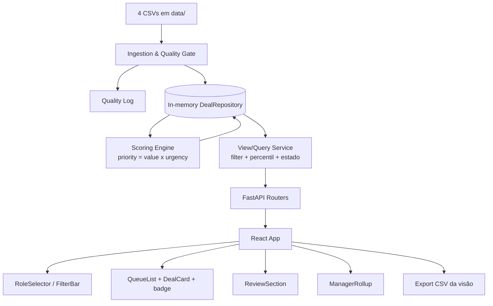

# Lead Scorer Design

**Spec**: `.specs/features/lead-scorer/spec.md`
**Status**: Implemented (Execute + faixa PASS). Motor de ordenação desta design (`lista × urgência`) foi substituído por `chance-por-idade` (ADR-014). Ingestão, query por visão e API de leitura permanecem.

---

## Architecture Overview

Aplicação determinística em duas camadas: um backend **FastAPI** que carrega os 4 CSVs em memória **uma vez** na inicialização, normaliza/loga a qualidade, materializa um conjunto imutável de deals pontuados, e expõe endpoints de leitura que calculam **visão + percentil sob demanda**; e um frontend **React** que seleciona papel/filtro e renderiza fila, Revisar, badges, rollup e export. Nada é persistido; o único artefato durável é o CSV exportado pelo cliente a partir da visão atual.

Decisão arquitetural central (ADR-001 / AD-001): o **score é um percentil calculado por visão** — PRIORIDADE (`sales_price × urgência`) é um atributo estável do deal, mas o SCORE 0–100 só existe relativo ao conjunto filtrado, então o cálculo de percentil vive na camada de query, não na ingestão.



Fluxo de uma requisição: `GET /api/queue?view=mine&agent=...` → Query Service filtra os deals trabalháveis da visão → ordena por PRIORIDADE → calcula percentil (SCORE) e ESTADO (Focar/Acompanhar) sobre esse conjunto → serializa com reason/action em português.

---

## Code Reuse Analysis

### Existing Components to Leverage

| Component | Location | How to Use |
| --------- | -------- | ---------- |
| Dicionários de alias (`PRODUCT_ALIASES`, `SECTOR_ALIASES`, `LOCATION_ALIASES`) | `solution/eda.py:27-37` | Extrair para o módulo de ingestão como fonte única dos aliases (CA6, LEAD-11/12). |
| `load()` (leitura dos 4 CSVs com pandas) | `solution/eda.py:46-51` | Reaproveitar o padrão de leitura por `pathlib.Path` no loader de ingestão. |
| Números congelados (57d, 106d, hoje=2017-12-31, limiares) | `docs/analise-exploratoria.md` | Constantes do motor de score; não re-derivar. |
| `pandas` / `numpy` já no `.venv` | `solution/.venv` | Cálculo vetorizado de idade, prioridade e percentil. |

### Integration Points

| System | Integration Method |
| ------ | ------------------ |
| CSVs do CRM (`solution/data/*.csv`) | Lidos uma vez no startup do FastAPI (lifespan/startup event) para o DealRepository em memória. |
| Frontend React ↔ Backend | HTTP JSON (REST) no mesmo `docker compose`; API em inglês, rótulos traduzidos na borda da UI (AD-004). |
| Export CSV | Gerado server-side a partir do mesmo payload da visão e baixado pelo cliente (garante paridade UI↔CSV, CA9). |

---

## Components

### IngestionService

- **Purpose**: Carregar os 4 CSVs, aplicar aliases/normalizações, resolver joins e emitir o log de qualidade.
- **Location**: `solution/backend/app/ingestion/` (`loader.py`, `quality.py`)
- **Interfaces**:
  - `load_dataset(data_dir: Path) -> Dataset` - lê e junta pipeline↔accounts↔products↔teams.
  - `normalize(dataset: RawDataset) -> tuple[Dataset, list[QualityLogEntry]]` - aplica aliases e registra correções.
- **Dependencies**: pandas, dicionários de alias.
- **Reuses**: `eda.py` aliases + `load()`.

### ScoringEngine (pure, deterministic)

- **Purpose**: Calcular idade, URGÊNCIA, VALOR, PRIORIDADE e CONFIANÇA por deal (atributos independentes de visão).
- **Location**: `solution/backend/app/scoring/` (`urgency.py`, `priority.py`, `confidence.py`)
- **Interfaces**:
  - `age_days(engage_date, today=date(2017,12,31)) -> int | None`
  - `urgency(age_days: int | None) -> float` - rampa 0–57→0,5..1,0; platô 57–106→1,0; decaimento >106 até piso 0,35.
  - `priority(value: float, urgency: float) -> float` - `value * urgency`.
  - `confidence(completude: Level, suporte: Level) -> Confianca` - `min(...)` → Alta/Média/Baixa.
- **Dependencies**: numpy; constantes congeladas.
- **Reuses**: parâmetros da EDA.

### ViewQueryService

- **Purpose**: Filtrar por visão (meus-deals/time, agente/manager/escritório), separar Revisar, ordenar a fila, calcular SCORE percentil e ESTADO sobre a visão.
- **Location**: `solution/backend/app/views/query.py`
- **Interfaces**:
  - `build_queue(repo, view_filter) -> QueueView` - fila ordenada + percentil + Focar/Acompanhar.
  - `build_review(repo, view_filter) -> list[Deal]` - deals sem conta/sem engage_date.
  - `percentile_scores(priorities: list[float]) -> list[int]` - 0–100 por visão.
  - `manager_rollup(repo, view_filter) -> list[RollupRow]` - por agente.
- **Dependencies**: ScoringEngine (PRIORIDADE pré-calculada), DealRepository.
- **Reuses**: motor de score.

### Api (FastAPI routers)

- **Purpose**: Expor as visões e o export.
- **Location**: `solution/backend/app/api/routes.py`
- **Interfaces**:
  - `GET /api/agents` - lista agentes/managers/escritórios (com empty state para os 5 sem deals).
  - `GET /api/queue?view=&agent=&manager=&office=` - fila trabalhável + Revisar.
  - `GET /api/rollup?manager=&office=` - rollup do gestor.
  - `GET /api/export.csv?...` - CSV da visão filtrada.
  - `GET /api/quality-log` - correções aplicadas na ingestão.
- **Dependencies**: ViewQueryService, IngestionService (startup).
- **Reuses**: —.

### React UI

- **Purpose**: Seletor de papel/filtro, fila explicada, Revisar, rollup, export.
- **Location**: `solution/frontend/src/`
- **Interfaces** (componentes): `RoleSelector`, `FilterBar`, `QueueList`, `DealCard` (motivo/ação/badge/estado/confiança), `ReviewSection`, `ManagerRollup`, `EmptyState`, `ExportButton`.
- **Dependencies**: API REST; i18n de rótulos PT.
- **Reuses**: —.

---

## Data Models

### Deal (normalizado, em memória)

```typescript
interface Deal {
  opportunityId: string
  salesAgent: string
  product: string          // já normalizado (GTXPro -> GTX Pro)
  account: string | null   // null => Revisar
  dealStage: 'Prospecting' | 'Engaging' | 'Won' | 'Lost'
  engageDate: string | null
  closeDate: string | null
  closeValue: number | null
}
```

### ScoredDeal (atributos independentes de visão)

```typescript
interface ScoredDeal {
  deal: Deal
  value: number            // sales_price do catálogo (0 se sem match)
  ageDays: number | null
  urgency: number          // [0.35 .. 1.0]
  priority: number         // value * urgency
  confidence: 'Alta' | 'Media' | 'Baixa'
  cooling: boolean         // ageDays > 106
}
```

**Relationships**: `ScoredDeal.deal.product` referencia `Product.product`; o join de valor usa o catálogo após alias.

### QueueItem (dependente da visão — montado por requisição)

```typescript
interface QueueItem {
  scored: ScoredDeal
  score: number            // percentil 0-100 na visão atual
  estado: 'Focar' | 'Acompanhar' | 'Revisar'
  reason: string           // PT: "GTX Pro - US$ 4.821 - 40 dias no funil - dentro do ciclo"
  action: string           // PT
}
```

### RollupRow (visão do gestor)

```typescript
interface RollupRow {
  salesAgent: string
  queuedCount: number
  expectedValueSum: number  // soma de value na fila do agente
  coolingCount: number
  goodDealsCooling: number   // SCORE alto + cooling
}
```

### QualityLogEntry

```typescript
interface QualityLogEntry {
  correction: string        // ex.: 'alias GTXPro->GTX Pro'
  type: 'product_alias' | 'sector_alias' | 'location_alias' | 'missing_account' | 'missing_engage_date' | 'ghost_agent'
  affectedRows: number
}
```

**Product/Account/SalesAgent**: espelham os headers dos CSVs (`product, series, sales_price`; `account, sector, ... , office_location, subsidiary_of`; `sales_agent, manager, regional_office`).

---

## Error Handling Strategy

| Error Scenario | Handling | User Impact |
| -------------- | -------- | ----------- |
| Produto do pipeline não casa no catálogo após alias | `value = 0`, `confidence = Baixa`, item logado | Deal aparece com valor 0 e confiança Baixa, não some (LEAD-14). |
| Deal aberto sem `account` | Vai para Revisar, fora da fila ordenada | Seção Revisar separada (LEAD-16/18). |
| Deal sem `engage_date` (Prospecting) | Revisar + Confiança Baixa, sem inferir urgência | Não entra na fila (LEAD-17). |
| Visão com fila vazia | Empty-state, não erro | Mensagem "sem deals nesta visão" (edge case). |
| Agente sem nenhum deal (5 fantasmas) | Empty state explícito no seletor | Não listado como carteira real (LEAD-15). |
| CSV ausente/ilegível no startup | Falha explícita na inicialização com mensagem clara | API não sobe silenciosa com dados parciais. |

---

## Risks & Concerns

| Concern | Location (file:line) | Impact | Mitigation |
| ------- | -------------------- | ------ | ---------- |
| Alias `GTXPro` espalhado: se a normalização não for a fonte única, 17% do pipeline perde preço | `solution/eda.py:27-29` (origem dos aliases) | GTX Pro (produto que mais fatura) some da fila | Centralizar aliases no IngestionService e cobrir com teste LEAD-11 (0 deals sem preço). |
| Curva de urgência sem forma fechada na EDA (só os nós 57/106) | `docs/analise-exploratoria.md` §4 | Fila de baixa qualidade se mal calibrada | Forma e piso congelados como assumption na spec, parametrizáveis; teste nos nós (57/106/esfriando). |
| Percentil recalculado por visão é fácil de calcular na ingestão por engano | `.specs/.../design.md` (ViewQueryService) | SCORE erraria ao filtrar (quebra CA7) | SCORE só na camada de query; teste LEAD-23 troca de visão e exige recálculo. |
| Idade mediana (165d) > máx Won (138d): tentação de excluir por idade | `docs/analise-exploratoria.md` §4 | Esvaziaria 89% do funil | AD-003: idade nunca exclui; teste LEAD-20. |
| Sem testes de produção ainda (só `eda.py`) | `solution/` | Regressões silenciosas | Test Coverage Matrix em `tasks.md` cobre domínio 1:1 com ACs. |

> Nenhum concern de segurança (sem auth/entrada externa/segredos) — superfície é leitura de CSV local.

---

## Tech Decisions (only non-obvious ones)

| Decision | Choice | Rationale |
| -------- | ------ | --------- |
| Onde calcular o SCORE | Camada de query, por requisição | SCORE é percentil **relativo à visão** (CA7); calcular na ingestão fixaria o percentil errado. |
| Representação do valor | `sales_price` de catálogo como VALOR | `p̂` sem sinal e close/lista ≈ 1,0 (ADR-001); evita modelar desconto. |
| Urgência com piso > 0 | Piso 0,35, nunca zero | Idade jamais remove/zera o deal (AD-003). |
| Normalização como fonte única | Dicionários de alias centralizados no IngestionService | Evita o preço sumir se o alias for aplicado em só um ponto (CA6). |
| Export server-side | CSV gerado do mesmo payload da visão | Garante paridade exata UI↔CSV (CA9). |

> **Project-level decisions:** registradas em `.specs/STATE.md` `## Decisions` (AD-001..AD-007) e em `docs/adr/` (001–007).
