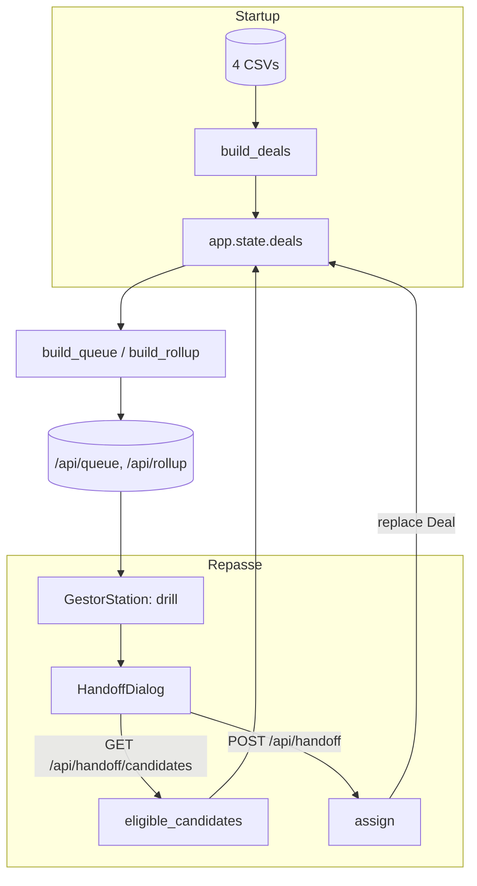

# Repassar deal — o gestor passa o negócio sem perdê-lo (`repassar-deal`) Design

**Spec**: `.specs/features/repassar-deal/spec.md`
**Status**: Implemented (Execute + faixa PASS). Repasse continua só na fila trabalhável (Focar/Acompanhar); Decidir não oferece o botão.

---

## Architecture Overview

Feature **backend + frontend**. O motor (AD-001..007) fica intocado: PRIORIDADE, urgência e percentil não mudam. O repasse só troca **o dono** de um `opportunity_id` na tupla em memória — e, por tabela, em qual visão o deal aparece e qual SCORE (percentil da visão) ele recebe pela consulta que já existe.

**Sem overlay, sem banco (ADR-013).** `app.state.deals` é reatribuído com `dataclasses.replace`. O lifespan continua só: load CSV → normalize → `build_deals`. Reiniciar cria um app novo a partir dos CSVs. Os quatro arquivos em `solution/data/` são read-only.



Fluxo: no drill, o card abre o `HandoffDialog`; o diálogo pede colegas (`GET /api/handoff/candidates`); o gestor confirma; `POST /api/handoff` valida e troca o dono em memória; a estação refaz o `fetch`. O deal sai da visão de origem e entra na de destino, mesmo `opportunity_id`.

---

## Code Reuse Analysis

### Existing Components to Leverage

| Component | Location | How to Use |
| --------- | -------- | ---------- |
| `Deal` (frozen dataclass) | `backend/app/ingestion/repository.py:16-29` | Ganha `from_agent`; reatribuição via `dataclasses.replace`. |
| `build_deals` | `backend/app/ingestion/repository.py:32-80` | Intocado. Startup não aplica overlay. |
| `split_view` | `backend/app/views/filter.py:17-46` | Define fila trabalhável; o serviço reusa para REPA-13. |
| `build_queue` / percentil por visão | `backend/app/views/query.py:48-117` | Inalterado; SCORE na visão de destino (REPA-05). |
| `build_rollup` | `backend/app/views/rollup.py:18-48` | Inalterado; o deal conta na linha do colega. |
| Lifespan / `app.state` | `backend/app/main.py:19-37` | Sem passo extra. `assign` reatribui `app.state.deals`. |
| Padrão de router | `backend/app/api/queue.py` | Molde de `app/api/handoff.py`. |
| Pytest unit/integration/e2e | `backend/tests/**` | Mesma stack; restart = segundo `TestClient(create_app())`. |
| Tipos + `fetch` | `frontend/src/api/client.ts` | `from_agent`, `postHandoff`, `fetchHandoffCandidates`. |
| `DealCard` | `frontend/src/components/DealCard.tsx` | Botão só no drill do gestor; selo "Veio de". |
| `GestorStation` | `frontend/src/stations/GestorStation.tsx` | Diálogo + refresh. |

### Integration Points

| System | Integration Method |
| ------ | ------------------ |
| Motor de score | Nenhuma mudança. Titularidade só; SCORE/ESTADO saem da consulta por visão. |
| `/api/queue`, `/api/rollup`, `/api/export.csv` | Contrato igual, mais `from_agent` opcional no item da fila. |
| Disco (`data/`) | CSVs read-only. Nenhum arquivo novo. |

---

## Components

### Handoff service

- **Purpose**: Elegibilidade e ação de repasse em memória.
- **Location**: `backend/app/handoffs/service.py`
- **Interfaces**:
  - `eligible_candidates(deals, opportunity_id) -> tuple[str, ...]` — mesmo `regional_office`, menos o dono; `()` se deal inexistente ou dono sem escritório.
  - `assign(deals, opportunity_id, to_agent, team_by_agent) -> HandoffResult` — valida (deal existe → workable → colega existe → mesmo escritório → não é o dono), devolve nova tupla com `replace` (sales_agent, manager, regional_office, from_agent). `HandoffResult`: `ok`, `error_code`, `message`, `deals`.
- **Dependencies**: `split_view`, `Deal`.
- **Reuses**: mapa agente → (manager, office) no mesmo espírito de `build_deals`.

### Handoff API

- **Purpose**: Expor o repasse e a lista de colegas.
- **Location**: `backend/app/api/handoff.py` (registrado em `app/main.py`)
- **Interfaces**:
  - `POST /api/handoff` body `{opportunity_id, to_agent}` → 200 `{opportunity_id, sales_agent, from_agent}`; erros com status + `detail`.
  - `GET /api/handoff/candidates?opportunity_id=<id>` → `{candidates: [sales_agent...]}`.
- **Dependencies**: `service`, `request.app.state.deals`.
- **Reuses**: molde de `queue.py`.

### from_agent no payload da fila

- **Purpose**: Selo "Veio de" na sessão.
- **Location**: `backend/app/views/query.py` (`QueueItem.from_agent: str | None`); `queue.py` serializa via `asdict`.
- **Dependencies**: `Deal.from_agent`.
- **Reuses**: `build_queue`.

### Frontend: client + dialog + card + station

- **HandoffDialog** (`frontend/src/components/HandoffDialog.tsx`): lista, aviso se `age_days > 106`, confirmar/cancelar, erro, empty "Nenhum colega neste escritório".
- **DealCard**: "Passar para colega" só no drill gestor, Focar/Acompanhar; "Veio de {from_agent}".
- **GestorStation**: abre o diálogo; no sucesso, refetch.
- **client.ts**: `from_agent?`; `postHandoff`; `fetchHandoffCandidates`.

---

## Data Models

### Deal (campo novo)

```typescript
from_agent: string | null // dono anterior nesta sessão; null se nunca repassado neste processo
```

**Relationships**: `sales_agent` = dono atual; `from_agent` = dono anterior (rastro). `manager`/`regional_office` acompanham o `sales_agent`. Nada disso vai a disco.

Não há `HandoffRecord` persistido.

---

## Error Handling Strategy

| Error Scenario | Handling | User Impact |
| -------------- | -------- | ----------- |
| Colega inexistente | 404, `detail` "Colega não encontrado"; dono inalterado | REPA-10. |
| Alvo é o dono atual | 409, `detail` "Este negócio já está com essa pessoa" | REPA-11 / duplo clique. |
| Colega de outro escritório | 422, `detail` "Colega de outro escritório" | REPA-12 / dono sem escritório. |
| Deal fora da fila trabalhável | 422, `detail` "Este negócio não está na fila trabalhável" | REPA-13. |
| Restart / novo processo | Donos = CSV | REPA-15. Limitação documentada, não mensagem de erro. |

---

## Risks & Concerns

| Concern | Location (file:line) | Impact | Mitigation |
| ------- | -------------------- | ------ | ---------- |
| Avaliador achar que o repasse “sumiu” no restart | README; ADR-013 | Parecer bug | Texto no README § Limitações + teste que afirma o restore do CSV (REPA-15). |
| `Deal` é frozen; mutação in-place quebra | `backend/app/ingestion/repository.py:16` | Runtime | Só `dataclasses.replace`; reatribuir `app.state.deals`. |
| `from_agent` poluir o card (ADR-010) | `frontend/src/components/DealCard.tsx` | Jargão | Selo textual "Veio de {nome}", sem número. |

> Sem risco de disco: não há overlay. Sem auth nova: AD-002.

---

## Tech Decisions (only non-obvious ones)

| Decision | Choice | Rationale |
| -------- | ------ | --------- |
| Durabilidade | Memória; restart = CSV | ADR-013. Overlay/banco fora. |
| CSVs | Read-only | Snapshot reproduzível (REPA-14). |
| Regra de escritório | Servidor (`eligible_candidates` = `assign`) | UI não divergir da trava. |
| Reatribuição | `dataclasses.replace` + nova tupla | Deal frozen. |
| Rastro | `from_agent` em memória | REPA-18/19 sem arquivo. |

> **Project-level:** AD-013 em `STATE.md` e `docs/adr/013-repasse-so-na-sessao.md`. Conforma à AD-002; não a supera. Motor 001–007 intocado.
