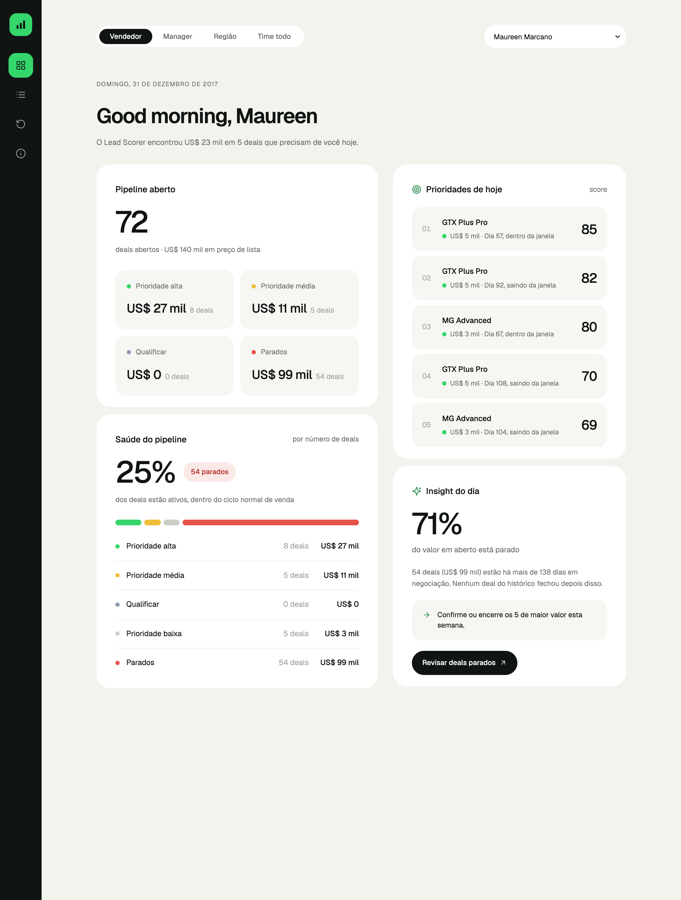
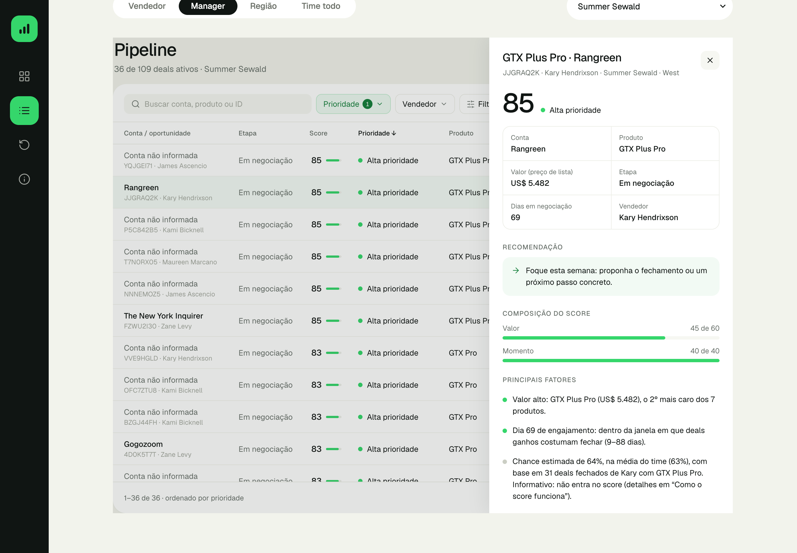

# Submissão — Lucas Siqueira — Challenge 003

## Sobre mim

- **Nome:** Lucas Siqueira
- **LinkedIn:** https://www.linkedin.com/in/lucas-r-siqueira/
- **Challenge escolhido:** 003 — Lead Scorer (Vendas / RevOps)

---

## Executive Summary

**Problema:** 35 vendedores priorizam cerca de 8.800 oportunidades "no feeling", perdendo tempo com deals que não fecham e deixando bons deals esfriarem.

**Solução:** um app em Streamlit em que o vendedor ou manager vê, em segundos, o pipeline em ordem de prioridade, com a próxima ação e o motivo de cada posição.

**Abordagem:** antes de construir o score, testei se os dados permitem prever o resultado. **Não permitem:** vendedor, produto, setor, porte e tempo no pipeline acertam tanto quanto o acaso (AUC 0,47–0,52 em teste temporal). Por isso o score não finge prever. Ele ordena por **valor** (60 pontos) e **momento** (40 pontos), e a chance histórica aparece só como informação.

**Principal contribuição:** **81% dos deals em negociação (1.291) estão parados há mais tempo do que qualquer deal já levou para fechar.** Eles concentram US$ 3,2 milhões dos US$ 4,97 milhões em aberto. O app separa esses deals numa fila própria, e a primeira recomendação é limpá-los.

---

## Solução

### Como rodar

Python 3.11+ (testado em 3.11 e 3.14):

```bash
cd solution
pip install -r requirements.txt
streamlit run app.py
```

Os dados (CSVs do Kaggle, licença CC0) já estão em `solution/data/`. Testes: `python -m pytest`. Detalhes em [`solution/README.md`](solution/README.md).

### O que o app faz

| Tela | Para quê |
|---|---|
| **Visão geral** | Pipeline aberto por prioridade, saúde do pipeline (% ativo × parado), as 5 prioridades do dia e um insight com ação |
| **Pipeline** | Todos os deals ativos com busca, filtros (prioridade, vendedor, etapa, produto, conta), ordenação (prioridade, score, valor, tempo), tooltip do score e painel lateral com motivos e recomendação |
| **Deals parados** | Fila dos deals com mais de 138 dias, do maior valor para o menor, com a mesma tabela |
| **Como o score funciona** | Regra, gráfico do ciclo de venda, validação com o passado e limitações |

Toda tela respeita o escopo escolhido no topo (vendedor, manager, região ou time todo), e o escopo fica na URL.

| Visão geral | Pipeline com o painel do deal |
|---|---|
|  |  |

### Arquitetura e tecnologias

Python 3.11+, pandas, Streamlit; HTML/CSS/JS próprios para a interface (fonte Geist, ícones Lucide); pytest e Playwright nos testes.

```
data/*.csv ─► src/data_processing.py   (valida chaves, reconcilia, log de qualidade)
           └► lead_scorer/              (domínio, sem Streamlit)
                data_loader → scoring → explain → insights ; backtest
                                   │
              ui/ (tema, componentes HTML, tabela interativa) ─► app.py (páginas e navegação)
```

### Metodologia de scoring

**Score (0–100) = Valor (até 60, preço de lista em escala log) + Momento (até 40).** O Momento é máximo na janela em que os deals ganhos fecham (9–88 dias) e zera aos 138 dias. Uma **faixa** é atribuída antes do score:

| Faixa | Regra |
|---|---|
| Alta, Média, Baixa | Deals em negociação dentro do ciclo, por percentil do score |
| Qualificar | Prospecção |
| Parados | Mais de 138 dias em negociação |

A chance histórica por vendedor e produto é calculada e exibida, mas tem peso 0, porque não diferencia ganhos de perdidos. Detalhes e justificativas: [`solution/README.md`](solution/README.md) e [doc 04](docs/04-data-analysis.md).

### Abordagem

1. **Discovery antes de código** ([docs 01–03](docs/)): requisitos, MVP e critérios de aceite, com fatos separados de hipóteses.
2. **Testar se dá para prever** antes de construir: holdout temporal e snapshots mensais reconstruindo o pipeline aberto em cada data. Nada passou do acaso, então o produto virou uma **regra de priorização honesta**.
3. **Faixas antes do score:** com 81% do pipeline em negociação parado, um score único jogaria quase tudo para o fim da lista.
4. **Validação com o passado e ajuste dos pesos:** o desenho inicial era 50/30/20 (Valor/Momento/Chance). Comparei 9 combinações e adotei **60/40/0**, que superou o original em 8 de 9 meses.
5. **Camada de dados auditável** ([docs 04–05](docs/)): chaves validadas, contagens reconciliadas e colunas de desfecho impedidas de virar preditoras.
6. **Auditoria e redesign** ([docs 08–10](docs/)): correção de 1 P0 e 3 P1, interface minimalista e tabela do Pipeline com busca, filtros e painel lateral.

### Resultados / Findings

**Validação com o passado** (9 snapshots mensais de 2017, usando só o que se sabia em cada data):

| Ordenação | Valor ganho nos top 20% da lista |
|---|---|
| Score 60/40/0 (atual) | **48%** |
| Score 50/30/20 (versão inicial) | 46% |
| Só valor | 49% |
| Aleatória | 20% |

O score fica a 1 ponto de "só valor", mas separa os parados e indica o momento e a ação de cada deal. A correlação com "só valor" é 0,75, então não é uma ordenação por preço disfarçada.

**Descobertas sobre os dados** ([doc 04](docs/04-data-analysis.md)):
1. **Pipeline parado:** 1.291 deals em negociação têm mais de 138 dias, e nenhum deal fechado passou disso.
2. **Nenhum atributo prevê o resultado:** qui-quadrado por permutação com p entre 0,10 e 0,97 e V de Cramér ≤ 0,07.
3. **Ranking de vendedores é ruído:** o IC 95% contém a média do time para 28 de 30 vendedores.
4. **O valor é previsível, o resultado não:** ganhos fecham a 99,8% do preço de lista.
5. **Vieses de coleta:** sem fechamentos antes de mar/2017, deals de 2016 mostram um win rate artificial de 82%. Conta ausente aparece em 1.425 abertos e em 0 fechados, o que seria vazamento se usada como preditor.

**Testes** ([resultados da auditoria final](process-log/test-results.md)):
- **Clone limpo:** 64 testes de unidade passando.
- **Navegador:** 13 testes com Playwright (13/13 em 3 de 4 execuções; 1 falha intermitente sem causa identificada).
- **Todas as páginas:** 113 execuções com AppTest, sem erro.
- **Versões mínimas:** Python 3.11 e Streamlit 1.49 testados.

### Recomendações

| # | Ação | Impacto | Esforço | Prazo |
|---|---|---|---|---|
| 1 | Cada vendedor confirma ou encerra os deals da fila *Deals parados*, começando pelos de maior valor | Alto: 64% do valor em aberto está parado e distorce o forecast | Baixo | Esta semana |
| 2 | Tornar `account` obrigatório e registrar a data prevista de fechamento | Médio: hoje 68% dos deals abertos não têm conta | Baixo | Este mês |
| 3 | Registrar atividades com data (e-mails, ligações, reuniões, mudanças de etapa) | Alto: é o único dado que pode revelar quando um deal "esfria" | Médio | Este trimestre |
| 4 | Recalibrar os pesos a cada trimestre, com o backtest já pronto, usando o resultado das ações tomadas | Médio | Baixo | Contínuo |
| 5 | **Não** cobrar nem premiar vendedores pelo win rate atual, e **não** treinar ML com estes dados | Evita decisões baseadas em ruído | — | — |

**Próximas evoluções do produto:**
- Conector com o CRM (dados diários).
- Login com filtro automático pelo vendedor.
- Registro de "ação tomada" no painel do deal.
- Deploy com URL pública.

### Limitações

- **Dataset:** parece sintético (datas uniformes, inclusive em fins de semana, e ciclo de 8–9 dias nos meses de início de trimestre); por isso não há sinal preditivo. Não há atividades, data de criação nem data prevista de fechamento. O "hoje" é 31/12/2017 (configurável).
- **Scoring:** é uma regra de priorização, não uma probabilidade calibrada. A validação só usa deals que fecharam.
- **Não implementado:** login, escrita de volta no CRM, deploy público, registro de ações.
- **Não verificado:**
  - Teste com um vendedor real (CA9).
  - Causa da falha intermitente no e2e.
  - Python 3.10.
- **Para escalar:** conector com o CRM, SSO, histórico de atividades e recalibração periódica ([`solution/README.md`](solution/README.md)).

---

## Process Log — Como usei IA

> O índice completo das evidências está em [`process-log/README.md`](process-log/README.md). Os prompts originais, na íntegra, estão no [export da conversa](process-log/chat-exports/conversa-claude-code.md) (sanitizado: sem e-mail nem caminhos locais).

### Ferramentas usadas

| Ferramenta | Para que usou | Evidência |
|---|---|---|
| **Claude Code** (app desktop, modelo Claude Opus 5.5) | Todas as etapas: leitura do desafio, análise de dados, documentação, código, testes, auditorias, PR | Export da conversa; `Co-Authored-By` nos commits |
| Navegador embutido do Claude Code | Testar o app como usuário e capturar os bugs | Screenshots 01–08 |
| Playwright + Chrome (ferramentas de teste, não IA) | Testes no navegador e screenshots em alta resolução, operados pelo Claude Code | `solution/tests/e2e/`, screenshots 09–11 e 13–16 (o 12 é um screenshot meu da versão anterior) |

Não usei outras ferramentas de IA além das listadas (confirmado pelo autor em 15/10/2026).

### Workflow

A ordem abaixo é a cronologia real da conversa. Os nomes "Etapa 01/02/05" são os dos meus prompts; as etapas 03 e 04 não foram enviadas separadamente.

| Fase | O que pedi | O que foi produzido | Evidência |
|---|---|---|---|
| 1. Discovery e planejamento | Papel de PM/arquiteto; fatos separados de hipóteses; nenhum código; aguardar aprovação | Docs 01–03 e scripts de exploração inicial. Aprovei Streamlit, pesos 50/30/20, data 31/12/2017 e limite de 138 dias | [docs 01–03](docs/), [`process-log/eda/`](process-log/eda/) |
| 2. Exploração e engenharia de dados | Pipeline auditável e regras contra vazamento (não usar `close_value` como previsão, nada pós-fechamento, não inventar datas) | `src/data_processing.py`, análise, docs 04–05, testes de integridade | [doc 04](docs/04-data-analysis.md), [doc 05](docs/05-data-dictionary.md), [narrativa](process-log/etapa-02b-dados.md) |
| 3. Desenvolvimento do scoring | Construção na fase 1; após ver o backtest, **pedi para rever os pesos** | Score, faixas, backtest; comparação de 9 pesos; adotei **60/40/0** | [narrativa](process-log/etapa-02-implementacao.md), `lead_scorer/` |
| 4. Construção da interface | Redesign minimalista a partir de uma imagem de referência; depois, redesign da tabela do Pipeline com especificação detalhada | Interface com 4 áreas; tabela com busca, filtros, ordenação e painel | [doc 09](docs/09-ui-redesign.md), [doc 10](docs/10-pipeline-ux.md), screenshots 08–16 |
| 5. Testes e auditoria | Auditoria P0–P3 com a regra "não declarar teste aprovado sem executá-lo"; auditoria final baseada em evidências | 1 P0, 3 P1 e 5 P2 corrigidos; testes de 30 para 64 + 13 no navegador | [doc 08](docs/08-quality-assurance.md), [auditoria final](docs/final-submission-audit.md), [resultados](process-log/test-results.md) |
| 6. Documentação e entrega | README pelo template, process log e PR | PR 196 com 7 commits | Este README; [PR 196](https://github.com/Gestao-Quatro-Ponto-Zero/ai-master-challenge/pull/196) |

### Onde a IA errou e como corrigi

A coluna "Quem detectou" segue o export da conversa. A maior parte dos erros foi encontrada pela própria IA nos testes e auditorias que eu pedi; os itens marcados **Eu** partiram de mim.

| Problema | Quem detectou | Intervenção / correção | Evidência |
|---|---|---|---|
| A "chance" pesava 20% no score sem prever nada | IA (backtest); **Eu** decidi rever os pesos | Comparação de 9 combinações; escolhi 60/40/0 | Prompt "Antes da entrega, quero rever os pesos" |
| O 1º "foco" de uma vendedora era um deal de US$ 55 | IA (teste visual) | Qualificar passou a vir antes de Baixa | [screenshot 01](process-log/screenshots/01-bug-foco-anna-deal-55-dolares.jpg) |
| Gráfico de ciclo ordenado como texto | IA (teste visual) | Eixo numérico | [screenshot 02](process-log/screenshots/02-bug-grafico-eixo-texto.jpg) |
| Números errados em rascunhos ("metade dos vendedores", "77% nos EUA") | IA (conferência antes de publicar) | Valores reais: 6 de 27; 83% | [narrativas](process-log/) |
| Crash ao trocar de vendedor com uma linha selecionada (P0) | IA, na auditoria que **eu** pedi | Seleção zerada quando os deals exibidos mudam | [screenshots 06/07](process-log/screenshots/), [doc 08](docs/08-quality-assurance.md) |
| Data de referência "ajustável" usava deals fechados no futuro (P1) | IA, na auditoria que **eu** pedi | Pipeline reconstruído na data, com teste | [doc 08](docs/08-quality-assurance.md) |
| Versões mínimas do `requirements.txt` quebravam as tabelas (P1) | IA, na auditoria que **eu** pedi | Mínimos corrigidos e testados | [doc 08](docs/08-quality-assurance.md) |
| Interface carregada (emojis, cards de texto, cor sem significado) | **Eu**, com uma imagem de referência | Redesign em 4 áreas | [screenshot 08 → 09](process-log/screenshots/), [doc 09](docs/09-ui-redesign.md) |
| Saudação com nome fixo | **Eu** ("troque o nome para o vendedor selecionado ou manager") | Primeiro nome da pessoa em foco | Export da conversa |
| Tabela do Pipeline estilo Excel, botões pretos, colunas cortadas | **Eu** (screenshot + especificação) | Tabela interativa com painel lateral | [screenshot 12 → 13–16](process-log/screenshots/), [doc 10](docs/10-pipeline-ux.md) |
| Link para outra pessoa abria a anterior; faixa de sombra na borda; cabeçalho desalinhado em tablet | IA (validação no navegador) | Corrigidos, com testes | [doc 09](docs/09-ui-redesign.md), [doc 10](docs/10-pipeline-ux.md) |
| README descrevia um "resumo por vendedor" que não existe mais; process log sem autoria dos erros | IA, na auditoria final que **eu** pedi | Corrigidos nesta revisão | [auditoria final](docs/final-submission-audit.md) |

### O que eu adicionei que a IA sozinha não faria

**Comprovado pelos prompts (export da conversa):**
- **Processo em etapas com aprovação:** discovery antes de código, com a exigência de separar fato de hipótese.
- **Escolhas da fase de discovery:** aprovei a stack, a data de referência e o limite de 138 dias.
- **Revisão dos pesos:** decidi revê-los depois de ver o backtest e escolhi 60/40/0 entre as opções apresentadas.
- **Regras de dados contra vazamento:** `close_value`, nada pós-fechamento, nada de datas inventadas.
- **Padrão de qualidade:** auditoria com P0–P3, "não declare testes aprovados sem executá-los" e auditoria final só com evidências.
- **Direção visual e de produto:** imagem de referência, paleta, "se não ajuda a decidir, não fica na tela principal" e a especificação da tabela do Pipeline.
- **Ajustes de experiência:** saudação com a pessoa selecionada.

*Seção revisada e confirmada pelo autor em 15/10/2026.*

---

## Evidências

- [ ] Screenshots das conversas com IA. Não há screenshots; a conversa está no export (item abaixo).
- [ ] Screen recording do workflow
- [x] Chat exports: [`process-log/chat-exports/conversa-claude-code.md`](process-log/chat-exports/conversa-claude-code.md), versão legível e sanitizada com as 15 mensagens do autor
- [x] Git history: 7 commits na branch. Os 4 primeiros foram criados juntos no envio (mesmo horário); a cronologia real está no export
- [x] Outro:
  - 16 screenshots do app, incluindo bugs antes/depois ([`process-log/screenshots/`](process-log/screenshots/))
  - [resultados dos testes](process-log/test-results.md)
  - scripts reproduzíveis ([`process-log/eda/`](process-log/eda/), [`solution/src/`](solution/src/))
  - testes ([`solution/tests/`](solution/tests/))

---

_Submissão enviada em: 15/10/2026_
