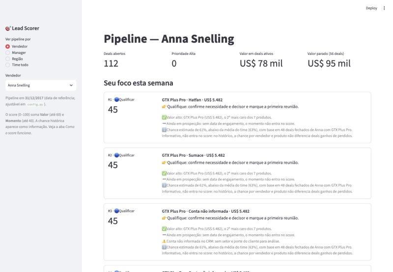

# 09 — UI Redesign

> Objetivo: uma interface que respire. Referência visual: o dashboard anexado (composição, cores, proporções), com a precisão do Linear e a simplicidade da Apple.
> Regra aplicada a cada elemento: **se não ajuda o vendedor a decidir, não fica na tela principal.**

| Antes | Depois |
|---|---|
|  |  |

## 1. Revisão do layout anterior: excessos

| Excesso | Por que atrapalhava | Decisão |
|---|---|---|
| Cada card do "foco" tinha de 4 a 5 linhas de motivos | O vendedor precisava ler um parágrafo para saber o que fazer | Na lista principal, só **uma** justificativa curta ("Dia 57, dentro da janela"). Os motivos completos ficam no detalhe |
| Emojis como ícones (🎯 👉 ✅ ⚠️ ℹ️ 🟢) | Ruído visual e estilos misturados | Ícones Lucide de traço fino; nos motivos, pontos coloridos |
| Vermelho padrão do Streamlit em barras e filtros | A cor não significava nada | Tema verde `#35D66B`; cor só para significado (verde = agir, âmbar = acompanhar, vermelho = parado) |
| Sidebar larga, com rádio e textos explicativos | Ocupava espaço e explicava o que a tela deveria mostrar sozinha | Rail preto de 88 px com 4 ícones. Escopo numa pílula segmentada no topo |
| 4 KPIs soltos, sem hierarquia | Tudo com o mesmo peso | Um número grande por card e labels pequenos |
| Tabela, abas e metodologia na tela principal | Três tarefas competindo | Tela principal com 4 áreas. Lista completa, deals parados e metodologia em páginas próprias |
| Menu "Deploy" e cabeçalho do Streamlit | Cromo de ferramenta, não de produto | Ocultos |
| Coluna "Vendedor" na visão de um vendedor; coluna "Faixa" na página de parados | Repetiam a mesma informação em toda linha | Ocultas nesses contextos |
| Nome do vendedor no card do pipeline | Repetia o seletor do topo | Removido |

## 2. Estrutura

```
┌──────┬─────────────────────────────────────────────────────────┐
│ rail │ [Vendedor | Manager | Região | Time todo]   [vendedor ▾] │
│  ▣   │ DOMINGO, 31 DE DEZEMBRO DE 2017                          │
│  ☰   │ Good morning, Maureen                                    │
│  ↺   │ O Lead Scorer encontrou US$ 23 mil em 5 deals…           │
│  ⓘ   │ ┌ Pipeline aberto ────────┐ ┌ Prioridades de hoje ──┐   │
│      │ │ 72 + 4 faixas em blocos │ │ 01 … 05 com score     │   │
│      │ ├ Saúde do pipeline ──────┤ ├ Insight do dia ───────┤   │
│      │ │ 25% + barra + 5 linhas  │ │ 71% + ação + botão    │   │
└──────┴─────────────────────────────────────────────────────────┘
```

| Área | Pergunta que responde | Conteúdo |
|---|---|---|
| **Pipeline aberto** | Quanto tenho e onde está? | Total de deals, valor em preço de lista e 4 blocos: alta, média, qualificar e parados |
| **Saúde do pipeline** | Meu pipeline está vivo? | % de deals ativos, barra proporcional por faixa e as 5 faixas com quantidade e valor |
| **Prioridades de hoje** | Em que eu trabalho agora? | Os 5 deals mais relevantes, com score e justificativa de uma linha. Cada um abre o detalhe |
| **Insight do dia** | O que mais importa mudar? | Um número, uma frase e uma ação, com botão para onde agir |

**Saudação:** "Good morning", seguido do primeiro nome do vendedor ou manager selecionado. Em Região e Time todo, onde não há uma pessoa em foco, usa o nome de quem usa o app (`viewer_name` em `config.py`).

**Frase do topo e insight** são calculados com os dados (`lead_scorer/insights.py`):
- A frase soma as 5 prioridades.
- O insight segue esta ordem de urgência:
  1. Valor parado ≥ 50%.
  2. Deals importantes saindo da janela.
  3. Conta ausente ≥ 50%.
  4. Deals a qualificar.

**Navegação:** o rail usa links com a página, o escopo, a pessoa e o deal na URL. Qualquer tela pode ser compartilhada ou recarregada, e clicar numa prioridade abre o Pipeline com o detalhe daquele deal.

## 3. Identidade

| Token | Valor | Uso |
|---|---|---|
| Fundo | `#F2F3EC` | Página |
| Rail | `#101513` | Barra lateral, pílula ativa, botão de ação |
| Card | `#FFFFFF`, raio 30 px | Áreas principais |
| Bloco | `#F6F7F2`, raio 20 px | Blocos internos e linhas de prioridade |
| Verde | `#35D66B` | Prioridade alta, item ativo, barras de score |
| Âmbar | `#F0BE3A` | Prioridade média |
| Ardósia / pedra | `#8D9AAE` / `#CBCEC4` | Qualificar / prioridade baixa |
| Vermelho | `#E5544B` | Parados |
| Tipografia | Geist (Inter como reserva) | Números grandes de 60–64 px com espaçamento negativo; labels de 13–15 px |

Sem sombras e sem gradientes. Os ícones são SVG da Lucide, embutidos em `ui/theme.py`.

## 4. Organização do código

| Arquivo | Responsabilidade |
|---|---|
| `lead_scorer/insights.py` | Frase do topo, prioridades, insight, resumo por faixa (sem Streamlit; testado) |
| `ui/theme.py` | Tokens, ícones e CSS |
| `ui/components.py` | Blocos de HTML como funções puras. Todo dado passa por escape (testado) |
| `app.py` | Estado, navegação e montagem das páginas |
| `.streamlit/config.toml` | Tema base, para que os widgets nativos usem o verde |

## 5. Validação

| Verificação | Resultado |
|---|---|
| Testes automatizados | **60 passando** (eram 41): insights, justificativa curta, formatação, escape de HTML, links das prioridades, rail, saudação |
| Todas as páginas × todos os escopos e pessoas (AppTest, 113 execuções) | 0 exceções e 0 avisos, nas versões **mínimas** (Python 3.11, Streamlit 1.49) e **atuais** (Python 3.14, Streamlit 1.66) |
| Link direto para um deal (`?page=pipeline&deal=…`) | Abre o detalhe correto |
| Navegador real (1280–1440 px e 760 px) | Rail, pílula ativa, seletor, filtros, fonte Geist e empilhamento responsivo conferidos. Em tela estreita, as prioridades vêm primeiro |
| Dados preservados | Mesmos números do motor (ex.: Maureen com 72 abertos, US$ 99 mil parados, top 5 com scores 85/82/80/70/69) |

### Problemas encontrados ao validar (e corrigidos)
- **Seleção vencendo a URL:** o Streamlit reaproveita a sessão da aba ao recarregar, então um link para outra pessoa abria a anterior. Agora a URL vence quando muda por fora.
- **Seletores de CSS desatualizados:** os estados ativos (`aria-checked`, `aria-pressed`, `data-selected`) e o seletor (`role=group`) mudam entre versões do Streamlit. O CSS cobre as duas marcações e foi conferido em 1.49 e 1.66.
- **Fonte do Streamlit vencendo a Geist:** por especificidade de CSS. Corrigido.
- **Grade espremida em telas estreitas:** agora empilha abaixo de 1.180 px.
- **Asteriscos literais no detalhe:** o texto era Markdown dentro de HTML escapado.
- **Ícone de link ao lado do título:** acrescentado automaticamente pelo Streamlit. Oculto.

## 6. Pendências
- **Idioma misturado:** a saudação está em inglês, como pedido ("Good morning"), e o resto da interface em português. Se preferir, "Bom dia" é uma linha em `ui/components.py`.
- **"Good morning" fixo:** a data de referência não tem hora, então a saudação não acompanha o horário do dia.
- **Tabelas do Streamlit:** o grid é desenhado em canvas e não aceita o mesmo nível de estilo dos cards (bordas, tipografia das células).
