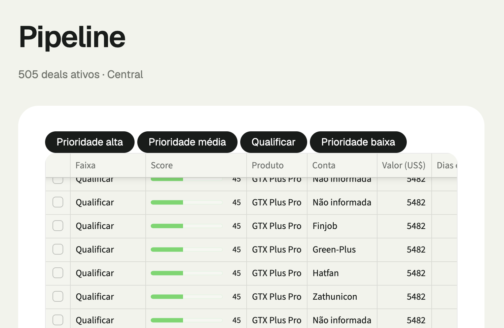
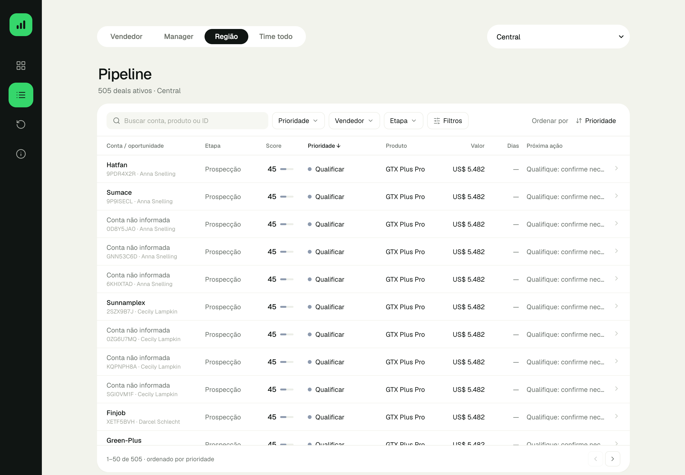

# 10 — Pipeline: redesign da experiência

> Objetivo: menos esforço para encontrar, entender e priorizar oportunidades. A interface deve ser visualmente silenciosa e operacionalmente poderosa.

| Antes | Depois |
|---|---|
|  |  |

## 1. Diagnóstico da versão anterior

| Problema | Causa | Efeito para o vendedor |
|---|---|---|
| Tabela com cara de Excel, bordas em todas as células | `st.dataframe` é um grid em canvas que não aceita estilo próprio | Leitura cansativa, sem hierarquia |
| Quatro botões pretos gigantes | `st.pills` era o único filtro (faixa) | Peso visual sem função; não havia busca, filtro de vendedor nem de etapa |
| Colunas cortadas ("Dias", "Próxima ação") | Largura fixa do grid | Informação escondida |
| Barra de progresso grande em toda linha | `ProgressColumn` | Ruído; o número já diz o score |
| Detalhe aparecia abaixo da tabela, fora da vista | Seleção por checkbox e card renderizado depois | O vendedor perdia o contexto |
| Contagem fixa | Título fora da tabela | Os filtros não refletiam no total |
| Sem ordenação controlável | Ordem só por faixa | Não dava para priorizar por valor ou tempo |

## 2. Decisão técnica

**Um único componente HTML/JS** (`ui/pipeline_table.py`), servido por `st.components.v1.html` e usado nas páginas **Pipeline** e **Deals parados**:
- Busca, filtros, ordenação, paginação, tooltip e painel lateral rodam no navegador. Nenhuma interação recarrega a página, então o vendedor fecha o painel e continua exatamente onde estava (página e rolagem).
- O Python entrega só as linhas reais do recorte atual (escopo e pessoa da barra superior), já pontuadas pelo motor. **Nenhum score, faixa ou critério foi alterado.**
- Os dados entram no HTML como JSON com `</` escapado, e todo texto é escapado ao montar o DOM (testado com um nome de conta malicioso).

**Trade-off:** o componente roda dentro de um iframe de altura fixa (860 px). A tabela rola por dentro, com cabeçalho fixo, e o painel lateral ocupa a altura do componente, não a da janela.

## 3. O que mudou

| Área | Agora |
|---|---|
| Cabeçalho | Título de 32 px. Contagem dinâmica: "505 deals ativos · Central" vira "36 de 109 deals ativos · Summer Sewald" com filtros |
| Barra de ferramentas | Busca (conta, produto, ID ou vendedor, sem diferenciar acentos), Prioridade, Vendedor (fora da visão de um vendedor), Etapa (quando há mais de uma), Filtros (produto e conta no CRM), "Limpar" e "Ordenar por". Filtro ativo fica verde com contador |
| Tabela | Separadores horizontais sutis, linhas de 58 px, valores alinhados à direita e com números tabulares, texto longo truncado com o conteúdo completo ao passar o mouse, hover discreto, cabeçalho fixo, paginação de 50 |
| Colunas | Conta/oportunidade (com ID e vendedor), Etapa, Score, Prioridade, Produto, Valor, Dias, Próxima ação |
| Score | Número + indicador de 28 px na cor da faixa. O tooltip mostra "85 · Alta prioridade", Valor 45/60, Momento 40/40 e o momento do deal |
| Ordenação | Prioridade (padrão: faixa → score → valor, a mesma ordem do motor), Score, Valor e Tempo no pipeline. Empates mantêm a ordem padrão (estável). Prospecção, sem tempo calculável, vai para o fim. Ativação pelo menu ou pelo cabeçalho; a seta indica "maior primeiro" |
| Painel lateral | Produto · conta, ID, vendedor, manager e região; score e prioridade; conta, produto, valor (preço de lista), etapa, dias e vendedor; recomendação; composição do score; principais fatores. Fecha com Esc, X ou clique fora |
| Deep link | `?page=pipeline&deal=ID` (as prioridades da visão geral) abre o painel na página certa da tabela |
| Deals parados | Mesmo componente: sem filtro de prioridade (todos são "Parado"), ordenação padrão por valor, como antes |
| Estado vazio | "Nenhum deal encontrado", com botão para limpar filtros |

### Responsividade (largura do componente)

| Largura | Comportamento |
|---|---|
| > 1.000 px | Tabela completa |
| 641–1.000 px | Ficam conta, score, prioridade, valor e ação; etapa, produto e dias vão para o painel |
| ≤ 640 px | Linhas compactas: conta e score no topo; prioridade · valor; ação. Sem rolagem horizontal; painel em tela cheia |

## 4. Validação

**Testes de unidade** (`tests/test_pipeline_table.py`, 5 testes):
- Os registros reproduzem o motor (ID, ordem, score, valor, ação, motivos).
- Ausências aparecem explícitas (prospecção sem dias, conta não informada).
- Dados não conseguem fechar o `<script>`.
- Os filtros oferecem só opções do recorte.

**Testes no navegador real** (`tests/e2e/test_pipeline_ui.py`, 13 testes, Playwright + Chrome), nas versões **mínimas** (Streamlit 1.49 / Python 3.11) e **atuais** (Streamlit 1.66 / Python 3.14):

| Teste | O que confirma |
|---|---|
| Ordem e contagem padrão | Primeiras 50 linhas e total idênticos ao motor (Central: 505) |
| Busca + vendedor + etapa | Resultado igual ao filtro equivalente em pandas; contagem "X de Y" |
| Estado vazio e limpar | Mensagem aparece; um clique restaura 505 |
| Filtro preserva ordenação | Ordem por valor mantida após filtrar; desempate estável |
| Ordenação pelo cabeçalho | Score e tempo no pipeline, com alternância e `aria-sort` |
| Painel | Score, ação, produto e todos os motivos do deal clicado; Esc mantém a página 2 e a rolagem |
| Deep link | Abre o painel do deal T7N0RX05 |
| Tooltip | Mostra os pontos reais de Valor e Momento |
| Larguras 1440 / 1100 / 900 / 390 | Sem rolagem horizontal, sem célula para fora da linha, cabeçalho alinhado às colunas |
| Deals parados | Ordem por valor igual à anterior; sem filtro de prioridade |

### Problemas encontrados na validação (corrigidos)
- **Faixa cinza na borda direita:** a sombra do painel fechado vazava na tela. O painel fechado agora fica invisível e sem sombra.
- **Cabeçalho desalinhado em 1.100 px:** as colunas ocultas continuavam no cabeçalho por especificidade de CSS. O teste de larguras passou a comparar cabeçalho e células.
- **Validação inicial nas versões mínimas contra um servidor antigo:** o comando para encerrá-lo não casava com o processo. Reexecutado contra um servidor novo.

## 5. Pendências
- **Iframe de altura fixa:** o Streamlit não ajusta a altura automaticamente. Em telas muito baixas a tabela rola por dentro.
- **Ordenação não fica na URL:** ao recarregar a página, a ordenação volta ao padrão. Escopo, pessoa e deal são preservados.
- **Testes no navegador são opcionais:** dependem de `playwright` e de um servidor rodando (`LEAD_SCORER_URL`). Sem isso, o pytest os marca como pulados.
