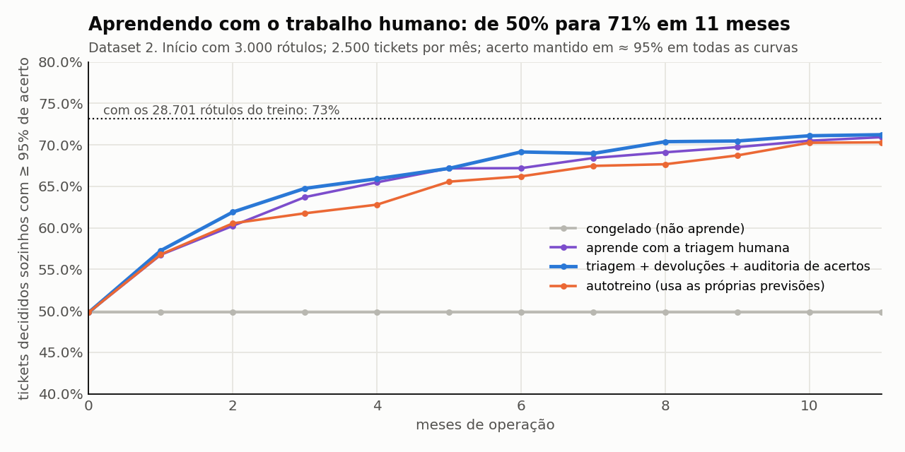
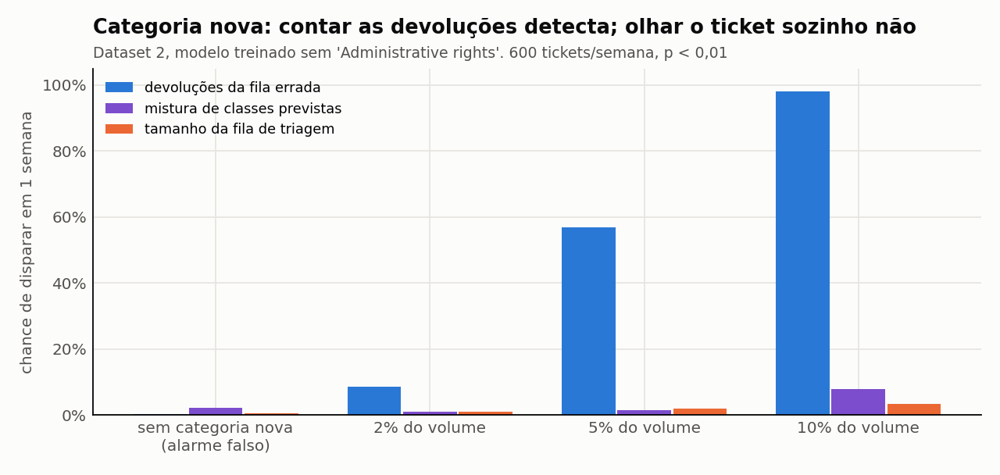

# Economia e aprendizado: onde cortar sem perder, e como a IA aprende

> **Aprofundamento da Entrega 2.** Responde duas perguntas: *onde economizar sem perder eficiência?* e *o que medir para a IA aprender com os erros e os acertos?*
> Números de [`aprendizado.py`](aprendizado.py), sobre o Dataset 2 (47.837 tickets reais rotulados), e de [`automacao.py`](automacao.py). Resultados brutos em [`outputs/aprendizado.json`](outputs/aprendizado.json).
> As decisões daqui vêm de falhas que o [harness](HARNESS_AUTOMACAO.md) encontrou na [proposta](PROPOSTA_AUTOMACAO.md). Onde o harness derrubou uma afirmação, este documento traz a solução, e não só o erro.

---

## Resposta curta

| Pergunta | Resposta |
|---|---|
| **Onde economizar sem perder eficiência?** | **No tempo humano dentro do fluxo, não no token nem na cobertura.** Três alavancas medidas devolvem **≈ 480 h/ano (≈ R$ 17 mil)** a mais, sem baixar acerto nem segurança: (1) na rota 1, **a IA rascunha onde o risco está na decisão**, não no texto (hardware, reparo, recontato): 224 h; (2) **os rótulos saem do trabalho que o time já faz**, sem projeto de rotulagem: 190 h; (3) a **triagem humana escolhe entre 3 sugestões**, e a certa está entre elas em 95,8% dos casos: 68 h. Também **não construir** quatro coisas que pareciam boas e o dado mostrou que não pagam. |
| **Onde NÃO economizar?** | **Auditoria (10% dos automáticos, 1,5 h/mês)**, porque com os 2% que eu tinha proposto uma queda de acerto passa despercebida metade das vezes. **Gold set de 3.000 rótulos**, que se paga em 4 meses. **Grupo de controle de 10% sem IA**, a única forma de provar o ROI. |
| **O que medir para a IA aprender?** | **Quatro sinais que o humano já produz:** a classe que ele escolhe na triagem, o ticket que ele **devolve** por estar na fila errada, a **auditoria sorteada** dos acertos e a ação dele sobre o rascunho (aprova, edita ou rejeita, com o **motivo em lista fechada**). Com esses sinais, o modelo sai de **50% para 71%** dos tickets decididos sozinhos em 11 meses, mantendo 95% de acerto. Parado, fica em 50%. Treinado com as próprias previsões, aprende mais devagar, mesmo com o dobro de rótulos. |
| **E se aparecer um tipo de ticket novo?** | O limiar **não protege**: o modelo classifica errado, com confiança, 60,5% dos tickets de uma categoria que nunca viu. **Contar as devoluções da fila errada detecta** a novidade: com uma categoria nova em 5% do volume, o alarme dispara em 4 semanas em 100% das simulações, com 0% de alarme falso. |

---

## 1. Onde economizar sem perder eficiência

### 1.1 O achado que muda a pergunta: o ganho vem de acertar, não de automatizar mais

| Cenário | Tickets decididos sozinhos | Horas/ano recuperadas na retriagem |
|---|---|---|
| Modelo com 3.000 rótulos, parado | 49,8% | **1.193** |
| Modelo aprendendo (ano 1, média) | 49,8% → 71,2% | **1.298** |
| Modelo em regime (ano 2 em diante) | 71,2% | **1.333** |
| Premissa da proposta (73% desde o dia 1) | 73,2% | 1.344 |

Com metade da cobertura, a IA já devolve **89%** das horas. O motivo: o desperdício da Entrega 1 é o ticket **mal classificado** (65% hoje). Mesmo abaixo do limiar, o humano revisa **com a sugestão da IA** em cerca de 1 minuto e acerta 90%. O erro cai de 65% para ≈ 7% com qualquer cobertura.

**Consequência prática:** baixar o limiar para "automatizar mais" é **onde se perderia eficiência**. Cada ponto de cobertura comprado com acerto piora a retriagem. A economia está nos **minutos humanos** do fluxo, não em tirar o humano.

### 1.2 Alavancas medidas

| Alavanca | Economia | Por que não perde eficiência | Evidência |
|---|---|---|---|
| **Rota 1A: a IA rascunha, o humano decide** (hardware, reparo, recontato) | **224 h/ano** (75–374) | O risco desses tickets está na **decisão** (trocar o aparelho, compensar o cliente), que continua humana. O texto é baixo risco. Perda de dados, segurança e dinheiro (1B) continuam escritos pelo humano | 1.267 dos 2.798 tickets da rota 1 (45%) só têm esses gatilhos (harness A10) |
| **Rótulos do trabalho normal** | **190 h/ano** de rotulagem evitada | A triagem, as devoluções e a auditoria já são feitas; basta **gravar** a escolha do humano | 11.419 rótulos em 11 meses sem nenhum projeto de rotulagem (B1) |
| **Triagem com 3 sugestões** em vez de 8 classes | **68 h/ano** | A classe certa está entre as 3 em **95,8%** dos casos (entre 2, em 88,4%). Nos 4,2% restantes, o humano abre a lista completa, como hoje | B3 |
| **Modelo 4× menor** (50 mil variáveis, não 200 mil) | Metade do tempo de treino | Mesma cobertura e mesmo acerto (harness A3). Permite re-treino diário, se preciso | A3 |
| **Regras fixas antes da IA** | 40% do ganho total em 2 semanas | Não dependem de modelo; já estavam na proposta | Proposta, seção 5 |
| **Total das 3 primeiras** | **≈ 480 h/ano (≈ R$ 17 mil)** | Somam-se às ≈ 3.470 h da proposta | premissas de minutos na seção 5 |

### 1.3 O que parecia economia (ou proteção) e o dado mostrou que não é

| Ideia | O que o dado mostrou | Decisão |
|---|---|---|
| **Detector de "ticket estranho" por ticket** (similaridade com o histórico) | Separa mal o ticket novo do conhecido (AUC 0,50–0,72) e **tira 6 p.p. de cobertura** | Não construir. Usar o monitor de população (seção 2.7) |
| **Duplicata para sugerir a classe** | O modelo já acerta 95,6% nesses tickets; copiar a duplicata dá 96,1% | Não construir essa parte. A duplicata serve para **vincular** ao ticket anterior |
| **Limiar mais rígido para permissão de administrador** | Não muda nada: quando o modelo diz "permissão", já acerta **96,7%** | Não construir |
| **Gatilho de palavra para pedidos de permissão** | O risco real é o contrário: um pedido de permissão ir para Hardware (40 de 41 erros). O melhor gatilho pega **41,5%** desses erros e manda **14,9%** de todos os tickets automáticos para humano | Não construir. **Proteger a ação**: nenhuma concessão de acesso sai sem aprovação humana no sistema de identidade. Um pedido mal roteado custa uma devolução, que ainda vira rótulo |
| **Rotular primeiro os tickets mais difíceis** (aprendizado ativo) | Com 3.000 rótulos, dá **menos** cobertura que sortear (harness A8) | Gold set **sorteado** |
| **Otimizar tokens** (cache, lote, modelo menor na LLM) | Toda a LLM custa ≈ R$ 270/ano (Proposta, seção 4) | Fazer o óbvio (cache, Haiku no dossiê) e não gastar horas de engenharia nisso |

### 1.4 Onde NÃO economizar

| Item | Custo | Por que manter | Evidência |
|---|---|---|---|
| **Auditoria de 10% dos tickets automáticos** | ≈ 182 tickets/mês, **1,5 h/mês** | É o único acerto medido **sem viés**. Com 2% (a proposta original), uma queda de 95% para 90% passa despercebida metade das vezes | B5 (tabela abaixo) |
| **Gold set de 3.000 rótulos** (e não 1.000) | 33 h a mais, uma vez | Começa com 49,8% de cobertura em vez de 33,9%, e **se paga em 4,1 meses** | B6 |
| **Grupo de controle de 10% sem IA** | 10% dos tickets sem ganho | Sem ele, não há como separar o efeito da IA da sazonalidade | seção 2.4 |

**Tamanho da auditoria (B5):** chance de perceber, dentro do mês, uma queda de acerto de 95% para 90%, com ≈ 1.825 tickets automáticos por mês.

| Auditoria | Tickets conferidos/mês | Chance de ver a queda | Custo (0,5 min/ticket) |
|---|---|---|---|
| 1% | 18 | 27% | 0,1 h/mês |
| 2% | 36 | 49% | 0,3 h/mês |
| 5% | 91 | 70% | 0,8 h/mês |
| **10%** | **182** | **88%** | **1,5 h/mês** |

---

## 2. O que medir para a IA aprender com os erros e os acertos

### 2.1 O ciclo: o trabalho humano vira rótulo



Simulação de 11 meses de operação no Dataset 2: 2.500 tickets por mês, modelo começando com 3.000 rótulos sorteados, re-treino mensal, limiar recalibrado todo mês para manter 95% de acerto.

| Estratégia | O que entra como rótulo | Cobertura no mês 3 | Cobertura no mês 11 | Rótulos usados |
|---|---|---|---|---|
| **Congelado** | nada | 49,8% | **49,8%** | 3.000 |
| **Só triagem** | a classe que o humano escolheu nos tickets abaixo do limiar | 63,7% | 70,9% | 12.378 |
| **Completo** ✅ | triagem + tickets **devolvidos** pela fila errada + **auditoria de 10%** dos automáticos | **64,8%** | **71,2%** | 14.419 |
| **Autotreino** | triagem + as **próprias previsões** do modelo | 61,8% | 70,3% | 28.701 |

**Leitura:**
- **Aprender é o que importa:** +21 p.p. contra o modelo parado. A diferença entre as estratégias que aprendem é pequena (≈ 1 p.p., uma simulação só), mas a **completa** é a única que mede o acerto sem viés, pela auditoria.
- **Autotreino é a armadilha:** usa o dobro de rótulos e aprende mais devagar, porque grava os próprios erros como verdade. **As previsões automáticas nunca viram rótulo** sem um humano confirmar.
- **Erros e acertos ensinam coisas diferentes.** Os erros (triagem, devolução) mostram onde o modelo tem dúvida ou está enganado. Os acertos auditados mostram se a confiança continua valendo, e são a única amostra sem viés.

### 2.2 Os quatro sinais de aprendizado

| Sinal | Ensina com | Quem produz | Custo extra | O que ensina | Vai para |
|---|---|---|---|---|---|
| **Triagem humana** | erro / dúvida | agente na fila de triagem (27% dos tickets) | zero: ele já faz | classes onde o modelo hesita | re-treino mensal |
| **Devolução da fila errada** | erro | agente da fila que recebeu o ticket ("não é meu") | 1 clique | erros **confiantes**, os mais perigosos | re-treino + monitor de categoria nova |
| **Auditoria sorteada** | erro **e** acerto | revisor, 10% dos automáticos | 1,5 h/mês | se o acerto de 95% continua valendo | recalibrar o limiar + alarme |
| **Ação no rascunho** (LLM) | erro **e** acerto | agente nas rotas 1A e 2 | 1 clique + motivo | o que a LLM erra e o que ela acerta | banco de exemplos, base de conhecimento, conjunto de regressão |

### 2.3 O que **não** usar como sinal

- **As próprias previsões do modelo** (autotreino): medido acima, aprende mais devagar e cristaliza o erro.
- **CSAT sozinho:** só existe em 32,7% dos tickets, os fechados, e não mede quem abandonou (Entrega 1). Serve como desfecho, não como rótulo.
- **Só os tickets com dúvida:** é uma amostra enviesada, que nunca mostra os erros confiantes. Por isso existem a devolução e a auditoria.
- **Texto livre como motivo de rejeição:** não dá para somar nem para rotear a correção.

### 2.4 Métricas por componente: o que medir, meta e quando voltar um nível

| Componente | Métrica | Como mede | Meta | Volta um nível se… |
|---|---|---|---|---|
| **Classificador** | Acerto nas decisões automáticas | Auditoria **sorteada** de 10% dos automáticos (B5) | ≥ 95% | < 92% no mês |
| | Cobertura | % de tickets acima do limiar | cresce todo mês até ~73% | cai 5 p.p. sem mudança de volume |
| | Calibração | Erro de calibração (ECE) na auditoria | < 0,05 | ≥ 0,08 |
| | Devoluções por fila | "Não é da minha fila" por classe | ≤ linha de base | alarme do monitor (B2) |
| | Mistura de classes | Qui-quadrado contra o mês anterior | estável | alarme do monitor (B2) |
| **Gatilhos de risco** | Falso negativo | Ticket de risco que passou pela rota 2 ou 3 (achado em reabertura, reclamação ou auditoria) | **0** | **qualquer caso** → revisão do gatilho em 48 h |
| | Carga | % de tickets na rota 1 | ~33% | — (informativo; corte só com evidência) |
| **Copiloto (LLM)** | Aprovado sem edição | Ação do agente | ≥ 60% no mês 3; ≥ 90% por intenção para subir de nível | < 40% por 2 semanas |
| | Tamanho da edição | Distância de edição entre rascunho e enviado | cai mês a mês | sobe 2 meses seguidos |
| | Motivo de rejeição | Lista fechada (abaixo) | "fato errado" < 2% | "fato errado" ≥ 5% |
| | Efeito real | Grupo de controle de **10% sem IA** (sorteado) | tempo de atendimento −20%, CSAT e reabertura iguais ou melhores | CSAT ou reabertura piores que o controle |
| **Dossiê (LLM)** | Utilidade | Polegar do agente + "faltou informação?" | ≥ 80% útil | < 60% |
| **Rota 3 (coleta)** | Resposta do cliente | % que responde com o dado pedido | ≥ 50% | < 30% (template ruim) |
| | Fechamento em D+7 | % fechado sem resposta e reaberto depois | reabertura < 10% | ≥ 20% (prazo curto demais) |

**Lista fechada de motivos de rejeição do rascunho** (o agente escolhe um, em 1 clique): `fato errado` · `passo já tentado pelo cliente` · `faltou passo` · `artigo da base não existe` · `política errada` · `tom inadequado` · `ticket mal classificado`. Cada motivo tem um dono e uma ação (seção 2.5). Texto livre não serve: não dá para somar.

### 2.5 Como a LLM aprende sem re-treino

A LLM da proposta **não é re-treinada**. Ela aprende por quatro canais, todos alimentados pelo registro de eventos:

| Canal | Entrada | O que muda | Frequência |
|---|---|---|---|
| **Banco de exemplos** | Rascunhos **aprovados sem edição** (acertos) | Os 3 mais parecidos com o ticket novo entram no prompt como exemplo | contínuo |
| **Base de conhecimento** | Rejeições com motivo `artigo da base não existe` ou `faltou passo` | Fila de artigos novos ou corrigidos, com dono | semanal |
| **Conjunto de regressão** | Todo rascunho com motivo `fato errado` ou `política errada` (erros) | Vira caso de teste. **Nova versão de prompt só entra se não piorar nenhum caso** | a cada mudança |
| **Extrator de sinais** | Motivo `passo já tentado pelo cliente` | Nova frase para o sinal `ja_tentou_o_basico` | mensal |

O classificador supervisionado, diferente da LLM, **é re-treinado** todo mês com os rótulos do ciclo (seção 2.1).

### 2.6 O registro de evento (o que gravar em cada decisão)

Sem este registro não há aprendizado, nem auditoria, nem como provar o ROI.

| Campo | Exemplo | Para quê |
|---|---|---|
| `ticket_id`, `evento_em` | 7971, 2026-10-02T14:03 | Chave e relógio (P1 da Entrega 1) |
| `etapa` | classificacao · gatilho · rascunho · dossie · coleta | Em que ponto do fluxo |
| `versao_modelo`, `versao_prompt`, `versao_base` | clf-2026-10 · p-14 · kb-31 | Saber **qual versão** errou |
| `saida` | classe, confiança, rota, motivos, rascunho | O que a IA propôs |
| `acao_humana` | aceitou · editou · rejeitou · reclassificou · devolveu | O sinal de aprendizado |
| `rotulo_final` | classe confirmada pelo humano | Rótulo para o re-treino |
| `motivo_rejeicao` | lista fechada | Aonde mandar a correção |
| `distancia_edicao` | 0,12 | Quanto o humano mudou |
| `origem_do_rotulo` | triagem · devolução · auditoria · gold set | Separar amostra sorteada de amostra enviesada |
| `grupo` | ia · controle | Medir o efeito real (10% sem IA) |
| `desfecho` | reaberto em 7 dias, CSAT, recontato | Se a decisão estava certa **depois** |

### 2.7 Tipo de ticket novo: o monitor que funciona

**O problema (harness A6):** quando surge uma categoria que o modelo nunca viu, o limiar **não** a manda para humano. No pior caso (modelo treinado sem "Administrative rights"), **60,5%** desses tickets saem classificados errado com confiança alta, quase todos como Hardware. Um detector por ticket também não resolve (seção 1.3).

**A solução é olhar a população, não o ticket.** Testei três monitores semanais (600 tickets/semana, alarme com p < 0,01, 400 simulações por cenário):



| Categoria nova (% do volume) | **Devoluções da fila errada** (1 semana / 4 semanas) | Mistura de classes previstas | Tamanho da fila de triagem |
|---|---|---|---|
| 0% (alarme falso) | **0,3% / 0%** | 2,2% / 6,5% | 0,5% / 0,3% |
| 2% | 8,5% / **42%** | 1,0% / 3,7% | 1,0% / 1,8% |
| 5% | **57% / 100%** | 1,5% / 5,8% | 2,0% / 2,8% |
| 10% | **98% / 100%** | 8,0% / 68% | 3,5% / 17% |

**Leitura:** a **devolução** é o sinal que funciona, porque é exatamente o que um erro confiante produz: um agente recebendo um ticket que não é da fila dele. A mistura de classes dispara alarme falso acima do nível nominal e só vê a novidade quando ela já é grande. O tamanho da fila de triagem não vê nada, porque o modelo **não hesita**: ele erra com confiança.

**Regra operacional:** alarme de devoluções → um humano lê as devoluções da semana → se for uma categoria nova, ela entra na taxonomia, ganha 200 rótulos pela triagem e o modelo é re-treinado. Até lá, **as devoluções já são os rótulos**.

### 2.8 O ritual: quem olha o quê, e quando

| Frequência | O que olhar | Quem | Ação |
|---|---|---|---|
| **Diário** | Falso negativo de risco (ticket de risco fora da rota 1) | Líder de operação | Corrigir o gatilho em 48 h |
| **Semanal** | Monitor de devoluções; motivos de rejeição do rascunho; artigos faltando na base | Dono da IA + dono da base | Investigar alarme; escrever ou corrigir artigos |
| **Mensal** | Re-treino com os rótulos do mês; limiar recalibrado na auditoria; conjunto de regressão da LLM; ROI contra o grupo de controle | Dono da IA | Publicar nova versão **só se não piorar** a auditoria nem o conjunto de regressão |
| **Trimestral** | Promoções de nível (Proposta, seção 3.4); revisão da taxonomia | Diretor de Operações | Subir ou descer de nível cada automação |

---

## Limitações

- **A simulação usa o Dataset 2** (taxonomia de TI interna) e rótulos humanos perfeitos. Na operação real, o humano também erra; por isso a auditoria usa um revisor diferente de quem triou.
- **A devolução foi simulada com 80% de chance** de o agente perceber o ticket errado (premissa). Com uma taxa menor, o sinal do monitor e o ganho de aprendizado encolhem na mesma proporção; não simulei outros valores.
- **Uma simulação só por estratégia.** A diferença entre "só triagem" e "completo" (≈ 1 p.p.) está dentro do ruído; a diferença contra o modelo congelado (+21 p.p.) não.
- **Minutos por rascunho, por revisão e por rótulo são premissas**, com faixa, no topo de `aprendizado.py`.
- **A LLM não foi executada.** As métricas do copiloto e do dossiê (seção 2.4) são o plano de medição, com meta e gatilho de volta; o valor delas só existe com a operação rodando.

## Reprodução

```bash
python aprendizado.py --data2 ../data/it_tickets.csv        # ≈ 5 min — gera aprendizado.json e os gráficos 10 e 11
python harness_automacao.py --data2 ../data/it_tickets.csv  # ≈ 4 min — confere este documento contra o código (A1)
```
