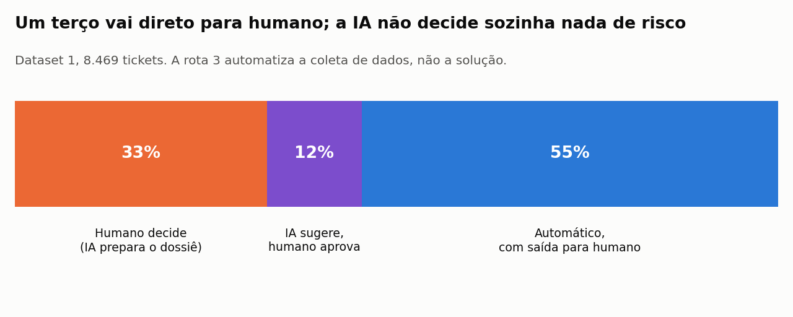
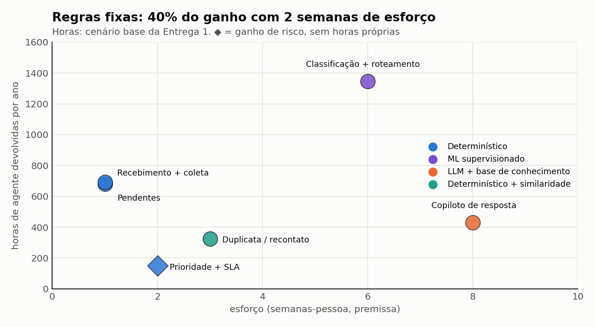
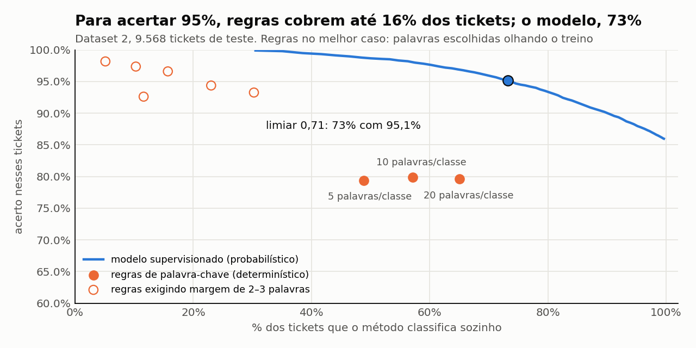
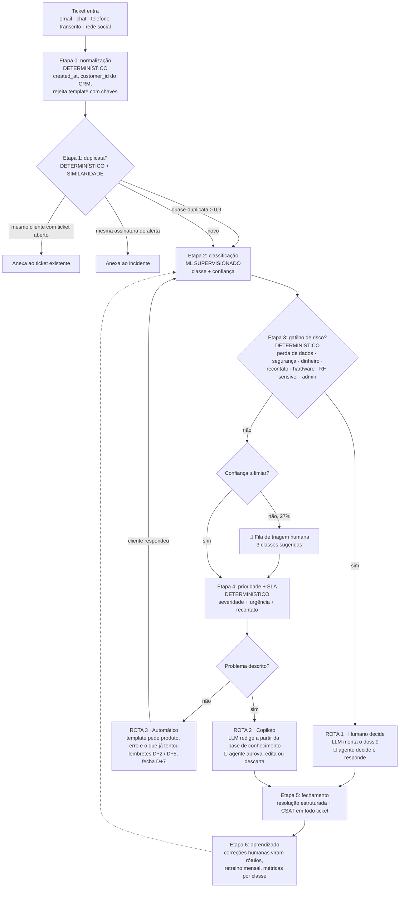

# Proposta de Automação com IA — Suporte ao Cliente

> **Aprofundamento:** esta proposta passou por um [harness de 13 testes](HARNESS_AUTOMACAO.md) que encontrou 8 erros nesta proposta (4 decisões derrubadas e 4 afirmações imprecisas), todos corrigidos aqui. Onde economizar e o que medir para a IA aprender estão em [ECONOMIA_E_APRENDIZADO.md](ECONOMIA_E_APRENDIZADO.md).
>
> **Entrega 2 do Challenge 002.** Base: Dataset 1 (8.469 tickets com métricas e texto) + Dataset 2 (47.837 tickets de TI rotulados em 8 classes).
> Todos os números vêm de [`automacao.py`](automacao.py). Os resultados brutos estão em [`outputs/automacao.json`](outputs/automacao.json), e a rota de cada ticket, com o motivo, em [`outputs/rotas_dataset1.csv`](outputs/rotas_dataset1.csv).
> Continuação do [diagnóstico](../diagnostico/DIAGNOSTICO.md) e da [causa raiz](../diagnostico/CAUSA_RAIZ_E_SOLUCAO.md) da Entrega 1.

---

## Resposta curta ao Diretor

| Pergunta | Resposta |
|---|---|
| **O que automatizar?** | Seis coisas, em ordem de retorno sobre esforço. **Três são regras fixas, sem IA**: política de pendentes, resposta de recebimento que pede os dados que faltam, e prioridade por sinais de risco com SLA. Elas entregam **40% do ganho com 2 semanas de trabalho**. As outras três usam IA: **classificação e roteamento** com modelo supervisionado (73% dos tickets decididos sozinhos, com 95% de acerto, medido), **detecção de duplicata e recontato** por similaridade, e **resposta sugerida ao agente** com LLM. Juntas devolvem **≈ 3.470 h/ano (≈ R$ 122 mil)**. |
| **O que NÃO automatizar?** | **Um terço dos tickets (33%) vai direto para humano**, porque o erro ali é caro ou irreversível: perda de dados (653 tickets), segurança e conta bloqueada (592), dinheiro (346), cliente que já reclamou várias vezes (460) e reparo ou troca de hardware (1.005). Um ticket pode ter mais de um motivo. No Dataset 2, o mesmo vale para **permissão de administrador** (1 em cada 5 pedidos que a IA decide sozinha vai para a fila errada, quase sempre Hardware) e para **RH com dado pessoal** (salário, desligamento, licença). Nesses casos a IA **prepara**, e o humano **decide**. |
| **Determinístico ou LLM?** | **O custo do token não decide nada.** Toda a LLM da proposta custa **≈ R$ 270/ano**, o equivalente a 8 horas de agente. Quem decide é o tipo de entrada e o custo do erro. Se a regra pode ser escrita por inteiro, ela é **determinística**. Se é texto livre com rótulo fechado, vai para **modelo supervisionado**, que no teste foi melhor que as regras (98% contra 80% de acerto na mesma fatia de tickets). A **LLM** fica só onde a saída é texto aberto (redigir, resumir). E, se o erro for caro, **quem decide é humano**, qualquer que seja a técnica. |
| **Como funciona?** | O ticket entra, é deduplicado, classificado e priorizado **em menos de 1 segundo e sem humano**. Depois cai em uma de três rotas: **(1) humano decide**, com o dossiê pronto; **(2) a IA sugere e o humano aprova**; **(3) coleta automática** do que falta, e quando o cliente responde o ticket volta para a classificação. Regras de risco **só tiram tickets da automação, nunca colocam**. |



---

## Como decidi: 4 perguntas, nesta ordem

Antes de olhar cada candidato, fixei o critério. Custo de token entra por último porque, como a seção 4 mostra, ele é desprezível perto das horas de agente.

| # | Pergunta | Se **sim** | Evidência que sustenta a regra |
|---|---|---|---|
| 1 | **O erro é caro, irreversível, financeiro, de segurança ou público?** | **Humano decide.** A IA só prepara. Vale para qualquer resposta às perguntas 2–4 | Perda de dados, conta bloqueada, reembolso e rede social pública (exemplos na seção 2) |
| 2 | **A regra pode ser escrita por inteiro sobre dado estruturado?** (status, prazo, canal, ID, assinatura fixa) | **Determinístico.** Não usar modelo onde uma regra acerta sempre | Pendentes (D+2/D+5/D+7), SLA e os 149 alertas de máquina idênticos espalhados em 5 filas |
| 3 | **É texto livre com rótulo fechado e histórico rotulado?** | **ML supervisionado** com limiar de confiança | Para acertar 95%, regras cobrem até 16% dos tickets; o modelo, 73% (seção 1.1 e harness A2) |
| 4 | **A saída é texto aberto (redigir, resumir, extrair) ou não existe rótulo?** | **LLM**, sempre com humano aprovando até existir medição | Resposta sugerida, dossiê e rotulagem inicial do conjunto de referência |

**Três critérios de desempate**, na ordem: (a) **acurácia medida** vence acurácia suposta; (b) **impacto × esforço** (seção 5) decide a sequência; (c) **auditabilidade**, porque regra e modelo supervisionado explicam a decisão de forma reproduzível e a LLM não.

---

## 1. O que automatizar

### Visão geral

| Automação | Técnica | Por que essa técnica | Ganho | Esforço | Evidência |
|---|---|---|---|---|---|
| **Política de pendentes** (lembrete D+2 e D+5, fechamento em D+7 com reabertura em 1 clique) | Determinístico | Entrada estruturada (status + data); a regra é completa | **680 h/ano** | 1 semana | 34% dos tickets parados esperando o cliente (Entrega 1) |
| **Recebimento com coleta de dados** (template fixo pede produto, mensagem de erro e o que já foi tentado) | Determinístico | O gatilho é "o texto não descreve o problema", detectável; o conteúdo da resposta é fixo | **693 h/ano** (346–1.039) | 1 semana | **69% dos tickets só dizem "estou com problema no {produto}"** |
| **Prioridade por sinais + SLA** | Determinístico | Poucos sinais, alta precisão, e **não há rótulo confiável para treinar** (a prioridade atual é aleatória) | Risco. Meta: *Critical* sem resposta de 32,5% → < 5% | 2 semanas | Entrega 1: urgência escrita ignorada em 48% dos casos |
| **Classificação + roteamento** | ML supervisionado + limiar | Texto livre, 8 classes fechadas, 48 mil exemplos rotulados | **1.345 h/ano** (medido) | 6 semanas | 73% decididos sozinhos com 95,1% de acerto (Dataset 2) |
| **Duplicata e recontato** | Determinístico (`customer_id`) + similaridade de texto | Identidade é dado estruturado; "é o mesmo problema?" é texto | **≈ 330 h/ano** | 3 semanas | 5,4% dos tickets têm quase-duplicata no histórico; nelas, a classe coincide em 96% |
| **Resposta sugerida ao agente** (copiloto) | LLM + base de conhecimento curada | Saída é texto aberto; não existe resposta certa única | **≈ 430 h/ano** | 8 semanas | Depende de base de conhecimento: o campo `Resolution` atual é ilegível (P7) |
| **Dossiê para o humano** (rota 1) | LLM (modelo pequeno) | Resumir e extrair de texto livre | Reduz tempo de leitura (não contabilizado) | junto do copiloto | 2.798 tickets de rota 1 no dataset |



**Total: ≈ 3.470 h/ano (≈ R$ 122 mil)** em regime. No **ano 1**, a classificação devolve ≈ 1.298 h, e não 1.345 h, porque o modelo começa com 50% de cobertura e aprende ao longo do ano (harness A7, [ciclo](ECONOMIA_E_APRENDIZADO.md)); a diferença é pequena porque o ganho vem de acertar a classe, não de automatizar mais. As alavancas de economia do aprofundamento somam ≈ 480 h/ano. A coleta automática (693 h) é um item novo, que não estava nos 3.400 h de desperdício da Entrega 1. Sem ela, as outras cinco frentes recuperam **≈ 2.780 h, 82% do desperdício mapeado**.

### As 5 automações que o desafio cita, com 3 opções cada

Mesmo formato da Entrega 1: três opções com os mesmos critérios, a escolhida e o porquê.

#### 1.1 Classificação automática

| | Opção | A favor | Contra |
|---|---|---|---|
| A | **Regras de palavra-chave** (gatilhos no helpdesk) | Determinístico, auditável, custo zero | **Medido:** mesmo com as melhores palavras escolhidas olhando o treino, decide 57% dos tickets com **80% de acerto**. Exigindo margem entre as classes, o acerto chega a 95%, mas a cobertura cai para **16%** (harness A2) |
| B ✅ | **Modelo supervisionado (TF-IDF + regressão logística) com limiar de confiança** | **Medido:** 73% com **95,1%** (sem limiar, decidindo tudo: 85,8%). Na mesma fatia de 57% em que as regras decidem, acerta **98,0%**. Leva 0,05 ms por ticket (medido), é reproduzível e dá uma confiança calibrada que define quem vai para humano | Precisa de rótulos confiáveis, e os atuais são aleatórios; exige monitoramento |
| C | **LLM classificando todos os tickets (zero-shot)** | Começa sem rótulo e entende texto novo | Acurácia **não medida**. É não determinística (o mesmo ticket pode mudar de classe), tem latência de segundos e a confiança não é calibrada |

**Escolha: B**, com a **LLM no papel certo**: rotular os primeiros 3.000 tickets na taxonomia nova, **sorteados** (e não os mais difíceis: harness A8), que humanos validam e que viram o conjunto de referência (*gold set*) para treinar B (plano P2 da Entrega 1). O critério de entrada continua o mesmo: **≥ 90% de acerto em 500 tickets rotulados por humanos**. Com 3.000 rótulos o modelo começa decidindo **50%** dos tickets, não 73%, e chega lá aprendendo com a triagem humana ([ciclo de aprendizado](ECONOMIA_E_APRENDIZADO.md)).
**Por que não A:** a diferença de 80% para 98% de acerto na mesma cobertura significa ≈ 1 ticket mal roteado a cada 5 contra 1 a cada 50.



#### 1.2 Roteamento inteligente

| | Opção | A favor | Contra |
|---|---|---|---|
| A ✅ | **Tabela fixa classe → fila, com desvio por limiar e por gatilho de risco** | Determinístico e auditável; quem mudar a tabela sabe o efeito | Não aprende sozinho |
| B | Modelo que aprende o melhor agente para cada ticket | Otimiza o casamento ticket-agente | Não há dado para isso: não existe `agent_id` nem tempo de atendimento válido (P1) |
| C | LLM decide a fila lendo o ticket | Flexível | Junta dois erros (classificação e fila) numa decisão que não dá para auditar |

**Escolha: A.** A parte probabilística fica **só na classificação** (1.1). Depois dela, o roteamento é uma tabela. Quando a classe está certa, a fila está certa, e o erro tem um único lugar para ser investigado.

#### 1.3 Respostas sugeridas

| | Opção | A favor | Contra |
|---|---|---|---|
| A | Macros fixas por categoria | Determinístico e aprovado uma vez | **34% dos clientes já fizeram o básico** (reset de fábrica, atualização, manual). Uma macro genérica manda de novo o que já falhou |
| B ✅ | **LLM redige a partir da base de conhecimento curada; o agente aprova, edita ou descarta** | Adapta ao que o cliente já tentou; o humano segura o risco; cada edição vira dado de qualidade | Acurácia ainda não medida; depende de montar a base de conhecimento |
| C | LLM responde direto ao cliente | Maior ganho de tempo | Sem medição, é colocar texto não verificado na frente do cliente |

**Escolha: B.** Uma intenção só passa para envio automático (C) depois de **≥ 90% de aprovação sem edição em 200 casos**, e **nunca** na rota 1.
**Restrição que o dado impõe:** a LLM **não** pode buscar respostas no histórico de resoluções, porque o campo `Resolution` é texto sem sentido ("Such option result friend able director.", Entrega 1). A base de conhecimento precisa ser escrita. São poucos artigos: o Dataset 1 tem **15 problemas-padrão**, em 7 famílias.

#### 1.4 Triagem de prioridade

| | Opção | A favor | Contra |
|---|---|---|---|
| A | Prioridade declarada pelo cliente ou pelo agente | Já existe | É aleatória: *Critical* fica sem resposta tanto quanto *Low* (Entrega 1) |
| B ✅ | **Pontuação por sinais (severidade + urgência + recontato) → SLA** | Determinístico, explicável ("subiu porque diz perda de dados + urgente"); pronto desde a Entrega 1 | Só enxerga os sinais listados |
| C | Modelo treinado para prever prioridade | Aprende padrões sutis | **Não há rótulo confiável**: treinar na prioridade atual ensinaria o sorteio |

**Escolha: B.** Vira C quando existir um histórico de prioridades corrigidas pelos agentes. **Exemplo do dado:** o ticket **#7971** relata um bug que causa perda de dados e diz *"I need assistance as soon as possible because it's affecting my work"*. Hoje ele está como *Medium*, tipo *Cancellation request*, e aberto. Pela pontuação, vira *Critical*.

#### 1.5 Detecção de duplicatas

| | Opção | A favor | Contra |
|---|---|---|---|
| A | E-mail igual = mesmo cliente | Trivial | **Medido:** 139 e-mails repetidos, e em **100%** deles os tickets têm nomes e produtos diferentes. `asmith@example.com` são 4 pessoas: Brent Haynes (GoPro), Tyler Foster (Xbox), Kathy Moore (Nikon) e David Walters (Garmin) |
| B ✅ | **`customer_id` do CRM (determinístico) + similaridade de texto ≥ 0,9 (probabilístico) + assinatura de alerta (determinístico)** | Cada parte faz o que sabe: identidade é dado, "mesmo problema" é texto, alerta de máquina é assinatura fixa | Exige integração com o CRM (P8) |
| C | LLM compara pares de tickets | Entende paráfrase | Comparar cada ticket novo com o histórico custa O(n) chamadas; similaridade vetorial faz o mesmo em milissegundos |

**Escolha: B.** Três achados do Dataset 2:
- **5,4%** dos tickets novos têm uma quase-duplicata (cosseno ≥ 0,9) no histórico, e nelas **a classe coincide em 96%**. O resultado é estável: 94% com limiar 0,8 e 97% com 0,95. **Mas isso não ajuda a classificar:** o modelo já acerta 95,6% nesses tickets (harness A9). O valor da duplicata é **vincular** o ticket ao anterior (histórico, resolução já dada, recontato), não sugerir a classe.
- **149 alertas de monitoramento** ("critical alert … tape library") foram tratados como tickets separados e caíram em **5 classes diferentes** (Miscellaneous 57, Hardware 50, HR Support 33, Administrative rights 5, Storage 4). Isso não pede IA: pede **uma regra de assinatura** que abre um incidente e anexa os demais.
- No Dataset 1, 1.454 tickets trazem sinal de incidente ("vários aparelhos do mesmo modelo", "depois da atualização"). Quando se acumulam no mesmo produto, **o sistema sugere o incidente e um humano o declara** (seção 2).

---

## 2. O que NÃO automatizar

**Regra de desenho:** gatilho de risco **só tira** um ticket da automação, **nunca coloca**. O custo é assimétrico. Um falso positivo custa um humano lendo um ticket simples; um falso negativo custa um cliente perdendo dados por causa de uma resposta automática.

### No Dataset 1: 2.798 tickets (33%) vão direto para humano

| Tipo de ticket | Tickets | Por que exige julgamento humano | Exemplo real |
|---|---|---|---|
| **Perda de dados** | 653 (215 urgentes) | **Irreversível.** A resposta-padrão de troubleshooting ("faça reset de fábrica", "reinstale") **apaga o que ainda daria para recuperar** | **#7971** *"software bug… causing data loss… affecting my work"*: hoje *Medium* / *Cancellation request*, aberto sem resposta |
| **Segurança e conta bloqueada** | 592 | Risco de sequestro de conta. **Liberar acesso é decisão de identidade:** a verificação é um processo fixo, conduzido por pessoa, e a LLM nunca libera acesso | **#1711** *"It says my account is locked"*; **#157** *"concerned about the security… ensure that my data is safe"* (rede social, *Low*) |
| **Dinheiro** (reembolso, cobrança, fatura, cancelamento) | 346 | Decisão financeira e de retenção. A **elegibilidade** pode ser calculada por regra (`Date of Purchase` + política), mas **a aprovação é humana** | **#3011** *"The original invoice with the refund was $60 and the new invoice arrived…"* |
| **Recontato** ("já contatei várias vezes") | 460 | O processo já falhou com esse cliente, e uma resposta automática piora a experiência. Vai para um agente sênior, com histórico | **#7000** *Critical*: credencial inválida + *"already contacted customer support multiple times"* |
| **Hardware, reparo ou troca** | 1.005 | Diagnóstico físico e decisão de garantia/RMA, que tem custo | **#7019** *"strange noises… might require repair or replacement"* |

### No Dataset 2: onde o modelo erra, o erro custa caro

| Tipo | Evidência | Decisão |
|---|---|---|
| **Administrative rights** | A classe mais difícil: só 62% passam do limiar, e mesmo acima dele **1 em cada 5** vai para a fila errada (*Administrative rights → Hardware*, 40 de 41 erros). Quando o modelo diz "permissão", acerta 96,7%: o risco é o pedido que **não** é reconhecido. Limiar próprio e gatilho de palavra não resolvem ([B4](ECONOMIA_E_APRENDIZADO.md)) | **Proteger a ação, não o rótulo:** nenhuma concessão de acesso sai sem aprovação humana no sistema de identidade. O pedido mal roteado custa uma devolução, que vira rótulo |
| **RH com dado pessoal** | Em *HR Support*: *maternity* 411, *sick* 47, *salary* 34, *termination* 32, *resign* 17, *payroll* 11. Exemplo: *"employee salaries report… gross salary… tax exemption"* | Dado trabalhista e de saúde. A IA roteia para o RH e **não redige resposta** |
| **Abaixo do limiar de confiança** | 27% dos tickets, nos quais a IA acertaria **60%** | Fila de triagem humana, com as 2 classes mais prováveis como sugestão |

### Em qualquer canal ou tipo

- **Resposta pública em rede social** (2.121 tickets, 25%): nenhum texto gerado por LLM é publicado sem aprovação. A resposta automática é **um template aprovado uma vez pela comunicação**, que leva a conversa para o privado.
- **Declarar incidente e comunicar em massa**: o agrupamento sugere, e **um humano confirma**. Um falso incidente vira comunicado errado para milhares de clientes.
- **Decisões de gestão** (contratar, mudar política): ficam com pessoas e números (P4 da Entrega 1).

### Automações que parecem óbvias e o dado mostra que estão erradas

| Automação "óbvia" | O que o dado mostra | O que fazer |
|---|---|---|
| Mandar o link de redefinição de senha para "esqueci a senha" | **186 clientes dizem que a redefinição não funciona** (#2613: *"the password reset option is not working"*) | Rota 2: o agente investiga, com sugestão da IA |
| Mandar o roteiro L1 padrão | **2.889 clientes (34%) já fizeram o básico** (#5752: *"performed a factory reset… it didn't help"*) | Marcar `ja_tentou_o_basico` e pular o L1 |
| Deduplicar por e-mail | 100% dos e-mails repetidos são de pessoas diferentes | `customer_id` do CRM |
| Montar respostas a partir das resoluções antigas | O campo `Resolution` é texto sem sentido | Base de conhecimento curada |
| Treinar prioridade com a prioridade atual | A prioridade atual é aleatória (Entrega 1) | Regras de sinal agora; modelo quando houver rótulo corrigido |
| Usar LLM para classificar alertas de máquina | 149 alertas idênticos em 5 filas | Regra de assinatura → 1 incidente |

---

## 3. Como funcionaria na prática

### 3.1 O fluxo



### 3.2 Etapa por etapa

| Etapa | O que acontece | Quem atua | Técnica | Tempo | Onde o humano entra |
|---|---|---|---|---|---|
| **0. Normalização** | Carimba `created_at`, busca o `customer_id` no CRM, rejeita texto com `{placeholder}` | Sistema | Determinístico (Quality Gate da Entrega 1) | ms | — |
| **1. Duplicata** | Mesmo cliente com ticket aberto → anexa. Assinatura de alerta → incidente. Quase-duplicata → vincula ao ticket anterior e mostra a resolução dada | Sistema | Regra + similaridade vetorial | ms | Confirma o **incidente** quando o agrupamento passa de N tickets |
| **2. Classificação** | Classe + confiança | IA | ML supervisionado | 0,05 ms | Abaixo do limiar (27%): **fila de triagem humana** |
| **3. Gatilho de risco** | Lista fechada de sinais → rota 1, **independente do modelo** | Sistema | Determinístico | ms | — |
| **4. Prioridade + SLA** | Pontuação → SLA na fila | Sistema | Determinístico | ms | Agente pode subir a prioridade (vira rótulo) |
| **Rota 3** (55%) | Template fixo pede os dados que faltam; lembretes e fechamento automáticos. Na rede social, o template leva para o privado | Sistema | Determinístico | segundos | Quando o cliente responde, o ticket volta à etapa 2 |
| **Rota 2** (12%) | A LLM redige usando a base de conhecimento e o que o cliente já tentou | IA + agente | LLM (maior) | segundos | **Agente aprova, edita ou descarta** cada resposta |
| **Rota 1** (33%) | A LLM monta o dossiê: resumo, o que já foi tentado, histórico do cliente, política aplicável (ex.: elegibilidade de reembolso calculada por regra). **1A** (hardware, reparo, recontato: 45% da rota): a IA também rascunha a resposta, porque o risco está na decisão, não no texto. **1B** (perda de dados, segurança, dinheiro): o humano escreve | IA prepara, humano decide | LLM (menor) + regra | segundos | **Agente decide e responde** |
| **5. Fechamento** | Resolução estruturada (código + texto) e CSAT em todo ticket | Agente + sistema | Determinístico | — | Registra a resolução |
| **6. Aprendizado** | Triagem humana, **devoluções** da fila errada e **auditoria** viram rótulo; retreino mensal; monitor de devoluções detecta categoria nova ([ciclo](ECONOMIA_E_APRENDIZADO.md)) | Sistema | ML | — | **Auditoria sorteada de 10%** das decisões automáticas (1,5 h/mês): 2% não enxergaria uma queda de acerto |

> **Por que a rota 3 é tão grande (55%):** 69% dos tickets não descrevem o problema (Entrega 1: template quebrado, `{product_purchased}` literal). Ninguém, humano ou IA, resolve o que não foi descrito. O primeiro passo útil é **pedir o dado**, e isso é um template, não um modelo. Quando o problema chega, o ticket é reclassificado e cai na rota 1 ou 2. **O que a rota 3 automatiza é a coleta, não a solução.** Com o template da entrada corrigido (P7), essa fatia encolhe.

### 3.3 Três tickets atravessando o fluxo

| Ticket | Etapas | Resultado |
|---|---|---|
| **#7971** (e-mail, hoje *Medium*): *"software bug… causing data loss… I need assistance as soon as possible because it's affecting my work"* | Classe: software → **gatilho perda de dados** → rota 1. Prioridade: severidade 3 + urgência 2 → *Critical* (a mesma da fila repriorizada da Entrega 1) | O agente recebe o dossiê: *"perda de dados causada por bug; não sugerir reset; cliente diz que afeta o trabalho"* |
| **#5752** (telefone): *"trouble connecting… to my home Wi-Fi… performed a factory reset… it didn't help"* | Classe: rede, confiança alta → sem gatilho → rota 2, marcado `ja_tentou_o_basico` | A LLM redige **a partir do passo 2 do artigo de rede**, sem repetir o reset; o agente aprova |
| **#2080** (telefone): *"I'm having an issue with the {product}. Please assist. This problem started occurring after the recent software update."* | Problema não descrito → rota 3; sinal de incidente → agrupado com outros tickets do mesmo produto | O template pede o modelo e a mensagem de erro. Se o grupo "pós-atualização" crescer, **um humano declara o incidente** |

### 3.4 Quando uma automação sobe de nível

Nenhuma automação nasce autônoma. Cada uma sobe de nível só com medição:

| De → para | Critério | Quem aprova |
|---|---|---|
| LLM rotula → modelo supervisionado em produção | ≥ 90% de acerto em 500 tickets rotulados por humanos (P2) | Operações + IA |
| Copiloto → envio automático (por intenção) | ≥ 90% aprovadas sem edição em 200 casos, zero incidentes de risco, **só rotas 2 e 3** | Operações |
| Limiar de confiança mais baixo | Acurácia ≥ 95% mantida por 4 semanas na auditoria | IA |
| **Rota 1 → qualquer automação de decisão** | **Não existe critério. Não sobe** | — |

**Se algo piorar, a automação volta um nível** automaticamente: acurácia semanal abaixo de 90% em uma classe, taxa de reabertura acima da média, ou queda de CSAT na rota.

---

## 4. Custo: por que o token não decide

| Uso de LLM | Tickets/ano | Modelo | US$/ano | Com 10× os tokens |
|---|---|---|---|---|
| Resposta sugerida (rota 2) | 3.720 | Claude Sonnet 5 | 27 | 269 |
| Dossiê para o humano (rota 1) | 9.912 | Claude Haiku 4.5 | 19 | 191 |
| Rotulagem inicial do gold set (uma vez) | 3.000 | Claude Sonnet 5 | 3 | 34 |
| **Total** | | | **≈ US$ 49 (≈ R$ 270)** | **≈ R$ 2.700** |

Premissas: preços da API (US$/1M tokens: Sonnet 5 a 2 de entrada e 10 de saída; Haiku 4.5 a 1 e 5), prompt fixo em cache (leitura a 10% do preço), texto médio de 72 tokens por ticket (medido), base de conhecimento de 1.500 tokens por consulta, US$ 1 = R$ 5,40. Todas trocáveis no topo do script.

**Leitura:**
- A LLM custa **1,8% do valor das horas que o copiloto devolve** (R$ 15 mil/ano). Mesmo com 10× os tokens estimados, fica em 18% (verificação V5).
- Um lote de tickets reclassificados pela rota 3 aumenta o uso do copiloto, mas a ordem de grandeza não muda.
- **Por isso, o critério nunca foi preço do token.** Foi **custo do erro** (quem decide), **acurácia medida** (supervisionado ganha de regra), **latência e reprodutibilidade** (0,05 ms e o mesmo resultado sempre, contra segundos e resultados que variam) e **dependências** (o copiloto só existe com base de conhecimento).
- **Onde o dinheiro está de fato:** nas 8 semanas de construção do copiloto e na curadoria da base de conhecimento, não na API.

---

## 5. Impacto × esforço: a ordem de implantação

| # | Automação | Técnica | h/ano | h/mês | R$/ano | Semanas | Depende de |
|---|---|---|---|---|---|---|---|
| 1 | Política de pendentes | Determinístico | 680 | 57 | 23.800 | 1 | nada |
| 2 | Recebimento com coleta de dados | Determinístico | 693 | 58 | 24.255 | 1 | nada |
| 3 | Prioridade por sinais + SLA | Determinístico | risco | — | — | 2 | nada |
| 4 | Classificação + roteamento | ML supervisionado | 1.345 | 112 | 47.075 | 6 | gold set |
| 5 | Duplicata / recontato | Regra + similaridade | 326 | 27 | 11.410 | 3 | `customer_id` (P8) |
| 6 | Copiloto de resposta + dossiê | LLM + base de conhecimento | 429 | 36 | 15.015 | 8 | base de conhecimento (P7) |
| | **Total** | | **≈ 3.470** | **≈ 290 h/mês** | **≈ 121.600** | | |

Horas no cenário base da Entrega 1; na duplicata, premissa de 50% do recontato evitado. O esforço é premissa, em semanas-pessoa.

**Sequência (encaixada no plano da Entrega 1):**

```text
SEMANAS 1–2   Regras fixas (1, 2, 3)          → ≈ 1.370 h/ano, 40% do ganho, sem IA
SEMANAS 3–8   Classificação (4)               → LLM rotula, humano valida 500, modelo em produção
              Duplicata (5)                   → assim que o customer_id existir
SEMANAS 6–14  Copiloto + dossiê (6)           → base de conhecimento dos 15 problemas-padrão primeiro
MÊS 4+        Promoções de nível (seção 3.4)  → só com medição
```

**Por que nessa ordem:** as regras fixas não dependem de dado novo, de modelo nem de treino, e liberam horas do time **antes** que a IA precise de gente para validar o gold set. O copiloto vem por último porque tem o maior esforço, o menor ganho e uma dependência que ainda não existe.

---

## Verificações

O script roda 5 verificações e termina com erro se alguma falhar.

| # | O que verifica | Resultado |
|---|---|---|
| V1 | Cada ticket cai em exatamente uma rota | ✅ 8.469 de 8.469 |
| V2 | Nenhum ticket com sinal de risco fica fora da rota 1 | ✅ 2.798 de 2.798 |
| V3 | Regras × modelo **na mesma cobertura** (comparação justa) | ✅ 80,0% contra 98,0% |
| V4 | A duplicata acerta a classe em qualquer limiar razoável | ✅ 94–97% entre 0,8 e 0,95 |
| V5 | O custo de LLM com 10× os tokens fica abaixo do ganho do copiloto | ✅ 18% do ganho |

---

## Limitações

- **O texto do Dataset 1 é montado por templates.** Por isso, regras exatas reconhecem o problema com precisão quase total. Em texto livre isso não se sustenta (seção 1.1: para acertar 95%, regras cobrem só 16%), e **em produção quem reconhece o problema é o modelo**. As regras ficam só para os gatilhos de risco, que são poucos e deliberadamente amplos.
- **A acurácia da LLM não foi medida nesta entrega.** Por isso, toda LLM da proposta começa **com humano aprovando**, e só sobe de nível com o critério da seção 3.4. A medição é o objetivo do protótipo (Entrega 3).
- **O sinal "dinheiro" no Dataset 1** vem de palavras soltas no texto (o campo `Ticket Type` é aleatório, Entrega 1). Em produção, a regra passa a valer sobre a classe prevista pelo modelo **e** sobre as palavras.
- **O Dataset 2 é outra taxonomia** (TI interna). Ele prova a técnica, não a acurácia na taxonomia desta operação; isso é o critério P2.
- **O esforço em semanas e a fração de recontato evitado (50%) são premissas.** As horas de pendentes, retriagem e L1 vêm do cenário base da Entrega 1, com a mesma faixa de incerteza (P10–P90 de 3.200 a 4.700 h).

---

## Reprodução

```bash
pip install -r ../diagnostico/requirements.txt
python automacao.py --data ../data/support_tickets.csv --data2 ../data/it_tickets.csv   # ≈ 1 min, exit 0 = verificações OK
```

Gera em `outputs/`: `automacao.json`, `rotas_dataset1.csv` e os gráficos 07 a 09. Lê `../diagnostico/outputs/resultados.json` e `triagem_ia.json`, para usar os mesmos números da Entrega 1 sem copiá-los.

---

## Registro de decisões

| Decisão | Opções | Escolhida | Critério decisivo | Verificado por |
|---|---|---|---|---|
| Classificação | Regras · ML supervisionado · LLM zero-shot | **ML + LLM só para o gold set** | Acurácia medida (98% × 80% na mesma cobertura; a 95%, 73% × 16% de cobertura) | V3, A2 |
| Roteamento | Tabela · modelo de alocação · LLM | **Tabela** | Auditabilidade; não há dado para alocação | — |
| Resposta sugerida | Macros · LLM + aprovação · LLM direto | **LLM + aprovação** | 34% já tentaram o básico; custo do erro | Critério de promoção (3.4) |
| Prioridade | Declarada · regras de sinal · modelo | **Regras de sinal** | Não há rótulo confiável | Entrega 1 (P3) |
| Duplicata | E-mail · `customer_id` + similaridade · LLM | **`customer_id` + similaridade + assinatura** | E-mail erra 100%; valor está no vínculo, não na classe | V4, A9 |
| O que fica humano | — | **33% dos tickets + admin + RH sensível** | Custo do erro assimétrico | V2 |
| Técnica × custo | — | **Custo de token não decide** | R$ 270/ano ≈ 8 h de agente | V5 |
