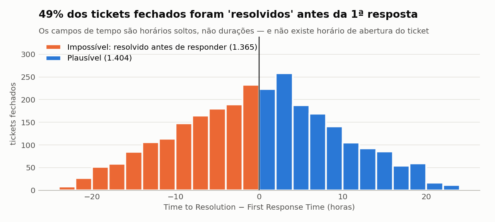
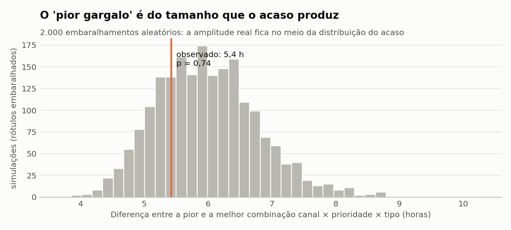
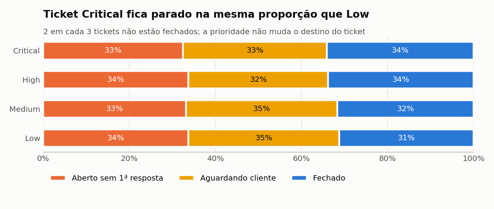
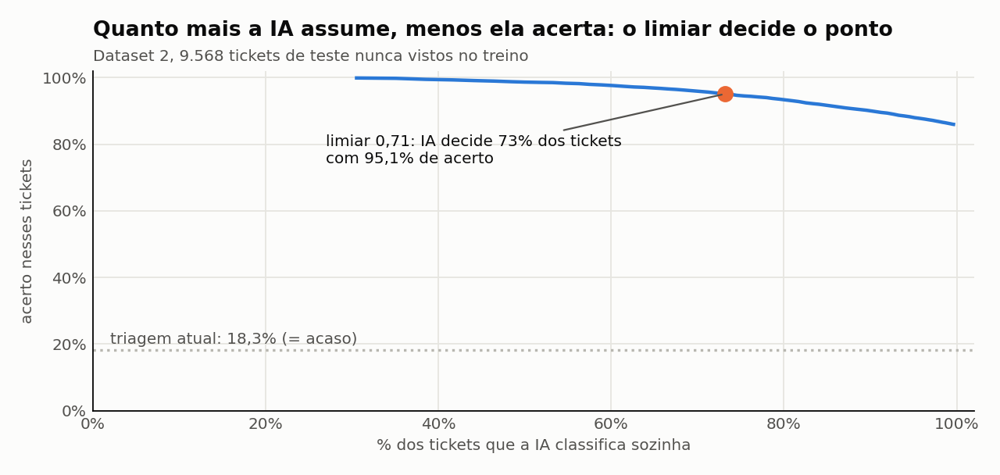
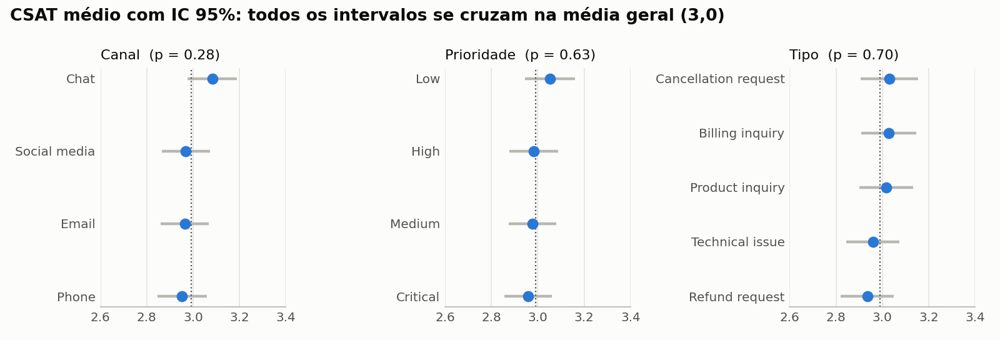
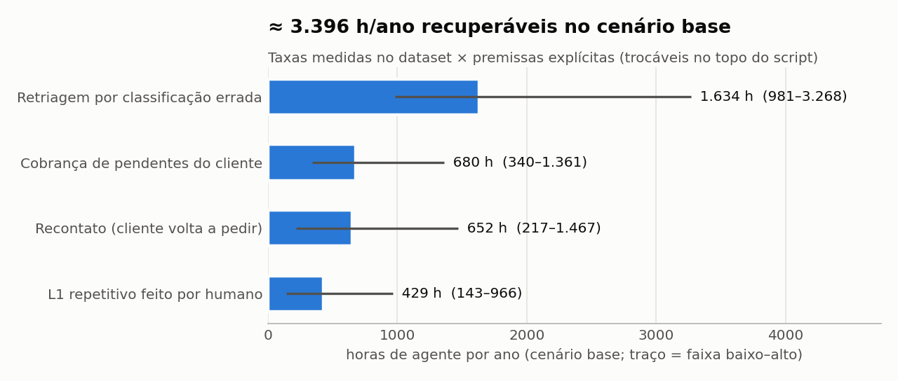

# Diagnóstico Operacional — Suporte ao Cliente

> **Entrega 1 do Challenge 002.** Base: Dataset 1 (*Customer Support Ticket Dataset*, Kaggle).
> Todos os números vêm de [`diagnostico.py`](diagnostico.py). Os resultados brutos estão em [`outputs/resultados.json`](outputs/resultados.json).
>
> **Documentos desta entrega:**
> 1. **Este diagnóstico:** onde trava, CSAT e desperdício.
> 2. [**HARNESS.md**](HARNESS.md): 10 testes que tentam derrubar cada conclusão e cada decisão, e a aderência ao desafio.
> 3. [**CAUSA_RAIZ_E_SOLUCAO.md**](CAUSA_RAIZ_E_SOLUCAO.md): é gente, ferramenta ou processo? 9 causas, 3 opções para cada, a solução e o plano.
> 4. [**solucao/**](solucao/): o que roda amanhã. `quality_gate.py` (contrato de dados) e `triagem_ia.py` (IA de triagem + fila do backlog repriorizada).

---

## Resposta curta ao Diretor

| Pergunta | Resposta |
|---|---|
| **Onde o fluxo trava?** | **O fluxo trava porque o dado não é registrado corretamente.** Isso acontece em dois pontos. Na **entrada**, a classificação do ticket não tem relação com o que o cliente escreveu: o assunto bate com a descrição em 18,3% dos casos, exatamente o que se obteria por sorteio. No **relógio**, não existe o horário de abertura do ticket, e 49% dos tickets fechados aparecem como "resolvidos" antes da primeira resposta. O dado sustenta um único retrato do fluxo: **2 em cada 3 tickets não estão fechados**, **1 em cada 3 nunca recebeu resposta**, e um ticket *Critical* fica parado na mesma proporção que um *Low*. **Não é erro humano:** todas as falhas têm assinatura de sistema ([causa raiz](CAUSA_RAIZ_E_SOLUCAO.md)). |
| **O que impacta a satisfação?** | **Nenhuma variável registrada explica o CSAT.** Canal, prioridade, tipo, produto, idade e tempo têm todos p > 0,25. Um modelo com todas as variáveis acerta 20,0% das notas, o mesmo que um sorteio entre as 5 notas. O CSAT só existe em 32,7% dos tickets, os fechados, e por isso não mede justamente os clientes mais insatisfeitos. |
| **Quanto estamos desperdiçando?** | **≈ 3.400 h/ano de agente, ≈ R$ 119 mil/ano, ≈ 1,7 pessoa em tempo integral.** A faixa plausível (P10–P90 em 20 mil cenários) é de 3.200 a 4.700 h e R$ 109 mil a 194 mil. O maior desperdício recuperável é a **retriagem de tickets mal classificados, com ≈ 48% do total**; ela é o maior item em 100% dos cenários. Com triagem por IA, **≈ 1.345 h/ano voltam**, número calculado com acurácia medida em dado real e não com premissa. Além disso, há uma **dívida de capacidade de ≈ 2.000 h/ano**: o trabalho necessário para responder os tickets que nunca foram respondidos. |

---

## Como ler este documento

Cada etapa segue o mesmo formato:

**O que o dado mostra → Erro encontrado → 3 opções de tratamento → Opção escolhida e por quê → Correção na fonte + contorno até lá**

As três opções são apresentadas com os mesmos critérios. A escolhida é a que responde à pergunta sem afirmar algo que o dado não sustenta. As opções descartadas ficam registradas, com o motivo.

---

## Etapa 0 — O dado é confiável? (pré-requisito)

Antes de procurar gargalos, auditei cada coluna. Encontrei 10 problemas:

| # | Problema | Evidência | Consequência |
|---|---|---|---|
| 1 | **O volume não é ~30 mil** | 8.469 tickets. O arquivo tem 29.807 linhas porque as descrições ocupam várias linhas | Quem conta linhas (`wc -l`) superestima o volume em 3,5× |
| 2 | **Não existe horário de abertura do ticket** | Nenhuma coluna `created_at` | É impossível medir o tempo até a 1ª resposta, a métrica nº 1 de suporte |
| 3 | **Os "tempos" são horários, não durações** | `First Response Time` e `Time to Resolution` são datas-hora, todas dentro de uma janela de 27 h (31/05 21:53 → 02/06 00:55) | Isso parece o momento da carga dos dados, não o da operação |
| 4 | **Resolução antes da resposta** | 1.365 de 2.769 tickets fechados (**49,3%**) têm resolução anterior à 1ª resposta. E 100% dos pares têm os mesmos segundos: a resolução é *calculada* como 1ª resposta ± N minutos, não registrada | Qualquer duração calculada com esses campos é inválida |
| 5 | **Template não preenchido** | 100% das descrições contêm `{product_purchased}` literal, e 668 contêm outros 155 placeholders (`{error_message}`…) | O texto não diz qual produto nem qual erro, o que atrapalha a triagem |
| 6 | **Resolução sem conteúdo** | `Resolution` = "Such option result friend able director." | Não dá para montar uma base de conhecimento a partir das resoluções |
| 7 | **Tipo e Assunto sem relação** | Qui-quadrado p = 0,98: o assunto "Refund request" aparece com a mesma frequência como *Technical issue* e como *Refund request* | Classificação aleatória, e portanto roteamento aleatório |
| 8 | **Assunto e descrição sem relação** | O assunto bate com o tema do texto em **18,31%**; o acaso daria **18,32%** (n = 1.982) | Quem registra o ticket não usa o conteúdo para classificá-lo |
| 9 | **CSAT só nos fechados** | 5.700 nulos; cobertura de **32,7%**; notas 1 a 5 com frequências iguais (p = 0,80) | Viés de sobrevivência: os tickets abandonados não são avaliados |
| 10 | **Não há ID de cliente nem contador de recontato** | 149 e-mails repetidos, sem vínculo entre tickets | Recontato só pode ser detectado pelo texto |

> **Nota de honestidade:** o dataset é sintético (gerado para o Kaggle), e isso explica a distribuição uniforme de quase tudo. Tratei os dados **como se fossem de uma operação real**. Nesse cenário, o padrão acima indica uma **captura quebrada**, e a resposta ao Diretor é: *"o fluxo trava porque o dado não é registrado corretamente"*.

### Como tratar um dado com essas falhas?

| Opção | O que faz | A favor | Contra |
|---|---|---|---|
| **A. Usar como está** | Calcula as durações, ranqueia combinações e reporta "gargalos" | Entrega rápida, com "cara de análise" | Apresenta ruído como achado. O Diretor agiria sobre algo que não existe |
| **B. Descartar o dataset** | Troca os dados por benchmarks de mercado | Evita conclusões falsas | Joga fora o que o dado *sustenta*: backlog, status e incoerência da triagem |
| **C. Separar o que o dado sustenta do que não sustenta** ✅ | Responde com o que é válido. Para o resto, diagnostica a falha de captura e prescreve a correção e um contorno com rótulo claro | Honesta e acionável: o próprio erro vira achado | Dá mais trabalho e entrega menos "números bonitos" |

**Escolha: C.** O desafio pede diagnóstico "com dados". A opção A inventa sinal e a opção B ignora o sinal que existe. A opção C é a única que não afirma nada que o dado não sustenta.

---

## Etapa 1 — Onde o fluxo trava?

### 1.1 Medir tempo com campos quebrados

| Opção | Como calcula | Resultado |
|---|---|---|
| **A. Descartar os negativos** | Resolução − 1ª resposta, mantendo só os 1.404 valores ≥ 0 | Joga fora 49% dos fechados, e a amostra que sobra é selecionada pelo próprio erro |
| **B. Tratar como "virada do dia"** (usual no Kaggle) | (Resolução − 1ª resposta) **mod 24 h** | Gera tempos entre 0 e 24 h, com média de 11,8 h, próxima do centro dessa faixa |
| **C. Declarar a métrica inválida, instrumentar e usar o status como proxy** ✅ | Não calcula duração. Mede o fluxo pelo status de cada ticket | Tem menos granularidade, mas não gera números falsos |

**Por que não B?** Testei essa opção. As 80 combinações canal × prioridade × tipo ficam entre 9,2 h e 14,6 h, e a "pior" seria **Chat × Low × Technical issue (14,6 h, n = 33)**. Em seguida, embaralhei os rótulos 2.000 vezes. A diferença entre a pior e a melhor combinação é **menor** do que a que o acaso produz (5,4 h observadas contra 5,9 h de mediana no acaso; **p = 0,74**). Esse "pior gargalo" não existe; ele é produto de amostras pequenas (20 a 49 tickets por combinação).




**Escolha: C.** A opção A introduz viés de seleção e a opção B produz ruído (demonstrado acima e confirmado no harness H4: em 1.000 reamostragens, 51 combinações diferentes já apareceram como "a pior", e duas metades do dado concordam no ranking com ρ = 0,01). Nenhuma das duas mede tempo de fato, e publicar um ranking de gargalos a partir delas levaria a mexer no processo errado.

### 1.2 O que o dado sustenta

| Achado | Número | Teste |
|---|---|---|
| **2 em cada 3 tickets não estão fechados** | 33,3% abertos sem nenhuma 1ª resposta · 34,0% aguardando o cliente · 32,7% fechados | — |
| **A prioridade não muda o destino do ticket** | Abertos sem resposta: *Critical* 32,5% · *High* 33,8% · *Medium* 33,2% · *Low* 33,7% | χ² p = 0,23 |
| **O canal não muda o destino** | Abertos sem resposta: de 32,7% (Email) a 34,5% (Phone) | χ² p = 0,77 |
| **O tipo não muda o destino** | Abertos sem resposta: de 32,2% (Refund) a 34,5% (Technical) | χ² p = 0,34 |
| **A triagem é aleatória** | Tipo × assunto incoerentes em **65,4%** (mapa generoso) a **79,4%** (mapa estrito) · assunto × descrição = acaso | χ² p = 0,98 |
| **A urgência escrita é ignorada** | 692 tickets dizem "urgente / afetando meu trabalho", e só 52,5% deles estão em Critical/High (21% em *Low*) | ≈ acaso |



### 1.3 Diagnóstico: onde trava

1. **Entrada (triagem).** O ticket entra com tipo e assunto que não correspondem ao que o cliente escreveu. Uma fila que não sabe *o que* o ticket é também não consegue decidir *para quem* mandá-lo nem *com que urgência*. Por isso prioridade, canal e tipo não fazem diferença no desfecho: a fila não tem informação útil para ordenar. **A causa não é o agente.** A classificação acerta exatamente o acaso em todos os canais, e erro humano deixaria outro rastro (análise forense no [harness H8](HARNESS.md) e na [causa raiz](CAUSA_RAIZ_E_SOLUCAO.md)).
2. **1ª resposta.** 2.819 tickets (33%) nunca foram respondidos, inclusive 692 *Critical*.
3. **Espera pelo cliente.** 2.881 tickets (34%) estão parados aguardando o cliente, sem prazo de encerramento automático registrado.

### 1.4 Correção: como destravar a triagem

| Opção | Como funciona | A favor | Contra |
|---|---|---|---|
| **A. Regras e treinamento** | Campos obrigatórios, lista fechada de assuntos, treinamento do time | Custo baixo, sem tecnologia | Depende da disciplina de um time já sobrecarregado; é justamente esse processo que já falha |
| **B. Classificação por IA na entrada, com revisão humana quando a confiança for baixa** ✅ | O modelo lê a descrição e sugere tipo, assunto e prioridade; abaixo de um limiar de confiança, um humano revisa | Tira o trabalho do agente e fica consistente e auditável; o Dataset 2 (48 mil textos rotulados) permite treinar e validar | Exige construção e monitoramento; erra em casos ambíguos |
| **C. Formulário estruturado para o cliente** | O cliente escolhe a categoria antes de escrever | Simples e barato | O cliente escolhe errado (o item 8 da auditoria mostra que o texto e a categoria já não batem); não funciona em telefone nem redes sociais |

**Escolha: B, com A como complemento** (lista fechada de categorias que a IA preenche). A opção B é a única que ataca a causa, porque a classificação passa a depender do conteúdo e não de quem registra o ticket, e funciona em todos os canais.

**Verificado com dado real (harness H9):** um classificador treinado no Dataset 2 (48 mil tickets), com limiar de confiança escolhido na validação e medido num teste nunca visto, **classifica 73% dos tickets sozinho com 95,1% de acerto**. Os 27% abaixo do limiar vão para humano, porque ali a IA acertaria só 60%. Veja [`solucao/triagem_ia.py`](solucao/triagem_ia.py).



**Contorno imediato (antes da IA):** triagem manual do backlog de *Critical* e *High* sem resposta (≈ 1.400 tickets), pelo texto e não pelo campo de tipo.

---

## Etapa 2 — O que impacta a satisfação?

### O que o dado mostra

Base: 2.769 tickets fechados com CSAT. Média de 2,99.

| Variável | Teste | p-valor | Diferença entre grupos |
|---|---|---|---|
| Canal | Kruskal-Wallis | 0,28 | 0,13 ponto (Chat 3,08 · Phone 2,95) |
| Prioridade | Kruskal-Wallis | 0,63 | 0,09 |
| Tipo | Kruskal-Wallis | 0,70 | 0,10 |
| Assunto (16) | Kruskal-Wallis | 0,81 | 0,38 |
| Produto (42) | Kruskal-Wallis | 0,67 | 0,68 |
| Gênero | Kruskal-Wallis | 0,63 | 0,06 |
| Idade | Spearman | 0,83 | ρ = −0,004 |
| Tempo (proxy mod 24 h) | Spearman | 0,33 | ρ = −0,019 |
| **Texto: "já contatei várias vezes"** | Mann-Whitney | **0,14** | **2,83 com vs 3,00 sem** (n = 152) |
| Texto: dúvida de conta/senha | Mann-Whitney | 0,71 | 3,03 vs 2,99 |
| Texto: "me guie passo a passo" | Mann-Whitney | 0,25 | 2,91 vs 3,00 |

**Modelo multivariado (Random Forest, validação cruzada em 5 partes, todas as variáveis acima):** acerto de **20,0%**. Sortear uma entre as 5 notas daria 20%, e chutar sempre a nota mais comum daria 20,9%. Na versão de regressão, **R² = −0,04**, pior do que prever sempre a média.



### Erro encontrado

O CSAT **só é coletado quando o ticket fecha** (32,7% dos casos). Os 5.700 tickets abertos ou pendentes, que em geral concentram os clientes mais irritados, ficam sem avaliação. Somam-se a isso as notas uniformes e a falta de timestamps válidos. **O CSAT atual não consegue medir o que a pergunta quer saber.**

### Três opções

| Opção | O que faz | A favor | Contra |
|---|---|---|---|
| **A. Reportar a importância das variáveis no modelo** | Ranqueia as variáveis pela importância no Random Forest | É o entregável que o Diretor espera ver | O modelo acerta o mesmo que um sorteio; ranquear a importância de um modelo inútil é ranquear ruído |
| **B. Reportar as maiores diferenças de média** | "Chat tem o melhor CSAT, Phone o pior" | Parece um insight acionável | p = 0,28, sem significância. Levaria a mudar o mix de canais por acaso estatístico |
| **C. Declarar que nada explica, consertar a coleta e fixar hipóteses a testar** ✅ | Diz com clareza o que não se sabe, corrige a coleta e define o que testar primeiro | Evita decisões erradas; o mesmo script roda de novo com dado bom | Não entrega um driver agora |

**Escolha: C.** A e B são tecnicamente possíveis, mas as duas levariam a decisões sobre ruído, o que é pior do que não decidir.

**"Nada explica" não é teste fraco (harness H3):** um efeito de canal a partir de +0,24 ponto seria detectado em ≥ 80% das vezes. Com um sinal plantado, o mesmo Random Forest sai de 20% para 62% de acerto. O pipeline enxerga sinal quando ele existe; este dado não tem.

### Correção na fonte

- Enviar pesquisa para **todo ticket**: ao fechar **e** quando o ticket completa X dias aberto ou pendente.
- Vincular a nota ao `ticket_id`, com `created_at` e `first_response_at` válidos.
- Acrescentar uma pergunta de motivo ("o que mais pesou?") e o **CES** (esforço do cliente).

**Hipóteses a testar primeiro, assim que houver dado:**

1. **Recontato.** É o único sinal com a direção esperada (−0,17 ponto), ainda sem significância.
2. **Tempo até a 1ª resposta.** Hoje não pode ser medido (Etapa 0, item 2).
3. **Número de transferências.** Consequência direta da triagem errada; hoje não é registrado.

---

## Etapa 3 — Quanto estamos desperdiçando?

### Três opções

| Opção | Como calcula | A favor | Contra |
|---|---|---|---|
| **A. Somar as horas do proxy de tempo** | Σ (mod 24 h) dos fechados ≈ 32 mil h | Número grande, "vem do dado" | Soma de um campo que já foi mostrado como inválido (Etapa 1.1); o número não significa nada |
| **B. Taxas medidas × premissas explícitas** ✅ | Taxas de problema **medidas no dataset** × minutos por ocorrência (**premissa**) × 30 mil tickets/ano, em três cenários | Cada número é rastreável e cada premissa pode ser trocada pelo dado real; a faixa mostra a incerteza | Depende de premissas; a precisão é de ordem de grandeza |
| **C. Não quantificar até instrumentar** | Espera o dado bom | Rigor máximo | O Diretor pediu ROI; sem número, nenhuma decisão sai do lugar |

**Escolha: B.** Dos três, é o único cálculo que separa o que foi **medido** do que é **premissa**. As premissas ficam no topo de [`diagnostico.py`](diagnostico.py) para serem trocadas pelos números reais.

### Premissas (não vêm do dataset)

| Premissa | Baixo | Base | Alto |
|---|---|---|---|
| Volume anual (informado pelo Diretor) | 30.000 | 30.000 | 30.000 |
| Tempo médio de atendimento por contato (AHT) | 8 min | 12 min | 18 min |
| Retriagem + transferência de 1 ticket | 3 min | 5 min | 10 min |
| Contatos extras por ticket com "já contatei várias vezes" | 1 | 2 | 3 |
| Cobrança de 1 ticket pendente | 2 min | 4 min | 8 min |
| Parcela do L1 repetitivo resolvível sem agente | 20% | 40% | 60% |
| Custo carregado por hora de agente | R$ 25 | R$ 35 | R$ 55 |

### Resultado

| Desperdício | Taxa **medida** | Horas/ano (base) | Faixa | R$/ano (base) |
|---|---|---|---|---|
| **Retriagem por classificação errada** | 65,4% dos tickets (mapa generoso) | **1.634 h** | 981 – 3.268 | ≈ R$ 57 mil |
| Cobrança de pendentes do cliente | 34,0% | 680 h | 340 – 1.361 | ≈ R$ 24 mil |
| Recontato (cliente volta a pedir) | 5,4% | 652 h | 217 – 1.467 | ≈ R$ 23 mil |
| L1 repetitivo feito por humano (senha, conta, "passo a passo") | 17,9% | 429 h | 143 – 966 | ≈ R$ 15 mil |
| **Total** | | **≈ 3.400 h (1,7 FTE)** | **1.700 – 7.100** | **≈ R$ 119 mil** (R$ 42 mil – R$ 388 mil) |
| *Faixa plausível (Monte Carlo, H6)* | | *P10–P90* | *3.200 – 4.700* | *R$ 109 mil – 194 mil* |
| *Dívida de capacidade: responder quem nunca teve resposta* | *33,3%* | *≈ 2.000 h* | *1.300 – 3.000* | *não é desperdício; é trabalho que está faltando* |



### Onde está o maior desperdício recuperável

**Na retriagem, com ≈ 48% do total.** Três motivos:

1. É o **maior** item em todos os cenários.
2. É a **causa** dos outros. Um ticket mal classificado vai para a fila errada, demora, gera recontato e acaba sem resposta.
3. É o **mais automatizável**. Medido no Dataset 2: a IA classifica 73% dos tickets sozinha com 95% de acerto, e isso recupera ≈ 82% da retriagem (≈ 1.345 h/ano líquidas). Recontato e L1 repetitivo vêm em seguida, com respostas sugeridas e autoatendimento.

**Sensibilidade:** o total depende mais dos **minutos por retriagem** e do **AHT**. Com o mapa estrito de incoerência (79,4%), a retriagem sobe para ≈ 1.985 h no cenário base.

---

## Checklist de correção da captura (para TI / dono do sistema de tickets)

| Campo / regra | Hoje | Correção |
|---|---|---|
| `created_at` | Não existe | Obrigatório, gerado pelo sistema na entrada |
| `first_response_at`, `resolved_at` | Horários soltos, 49% em ordem inválida | Gerados pelo sistema + validação `created_at ≤ first_response_at ≤ resolved_at` |
| `ticket_type`, `subject` | Sem relação com o texto | Lista fechada, preenchida pela IA, com revisão humana quando a confiança for baixa |
| Template da descrição | `{product_purchased}` não substituído | Corrigir a integração; rejeitar texto com `{...}` na entrada |
| `resolution` | Texto sem sentido | Resolução estruturada (código + texto livre) para alimentar a base de conhecimento |
| `customer_id`, `reopen_count`, `transfer_count` | Não existem | Criar; são as métricas de recontato e de retriagem |
| CSAT | Só nos fechados | Pesquisa em todo ticket + motivo + CES |
| Pendentes | Sem prazo | Encerramento automático após N dias sem resposta do cliente, com aviso prévio |

---

## Limitações

- **Dataset sintético.** Os padrões de uniformidade vêm da forma como os dados foram gerados. Em uma operação real, os mesmos testes revelariam os sinais que existissem (o harness H2/H3 mostra que eles teriam poder para isso).
- **As premissas não foram medidas.** O desperdício em horas e reais é uma ordem de grandeza. A faixa P10–P90 do Monte Carlo (H6) mostra a incerteza plausível e a faixa baixo–alto, o pior caso.
- **Os sinais de texto vêm de padrões simples** (regex sobre frases recorrentes). Eles subestimam casos escritos de outra forma.
- **O mapa de coerência tipo × assunto é um julgamento.** Por isso publiquei duas versões, generosa e estrita.
- **A extrapolação de 8.469 para 30 mil tickets/ano** supõe as mesmas proporções.
- **A prova da IA usa o Dataset 2**, que tem outra taxonomia (TI interna). Ela prova que a técnica funciona em texto real de ticket, não a acurácia na taxonomia desta operação; isso exige o critério de aprovação descrito na [causa raiz](CAUSA_RAIZ_E_SOLUCAO.md) (P2).

---

## Reprodução

```bash
pip install -r requirements.txt
python diagnostico.py --data ../data/support_tickets.csv
```

O script leva ≈ 10 s e gera `outputs/` com o JSON de resultados, as tabelas CSV e os 5 gráficos.

```bash
python harness.py --data ../data/support_tickets.csv --data2 ../data/it_tickets.csv       # ≈ 30 s, 10 testes
python solucao/quality_gate.py --data ../data/support_tickets.csv                          # exit 1 = reprovado
python solucao/triagem_ia.py --data ../data/support_tickets.csv --data2 ../data/it_tickets.csv
```

---

## Registro de decisões (para o process log)

| Etapa | Opções consideradas | Escolhida | Motivo em uma linha | Verificado por |
|---|---|---|---|---|
| 0. Integridade | Usar como está · Descartar · Separar o sustentado do não sustentado | **Separar** | Única opção que não inventa sinal nem joga fora o sinal real | H1, H8 |
| 1.1 Medir tempo | Descartar negativos · Mod 24 h · Declarar inválido + status | **Declarar inválido + status** | O teste de permutação (p = 0,74) mostrou que o mod 24 h é ruído | H2, H4 |
| 1.4 Destravar a triagem | Regras · IA com revisão humana · Formulário do cliente | **IA + revisão humana** | Ataca a causa e funciona em todos os canais | H5, H7, H9 |
| 2. CSAT | Importância no RF · Maiores médias · Declarar nulo + consertar coleta | **Declarar nulo + consertar coleta** | O modelo acerta 20% (= sorteio); qualquer ranking seria ruído | H3 |
| 3. Desperdício | Somar o proxy · Taxas × premissas · Não quantificar | **Taxas × premissas** | Rastreável, com premissas trocáveis e faixa de incerteza explícita | H6 |
