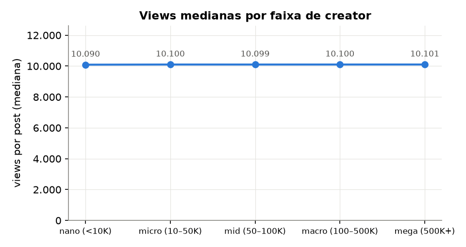

# Resumo executivo — Estratégia de Social Media

Para: Head de Marketing · Base: 52.214 posts (mai/2023 → mai/2025), 5 plataformas · Leitura: 5 minutos.

## A ação principal

**Pague creators por resultado (por mil views ou por interação), não por post: o mega custa ~134x mais por mil views que o nano.**

O motivo: nenhum fator que o time controla (plataforma, formato, tema, tamanho do creator, horário, hashtags, patrocínio) mostrou efeito no engajamento ou no alcance. As views ficam em ~10.100 por post em todos os portes, então o preço por seguidor vira custo sem retorno.

- **Medida por seguidor, o nano parece ~138x melhor** (0,368 × 0,0027 interação por seguidor). É efeito da conta: as views são iguais em todos os portes, e por view o engajamento fica em ~0,199 em todas as faixas.
- **Estável em todos os trimestres:** engajamento médio entre 0,1990 e 0,1991 nos 9 trimestres (2023T2 a 2025T2). Sem sazonalidade.
- Os testes detectariam diferenças de até 0,3%. Por isso, "não faz diferença" aqui é um resultado, não falta de dados. O próprio Kaggle descreve a base como **simulada** (views sorteadas). Com os dados da empresa, o mesmo site e as mesmas funções recalculam tudo.

## O que a IA diria × o que os dados mostram

| "Insight" típico | O que os dados mostram | Veredito |
|---|---|---|
| "Bilibili · vídeo · lifestyle · micro é o segmento que mais engaja: concentre o investimento nele." | índice 100,5 (média = 100), n = 109, p = 0,02, q = 0,88 | maior diferença bruta entre 450 segmentos; some após a correção |
| "Creators maiores entregam mais alcance: priorize macro e mega." | correlação seguidores × views = 0,005 (q = 0,53) | não se sustenta |
| "Vídeo é o formato que mais engaja: migre o mix para vídeo." | −0,03% de engajamento (q = 0,53) | não se sustenta |
| "Publique à noite (18–24h), quando o alcance é maior." | −0,01% de views (q = 0,53) | não se sustenta |
| TikTok · beauty · espanhol: mais posts no top 5% de likes | 10,0% vs. 4,9% (2,0x), nos 2 anos; q global = 0,035 entre 14.763 testes | **único que passou no filtro:** vai para teste A/B |

## As 4 perguntas

| Pergunta | Resposta | Número-chave |
|---|---|---|
| O que gera engajamento? | Nenhuma plataforma, formato, tema, porte de creator ou combinação | 450 combinações testadas, 0 com efeito real; maior diferença 0,07% |
| Patrocínio funciona? | Não para ganhar desempenho. Comparando posts parecidos (mesma plataforma, formato, tema e porte), o patrocinado engaja igual | +0,008% de engajamento: diferença indistinguível de zero |
| Que público engaja mais? | Nenhum: gênero, idade e país engajam igual em todo contexto | 36 contextos testados, 0 com efeito |
| O que não funciona? | 11 de 11 crenças de mercado testadas | ex.: "mais seguidores = mais alcance" (correlação 0,005) |

## O que fazer nesta semana

**Valem também com os dados reais da empresa:**
1. **Contratar creators por resultado** (por mil views ou por interação), não por post. As views não crescem com os seguidores: com cachê proporcional aos seguidores, o creator mega paga **~134x mais por mil views** que o nano, e essa proporção vale para qualquer valor de cachê.
2. **Exigir rótulo de publicidade no texto (#publi/#ad).** 47% dos patrocinados usam divulgação implícita (risco regulatório alto) e só 2,3% mostram o rótulo no texto. O tipo de divulgação não muda o engajamento.
3. **Todo patrocínio novo com um grupo de comparação orgânico**, para medir o ganho real (≥ 30 posts por grupo nesta base; o site refaz a conta com os seus dados).
4. **Não pagar a mais pelo histórico de desempenho do creator e tirar "melhor horário" e "nº ideal de hashtags" do checklist.** Só 8,8% dos melhores creators do 1º ano continuaram entre os melhores no 2º, menos que os 10% do acaso.

**Dependem dos preços reais (recalcular antes de aplicar):**
5. Teto de ~10 mil seguidores para contratos de preço fixo. Sai das premissas (US$ 10 por mil seguidores, até US$ 10 por mil views); com outros preços, varia de 1 mil a 40 mil.
6. Formato padrão pelo custo real de produção: nenhum formato engaja mais, então o mais barato que a plataforma comporta vence.

## O que testar (e quanto custa confirmar)

| # | Hipótese | Evidência | Posts por grupo | Como tratar |
|---|---|---|---|---|
| 1 | TikTok · beauty · espanhol: mais chance de top 5% em likes | 10,0% vs. 4,9% (2x), nos dois anos; único padrão que passou na correção entre ~14,7 mil testes | ~1.430 | teste A/B (mesmo conteúdo em espanhol × inglês) |
| 2 | YouTube: posts até 12h entram mais no top 1% de comentários | 1,45% vs. 0,85%; a média de comentários não muda | ~17.000 | acompanhar no histórico; usar como desempate de agenda |
| 3 | Patrocínio aumenta o engajamento em ≥ 5% | nenhum efeito nesta base | 30 | teste A/B com os contratos da empresa |

**Brief do teste 1** (calculado dos dados):
- **Grupos:** TikTok · beauty em espanhol (teste) × o mesmo conteúdo em inglês (controle).
- **Formato:** vídeo (61% do segmento), igual nos dois grupos.
- **Faixa de creator:** nano (<10K), a de menor custo por mil views, igual nos dois grupos.
- **Público-alvo:** Japão (15% do segmento) e 19–25 anos (36%), os mais frequentes. A distribuição é quase uniforme.
- **Horário:** não há evidência de horário para likes no TikTok (q = 0,97). Distribuir os horários igualmente entre os grupos.
- **Duração:** ~172 segundos (mediana do segmento). A duração não mudou o resultado em nenhum formato.
- **Critério de sucesso:** taxa de top 5% em likes ≥ 7,5% no grupo espanhol (resto do TikTok: 4,9%), p < 0,05, com 1.430 posts por grupo (poder de 80%).

## O que parar

- Pagar preço fixo por seguidores: pelas premissas, ~98% do gasto implícito com patrocínio é excedente sobre o preço justo.
- Pagar a mais por formatos caros "porque engajam mais".
- Usar como regra geral horário, hashtags, tamanho de legenda ou duração.

## Lacunas de carteira (valem mesmo sem efeito no engajamento)

- 60% dos patrocínios estão fora do nicho do creator (ex.: games em beleza).
- Só 22% dos posts estão no idioma do mercado e numa rede disponível lá. Brasil, Alemanha e Rússia não têm conteúdo no idioma local.

## Ferramenta para o dia a dia

Site em linguagem simples (`.venv/bin/social-web`):
- **Início:** este resumo, gerado dos dados.
- **Explorar:** painel com filtros para comparar grupos, com selo de "diferença real".
- **Simular post:** antes de publicar, mostra a chance de virar destaque e uma versão próxima mais forte, com selo de evidência.
- **Auditorias, Estratégia e Descobertas:** detalhes sob demanda.

Para usar com os dados da empresa: trocar o CSV e rodar `social-web --rebuild`. Textos, números e recomendações se recalculam sozinhos.

## Limites

- A base é simulada: os achados descrevem esta base. O valor que se transfere são o método e a ferramenta, validados com efeitos plantados.
- Não há preços na base. Todos os valores em US$ vêm de premissas editáveis.
- Sem posts que fracassaram: 0 posts com zero views, likes, compartilhamentos ou comentários (mínimo de 1.354 likes; views de 9.676 a 10.551). A base não mostra o que fracassa.
- `post_date` não tem fuso: os horários assumem um relógio único.
