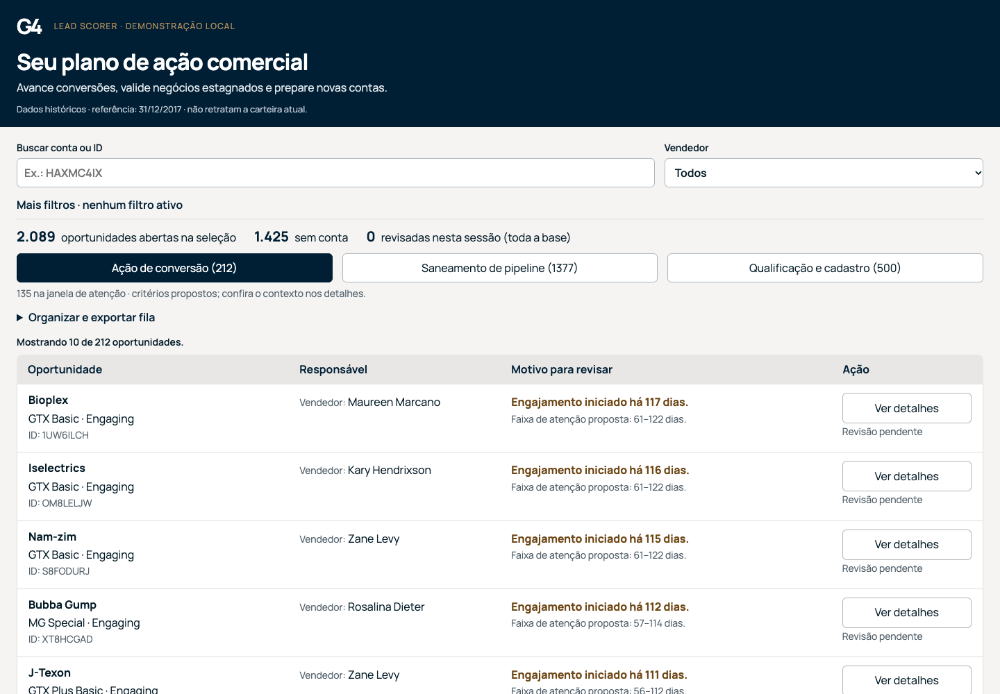

# Submissão — Ronaldo Lima Filho — Challenge 003

**Lead Scorer — seu plano de ação comercial · versão 1.11.1**

## Abrir o LeadScorer

> **[Abrir o LeadScorer](https://leadscorer.fly.dev/)**  
> https://leadscorer.fly.dev/ · Acesso direto no navegador, sem instalação. JEV permanece desligado.

**JEV público em preparação:** integração OpenRouter e proteção de gasto verificadas offline; serviço real permanece bloqueado até comprovar o teto de cobrança. Secret do backend: `OPENROUTER_API_KEY`. [Controles, orçamento e pendências](docs/jev-public-review.md).

## Sobre mim

- **Nome:** Ronaldo Lima Filho.
- **LinkedIn:** [linkedin.com/in/limaronaldo](https://www.linkedin.com/in/limaronaldo/).
- **Challenge escolhido:** 003 — Lead Scorer.

## Executive Summary

Construí uma aplicação que transforma 2.089 oportunidades abertas em três filas explicáveis: avançar conversões, confirmar continuidade de negócios antigos e qualificar novas contas. A descoberta central foi que 96,5% das oportunidades em Engaging tinham pelo menos 60 dias; priorizar idade indiscriminadamente colocava um negócio de 423 dias na frente. Separei atenção comercial de revisão do pipeline, acrescentei contexto por conta, filtros e exportações. A revisão agora permite salvar o próximo passo no navegador, responder um roteiro por fila e conferir outros vendedores com o mesmo produto na conta. Minha recomendação é validar as ações em um piloto pequeno antes de usar os limites como política comercial: a solução tem verificações técnicas, mas ainda não demonstra ganho de conversão ou economia de tempo.



## Solução

### Execução local (alternativa)

Python 3.10+ e biblioteca padrão. A partir de `submissions/ronaldo-lima-filho/`:

```sh
cd solution
python3 -B app.py
```

**Mantenha o terminal aberto e acesse [http://127.0.0.1:8765/](http://127.0.0.1:8765/).** O aplicativo deve ser acessado por esse endereço depois de iniciar o comando acima. Abrir `index.html` diretamente não inicia o servidor: a aplicação detecta essa situação e mostra o passo a passo, o comando e o link correto. Use uma instância nessa porta; Ctrl+C encerra. O aplicativo funciona sem dependências instaladas, credenciais ou serviços externos. O ZIP 1.11.1 contém os CSVs, código, fonte local e evidências desta versão. Os pacotes anteriores permanecem preservados separadamente. A versão hospedada está disponível no link no início deste README.

### Abordagem

1. Conferi vínculos, ausências e unidades antes de atribuir pontos. O alias `GTXPro` → `GTX Pro` reconcilia pipeline e catálogo, preservando os cinco CSVs originais.
2. Separei **índice explicativo** de **fila operacional**. Conta sem vínculo exige investigação; ausência de data em Prospecting pode ser esperada pela definição do campo.
3. Traduzi a decisão comercial em três ações: avançar, confirmar continuidade e qualificar. Datas dos ganhos anteriores ajudam a contextualizar o ciclo; não estimam probabilidade de fechamento.
4. Preservei a ordenação inicial como referência, acrescentei contexto por conta e rotinas de gestor e confrontei a implementação com testes e cenários de navegador.

**Neste projeto, “baseline” significa exclusivamente as regras e a ordenação originais da própria solução.** Não significa o benchmark privado do G4, ao qual não tive acesso. Preservar suas 2.089 decisões é uma verificação de regressão, não prova de superioridade comercial.

### Resultados / Findings

| Conjunto | Quantidade |
|---|---:|
| Contas / produtos / vendedores cadastrados | 85 / 7 / 35 |
| Oportunidades totais / abertas | 8.800 / 2.089 |
| Won / Lost no arquivo | 4.238 / 2.473 |
| Engaging / Prospecting | 1.589 / 500 |
| Abertas sem conta | 1.425 — 68,2% |
| Engaging com 60+ dias | 1.533 / 1.589 — 96,5% |

| Fila | Critério proposto | Fotografia atual |
|---|---|---:|
| Ação de conversão | Engaging com idade válida, abaixo dos limites de saneamento; destaca 1–2× ciclo mediano do produto | **212**, sendo 135 na janela |
| Saneamento de pipeline | Mais de 120 dias **OU** mais de 2,5× ciclo mediano | **1.377** |
| Qualificação e cadastro | Prospecting ou início sem data válida | **500**: 163 com conta, 337 sem conta |

As filas cobrem cada aberta uma única vez. Na conversão, a janela vem primeiro, seguida de ciclo acima de 2× e acompanhamento inicial. Dentro do mesmo momento, contas identificadas precedem órfãs; depois, dias decrescentes e ID crescente. Saneamento e qualificação mantêm dias/ID. Sem ciclo positivo disponível, usa-se janela alternativa de 30–90 dias e limite absoluto de saneamento.

**Por que revisar os limites:** na fotografia, a região Central tem 908 abertas e nenhuma em conversão pelas regras atuais. Dez dos 27 vendedores com abertas também ficam sem conversão. Isso não mede desempenho regional; é um sinal para conferir idade, continuidade e adequação da política. A interface agora oferece as outras filas mantendo a seleção.

**Exemplo HAXMC4IX:** 423 dias, ciclo mediano do MG Advanced de 57 dias, razão 7,42×. Ação: identificar a conta, confirmar continuidade do projeto e combinar um próximo passo. **Idade sozinha não justifica encerrar um negócio.** Nenhuma ação é executada no CRM.

#### Sensibilidade da política

| Limite absoluto de saneamento | Em conversão | Mudanças de fila ante a política atual |
|---|---:|---:|
| >96 dias | 128 | 84 |
| >120 dias — atual | 212 | 0 |
| >144 dias | 325 | 113 |

O p90 dos ciclos Won anteriores ao corte é 106 dias e 3,44% deles passaram de 120 dias. Isso dá contexto ao limite de revisão; não demonstra que ele seja ideal. Entre negócios já encerrados, os mais demorados têm taxa de ganho maior, e Lost tem mediana de 14 dias contra 57 em Won. Esses grupos são selecionados pela duração final e pelo desfecho observado: não estimam chances das abertas nem justificam encerramento por idade. [Análise completa, denominadores e reprodução](docs/policy-analysis.md).

### Recomendações

1. **Head de RevOps:** validar os limites e revisar uma amostra de casos próximos de 120 dias e 2,5× ciclo, incluindo oportunidades que mudam de fila. Não usar a classificação como fechamento automático.
2. **Responsáveis pelas carteiras:** tratar as 1.425 abertas sem conta como trabalho de identificação e vínculo, sem reduzir sua prioridade comercial só pela incompletude.
3. **Gestores da região Central:** conferir os 408 Engaging antigos e as 500 Prospecting da fotografia, distinguindo projeto ativo, registro desatualizado e qualificação pendente. Não interpretar a distribuição como comparação de produtividade.
4. **Operação comercial:** registrar último contato, responsável pelo próximo passo e prazo. Idade desde início de Engaging não substitui esses sinais.
5. **Piloto:** uma ou duas pessoas com experiência comercial devem executar três tarefas curtas. Medir compreensão, dificuldades e tempo de tarefa; avaliar conversão exigiria acompanhamento prospectivo. [Protocolo pendente](docs/user-test-protocol.md).

### Workflow de segunda-feira

1. Escolha vendedor, gestor ou região. Busca por conta/ID e filtros combinados refinam a carteira.
2. Escolha a fila e confira **motivo e próximo passo**. Se estiver vazia, use os atalhos para outra fila sem apagar sua seleção. Em Mais filtros, **Com conta / Sem conta** separa qualificação e vínculo cadastral.
3. Em **Agrupar por conta**, escolha **Coordenar contas** ou **Identificar contas**. O primeiro caminho reúne contas identificadas, com maior quantidade de oportunidades na fila primeiro; o segundo mantém cada oportunidade sem vínculo individual. Os dois caminhos mostram contagens e preservam vendedor, região, busca e revisão. Seus atalhos substituem o filtro Com/Sem conta. Exportações seguem o caminho selecionado. Soma de catálogo não é valor negociado ou receita esperada.
4. Marque **Revisado nesta sessão** nos detalhes e exporte toda a fila em CSV ou Markdown, ou copie um resumo. A cópia não envia mensagens. Sua confirmação desaparece ao trocar a seleção, inclusive quando a operação termina depois da troca de filtros. A marcação de revisão existe apenas na aba e desaparece ao recarregar. O próximo passo e as respostas têm um botão de salvamento próprio, descrito abaixo.
5. Com gestor selecionado, o painel de 1:1 mostra, por vendedor, abertas, percentual sem conta, percentual acima de 90 dias e contagens de **conversão, saneamento e qualificação**, incluindo quantas conversões estão na janela de atenção proposta. As três filas somam o total aberto; a janela é um subconjunto da conversão. Os números usam a carteira completa do gestor, independentemente dos demais filtros, inclusive para vendedores sem abertas.

Cada nome de fila no cartão do gestor é um atalho: um clique seleciona o vendedor e a fila, mantendo os demais filtros. Por exemplo, Anna Snelling tem 57 em saneamento e 55 em qualificação na fotografia. As contagens do painel continuam usando toda a carteira do gestor; filtros adicionais podem reduzir a seleção aberta pelo atalho.

Nos detalhes de uma conta identificada, **Outras oportunidades abertas desta conta** reúne as demais abertas de toda a base, com produto, etapa, vendedor, região, fila e idade. Exclui a oportunidade atual e mantém registros sem conta separados. É possível consultar um colega ou outra fila e voltar ao painel anterior, preservando rolagem, foco e filtros. São registros históricos; a presença de vários vendedores não comprova contatos simultâneos.

### Próximo passo salvo, roteiro por fila e coordenação — 1.11

Em **Ver detalhes → Seu próximo passo → Roteiro e registro da revisão**:

1. Responda apenas o que confirmou. Conversão pergunta sobre compromisso e responsável; saneamento, sobre continuidade e obstáculos; qualificação, sobre necessidade e decisão. Sem conta identificada, há uma pergunta adicional para conferir o vínculo na fonte. Campos vazios continuam **pendentes**, sem respostas automáticas.
2. Escreva um **próximo passo**, informe um prazo opcional e escolha **Planejado, Concluído ou Adiado**. Clique em **Salvar neste navegador**. Respostas, passo, prazo, estado e horário voltam após recarregar no mesmo navegador, origem HTTP e dispositivo, vinculados ao ID e ao hash/data da base. Trocar porta ou usar `localhost` em vez de `127.0.0.1` cria outra origem de armazenamento.
3. **Desfazer última edição** recupera a versão anterior; mantém até cinco alterações, inclusive após recarregar. Desfazer o primeiro salvamento remove o registro. **Copiar resumo da revisão** reúne os fatos históricos, respostas declaradas e pendências; identifica se o texto está salvo ou é rascunho. Nada é enviado ao CRM.
4. **Exportar anotações desta base · JSON** faz uma cópia dos registros e do histórico local, com hash/data da base. Inclui registros temporários que tiveram tentativa de salvamento; exclui campos editados sem clicar em Salvar. A versão atual não importa esse arquivo. **Apagar anotações locais desta base** pede confirmação e apaga somente essa base, para todos os vendedores neste navegador.

Digitar não grava automaticamente. Rascunhos permanecem na aba durante a navegação e são perdidos ao recarregar. Se o navegador bloquear armazenamento ou atingir o limite, o texto fica temporário e a interface orienta exportar antes de fechar. Dados ilegíveis são preservados, incluídos na exportação como cópia bruta e não sobrescritos. Se outra aba tiver salvo alterações, uma edição desatualizada fica temporária: exporte-a e recarregue para consultar o que foi salvo na outra aba. Isso reduz sobrescritas acidentais; não é sincronização multiusuário.

Em **Outras oportunidades abertas desta conta**, o aviso **Coordenar este produto na conta** destaca somente abertas com **a mesma conta identificada, o mesmo produto e outro vendedor**. O alias `GTXPro`/`GTX Pro` é reconciliado como no catálogo. As demais abertas da conta continuam consultáveis, com as correspondentes sinalizadas. Registros sem conta não são agrupados. A coincidência histórica sugere conferir o atendimento; não demonstra contato duplicado ou conflito e não transfere responsáveis.

Esses registros são declarações manuais, não eventos de CRM, contatos comprovados ou auditoria autenticada. Selecionar vendedor não autentica quem anotou. A marcação **Revisado nesta sessão** segue separada e temporária. As anotações não entram no índice, nas filas, no laboratório, nos CSVs originais ou no JEV; tampouco alteram as exportações comerciais anteriores. [Decisões, testes e capturas 1.11](docs/verification-v1.11.1.md).

### Lógica e manutenção

`app.py` valida os CSVs e serve API/interface. `revops.py` reúne histórico anterior, conta e fila operacional. `jev.py` isola a classificação opcional de texto. `workflow.js` valida e guarda anotações no navegador e monta roteiros e avisos de coordenação, sem participar do cálculo das filas ou do índice. `analyze_policy.py` reproduz a análise descritiva; HTML/CSS/JavaScript estão formatados para leitura e revisão.

O índice original fica em **Ver detalhes → Critérios e origem dos dados → Como o índice foi calculado**. Ele soma etapa, idade e catálogo, com teto de 80:

| Componente | Pontos |
|---|---|
| Etapa | Engaging +25; Prospecting +10 |
| Idade desde início | ≥30 +10; ≥60 +20; ≥90 +30; desconhecida ou <30 +0 |
| Preço unitário de catálogo | ≥1.000 +10; ≥5.000 +20; ≥10.000 +25; indisponível ou <1.000 +0 |

Só a maior faixa de cada componente é aplicada. Conta e responsável não somam nem retiram pontos. A ordem padrão usa fila/momento, conta identificada e idade, portanto **não é a ordem desse índice**. “Maior índice” é alternativa explícita. **Simular índice** altera pesos e limiares do índice original. Não muda as filas, seus limites ou a ordenação operacional. O aviso informa quantas oportunidades tiveram índice diferente da base; **Comparar por maior índice** permite mudar explicitamente a ordenação dentro da fila e dos filtros atuais. Restaurar recupera o índice original. As diferenças não medem ganho comercial; o estudo de sensibilidade operacional está separado.

O scoring recebe apenas seis campos permitidos, sem `close_date` ou `close_value` da aberta. Histórico usa fechamentos anteriores a 31/12/2017; ciclos incluem somente Won com datas válidas. Histórico da conta, ciclos e JEV ficam fora dos fatores do índice. Receita da conta está em milhões de USD; moeda do catálogo não foi confirmada. O aplicativo não inventa score de fit nem compara essas unidades diretamente.

A lista compacta alinha oportunidade, responsável, motivo e acesso aos detalhes. O painel de revisão tem 720 px no desktop e ocupa a tela no celular. Mostra uma recomendação, próximo passo declarado, histórico e perfil separados, data-base e marcação temporária de revisão. “Critérios e origem dos dados” reúne metodologia, amostra e índice, recolhidos no início. [Decisões de interface e significado da mediana](docs/interface-comparison.md).

### JEV opcional — contexto de texto e caminho de evolução

**O Lead Scorer funciona integralmente com regras locais.** A mensagem “JEV desativado. Fila e regras locais preservadas.” indica o estado esperado da entrega. O JEV é uma integração opcional com o serviço de classificação de texto da TypeSafe, preparada para acrescentar contexto de uma nota comercial à revisão da oportunidade. O dataset do desafio não contém notas de contato; por isso esse caminho foi separado da priorização tabular e ainda precisa de avaliação própria.

Em **Ver detalhes → Analisar nota desta oportunidade**, a proposta é distinguir três situações: **próximo passo explicitamente combinado**, **objeção ou bloqueio explícito** e **contexto insuficiente ou ambíguo**. Uma nota sintética como “O cliente confirmou a reunião para revisar a proposta” exemplifica o primeiro caso; “A compra depende da aprovação do orçamento” exemplifica o segundo. São exemplos da classificação pretendida, ainda sem acurácia medida. Se os dois sinais aparecerem juntos ou faltarem informações, o contrato pede contexto insuficiente.

A classificação seria combinada com a etapa e a fila por **regras locais** para apresentar uma orientação de revisão: conferir o próximo passo, esclarecer o bloqueio ou obter mais contexto. O JEV recebe somente o texto fornecido; conta, vendedor, ID e histórico não são enviados automaticamente. O resultado fica separado do índice, dos pesos e da ordenação. Sua confiança, quando retornada, diz respeito à classificação do texto e não à chance de venda. O aplicativo não executa ações no CRM.

**O que já está entregue:** formulário por oportunidade, contrato com três categorias, validação de resposta, tratamento de indisponibilidade e testes com transporte simulado. A opção **Demonstração local** permite conhecer o fluxo sem rede: permite selecionar um de três exemplos com resposta fixa e identificada como mock, independentemente do texto digitado. Ela não demonstra interpretação ou qualidade do modelo. O texto não é persistido. No modo serviço preparado, classificação, uso e hashes de controle ficam no ledger do servidor para evitar cobranças repetidas; o mock permanece sem persistência no servidor. Fechar a revisão ou trocar de oportunidade limpa o formulário e o resultado visível.

**Como esse caminho poderia evoluir:**

1. Construir uma amostra de notas públicas ou sintéticas em português, classificadas por pessoas, incluindo objeções, próximos passos, ambiguidades e casos com ambos os sinais. Medir erros por categoria e a adequação da resposta “contexto insuficiente”.
2. Em um piloto autorizado, comparar a revisão com regras locais e com apoio do JEV. Observar compreensão, utilidade das sugestões e tempo de tarefa; medir também latência e custo por análise. Manter revisão humana e acesso às regras locais.
3. Avaliar uma integração com notas do CRM somente após esses resultados e a definição de proteção de dados, acesso e retenção. Essa integração não está implementada; a versão atual admite apenas texto declarado público ou sintético, informado manualmente.

**O serviço real permanece desativado e não foi usado nesta entrega.** Sua ativação exige credencial somente no servidor, habilitação explícita de rede e gasto e confirmação de transmissão e custo em cada envio. Não houve inferência real nem cobrança. Não há avaliação de acurácia em português ou prova de ganho comercial. O JEV é um dos caminhos de evolução, ao lado da validação das filas com usuários e da melhoria dos registros de contato e próximo passo. [Contrato, configuração e limites do módulo opcional](docs/jev-optional.md).

### Limitações

- Demonstração histórica com referência fixa em **31/12/2017**, não uma carteira atual. Fonte: [CRM Sales Predictive Analytics](https://www.kaggle.com/datasets/agungpambudi/crm-sales-predictive-analytics); CC0 declarado pelo brief G4.
- Não há último contato, snapshots de CRM ou versões históricas dos atributos da conta. Ciclos apenas de ganhos têm viés de seleção. Não há backtest temporal ou prova de efeito causal.
- A priorização é hipótese operacional explicável; não é chance de fechar. As faixas ainda precisam de validação comercial.
- Testes automatizados não substituem pessoas. Não houve teste independente com vendedor nesta versão, auditoria integral de acessibilidade ou avaliação da acurácia JEV.
- Sem autenticação, sincronização entre dispositivos ou integração ao CRM. Anotações são locais ao navegador e podem ser perdidas ao limpar os dados do site ou em navegação privada. A marcação “Revisado nesta sessão” continua temporária. O prazo registrado é atual e separado da fotografia de 2017; não comprova atividade comercial.

## Process Log — Como usei IA

### Ferramentas usadas

| Ferramenta de IA | Uso efetivo |
|---|---|
| Codex | Análise dos dados, implementação e verificações, a partir das minhas orientações e das revisões recebidas |
| Claude Sonnet e Opus | Pareceres anteriores sobre motor, interface, requisitos e auditoria, registrados localmente |
| Luna — parecer fornecido | Revisão adicional consultada; não uma nova chamada de modelo nesta rodada |

Python, Node e Chrome/Playwright foram ferramentas de verificação. Figma foi uma referência visual anterior; sua edição não faz parte desta entrega. [Relato com rodadas, evidências e atribuição](process-log/log.md).

### Workflow

Decompus o problema em dados, explicação, decisão comercial e rotina de uso. Pedi implementação assistida, confrontei regras com os CSVs, recebi revisões e selecionei ajustes. Na versão 1.7, priorizei fila vazia, clareza da ação, entrada móvel, documentação e exame dos limites.

### Onde a IA errou e como corrigi

A primeira abordagem tratou a data ausente em Prospecting como defeito; a definição da fonte mostrou que isso pode ser esperado. A priorização por idade também saturava a carteira; a separação das três filas tornou a ação mais específica. Testes antigos pressupunham uma única fila e outro teste atribuía seis vendedores a Dustin, mas o CSV mostrava cinco. A revisão final apontou a experiência vazia de vendedores da Central e a competição visual entre índice e fila; priorizei esses ajustes, cobertos pelos cenários atuais.

### O que eu adicionei que a IA sozinha não faria

Meu julgamento foi orientar o produto para três decisões de trabalho, manter dados incompletos investigáveis e exigir que os números pudessem ser explicados e contestados. Pedi contexto por conta, apoio ao gestor e comparação com as regras originais. A qualidade desse julgamento ainda precisa de validação com pessoas e acompanhamento comercial; não afirmo originalidade exclusiva nem superioridade ao benchmark privado do G4.

Há **13 registros históricos com horário**, organizados por rodadas no relato. Eles não equivalem ao total de prompts ou iterações, que não foi registrado de forma confiável.

## Evidências

- [x] [Processo, rodadas e correções](process-log/log.md).
- [x] [Testes, cenários e capturas 1.11.1](docs/revops-verification.md).
- [x] [Análise da política reproduzível](docs/policy-analysis.md).
- [x] [Manifesto de código, dados e capturas](docs/implementation-manifest.json).
- [x] [Tratamento das revisões](docs/treatment-matrix.md).
- [ ] [Teste independente com participantes — pendente](docs/user-test-protocol.md).

**Estado da versão 1.11.1:** esta submissão e sua demonstração hospedada estão disponíveis em [https://leadscorer.fly.dev/](https://leadscorer.fly.dev/) (Fly.io, região GRU; JEV desativado). O PR #188 contém esta atualização de documentação. [Procedimento de preparação da submissão](docs/submission-preparation.md).

## Complementos locais 1.9 — plano reconciliado

[Plano revisado](docs/implementation-plan-reconciled.md) e [verificação atual](docs/verification-v1.11.1.md). O painel do gestor preserva contagens por fila e acrescenta o percentual acima de 90 dias sobre toda a carteira aberta. Agrupamento mantém dois caminhos explícitos; contas são ordenadas por quantidade, soma de catálogo e nome, e órfãs permanecem individualizadas. Detalhes mostram controladora declarada e registros de subsidiárias sem consolidar receita.

“Simular índice” permanece separado de um novo laboratório de limites operacionais. O laboratório mostra contagens e reclassificações hipotéticas sobre toda a base original, com referência e proveniência; não aplica limites nem muda a fila, o índice ou as exportações. JEV continua desativado e oferece três exemplos sintéticos locais selecionáveis, sem interpretar o texto digitado ou acessar o provedor.

A análise registra a partição de saneamento 1/85/1.291, máximo histórico observado de 138 dias e 53 quedas nas taxas cumulativas, além do recorte Central corrigido: 774 encerradas recentes = 466 Won + 308 Lost, com fechamento estritamente anterior à referência. São resultados descritivos, sem validação de probabilidade ou ganho causal.

## Novidades 1.10 — examinar decisões e coordenar a carteira

O laboratório agora mostra **quais casos mudariam de fila**, com transição hipotética, motivo e limites comparados. A lista é recolhível e paginada em 30 casos; o CSV próprio exporta todos os reclassificados, com data-base, hash do dataset e limites usados. No cenário >144 dias OU >2,5× mediana, são 113 casos. Ao editar limites, o resultado e a exportação antigos são invalidados. Consultar os detalhes mostra a política-base e devolve o foco ao caso de origem. A fila principal, o índice e suas exportações permanecem preservados.

Os detalhes passaram a mostrar as outras abertas da mesma conta e o painel do gestor oferece atalhos diretos por fila. Na versão 1.10, a revisão era temporária nesta aba, sem tarefas persistentes. A versão 1.11 acrescenta anotações locais descritas na seção “Próximo passo salvo, roteiro por fila e coordenação”; não cria eventos de CRM nem executa ações comerciais. JEV permanece opcional e desativado. [Implementação e verificações atuais](docs/verification-v1.11.1.md).

## Acabamento 1.10.1 — painel do gestor

Os botões das filas reservam mais espaço para o rótulo, preservando palavras inteiras no desktop e no celular. Contagens, atalhos, filtros e regras permanecem iguais. O pacote dessa rodada foi `LeadScorer-G4-local-v1.10.1.zip`, preservado com os seus hashes. O pacote atual é `LeadScorer-G4-local-v1.11.1.zip`.

## Reproduzir as verificações

A execução do aplicativo requer somente Python. Para os testes Node, use Node 18+ (executados aqui com 22.22.3). A partir de `solution/`:

```sh
python3 -B -m unittest discover -v
node --test test_ui.cjs test_workflow.cjs
python3 -B analyze_policy.py
```

A última saída deve ser idêntica a `docs/policy-analysis.json`. Os testes opcionais de navegador exigem Playwright e Chrome já disponíveis. Com uma instância local em execução, use `LEADSCORER_URL=http://127.0.0.1:8765 node test_browser.cjs`; eles geram capturas e registros em `docs/validation-v1.11.1/`. A verificação da entrega usou uma cópia isolada e porta independente, sem rede externa ou serviço JEV real. Textos de anotação nas evidências são exemplos sintéticos.


## Correção de inicialização 1.11.1

O servidor atende conexões simultâneas para que uma conexão ociosa do navegador não impeça a página, o script, a fonte e os dados de carregar. O comando e o endereço permanecem os mesmos. A regressão mantém uma conexão aceita sem enviar requisição e confere os quatro recursos; o Chrome também abre o HTML como arquivo, mostra a orientação e segue o link até a fila.

As três melhorias 1.11, os CSVs, os pesos, os limites e as 2.089 decisões originais permanecem iguais. Foram corrigidos o caminho das capturas no plano e a orientação/rótulo da referência no README. O pacote parte do ZIP 1.11 revisado; alterações paralelas do JEV na cópia de trabalho foram preservadas fora desta entrega. [Verificação 1.11.1](docs/verification-v1.11.1.md).
